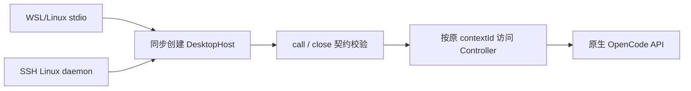

# OpenCode 后台宿主生命周期修复

## 需求与状态

2026-10-20，用户截图：OpenCode 2.0.24 节点报 `opencode must synchronously create a host with call() and close().`，界面提示重新接入并检查原生 API。

关联 AB-F02、M03-F02、M05-F02、M06-F01、M06-OC-F01。修复位于 alpha.34 派生工作区，并已包含在本地候选 alpha.35.config.2；GitHub alpha.35 标签冻结 b5de577 仍是旧工厂，本轮没有替换公开 EXE、部署用户后台或重派原请求。

| 需求 | 可验收行为 |
| --- | --- |
| OCH-01 | WSL/Linux stdio 的 OpenCode 工厂同步创建完整宿主，不再因缺少 close 被拒绝 |
| OCH-02 | 生产 daemon 的 OpenCode 工厂遵守同一契约，保留原上下文与安装绑定 |
| OCH-03 | 关闭门面不停止 Controller、不取消或重派任务，原 Task/Session 和请求计数保持 |

## 根因与实现

[适配器契约](../../../desktop/electron/agent-adapter-contract.cjs)要求工厂同步返回具备 `call()` 和 `close()` 的对象。旧 [stdio 入口](../../../src/desktop-host.ts)与 [生产 daemon 工厂](../../../desktop/electron/machine-daemon.cjs)只包装 `DesktopHost.handle()` 为 call，没有提供 close。`MachineHost.backend()` 在实际连接 API 前即报 ADAPTER_HOST。截图本身不能证明原生 API、账号或模型故障，也不能单凭截图确认它来自 WSL 还是 SSH。

DesktopHost 已有 call，现补齐无副作用的 close；两个工厂直接返回该实例，消除重复且不完整的包装。DesktopHost 是无自有进程/观察器的门面，Controller 与原生任务独立运行，因此 close 不发送 stop、cancel 或新请求。Windows 直接 HostConnection 路径本来具备 close，保持其原生命周期。



原 executable、contextId、agentId、Session 和 unknown 占位保持；data-model/protocol 已核对，无存储格式、线协议、模型层、版本门禁或权限变化。同步更新整体功能设计、架构、M03/M05/M06/M06-OC 设计和测试报告及迭代索引。当前发布基线和 I06C/I07C 准出范围不变。

## 实际验证

环境：2026-10-20，WSL Linux，Node22.23.1，alpha.34 后工作源码。证据目录 `artifacts/opencode-host-lifecycle/2026-10-20/`。新测试为生产宿主、受控状态和 HTTP，真实模型调用 0。

| 检查 | 实际结果 | 证据 |
| --- | --- | --- |
| 旧工厂双入口回放 | 2/2 按预期失败；stdio 快照出现合成错误节点，daemon 明确 ADAPTER_HOST | [旧工厂回放](../../../artifacts/opencode-host-lifecycle/2026-10-20/baseline-reproduced.tap) |
| 新增生产 stdio/daemon 回归 | 2/2 通过，原绑定文件不变、无新任务、close 可重复调用 | [定向结果](../../../artifacts/opencode-host-lifecycle/2026-10-20/targeted.tap) |
| 相关桌面测试 | 28/28，零失败/跳过；含上述 2 项、daemon 与适配器契约 | [桌面 TAP](../../../artifacts/opencode-host-lifecycle/2026-10-20/desktop.tap) |
| 核心桌面会话 | 2/2，受控 HTTP；等待任务关闭门面后原 Task/Session/状态及 Prompt 计数保持，随后原取消/历史检查通过 | [核心 TAP](../../../artifacts/opencode-host-lifecycle/2026-10-20/core.tap) |
| 源码构建 / 全工程类型检查 / 改动 TS 文件 lint | 均通过 | [构建](../../../artifacts/opencode-host-lifecycle/2026-10-20/build.log)、[类型](../../../artifacts/opencode-host-lifecycle/2026-10-20/typecheck.log)、[lint](../../../artifacts/opencode-host-lifecycle/2026-10-20/lint.log) |
| 文档检查 | 通过，具体数量见原始日志 | [文档](../../../artifacts/opencode-host-lifecycle/2026-10-20/docs.log) |

旧工厂回放在临时副本中恢复两个修复前的 call-only 包装，使用相同新增测试，没有改回工作区源码。它证明此错误的代码路径，不是用户现场重放。相关测试计数包含定向子集，不跨模块相加。

测试源码：[生产宿主回归](../../../desktop/tests/opencode-host-lifecycle.test.cjs)、[核心会话](../../../tests/desktop-host.test.ts)。复现命令（先确保 Node 在 PATH）：

```bash
npm run build
node --test desktop/tests/opencode-host-lifecycle.test.cjs desktop/tests/machine-daemon.test.cjs desktop/tests/agent-adapter-contract.test.cjs
node --import tsx --test tests/desktop-host.test.ts
node node_modules/typescript/bin/tsc -p tsconfig.check.json --noEmit
node node_modules/eslint/bin/eslint.js src/desktop-host.ts tests/desktop-host.test.ts
node scripts/check-docs.mjs
```

首次运行 PATH 缺 Node（[入口失败](../../../artifacts/opencode-host-lifecycle/2026-10-20/runtime-path-failure.log)），改用本机已有 Node22.23.1。受限沙箱禁止 Node 子进程，首次 runner 未完成测试（[首次 runner 输出](../../../artifacts/opencode-host-lifecycle/2026-10-20/baseline.tap)）；初版 daemon 夹具在建立 machine identity 前写入上下文，被原归属保护拒绝，调整夹具后完成本机子进程/socket 验证。没有放宽产品安全校验。

2026-10-20当时未测：用户实际 profile、真实 OpenCode 2.0.24 模型、Windows EXE、独立 SSH 服务器及完整 I06C/I07C；当时未打包/发布新版本。后续候选包核对见下节，旧 EXE 和远端 daemon 仍需分别获得包含修复的新包。原 unknown 仍只查询原 requestId/operationId，不能通过换节点或清数据恢复。


## 2026-10-21：公开 alpha.35 的 WSL 重现与候选核验

用户明确使用 GitHub alpha.35、WSL/Linux OpenCode2.0.24，仍报相同工厂错误。只读核对本地公开标签对应的 `b5de577`：stdio 和 daemon 工厂仍包装为只有 call 的对象。本轮未重新下载公开 EXE，不以本地源码修复推断公开附件已修复，也未读取/修改用户原生凭据或接入运行中的用户后台。

已有本地候选 [alpha.35.config.2 EXE](../../../desktop/release/AgentBridge-0.6.0-alpha.35.config.2-Windows-x64.exe) 包含完整 call/close 工厂。本轮重新计算交付文件完整 SHA-256，并在其冻结 `win-unpacked/resources/bridge` 上实际执行两条生产宿主回归（WSL Linux / Node22.23.1），**2/2 通过**。这验证包内代码，不是用户现场或真实 OpenCode 模型验收。

| 证据 | 本轮结果 |
| --- | --- |
| [候选完整摘要与关键包内代码](../../../artifacts/opencode-host-lifecycle/2026-10-21/candidate-audit.json) | 130015316字节；SHA-256 `eb13a208882a08eee7839df745bf215a82798b41c83071a1435138bed85990a0`，与之前冻结包报告一致 |
| [包内宿主测试](../../../artifacts/opencode-host-lifecycle/2026-10-21/packaged-host.tap) | stdio/daemon 2/2；无模型调用、无用户profile修改 |
| [包重新核验](../../../artifacts/opencode-host-lifecycle/2026-10-21/package-recheck.json) | 47 CJS、81 Core、1455 Linux资源，窗口ASAR/前端/核心与冻结构建一致 |

包内测试使用[当次派生入口](../../../artifacts/opencode-host-lifecycle/2026-10-21/packaged-host-lifecycle.test.cjs)，仅将已有源码回归的三个require与hostPath定向到冻结包资源。没有重新构建/发布或声称已现场修好。普通Windows EXE6组是同日较早[配置候选验收](agent-row-configuration.md)的历史结果，本轮未重跑普通EXE。

本地使用步骤：旧窗口“设置 → 后台运行 → 停止后台并退出”，再打开上述config.2 EXE；确认窗口版本后观察原WSL节点。若原attach仍待核对，在设置中的原管理操作查询原operationId；只有严格结算为原拒绝后才重新接入。原执行unknown不重派、不清理台账或换节点。本地候选含其他尚未公开增量，不等同公开alpha.35源码；原scope/安装身份保持。独立SSH仍须另行升级其daemon，本次用户场景为WSL。
