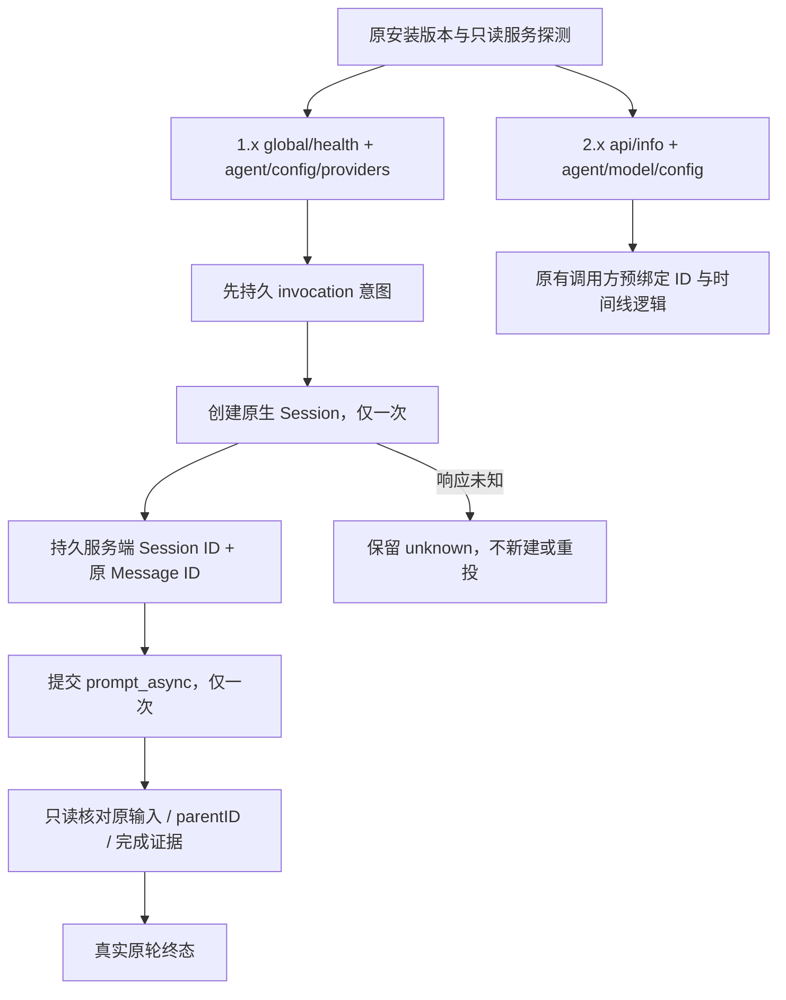

# OpenCode 1.x 与 2.x 双协议兼容修复

日期：2026-10-20。关联 AB-F02/F07/F08/F10/F11/F12/F13，M03/M05/M06-OC/M07/M08/M09。本片最初为工作源码修复，保留既有 CT-04/CT-05、MCP 与 alpha.30–33 整合增量；随后随[alpha.34](alpha34-release.md)提交并发布，新EXE与公开完整下载已核验。旧 alpha.33及更早版本 / integrated.3 EXE 不包含本片。

## 1. 问题与需求

用户从官方正常安装 1.x，却被提示“需要 OpenCode 2.x”。原适配基于开发环境 2.0.24 的 `/api/*`，alpha.32 又在原 CLI/托管启动增加明确的 2.x 门禁。该门禁解释了失败，却没有覆盖官方 1.x 协议；不能通过删除正则把两种 API 当成兼容。

本轮按官方 1.19.3 源码和官方发布二进制实现另一条原生路径，不替换用户当前安装，不新增模型服务层，也不把用户引向未提供普通安装包的标签。

| 需求 | 最终行为 |
| --- | --- |
| OC1-01 发现与准入 | 原 PATH/原 executable 核验不变；接受可识别 1.x/2.x，其他主版本仍在启动前拒绝；实际只读 API 握手继续必需 |
| OC1-02 继承配置 | 1.x 读原生 agent/config/已配置 provider、recent 与原生默认；不写登录或模型配置，不自行挑另一供应商 |
| OC1-03 执行与续聊 | 1.x 创建会话后先持久绑定服务端 Session，再提交一次预生成 Message；续聊沿用该 Session |
| OC1-04 控制与等待 | 映射 1.x permission/question/abort，回复仍经原 operationId 台账，取消回执不替代终态 |
| OC1-05 恢复与隔离 | 只读原 Session/Message；输入缺失、外来输入、协议变化或创建响应丢失保留 unknown，不换 ID/目录重发 |
| OC1-06 MCP | 托管 scope 注入和独立安装/导出区分 V1/V2；跨协议或双配置同名条目冲突保留原文件 |

## 2. 双协议设计与数据

| 语义 | 1.x | 2.x 保留路径 |
| --- | --- | --- |
| 健康/配置 | `/global/health`、`/agent`、`/config`、`/config/providers` | `/api/info`、`/api/agent`、`/api/model/default`、`/api/model`、`/api/config` |
| 目录 | `directory` 查询参数 | `location[directory]` |
| 创建 | `POST /session`，原生返回 ID；使用单数 `permission` 规则 | `POST /api/session`，传预绑定 ID 与 `permissions` |
| 提交 | `POST /session/{id}/prompt_async`，传 `messageID` / parts；204 后只读确认原输入存在 | 原 `/api/session/{id}/prompt` 收据匹配 |
| 消息 | 原生完整按时间顺序消息数组，校验 Session/父消息/唯一 ID | 原分页与 idle outcome |
| 等待 | 全局 `/permission` / `/question`，按原 Session 筛选 | 原 Session 下 permission/form |
| 回复 | `reply: once/reject`、问题答案二维数组 | 原 decision / answer |
| 取消 | `/session/{id}/abort` 返回 true 仅为控制回执 | 原 interrupt 回执 |

`NativeReference.snapshot.nativeProtocol` 新增可选 `v1` / `v2`。缺省表示历史 v2，旧绑定不能在 v1 服务上恢复或继续；不迁移旧 Session，也不释放原 unknown。内部事件、Conversation 保存同一原引用，机器主协议版本和 requestId/operationId 规则不变。

1.x 执行先持久 invocation，再创建 Session；取得原生 ID 后、任何 Prompt 前持久唯一绑定。若创建响应丢失，只能保留没有完整原生绑定的 unknown；不能按标题搜索后猜测归属，更不能再次创建会话。提交响应丢失但已绑定时，重新观察只查原 Session/Message。

1.x 完成需要原用户输入存在、先前输入列表一致、所有助手消息 parentID 属于本轮、助手完成时间有效、没有未完成工具。成功还需最后助手的明确 finish、没有最终工具调用，以及当前原生会话空闲；历史轮只在本轮证据完整时结算。空闲本身、工具轮 `tool-calls`、缺 finish 或缺输入均不证明完成。失败按原助手 error；取消须原助手 `MessageAbortedError` 与完成时间，不能由 abort=true 推断。响应受 16 MiB / 10,000 消息限制，超限拒绝而不把部分历史当成完整历史。

1.x 原生配置优先级为显式既有配置、原生 Agent 模型、全局模型、有效 recent、原生 provider 默认；近期模型与 variant 仅从原状态只读继承。无可用模型时 unhealthy，不引入账号或模型 API 配置页。禁工具“验证真实回复”入口仍只对已核验的 2.0.24 契约开放，1.x 普通任务不受该专项入口限制。

MCP：V1 使用 `mcp.agentbridge`，V2 使用 `mcp.servers.agentbridge`；V1 不写 `codemode`。独立连接保存自身协议，删除使用原布局；安装时重新查当前工具，检测跨代变化要求先移除原接入，避免双份授权或覆盖其他配置。托管 scope 文件仍是内部统一格式，启动时仅转换 Bridge 自己的条目；原用户模型/权限配置不被改写。

## 3. 实现落点

- [版本/发现](../../../desktop/electron/tool-discovery.cjs)、[Core 原安装核验](../../../src/discovery.ts)、[托管启动与 MCP 注入](../../../src/native-server.ts)。
- [双协议客户端](../../../src/drivers/opencode-client.ts)、[官方 1.x 映射](../../../src/drivers/opencode-v1.ts)、[执行与终态观察](../../../src/drivers/opencode.ts)、[单次控制台账](../../../src/edge.ts)。
- [原生绑定数据](../../../src/core.ts)、[独立 MCP 配置](../../../desktop/electron/mcp-config.cjs)、[MCP 连接与导出](../../../desktop/electron/mcp-integration.cjs)。

## 4. 验证、首次失败与限制

环境：WSL Linux、Node 22.23.1、官方 OpenCode 1.19.3 Linux x64。官方归档 SHA-256 为 `13a8fb2978302071b86f9d7e00da9c8895f9cd846978379c3bdc6a5333536c9b`，实际下载匹配。使用独立 HOME/XDG/原生目录；未替换用户的 2.x 安装。

| 场景 | 证据级别与结果 |
| --- | --- |
| T-M06-OC-150：新会话、原 Session 两轮、重开只读 | 新增受控 Hub/Edge 测试通过；官方 CLI + 本机受控模型传输也通过 |
| T-M06-OC-151：取消回执/实际终态分离、控制去重 | 受控台账与 Edge 重开测试通过；官方 CLI 原助手中断证据通过 |
| T-M06-OC-152：权限、问题、非法答案、重复回复 | 受控原生 HTTP + 生产 Hub/Edge 通过；真实模型自主触发权限/问题未测 |
| T-M06-OC-153：丢响应、缺输入、外来父输入、协议变化 | 受控测试通过，原 Prompt 计数不增加，创建响应丢失不提交 Prompt |
| T-M06-OC-154：MCP 双格式与上下文准入 | 生产 CJS 受控通过；官方 CLI 连接生产 broker 通过 |
| 工程与全套回归 | 核心 56/56、桌面 592/592，build/typecheck/lint/文档检查通过，见[最终汇总](../../../artifacts/opencode-v1/2026-10-20/summary.json) |

首次受限执行仅报告测试进程失败，换到正常本机权限执行同一类本机服务测试。首批 18 项定向测试有 1 项测试断言失败：Hub 按已有契约返回 rejected 操作收据，测试误期待 HTTP 抛错；改为核对 rejected 与原生回复数不增加后，新 1.x 的 5 项回归通过。

第一次真实 CLI 受控流测试：前两轮与只读恢复成功，第三轮测试代码等待原生尚未落盘的流式文本才取消，因而超时；未宣称取消通过，保留失败摘要。第二次独立运行改为观察受控传输已开始后发送单次取消，三次原生模型请求全部限定在本机受控服务，原助手中断确认通过。没有重投首次运行的原请求；第三次增加 MCP 验证的独立运行五组通过。分别保留[首次失败](../../../artifacts/opencode-v1/2026-10-20/native-run1.json)、[第二次通过](../../../artifacts/opencode-v1/2026-10-20/native-run2.json)、[最终官方 CLI 报告](../../../artifacts/opencode-v1/2026-10-20/native-run3.json)和[实际日志](../../../artifacts/opencode-v1/2026-10-20/native-cli.log)。

最终全套日志：[核心](../../../artifacts/opencode-v1/2026-10-20/core-tests.log)、[桌面](../../../artifacts/opencode-v1/2026-10-20/desktop-tests-final.log)、[类型检查](../../../artifacts/opencode-v1/2026-10-20/typecheck.log)、[lint](../../../artifacts/opencode-v1/2026-10-20/lint.log)、[文档](../../../artifacts/opencode-v1/2026-10-20/docs-final.log)、[选定源码摘要](../../../artifacts/opencode-v1/2026-10-20/source-manifest.json)。首次桌面 591/592 为已有维护测试 mock 返回 undefined，而当前生产接口返回对象；只修夹具返回值后 592/592，不修改 SSH 产品逻辑。首次全局文档检查的 13 个失效链接属于同时存在的维护专项，已从其独立工作树同步原始附件并保留[同步摘要](../../../artifacts/opencode-v1/2026-10-20/document-evidence-sync.json)，没有伪造或重标该专项验收。

**未测**：Windows 原生 OpenCode 1.x真实工具/推理、用户机器、独立 SSH 服务器、真实账号/真实模型推理、复杂原生问题表单、所有 1.x 小版本。后续alpha.34已补Windows包内Core受控协议5组和普通EXE两套各5组；这不是Windows原生Agent/真实模型验收。官方 CLI 加受控模型传输不等于真实模型验收。完整 I06C/I07C 继续未准出。

复现：`npm run build`；`node --import tsx --test --test-concurrency=1 tests/opencode-v1.test.ts`；`node --import tsx scripts/opencode-v1-acceptance.ts OFFICIAL_BINARY NEW_RUN_DIRECTORY`。真实 CLI 脚本首次发送前持久意图与原引用，已有报告目录拒绝重跑；不会覆盖用户配置或调用外部账号。

## 5. 源码、发布与使用边界

本片已随 alpha.34 交付；没有修改旧 alpha.32/33、integrated.3 冻结源码或 EXE。安装中的客户端与 SSH 后台不能通过重新扫描自动获得新协议；应使用包含本修复的新构建，远端后台还需在原机器维护升级。旧请求始终查询原 ID，不能通过新版本、新节点或目录别名放行占位。

官方依据：[1.19.3 发布](https://github.com/anomalyco/opencode/releases/tag/v1.19.3)、[HTTP 文档](https://opencode.ai/docs/server/)、[固定标签 Session 路由](https://github.com/anomalyco/opencode/blob/v1.19.3/packages/opencode/src/server/routes/instance/httpapi/groups/session.ts)、[Session 创建与身份](https://github.com/anomalyco/opencode/blob/v1.19.3/packages/opencode/src/session/session.ts)、[原生 Prompt 与完成条件](https://github.com/anomalyco/opencode/blob/v1.19.3/packages/opencode/src/session/prompt.ts)。
