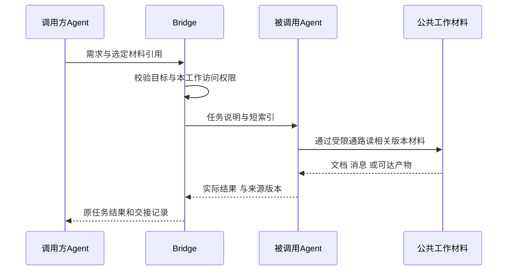

# Claude Projects、Dots 与 Grok Bot 的连接机制研究

调研：2026-10-18至2026-10-19；完成日期2026-10-19。方法：实际读取官方公告、现行产品文档及其Markdown正文，并核对AgentBridge当前源码/设计。使用OpenAI Docs技能核对Dots。没有登录体验三种产品、执行模型、配置账号、启动外部Bot或修改产品运行代码。

本页承接[连接通路/ACP/Multica研究](connectivity-research.md)和[10月15日Claude Projects历史调研](claude-projects-research.md)。目标仍是提供Agent发现、调用、控制和共享工作材料的通路；自动续接、多用户、云端规划模型不因外部产品具有这些功能而成为Bridge目标。

## 1. 对象和版本先分清

| 对象 | 本轮核实的对象 | 时间与证据边界 |
| --- | --- | --- |
| Claude Projects | Claude Code中的新版Projects，含协调对话、工作线程、公共上下文与Library；不是只有文件夹/知识库的旧Projects，也不等于Agent Teams | 2026-09-17公告与本轮现行文档；仍为分批beta，不能按公告日期推定每个账号可用 |
| Dots | ChatGPT的具名长期Agent，可把工作交给Work/Codex；不是Codex CLI新协议或内置子Agent列表 | 核对现行官方指南、10月5–9日线程/上下文更新及10月12–16日周报；后者新增移动入口，不改变本研究的协议判断 |
| Grok Bot | 有职责和独立会话的长期Bot，可互发消息及组成群聊 | bots页更新10月12日、collaboration页更新10月13日；产品行为不等于开放控制API |
| Grok Build | 本机编码CLI，是与Grok Bot不同的可执行工具 | 官方公开headless和ACP入口；当前不在Bridge内置注册表，本轮没有安装或接入 |

来源：[Projects公告](https://claude.com/resources/articles/projects-redesigned)、[当前帮助页](https://support.claude.com/en/articles/9517075-what-are-projects)、[Dots介绍](https://learn.chatgpt.com/docs/dots)、[Dots周报](https://learn.chatgpt.com/docs/whats-new)、[Grok Bot](https://docs.x.ai/grok-bot/bots)、[Grok Build](https://docs.x.ai/build/overview)。

## 2. Claude Projects：共享上下文与线程独立并存

现行文档把主对话和工作线程分开：协调对话读取线程报告，线程有自己的上下文。每个云线程启动读取项目`MEMORY.md`索引，再按需打开其他记忆文件；这些文件可由用户查看、修改或删除。Library归集输入及产物。这里共享的是工作资料和记忆文件，不是所有线程共用完整聊天历史。[现行Projects文档](https://code.claude.com/docs/en/claude-projects#give-a-project-standing-context)

相较9月17日公告，本轮现行文档已描述通过Remote Control把某个线程放本机：本机线程使用当地工具和原生设置、取得项目instructions，但不会自动载入云端项目memory。项目设置变更对新线程生效，不自动改写已运行线程。[本机线程](https://code.claude.com/docs/en/claude-projects#run-a-thread-on-your-own-computer)、[设置生效范围](https://code.claude.com/docs/en/claude-projects#project-settings-reference)

对Bridge的推论：在已有公共工作文档上增加一个短索引，指向版本化结论、任务和产物；成员读取相关材料即可。长期规则、共同结论、执行中的具体消息应分别维护。Bridge只保存、授权和传递，结论仍由外部Agent或用户整理，不新增自动总结模型。

## 3. Dots：稳定身份、工作索引与选择性传递

Dots可以创建任务、检查结果并给已有任务后续指令；新任务有自己的conversation，只收到为这项工作选定的说明和上下文。任务仍归属原电脑/云环境，切换Dot连接的电脑不迁移原任务。[Tasks and memory](https://learn.chatgpt.com/docs/dots/tasks-and-memory)、[Computers and apps](https://learn.chatgpt.com/docs/dots/computers-and-apps)

10月5–9日更新强调利用已有Codex线程上下文、选择新建还是继续原线程；这是产品层的工作路由能力，不是公开的跨厂商会话迁移协议。[该次更新](https://learn.chatgpt.com/docs/whats-new/dots-october-9-2026)

官方还把主Agent暂停和具体委派任务停止分开，Activity提供任务进度/文件/等待项入口。Bridge可借鉴可追溯的工作目录和原任务卡片，不复制Dot自动规划、主动研究或常驻云电脑。[Controls](https://learn.chatgpt.com/docs/dots/controls)

对Bridge的推论：发现Agent时，也能在权限允许的范围看见其负责的工作和可访问材料；显式目标由调用Agent选择，Bridge核对实际节点、机器、原任务和能力。给新任务发送材料清单，不能仅因为调用方看过资料就假设被调用方也拥有它。

## 4. Grok Bot：职责清楚、交接可见

Bot的长期职责放在description，单次请求放在消息；它们保留各自会话，通过直接消息、群聊和文件传信息。异步交接在会话中可见，群聊让下一步负责人明确；这些是官方产品行为，底层Bot间传输协议在本轮资料中未公开。[Bot职责](https://docs.x.ai/grok-bot/bots)、[消息与协作](https://docs.x.ai/grok-bot/chat-and-collaboration)

Bot可以读取共享`/workspace`中的文件，但结果仍应在对话提供明确引用。其共享电脑属于该产品的运行前提，不能搬成Bridge跨SSH默认共享磁盘的假设。[Files and results](https://docs.x.ai/grok-bot/files-and-results)

对Bridge的推论：把“我发给了谁、对方回复什么、关联哪项任务/哪个版本”作为可查看记录；Agent介绍与后台实际权限分开。公共MD应有稳定入口和来源，不能只生成一个接收方未读取、无法访问的路径。

## 5. 真正能形成接入候选的公开接口

| 产品入口 | 已核实的公开说明 | Bridge可采取的下一步 |
| --- | --- | --- |
| Claude Projects协调器/云线程 | 产品文档说明行为；本轮没有确认通用外部发现/控制接口 | 借鉴资料与线程组织；不能宣称现有Claude CLI适配已能驱动Projects协调器 |
| Dots | 产品文档说明可委派Codex；本轮没有确认通用外部控制API | 借鉴任务索引、选定上下文和归属；不能把现有Codex CLI接入写成已接入Dot |
| Grok Bot | 产品消息/群聊可用；本轮未确认Bot作为通用MCP/ACP服务端 | 产品参考，尚不登记为可直接操控的Bridge节点 |
| Grok Build | `grok -p`提供headless JSON；`grok agent stdio`提供ACP JSON-RPC | 可列为CT-03后续候选目标Agent，冻结版本后再验证启动、输出、权限、取消、恢复和MCP连接 |

Grok Build的ACP方法与增量输出有官方示例；本轮只读说明，没有执行示例或使用凭据。它使“第二种目标Agent复用通用ACP Client”更有具体对象，但不表示Bridge已实现该Client，更不表示Grok Bot底层使用ACP。[Headless与ACP](https://docs.x.ai/build/cli/headless-scripting)

## 6. 与Bridge现有实现逐项对应

这里依据[接入矩阵](../../agent-integration-matrix.md)、[TeamSpace](../../../desktop/electron/team-space.cjs)、[任务与产物](../../../desktop/electron/team-work.cjs)、[主从通路](../../../desktop/electron/agent-network.cjs)核对。CT-01和CT-02同期实际交付各有报告，本研究不覆盖或重复计算其测试。

| 可借鉴功能 | Bridge已有基础 | 建议补的部分 | 边界 |
| --- | --- | --- | --- |
| Agent名片 | 已登记name/purpose/inputs/outputs/limitations；节点有方向能力 | 让发现结果和界面容易查到职责、实际支持方向及证据来源 | 描述不授予权限，同一CLI安装不因两个名称变成独立实例 |
| 共享工作索引 | 已有工作目标、文档修订、任务、消息、版本产物 | 短索引列当前结论、进展/阻塞、相关任务和精确版本材料 | 不绑定节点到某项目；简单委派不用强制建完整公共空间 |
| 材料/产物Library | 任务报告已有artifact版本和reference，公共文档有历史 | 聚合为输入与产物索引，能追溯作者/任务/版本/所在机器/访问方式 | 先做引用和可达性；不因此开发文件同步或复制所有资料 |
| 显式上下文清单 | 普通委派有message；小队通过MCP读取共同材料 | 传目标、必要背景、相关文档/消息版本、产物、已知限制 | 接收方实际读取；不复用别家原生Session、私有推理或KV |
| 可见交接记录 | 已有委派台账，群消息支持reply/notify，任务交接有收据 | 展示发送/接收/回复/原任务的关联和下一步负责人 | 不把已发送/已读显示成已执行；不因@自动启动业务任务 |
| 等待与结果总览 | 已有真实等待投影、原任务查看与控制 | 聚合结果、未读回复和待用户处理项，点击回原执行 | 状态仍由原任务/收据决定，不用摘要替代事实 |
| 公开驱动复用 | 当前原生CLI/HTTP路径和CT-03建议 | 用OpenCode及另一种真实ACP Agent证明通用驱动收益 | Grok Build是候选；三个云产品不冒充已接入 |

这些是研究建议，不是新API定稿或本轮完成项。原生新任务与给已有会话发送消息仍是分别声明的能力；本轮不将自动续接、多用户、主动规划列为目标。

## 7. 公共MD和上下文的建议形态

建议基于既有SQLite权威记录提供短的工作索引；`WORK.md`/`INDEX.md`只是可选阅读名称，不是本轮创建的物理同步文件。常驻规则、共同结论、当前状态和交互原文各有出处：

| 材料 | 内容 | 谁维护 |
| --- | --- | --- |
| 常驻约定 | 目标边界、成员职责、协作方法 | 用户/获准Agent；后台权限另查实时授权 |
| 共同结论 | 已确认事实、决定、适用版本、待纠正假设 | Agent或用户按修订写文档，保留来源和时间 |
| 工作进展 | 任务/执行/阻塞和已验证结果的索引 | 从原结构化台账读取，不能由一段文字改终态 |
| 交互记录 | 原消息、回复、交接与相关材料 | 持久追加，索引按需引用 |
| 产物目录 | 版本、生产者、任务和可达地址 | 沿既有artifact/reference与文档修订记录 |

拟议读取过程：

这是后续方案图；普通子任务当前没有自动取得小队成员scope。不能只拼一个runId或链接就视为已授权，需在设计时明确目标成员的材料读取通路。首次先选短文本/引用即可，不要求全队共享完整历史，也不要求Bridge生成记忆。

## 8. 建议纳入既有目标的方式

CT-04增加“公共索引＋产物目录＋可见交接”的候选细化；CT-05增加“显式选择材料＋接收方可达与版本核验”；CT-03将Grok Build列为第二种ACP目标的候选之一。Agent名片和结果总览优先复用已有登记/任务视图，不新增独立模型层。

后续实现前可用以下场景判断收益，当前均未在本轮运行：

1. 接收Agent只读短索引及两份相关文档即可完成任务，不需要重复获取全聊天。
2. 两个Agent在同一工作共享结论，但不会读到另一个未授权工作的材料。
3. 远端引用不可访问或版本不符时，明确报告缺材料，不假装读到了调用方文件。
4. 从一条交接记录可定位原任务、消息、报告及产物版本；收到/已读不误报完成。
5. 本机与远端能力不同、设置后来更新时，仍按本次执行实际能力/版本和原身份处理，不静默迁移任务。

## 9. 本轮交付与证据边界

实际交付为本研究、相关入口和后续候选细化。没有改运行代码、协议、数据格式、真实权限或发布包，不更改既有CT-01/02验收结论。三个产品均以官方公开资料为证据，闭源内部实现未核实；只读文档不能证明用户账号可用或Bridge已接入。

六份官方正文的来源/抓取摘要见[来源清单](../../../artifacts/product-patterns/2026-10-19/sources.json)；仅保存URL、时间与SHA-256等元数据，不在仓库转载全文。检索工具对Claude现行页面偶发不可达、对Markdown返回类型不支持，已通过官方URL普通GET读取正文，没有用第三方转载补成官方实现证据。

交付前执行文档链接/结构、差异空白及新增Mermaid解析；不运行无产品变更的模型/EXE测试，不把文档检查增加到原工程测试数量。
