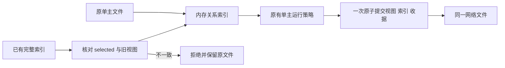

# CT-08-A1：关系索引存储迁移

日期：2026-10-24（Asia/Shanghai）。关联 CT-08、AB-F02/F07/F08/F11/F12/F13、M03/M07/M08/M10。按[已确认规划](agent-centric-operations.md#实施顺序与前置)先做关系重构、后开放行为。本片只交付存储迁移，不是完整多主关系或连接管理准出。公开仍 alpha.53；本地候选 alpha.57，模型 0，不切换日常后台、变更用户关系或部署 SSH。

## 需求与迁移规则

旧 `agent-network.json` 只有一个 `collaboration`。多主化必须先有可稳定保留的关系索引，且不能迁移时重建节点、原请求、Task/Session、委派或操作收据。旧程序可能保留未知字段却只修改旧协作视图，新版不能据此静默选择一方覆盖另一方。

[relation-state.cjs](../../../desktop/electron/relation-state.cjs)加入关系索引编解码；外层网络 version 仍为 1，新增 `relationsVersion:1`、`activeRelationId`、`relations[]`。每行含稳定 `relationId` 与既有 leaderId/memberIds/revision；selected 行的三个业务字段必须与旧 collaboration 一致。成员顺序、修订及所有原 ID 保持。索引中的非 selected 行逐项保留，本片不参与运行授权；按调用方路由、多主撤权与新工具必须下一片统一实现后开放。

| 原文件状态 | 本片行为 |
| --- | --- |
| 三个新字段全部不存在 | 内存构造唯一迁移行；只读构造不改原网络文件，首次正常原子写入才一起落盘 |
| 新索引完整且 selected 投影一致 | 使用原索引，不重新分配关系标识或修订 |
| 部分新字段、未知索引版本、重复标识、缺少 selected 行或无效结构 | `RELATION_STATE` 拒绝；不回退旧单主视图，不改原文件 |
| 索引与 collaboration 不一致，包括旧程序单独编辑后的文件 | `RELATION_STATE_CONFLICT` 拒绝；保留两个原视图供核对，不以新 ID、清空关系或挑较高修订解决 |

格式校验在 MachineRouter 构造之前完成；冲突负例确认没有先创建其他状态文件。这里的“无写入”只针对已有网络文件读取与冲突启动；正常 snapshot 原有观察写回和节点发现语义不改变。

## 实现与不变的运行边界

[AgentNetwork](../../../desktop/electron/agent-network.cjs)的网络提交统一进入 commitNetwork：先在新顶层对象中同步 selected 行，再走原 atomicWrite，落盘成功后替换内存指针。saveCollaboration、节点断开/移除/准备拒绝、机器移除、DSH绑定和正常请求/委派观察写回均使用该路径。索引与收据没有第二个文件或第二次独立提交；磁盘错误保留原失败码、重试次数及原文件。

经典 MCP 仍为 7 工具，既有 collaboration RPC、scope、权限、取消与原 ID 去重语义不变。当前调用方仍按旧 selected 单主视图判定；本片不新增 list_connectable/connect_agent/disconnect_agent，不接受 Agent 自选 activeRelationId，不授予 envelope 外连接。新增索引不是新授权凭据；非 selected 行不能据此委派。完整 CT-08 的多主路由、关系迁移审核、envelope 预授权/确认、即时撤权与界面策略/审计继续未完成。

旧 EXE 可能忽略新索引，因此本片不保证任意降级后继续编辑关系；再次打开新版时发现两个视图不一致即明确拒绝，不自动修复或丢弃原记录。没有迁移真实用户 profile，也未做日常切换。

## 工程验证

[迁移专项](../../../desktop/tests/relation-state.test.cjs) **7/7** 通过：[完整 TAP](../../../artifacts/ct08-relations/2026-10-24/targeted-unrestricted.tap)。覆盖只读加载/首次自然落盘、原 unknown/身份/修订/成员顺序保持、非 selected 数据保留、格式与旧写入冲突拒绝、原 ID 幂等、ENOSPC 不提交，以及实际节点断开/机器移除的原子同步。受控生产 AgentNetwork/Coordinator 与真实临时文件，非真实模型或用户关系。

首轮桌面 870 项，865 通过、5 失败：4 个持久化子场景及其父测试。旧 [network-persistence.test.cjs](../../../desktop/tests/network-persistence.test.cjs) 通过 Object.create 构造的 `{marker}` 不含合法关系状态，因而在磁盘故障注入前被索引校验拒绝；测试夹具补齐合法迁移状态，原重试次数、原文件与错误断言未放宽。另删除既有未用 project 解构以通过整文件 lint，等价清理无行为变化。[首轮完整失败](../../../artifacts/ct08-relations/2026-10-24/desktop.tap)、[首轮 lint](../../../artifacts/ct08-relations/2026-10-24/lint-initial.log)。

最终运行源码桌面全量 **870/870**，失败/跳过 0（版本号提升和alpha.56精确pin导入前执行；后续包内模块哈希、39份pin与Windows契约单独验证），[TAP](../../../artifacts/ct08-relations/2026-10-24/desktop-final.tap)。首次受限定向环境只返回文件级 1 项，不能算 7 个用例通过；后续正常子进程环境的 TAP 才逐项记录上述 7 项，[原文件级报告](../../../artifacts/ct08-relations/2026-10-24/targeted.tap)保留。最终语法/lint 和前端类型/生产构建通过，[lint](../../../artifacts/ct08-relations/2026-10-24/lint.log)、[构建](../../../artifacts/ct08-relations/2026-10-24/frontend-build.log)。Core 产品未变，未重跑或扩张旧 71/71。

alpha.56 原 EXE 完整 SHA 与 1708 项 Linux 文件核验后原样导入清单，可信目录现在 39 项；不是部署或认可未知版本。[导入证据](../../../artifacts/ct08-relations/2026-10-24/import-alpha56.json)。不以源码回归代替以下包内执行。

## 冻结包与Windows后端交付

alpha.57 EXE **130194064字节**，SHA-256 **`a0889e5162c134641b3cce29c48930dfd51a777093cc9a56923a657dc5c5c104`**；55后台模块、84Core文件、1710Linux资源，Core/Windows与Linux后台、ASAR/前端/bootstrap一致性均通过。Linux manifestDigest `f415dedbcca3f8783e4f756daec58560bb8b69e2054d28a50507e2837d1e5d03`。[包核验](../../../artifacts/ct08-relations/2026-10-24/package.json)、[构建日志](../../../artifacts/ct08-relations/2026-10-24/package-build.log)。

Windows Node24.21.0 对实际冻结AgentNetwork/relation-state模块执行迁移专项 **7/7**，同时经生产Coordinator命名管道完成隔离身份认证、原operationId幂等保存、selected索引/原收据同提交、RPC保持原三个业务字段，确认请求/委派记录为0。[后端报告](../../../artifacts/ct08-relations/2026-10-24/windows-relations.json)、[7项TAP](../../../artifacts/ct08-relations/2026-10-24/windows-relations.tap)、[验收器](../../../desktop/tests/windows-relation-state.cjs)。这是实际Windows IPC/文件配受控宿主，不是普通GUI或原生模型。

同一冻结包39份原清单与源文件字节一致，Windows严格复用/查询契约 **26/26**、固定短诊断及 **9,164,577字节**完整维护输入解析/原fingerprint保真通过。[报告](../../../artifacts/ct08-relations/2026-10-24/windows-contract.json)、[TAP](../../../artifacts/ct08-relations/2026-10-24/windows-contract.tap)。没有实际SSH认证/部署或维护动作。

[本地EXE](../../../desktop/release/AgentBridge-0.6.0-alpha.57-Windows-x64.exe)与[SHA256SUMS](../../../artifacts/ct08-relations/2026-10-24/SHA256SUMS.txt)已交付Windows Downloads，同名EXE/.sha256完整SHA复核通过，不覆盖不同已有文件。[副本核验](../../../artifacts/ct08-relations/2026-10-24/download-copy.json)。未签名、未公开、未切换日常后台；57普通窗口未补验，不用56的GUI证据推荐替代日常运行。

[本地源冻结清单](../../../artifacts/ct08-relations/2026-10-24/source-manifest.json)、[脚本摘要](../../../artifacts/ct08-relations/2026-10-24/scripts-sha256.json)、[分层汇总](../../../artifacts/ct08-relations/2026-10-24/verification-summary.json)。源码仍是公开5269d65之上的保留工作树，不是新公开标签。

## 未完成与后续

普通 EXE 窗口呈现/交互没有在本片重新验收：Computer Use 技能要求 node_repl，本会话工具未提供该入口；不通过其他 UI 自动化绕过该边界。现有 alpha.56 普通 EXE 4 组属于旧版本证据，不能移给 57。已执行的包内 Windows Node 后端契约不能替代该GUI证据。

同步整体功能状态、M03/M07/M08/M10 设计/报告、architecture/data-model/protocol 和推进台账。图 100ms、WSL 稳定性、原生父模型、完整 SSH 故障/版本切换与完整 CT-08 均未准出。下一片需将运行期关系读取/授权/撤权统一按身份查索引，再开放受 envelope 和确认流保护的连接工具；不能直接把多条存储记录当成已授权多主行为。

最终文档检查0错误、用户站测试6/6与构建通过，18用户页/19HTML，内部页面与证据导出均0。[检查](../../../artifacts/ct08-relations/2026-10-24/docs-check.log)、[测试](../../../artifacts/ct08-relations/2026-10-24/docs-test.log)、[构建](../../../artifacts/ct08-relations/2026-10-24/docs-build.log)。
