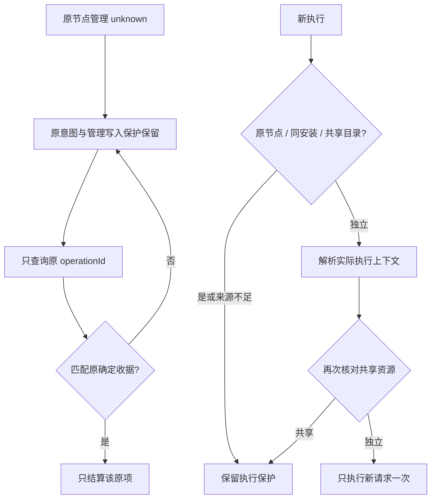

# 同机独立执行与完整管理恢复（issue #12）

日期：2026-10-20；隔离分支 codex/issue-12-scoped-execution-recovery，基于公开 alpha.34 后文档提交 d9bf2a5。**alpha.35 已公开预发布，PR #13 已合并，issue #12 已关闭**，完整 I06C/I07C 未准出。不包含主工作区另一个线程未提交的 DSH 改动。

## 需求与修复前证据

[issue #12](https://github.com/wsjq5477/MA-Relay/issues/12) 对应 AB-F03/F08/F11/F12/F16/F17，M01/M02/M03/M07/M08/M10。节点 A 的 attach 操作因 NATIVE_START_TIMEOUT 为 unknown，同机独立 Codex B 健康空闲却不能开始；查询 not_found 没有反馈，设置任务台账为空时误报没有未确认操作。

修复前 alpha.34 生产前端配合合成 IPC，三项均失败：[原始报告](../../../artifacts/scoped-execution-recovery/2026-10-20/baseline-ui/report.json)。不使用真实用户配置，不重试其原管理动作或发送真实 Prompt。

| 验收项 | 当前行为 |
| --- | --- |
| 管理与执行分离 | 管理写入仍同机保护；执行仅原节点、同安装/适配器别名、共享目录受保护，同机独立节点可执行 |
| 保护不倒退 | machine 维护 unknown 同机、relation 全局、来源不足保守、layout 不阻断独立执行；任务 pending 规则保持 |
| 前后端一致 | 概览、图卡片/详情、表单渲染/发送、后台入口及解析后实例检查同样资源 |
| 查询反馈 | 手动 loading/禁重复，尝试/确认/拒绝/未决/not_found/失败统计；自动查询不覆盖手动反馈 |
| 设置台账 | 合并中央 graphPending 与原本地意图，显示任务/节点/机器/授权/布局五类；按 lane+原 ID 去重 |
| 原收据安全 | unknown/not_found/异常或来源/内容不符保留；仅匹配原确定收据移除对应原项；不重放、不暴露原始 ID/params/远端错误 |

## 实现与接口

[共享前端恢复](../../../desktop/src/management-recovery.ts) 由 NetworkApp 持有一个实例，节点/机器管理包装沿用原两个 localStorage key 与单对象兼容。后台读取失败保留旧投影并保守保护。查询结果仅存在内存，不替代中央原收据；手动任务去重，自动轮询不会覆盖统计和逐项反馈。目录切换使用 generation 阻止旧读取结果污染新目录。

[管理范围](../../../desktop/electron/agent-network.cjs) 将 managementBlocks 与原 pendingBlocks 分开；来源 machineId/connectionId 不足不视为空本机。原节点的已保存实例目录与目标目录按既有 workspaceKey 规范化比较，原安装别名保留保护。中央入口先核对资源，MachineRouter 解析原上下文后再由 executionAdmissionCheck 核对真实实例目录；不会因为按钮启用就跳过后台校验。

[中央图台账](../../../desktop/electron/graph-operations.cjs) 不迁移格式，只对原查询结果增加已提供来源/内容指纹匹配。GraphOperationJournal 的管理写入互锁保持；graphPending 只读投影 blockedNodeIds。新中央能力 scoped-management-execution-v1 防止新前台继续复用旧范围语义；旧中央的设置/停止仍可使用，SSH 原 owned-object-controls-v1 门槛保持。

## 实际验证

受控结果、生产前端、普通包和公开发布分别记录，模型调用均为0。下列均为本次实际运行；公开分发已按用户明确批准完成。

- 定向后台/前端范围/收据测试 **71/71**：[日志](../../../artifacts/scoped-execution-recovery/2026-10-20/scoped-contract-provenance.tap)。包括独立 B 生产 Coordinator 提交一次、同请求不重放、原 A unknown 完整保留，解析后的共享目录阻止原生提交。
- 修复后最小生产前端三项观察全通过：[报告](../../../artifacts/scoped-execution-recovery/2026-10-20/ui-smoke/report.json)。

首次失败保留：新增后台夹具的 B 尚未接入、上下文返回目录与 snapshot 目录不一致，补齐受控事实；新范围测试发现无 connectionId 时误把 undefined 匹配本机，修复来源判断。前端脚本首次读取失败构建资源，随后修正测试选择器及原 localStorage key，没有更改产品台账 key。完整桌面首轮 598/600，原维护并发测试遇已知间歇 ENOENT，发现测试漏隔离新工具导致多发现一个真实安装；只补齐测试候选隔离，不放松发现逻辑。

| 层级 | 已实际完成的结果 | 原始证据 |
| --- | --- | --- |
| WSL Node22.23.1 Core | 56/56，0失败/跳过 | [日志](../../../artifacts/scoped-execution-recovery/2026-10-20/core-final.tap) |
| Windows Node24.19.0 / Edge155生产前端 | 15组，0页面错误，原始ID/远端错误不渲染 | [报告与截图](../../../artifacts/scoped-execution-recovery/2026-10-20/ui-final-source/report.json) |
| Windows Node生产后台纯CJS | 83/83，0失败/跳过 | [日志](../../../artifacts/scoped-execution-recovery/2026-10-20/windows-contract-final.tap) |
| WSL桌面最终全量 | 601/601，0失败/跳过 | [汇总](../../../artifacts/scoped-execution-recovery/2026-10-20/desktop-full.json)、[过程](../../../artifacts/scoped-execution-recovery/2026-10-20/desktop-full.log) |
| 工程 | lint、根类型及最终前端构建通过 | [lint](../../../artifacts/scoped-execution-recovery/2026-10-20/lint.log)、[类型](../../../artifacts/scoped-execution-recovery/2026-10-20/typecheck.log)、[构建](../../../artifacts/scoped-execution-recovery/2026-10-20/build-desktop-final.log) |

Windows生产前端覆盖概览/图/详情/受控表单提交、查询loading/not_found/unknown/失败/不匹配/confirmed/rejected、轮询不擦除反馈、reload保留原意图、机器/授权/布局/缺来源门槛、五类台账与每lane原查询。后台定向另证共享目录与解析实际上下文的拦截，受控新请求只执行一次且原unknown不改。Windows83项已在冻结b5de577源码副本复验通过。既有按机器管理4组及状态恢复10组/8图也通过，0业务/模型提交：[管理](../../../artifacts/scoped-execution-recovery/2026-10-20/ui-version-regression/report.json)、[状态](../../../artifacts/scoped-execution-recovery/2026-10-20/ui-state-regression/ui.json)。

## 候选、发布与未测边界

源码冻结 **b5de577980e140150352518c19bb6e9709a2bd20**，独立 git archive 构建；[逐文件核验](../../../artifacts/scoped-execution-recovery/2026-10-20/source-verification.json) 通过。候选包核验通过：43个后台CJS、81个Core文件、1452个Linux文件，ASAR/前端/Windows/Linux后台与冻结源码一致。Linux alpha.35 manifest digest为 `e4db314070688509489ba1a8a2bf3720575d76dd481502884181031e2fae1189`。普通无调试 Windows EXE 五组通过：旧alpha.34中央门禁、原两轮历史与unknown查询、窗口关闭重开、完整中央重启、冻结后台摘要一致；模型0。[包核验](../../../artifacts/scoped-execution-recovery/2026-10-20/package.json)、[普通EXE](../../../artifacts/scoped-execution-recovery/2026-10-20/portable.json)、[普通EXE日志](../../../artifacts/scoped-execution-recovery/2026-10-20/portable.log)。

构建 [Windows EXE](../../../artifacts/scoped-execution-recovery/2026-10-20/AgentBridge-0.6.0-alpha.35-Windows-x64.exe) 为 **130,024,572字节**，SHA-256 **`759e36efe2f4ad41cbd273ee17cfe54e6512758574f7bc424458db15f26d8aa1`**；[SHA256SUMS.txt](../../../artifacts/scoped-execution-recovery/2026-10-20/SHA256SUMS.txt)。[PR #13](https://github.com/wsjq5477/MA-Relay/pull/13) 已合并到 master，issue #12 自动关闭。alpha.34及更早版本原标签/附件保持。alpha.35 含精确 alpha.34 daemon 清单，客户端更新不会替换真实 SSH daemon。

本轮不读取或清理用户原配置，不重试其管理操作，不发送真实模型任务，不升级独立 SSH。用户故障 profile、真实原生 Agent/模型、独立服务器及完整 I06C/I07C 继续未测。升级新客户端前须在设置“后台运行 → 停止后台并退出”，再打开新 EXE；只关窗口可能仍保留旧中央。

## 已完成的 GitHub 预发布

用户明确批准合并 PR #13 并公开发布 alpha.35。PR 合并提交为 `24d81aa799ab5f221908e38de8e4a9cc44201045`；标签 **v0.6.0-alpha.35** 固定构建源码 **b5de577980e140150352518c19bb6e9709a2bd20**，后续仅补文档，不移动冻结标签。

- [公开 Windows EXE](https://github.com/wsjq5477/MA-Relay/releases/download/v0.6.0-alpha.35/AgentBridge-0.6.0-alpha.35-Windows-x64.exe)
- [公开 SHA256SUMS.txt](https://github.com/wsjq5477/MA-Relay/releases/download/v0.6.0-alpha.35/SHA256SUMS.txt)
- [预发布页](https://github.com/wsjq5477/MA-Relay/releases/tag/v0.6.0-alpha.35)

EXE **130,024,572字节**，SHA-256 **`759e36efe2f4ad41cbd273ee17cfe54e6512758574f7bc424458db15f26d8aa1`**。两资产 uploaded、size/digest 与本地一致；匿名下载16个精确HTTP Range片段并按连续字节顺序计算全部130024572字节摘要，与本地及GitHub资产一致；校验附件HTTP200完整字节一致。不是HEAD或部分下载验收。

原始[发布元数据](../../../artifacts/scoped-execution-recovery/2026-10-20/github-release.json)、[公开完整下载](../../../artifacts/scoped-execution-recovery/2026-10-20/github-download.json)、[发布过程](../../../artifacts/scoped-execution-recovery/2026-10-20/publish.log)、[分层最终汇总](../../../artifacts/scoped-execution-recovery/2026-10-20/verification-summary.json)。本次发布不升级用户真实SSH后台，也不将用户现场、真实模型或完整I06C/I07C标为通过。
