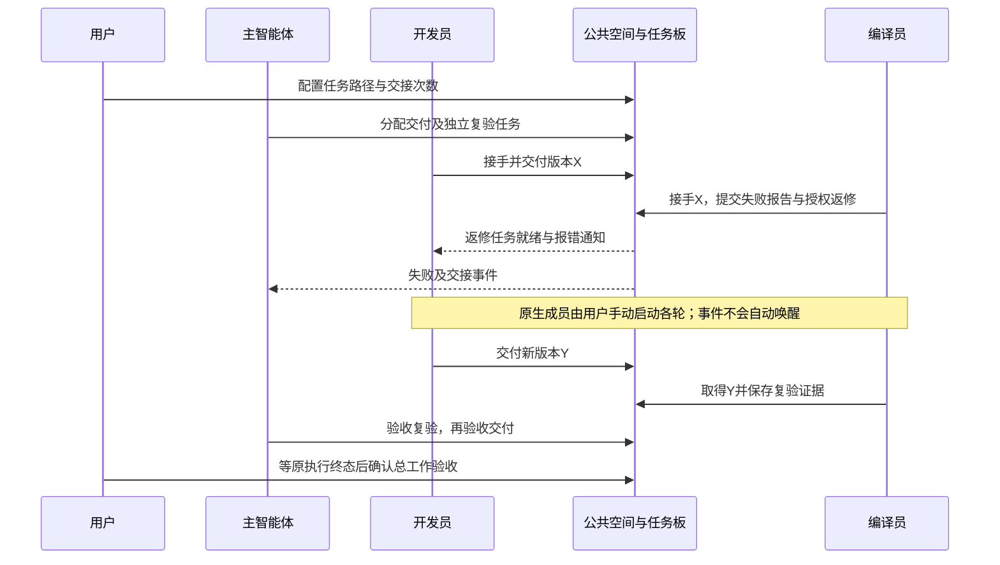

# I07B 任务板、授权交接与版本返修

日期：2026-10-16。源码/本地候选 **0.6.0-alpha.22**，GitHub预发布仍为alpha.20。本片承接[I07A](delivery.md)，实现I07-R06/07及R10/11/12相关边界；I07C自动激活/原会话续接与完整I06C准出仍未完成。开发已获用户授权，本次未发布GitHub、未升级用户后台。

## 1. 用户得到的行为

在“小队协作 → 工作空间”中新增任务板。用户或主智能体分配任务，分别说明要求、负责人、依赖；复验任务指定另一个成员交付的产物。依赖只能指向已存在的任务，首版不改写已建立依赖，也不提供任务转派/删除。每次工作最多50项，每项最多5轮。

负责人接手就绪任务，提交交付、通过、失败或受阻报告。交付必须登记未使用过的明确版本与产物引用；复验接手时绑定该版产物身份，通过报告必须确认实际取得产物并给出证据引用。Bridge保存成员报告及来源，不替成员运行编译器，不凭引用字符串声称完成文件同步或独立核验。

用户可在界面为具体交付/复验任务授权“交给复验”或“退回返修”，设置累计次数（1至20）、查看已用次数并撤销。队员不能授权自己；主智能体可协调本次工作已分配任务，不能修改成员/交接权限或突破轮次、任务数上限。

报告可附带明确交接，也可以报告后单独交接。报告、任务状态、授权消耗、群消息及给主智能体/目标负责人的通知在同一个SQLite事务提交。失败时全部回滚；普通@、群聊文字和职责描述不会形成授权或启动执行。

返修创建新业务轮次，保留X失败与全部原执行。所有依赖该交付的复验及其后续依赖一起失效，重新等待；旧通过结果不能证明Y。相关任务仍在执行、原生请求unknown或达到轮次上限时拒绝返修，不用别名释放占位。仅恢复外部访问等情况，用户或主智能体可安排受阻任务重试本项，同样保留历史并受5轮限制。

## 2. 原生执行与业务验收

任务板的“手动执行此任务”绑定任务身份、负责人及业务轮次；原生接入仍走原节点、原请求准入、实时成员权限和实际来源校验。原生工具报告必须属于本轮绑定的任务；另一个外部连接不能绕过同一成员的运行/unknown占用。派发标记在事务内竞争，不重复发送原请求。

原生执行成功不自动完成任务；模型报告也不能替代原生终态。验收复验需精确版本/实际取得声明/证据引用，验收交付需该版本的全部独立复验已验收；绑定原生尝试还须本轮最后一次尝试确实成功且没有未核对尝试。总工作只有全部任务已验收、所有原执行已核对后才可验收，结果记录为completed并关闭成员访问。归档closed不等同业务验收。

原生Agent运行时可报告结果，但交接须原尝试结束后进行。本片不自动唤醒下一成员，也不自动续接主会话。原生主角色自身尚在运行时不能直接验收总工作，用户可等待其原执行结束后确认；外部MCP主角色可在条件齐备时直接验收。I07C将继续处理事件激活和持续跟进。

暂停阻止分配、接手、重试、交接和新原生派发；已接手成员仍可报告实际结果。撤权立即阻止旧接入和原收据读取，历史与原执行保留。

## 3. 实现与迁移

| 层 | 落点与职责 |
| --- | --- |
| 任务业务 | [team-work.cjs](../../../desktop/electron/team-work.cjs)：任务、依赖、版本报告、授权交接、轮次失效及验收 |
| 事务及身份 | [team-space.cjs](../../../desktop/electron/team-space.cjs)：版本2状态、收据、消息、原执行绑定与准入 |
| 协作工具 | [team-tools.cjs](../../../desktop/electron/team-tools.cjs)：15项成员工具，包含任务读写/原操作查询；旧主从工具保持原集合 |
| 本地接口 | [Coordinator](../../../desktop/electron/coordinator-service.cjs)：显式方法白名单，禁止客户端自报内部teamScope |
| 桌面 | [TeamTaskBoard](../../../desktop/src/TeamTaskBoard.tsx)、[TeamWorkspace](../../../desktop/src/TeamWorkspace.tsx)：分配、授权、任务历史、手动执行及验收 |

`team-space.sqlite`的state版本1原子迁移到版本2，追加workItems/handoffGrants/handoffs；原成员、消息、文档、请求与receipts保持原身份。损坏数据不回退成空库；旧alpha.21不支持读取版本2，不能直接覆盖运行中的数据进行降级。底层IPC/SSH帧版本仍为2。外部MCP连接仍先支持中央所在电脑，不宣称跨设备通用执行器已交付。

## 4. 实际检查与证据

环境：2026-10-16（报告原始时间为UTC），WSL Linux Node22.23.1；Windows Node24.18.0、Edge155.0.4283.45，真实Claude Code 2.1.299。原生CLI沿用安装账号和原生配置，没有新增模型API层。以下工程数量只算一次，跨模块引用不相加。

| 检查 | 实际结果 | 原始证据 |
| --- | --- | --- |
| 核心工程 | 45/45通过 | [TAP](../../../artifacts/I07B/2026-10-16/root-tests.tap) |
| 桌面工程 | 最终208/208通过，包含任务/授权/回滚/修订/版本/预算/unknown及3个独立stdio MCP进程闭环 | [最终TAP](../../../artifacts/I07B/2026-10-16/desktop-tests.tap) |
| Windows契约 | 18/18通过，真实Windows SQLite和独立stdio进程 | [TAP](../../../artifacts/I07B/2026-10-16/windows-contract.tap)、[脚本](../../../desktop/tests/windows-i07b-contract.cjs) |
| lint / 根类型 / 桌面类型与前端构建 | 通过，构建保留现有单包体积提示 | [lint](../../../artifacts/I07B/2026-10-16/lint.log)、[根类型](../../../artifacts/I07B/2026-10-16/typecheck.log)、[前端](../../../artifacts/I07B/2026-10-16/desktop-build.log) |
| 真实开发与实际语法检查 | 4项通过。Claude两轮手动原生调用，独立MCP编译连接器实际运行Node检查，X退出1且SyntaxError，Y退出0；MCP协调员按当前版本验收 | [报告](../../../artifacts/I07B/2026-10-16/native.json)、[脚本](../../../desktop/tests/linux-i07b-native.cjs) |
| Windows界面 | 7组通过，生产前端/Coordinator/SQLite、受控节点目录、两个独立鉴权MCP成员；模型0 | [报告](../../../artifacts/I07B/2026-10-16/windows-ui.json)、[截图](../../../artifacts/I07B/2026-10-16/workspace.png)、[脚本](../../../desktop/tests/windows-i07b-ui.cjs) |
| 最终Windows包及普通EXE | 包逐项匹配31个CJS、78个core文件、1388个Linux清单条目；普通无debug EXE 5组通过，模型0，包含关闭窗口、全后台重启后X/Y任务接续 | [包校验](../../../artifacts/I07B/2026-10-16/package.json)、[普通EXE](../../../artifacts/I07B/2026-10-16/portable.json)、[脚本](../../../desktop/tests/windows-i07b-portable.cjs) |

文档结构检查通过（131份Markdown、14组模块设计/报告、58张图表计数），新增时序图已实际解析；[结构结果](../../../artifacts/I07B/2026-10-16/docs-check.json)、[解析结果](../../../artifacts/I07B/2026-10-16/diagrams.json)。这些是结构检查，不能算作模型验收用例。

真实开发测试使用已知有语法错误的隔离X夹具及修复Y。编译器是执行实际Node命令的受控MCP连接器，协调员也是受控MCP客户端；不把它们说成两个真实大模型Agent，也不把两轮手动启动说成自动接力。共享文档精确修订作为可取得产物，未证明跨设备文件可达性或任意项目编译能力。

首次全桌面运行207项中206通过，原有daemon-maintenance的owned-stop场景在启动时出现DAEMON_OWNERSHIP；保留[原始失败](../../../artifacts/I07B/2026-10-16/desktop-initial-daemon-failure.tap)。独立重查[8/8通过](../../../artifacts/I07B/2026-10-16/daemon-recheck.tap)，最终包含新请求不可变回归的208/208通过。未修改daemon启动代码，未宣称此低频启动问题已修复；源码存在socket listen后设置权限的时间窗口，关联原因尚未独立复现确认。

## 5. Windows候选与复现

本地便携程序：`AgentBridge-0.6.0-alpha.22-Windows-x64.exe`，已复制至Windows下载目录，同目录有`.exe.sha256`。文件大小 **129,877,523 bytes**，SHA-256：`5a6e68e1f028a83dcefd59661a294f9b86c42a2413ab6e574d758e7e52723ba8`；[校验文件](../../../artifacts/I07B/2026-10-16/SHA256SUMS.txt)。本次没有上传GitHub，不能称作已发布版本。

普通EXE隔离profile实测5组：公共材料真实存储；X失败与授权返修；冻结资源匹配；关闭窗口保留同后台；全后台重启刷新原MCP端点后继续Y，并保留原收据/授权消耗/X失败历史。没有使用debug启动参数，没有修改用户默认profile。

复现入口：核心`npm test`，桌面`npm --prefix desktop test`，Windows契约`windows-i07b-contract.cjs`、界面`windows-i07b-ui.cjs`、普通包`windows-i07b-portable.cjs`均由Windows Node执行。WSL使用交互Shell加载实际Node后运行工程命令；真实开发脚本`linux-i07b-native.cjs`保留隔离原请求，重跑先查询原操作，不重复发送未知轮次。普通EXE脚本只启动自己的隔离窗口/后台。打包使用`npm run desktop:dist`及`verify-package.cjs --portable`，最终检查见[汇总](../../../artifacts/I07B/2026-10-16/verification-summary.json)。

## 6. 未验收范围

I07C原生自动唤醒、运行中收信、原会话续接、持续主协调、自动激活预算及断线恢复尚未实现。本次未连接用户独立SSH服务器、未接入用户自研产品、未做任意外部执行协议或文件同步；旧I06C准出缺口保持原状态。任务转派、依赖编辑、跨工作共享知识及任务级取消/撤销尚未提供。

接下来的I07C应先验证各原生接入的消息/续接能力，再加事件激活与恢复；不能靠固定循环反复提示模型声称持续协调。
