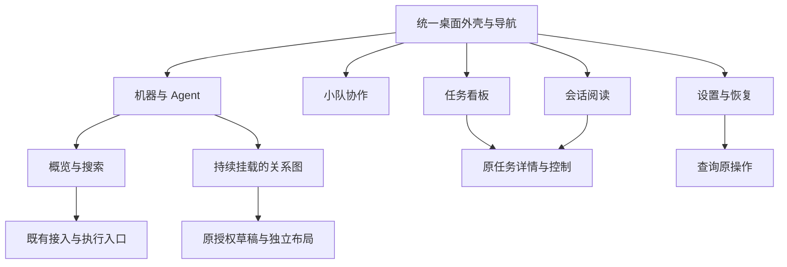

# I07 桌面界面整体重构

日期：2026-10-17；2026-10-18继续开发与验收。关联 AB-F01/02/03/08/09/10/11/16/20/21/22、M01-F01/05/06/07/09/10/11/12/13/14。状态：主工作区为基于 alpha.28 的未发布源码，另构建独立Windows本地UI候选；GitHub alpha.28 附件未改变。候选同时包含原有[空白原生 Session保护](blank-native-session.md)和[会话异常验收保护](acceptance-native-binding.md)，分别保留证据，不能把后台结果当作界面实测。

## 1. 本阶段交付与需求

用户要求深度调研 CC Switch 当前 UI，并整体重构 AgentBridge。先冻结研究对象，再改产品界面的结构和视觉体系；研究的完整来源、版本、官方截图和未测限制见 [CC Switch 调研](cc-switch-ui-research.md)。

| 需求 | 当前阶段交付 | 验收方式 |
| --- | --- | --- |
| I07-UI-R01 | 稳定的桌面导航、紧凑页头、统一字号/间距/状态/操作层级，支持深浅与系统主题 | 类型/构建、主题与窄窗展示检查 |
| I07-UI-R02 | 默认机器概览，按机器搜索/筛选工具，低频管理收进更多，关系图保持可用 | 概览/图切换、权限草稿保留、原节点占位不绕过 |
| I07-UI-R03 | 任务数量、原状态分列、等待提示、搜索和空态 | 运行/unknown/失败/等待分别呈现，不将收据当终态 |
| I07-UI-R04 | 会话双栏阅读、来源/目录/原轮次/历史与验证提示、原上下文续问 | canContinue、上一轮终态、连接、历史和 blocked 门槛回归 |
| I07-UI-R05 | 设置分组与可读恢复，小队导航、首次接入指引和分层说明 | 原操作只读恢复、后台停止确认、小队入口原契约 |

本次不增加供应商、模型 API、Skills 或原生账号管理；不改变 Coordinator/daemon 的业务与通信契约。

## 2. 设计依据与落点

CC Switch 当前正式版为 v4.0.14，冻结 commit `5de6feb4e5adda61f4ad824ce0df2c449245f447`。其官方 v4.0.0 图用于布局参考，不能宣称已运行或截图实测 v4.0.14 原生应用。迁移的是稳定壳层、实体列表、操作主次和渐进展示；AgentBridge 仍按机器、外部 Agent、小队、任务与会话组织。



| 模块落点 | 最终职责 |
| --- | --- |
| [AppShell](../../../desktop/src/AppShell.tsx) | 标题栏、固定导航、侧栏折叠、同步状态；版本读取失败不显示旧版本冒充当前 |
| [NetworkApp](../../../desktop/src/NetworkApp.tsx) | 数据与页面编排，保留原请求/占位/管理 hooks；机器显示方式只记本机 UI 偏好 |
| [MachineInventory](../../../desktop/src/MachineInventory.tsx) | 按机器分组的实体行、状态、搜索和已有动作；原生工具检查不等于真实模型验证 |
| [WorkspacePages](../../../desktop/src/WorkspacePages.tsx) | 任务四列、会话双栏、设置分组；搜索只改显示，不能改变身份与资源范围 |
| [TeamWorkspace](../../../desktop/src/TeamWorkspace.tsx) | 页内导航、数量、接入指引、可展开协作说明；公共消息/执行/工作项逻辑保留 |
| [共享样式](../../../desktop/src/workbench.css) / [页面样式](../../../desktop/src/workspace-pages.css) | 中性色层级、深橙主操作、蓝色选中、独立语义状态；字体/控件/圆角/间距与响应式一致 |

历史 style.css 仍供 TaskDetail、接入和权限表单等共享组件使用；新展示样式限定在 `.workbench` 下，最后加载页面样式，明确覆盖兼容类，避免重写原业务组件。图节点保持 280×132 几何及原路由，不单独改变 CSS 宽高。

## 3. 必须保留的行为

- snapshot/pending 仍每 1500ms 刷新；原未确认操作约 10 秒只读恢复。新 UI 不自动重派请求。
- blockedNodeIds 对应原节点/共享目录；旧后台缺该字段仍按机器保守限制。机器/节点管理保留各自 pending 锁。
- AgentGraph 在概览/关系图/其他页面之间只隐藏不卸载；授权与布局仍有独立修订和原 operationId。
- 普通会话只有来源节点仍接入、上一轮真实终态、canContinue 为真、无原占位时才可续问；历史和验证记录不能作为新的业务会话发送。
- TaskDetail 保留权限/表单/取消原控制逻辑；小队操作先保存原 operation，unknown 只查原 ID。确认收据不变成任务完成或取消。
- 普通群消息和 @ 不触发执行，自动工作依赖既有授权/预算/能力。停止、暂停、归档含义不合并。

## 4. 2026-10-17源码验证与历史未测边界

下表记录本次实际执行结果；不能将编译通过写成界面验收。

独立静态复核发现概览原先缺少关系保存unknown/后台断连的执行锁，已由AgentGraph向编排层投影原锁，概览及新建提交共同保护。新增SSR覆盖该门槛，图组件不因切视图重建。

| 层级 | 当前结果 | 证据 |
| --- | --- | --- |
| CC Switch 研究 | 官方发布/tag、冻结源码和四张官方历史界面图已核对；未运行原生应用 | [来源与判断](cc-switch-ui-research.md) |
| TypeScript / Vite | 最终集成后通过；既有大于500KB chunk提示保留，不作零警告声明 | [实际构建日志](../../../artifacts/ui-redesign/2026-10-17/build.log) |
| 全桌面受控回归 | 373/373通过，WSL Node22.23.1；含新增53项，跨模块不重复相加 | [最终TAP](../../../artifacts/ui-redesign/2026-10-17/desktop-tests.tap) |
| 原图/管理专项 | 先行24/24通过，已包含于上行全量结果 | graph-crash/layout/operations/routing 与 machine-management 既有用例 |
| 隔离预览HTTP | 6组通过：生产CSP、同源预载、目录/历史读取、禁止模型执行和旧前端对照入口；无浏览器 | [实际报告](../../../artifacts/ui-redesign/2026-10-17/preview-http.json) |
| 文档/格式/差异 | check-docs、变更源文件Prettier与git diff --check通过 | 文档最终检查149页、14模块设计/报告对；不是产品功能验收 |
| 新展示门槛 | 53/53通过（15组场景含子项），生产React组件SSR；模型0 | [测试源码](../../../desktop/tests/ui-redesign.test.cjs)、[实际TAP](../../../artifacts/ui-redesign/2026-10-17/render-tests.tap) |
| 浏览器/原生 EXE（10-17历史状态） | 当时尚待替代浏览器授权，未执行 | 用户已于10-18批准继续开发，后续实际结果见第6节 |

本次抽样计算浅色深橙主按钮/白字对比度4.76:1，浅色辅助文字/白底5.04:1，深色按钮文字7.82:1（准确浮点见[源码与颜色清单](../../../artifacts/ui-redesign/2026-10-17/source-manifest.json)）；这不是完整无障碍合规声明。独立Node直接解析Mermaid遇到DOMPurify缺DOM限制，未将其计为渲染通过。

本次检查架构、对象和协议：UI 组件拆分、本机显示偏好与搜索不新增后台字段/IPC/文件格式，故 architecture/data-model/protocol 的业务合约无需改变。M01 完整设计与报告、整体设计、迭代需求/开发/验收和当前路线同步维护。

10-17当次未实测用户 profile、独立 SSH、新 UI 下真实模型执行、多原生小队或普通 Windows EXE；完整 I06C/I07C 准出没有因此扩大。未发布源码不能用旧 alpha.28 EXE 验证。

## 5. 隔离预览

[preview-ui.cjs](../../../desktop/scripts/preview-ui.cjs) 使用生产前端、临时受控 Coordinator 与合成历史，HTTP仅绑定127.0.0.1；不读写用户profile，不允许原生/模型请求。界面预览中的新需求会明确拒绝，示例会话不支持续发。它是评审辅助入口，不进入Electron产品包，也不等于真实后台/模型验收。

从仓库根运行（需既有Node开发环境）：

```bash
npm run build --prefix desktop
node desktop/scripts/preview-ui.cjs
```

本地预览端口4197；环境变量AGENTBRIDGE_UI_PREVIEW_PORT可改端口。Windows最终用户继续使用发布EXE，此开发预览不替代Windows交付包。

## 6. 2026-10-18批准开发后的修复与验收

用户批准继续开发后，使用项目既有Playwright及Windows Edge直接验证生产前端。修复首页过多留白与会话发送区出窗；搜索清空/Escape回输入焦点，菜单单开、Escape/外点/动作后收起，长名称自动换行；任务/会话筛选放在标题之后。会话续问继承原执行锁并核对online，隐藏被机器/验证筛选排除的阅读；详情查询冻结原ID，迟到回应不能混入另一来源或重开已关闭详情。小队会话身份异常显示单独提示，同时保留原生succeeded事实，后台继续判断当前有效执行。

| 验证层 | 实际结果与限制 | 当次证据 |
| --- | --- | --- |
| 最终桌面回归 | 381/381，无跳过；包含新增59项生产React SSR，模型0；不与历史375/373叠加 | [最终TAP](../../../artifacts/ui-redesign/2026-10-18/desktop-tests-final.tap) |
| 页面/主题/最小窗口 | 5组通过，12张截图；Edge155.0.4283.45、Windows Node24.19.0，1440×960/980×660，生产前端+隔离Coordinator/合成历史 | [逐图审查](ui-visual-acceptance.md)、[稳定截图报告](../../../artifacts/ui-redesign/2026-10-18/verified/ui.json) |
| 状态与键盘 | 10组通过，8张图，notRun=[]、pageErrors=[]；包含断连/离线/迟到回应/unknown隔离/筛选/菜单/焦点/长名与发送可见性；所有业务执行拒绝，模型0 | [状态矩阵](../../../artifacts/ui-redesign/2026-10-18/state/2026-10-18T00-48-05-809Z/ui.json) |
| 原图交互回归 | 10组通过；Windows真实鼠标拖动、键盘连接、移动/缩放、授权与布局独立恢复、冲突和原收据；受控机器，无SSH/模型 | [原始报告](../../../artifacts/ui-redesign/2026-10-18/graph/ui.json) |
| 小队状态 | 3组通过，3张图；历史异常按原执行提示、后续正常记录无警告，不全局锁定验收；unknown保留上次等待及confirmed取消收据各自含义，实际验收和模型调用0 | [小队状态报告](../../../artifacts/ui-redesign/2026-10-18/team/2026-10-18T00-50-21-765Z/ui.json) |
| 本地候选 | ui.2包资源核验与普通EXE 4项均通过；ui.1作为中间包保留、不交付 | 具体字节、源码范围及升级方法见第7节 |

初次主题选择定位超时源于标签包含辅助说明，已改成独立标签/description；第一次菜单点击被弹层遮挡后改为真实键盘切换，再发现旧native toggle事件会抢走新菜单，修复为同步summary动作后完整10组通过。诊断轮次遇到dist重建而未开启浏览器，保留为环境失败，不混入通过计数。首次普通EXE脚本假设新观察目录没有历史，但实际可读到10条历史；后续改为记录观察基线、严格核对原生请求台账不新增/不重放。所有失败记录保留，不将其归为已完成的用户原生故障复现。

当前仍未验证用户故障profile、独立SSH、真实模型新UI任务、多原生小队；完整I06C/I07C未准出。主工作区及GitHub版本继续alpha.28，本地候选的版本元数据与冻结可信清单单独说明。

## 7. 最终Windows本地候选交付

2026-10-18，WSL Ubuntu/Node22.23.1从独立源码快照构建，Windows Node24.19.0验证普通无调试便携窗口。最终程序为[AgentBridge-0.6.0-alpha.28.ui.2-Windows-x64.exe](../../../artifacts/ui-redesign/2026-10-18/AgentBridge-0.6.0-alpha.28.ui.2-Windows-x64.exe)，大小129,899,528字节，SHA-256为`20a84ce98380457e5520d6bb9fc941c666c299a67b216e862d8568b7b3d015a6`；[校验文件](../../../artifacts/ui-redesign/2026-10-18/SHA256SUMS.txt)。这是本地候选，未创建GitHub标签或发布附件。

| 核对对象 | 当前实际结果 | 证据 |
| --- | --- | --- |
| 包资源 | 34个后台CJS、78个核心文件、1396个Linux清单项与冻结源码匹配，app.asar/前端匹配 | [包核验](../../../artifacts/ui-redesign/2026-10-18/package-ui2.json)、[构建日志](../../../artifacts/ui-redesign/2026-10-18/package-ui2-build.log) |
| 普通EXE | 4项通过：无debug启动、真实IPC/SQLite公共资料持久化、窗口关闭重开复用原Coordinator、后台完整重启保留原资料；原生请求台账无新增/重放，合成小队执行尝试0、模型0 | [实际程序报告](../../../artifacts/ui-redesign/2026-10-18/portable-ui2.json)、[验证脚本](../../../desktop/tests/windows-ui-redesign-portable.cjs) |
| 前端冻结 | 候选与状态/小队截图使用同一JS/CSS内容，分别为`38faf82f508ec56c0dbc3d14267cf821d030beae591a6a55a58434e5fc106e7e`与`0fd720d4258f65fc3689da7a1fe996bebc06c93bbf6b594bdf00979b0578ab95` | [源码与元数据差异清单](../../../artifacts/ui-redesign/2026-10-18/runtime-source-manifest.json) |
| 旧程序保留 | 原alpha.28 EXE仍为129,884,570字节，SHA-256`6d85f667c2e1009e26cd83f00afb09ad540b27787e71c5a2784af0e64c4602ef` | 主工作区release和公开附件未被本次构建覆盖 |

主工作区desktop/package.json和lock仍为alpha.28。独立快照仅将这两份元数据的版本改为alpha.28.ui.2，并补收原alpha.28包的冻结可信manifest，规范摘要`b06a14fe3716c2df46cb665e21f137d05aab6046a611cb0275c5cadbc365d00d`；不修改主工作区可信清单。新包Linux资源manifest规范摘要`c0e1db13e63a1f7985f074afc5d9791b07b555b66f30566351b1d400251e2d83`。候选包含当前工作区既有空白Session与业务验收保护，不能描述为仅含UI变更。预览脚本的后续纯排版不进入Electron包；最终清单单列该开发工具差异。

普通EXE测试使用临时独立profile；可观察到10条已有原生历史，脚本将其作为只读基线并核对原生请求身份集合保持不变，没有据此宣称用户历史为空或真实任务已复测。首次脚本的空历史假设失败保留于[中间包记录](../../../artifacts/ui-redesign/2026-10-18/portable-ui1-initial.json)。

Windows使用：先在旧程序“设置 → 后台运行”选择“停止后台并退出”，再打开新候选EXE；仅关闭旧窗口会保留旧后台。检查设置页版本为alpha.28.ui.2。原有任务与会话继续沿原身份恢复，未知操作不要另建请求重试。UI使用不要求升级SSH后台；若要使用本候选包含的后台业务修复，SSH仍须单独维护原远端daemon，本轮未在用户服务器实测。未接触用户profile或升级用户后台。

源码冻结边界补充：候选于2026-10-18 08:50完成构建；共享工作区11:18以后出现另一项原生适配器/工具发现/图标开发。它们未进入ui.2，不能套用本页381项和包核验结果。本片保留并行改动，隔离预览也使用本候选冻结快照，未重新打包混入未验收功能。
