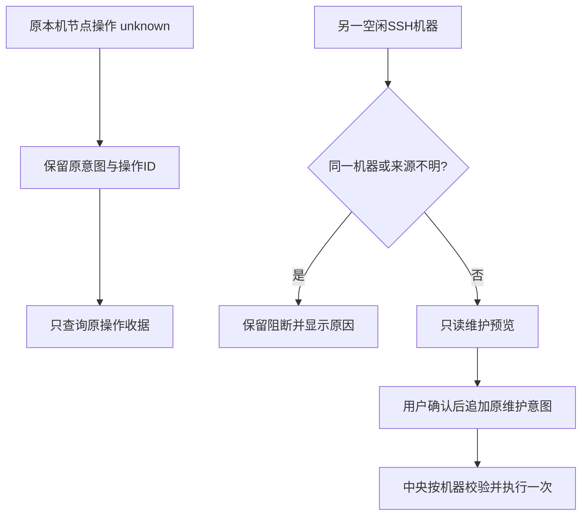

# OpenCode 2.x准入与按机器管理恢复（issues #8 / #9）

日期：2026-10-19（北京时间）。源码/GitHub预发布 **0.6.0-alpha.32**，从已发布alpha.31源码/文档`ff4194638da0a1a59d791be0d44c34c06c1ad488`隔离修复；原工作区CT-04/MCP未提交修改不入包。源码、普通EXE与公开发布分别以本页实际证据为准，完整I06C/I07C仍未准出。

## 需求与基线

对应[issue #8](https://github.com/wsjq5477/MA-Relay/issues/8)及[issue #9](https://github.com/wsjq5477/MA-Relay/issues/9)，覆盖AB-F02/F03/F07/F10/F11/F13/F17，M01/M02/M03/M04/M05/M06-OC/M07/M08/M10。

| 编号 | 要求 | 安全边界 |
| --- | --- | --- |
| V01 | 只支持OpenCode 2.x；安装可启动与执行兼容分开显示 | 不选其他安装、不修改原生账号/配置、不迁移Session |
| V02 | 新接入、旧上下文和保存配置恢复均在serve之前检查原安装版本 | 原端口进程归属检查保留，不结束无主进程 |
| V03 | 确定的API/认证错误快速返回，不被20秒启动轮询吞掉 | 暂态网络未就绪仍可等待；不发送Prompt验证 |
| M01 | 本机节点unknown不阻塞另一空闲SSH机器的维护、扫描和管理 | 同机、缺来源与授权变化仍保护，不释放原unknown |
| M02 | 概览、关系图、设置与中央持久操作台账使用一致机器范围 | 预览无副作用，确认后才写维护意图 |
| M03 | 多机管理意图可并存，关闭重开只查询原operationId | 不覆盖旧意图、不换ID、不重派原任务 |
| P01 | 新旧中央能力清晰门禁，当前EXE和Linux包一并交付 | 旧中央可显式停止；SSH维护另经用户确认 |

issue正文引用的master/alpha.29为报告时点。只读核对时master实际为alpha.31文档提交ff41946，修复以该版本为基线。alpha.31曾按实际API允许兼容的1.x；本轮用户明确要求仅2.x，该要求覆盖前次准入策略，旧版验证只保留历史范围。

## 最终实现

### 版本准入、旧上下文与错误分类

[共享发现器](../../../desktop/electron/tool-discovery.cjs)导出统一OpenCode兼容判定：仅完整2.x语义版本及其后缀通过；1.x、未知和其他主版本不通过。发现仍返回能执行`--version`的1.x安装，`healthy:true`仅表示安装可启动，另返回`compatibility.supported:false/requiredMajor:2/code:NATIVE_VERSION`。带点的企业版本后缀保留，不截断成另一个版本。

[MachineHost](../../../desktop/electron/machine-host.cjs)在创建默认目录/上下文前拒绝不兼容版本。[AgentNetwork](../../../desktop/electron/agent-network.cjs)在接入时及新执行前复验，快照投影`version_incompatible`、`connected:false`、执行/委派能力关闭、`available:false`；原节点绑定、角色、Session与历史不删。已经派发的原请求查询优先于当前版本门禁，不能让当前不兼容隐藏原收据。界面显示需要OpenCode 2.x，保留历史和管理入口。

[核心发现](../../../src/discovery.ts)只复验明确指定的原安装候选，允许同一`.cmd`/符号链接经发现器解析其实际入口，不改原存储executable且不回退PATH其他版本。[DesktopHost](../../../src/desktop-host.ts)新连接在写配置/启动Controller前检查；[托管启动](../../../src/native-server.ts)也复验，因此保存的旧配置/上下文恢复无法绕过门禁。端口占用与旧进程严格归属验证仍先执行，版本拒绝发生在serve、新密码与新identity落盘之前。

[OpenCodeClient.probe](../../../src/drivers/opencode-client.ts)要求实际`/api/info`版本为2.x，并继续检查info/agent/model/default/model及所需config的只读响应契约。确定的1.x返回`NATIVE_VERSION`；404/405、无效JSON或契约错误返回`OPENCODE_API_UNSUPPORTED`；401/403保留各自认证错误。托管启动循环立即透传这几类错误，不再等满20秒。其他暂态不可达仍走原就绪等待。没有创建Session或发送Prompt。

### 前端与中央的机器范围一致

[共享管理状态](../../../desktop/src/management-state.ts)同时服务节点与机器管理。阻断按原machineId比较；machineId不完整但双方有connectionId时按connectionId比较；来源不足则保守阻断。关联授权的relation未确认仍阻断所有相关元数据编辑，布局维持独立规则。每个目标按钮给出原管理动作及原operationId前缀；同机运行中任务和原生pending继续阻断维护。

[NetworkApp](../../../desktop/src/NetworkApp.tsx)、[概览](../../../desktop/src/MachineInventory.tsx)、[关系图](../../../desktop/src/AgentGraph.tsx)及[设置](../../../desktop/src/WorkspacePages.tsx)统一使用目标机器原因；其他机器可扫描、接入、编辑/断开/移除、打开维护。全局快照/同步错误仍保护全局。机器维护预览只读，确认前不发送maintainDaemon。

只放开按钮不足以修复：原[GraphOperationJournal](../../../desktop/electron/graph-operations.cjs)也全局互锁非布局操作。本轮中央持久台账按同样machineId/connectionId范围冲突，不同机器的node/machine可以并存；relation仍全局互锁非布局，缺来源仍保守锁。逐条原查询失败保留本条unknown，不吞成拒绝，也不阻塞其他机器的独立操作。只允许共享发现器标记的本地版本准入拒绝进入确定rejected；裸远端同码不能证明未发送，历史NATIVE_START_TIMEOUT仍unknown。

本地存储沿用原两个key，兼容旧单意图对象，后续保存为数组。新机器意图追加保存，不覆盖其他机器unknown；匹配原operationId、原保存内容和明确confirmed/rejected后才移除该条。无效台账保守禁写并提示保留数据，不能通过新key/新ID清空占位。graph-pending.json仍为原数组格式，不迁移旧行。

### 运行能力与升级

[运行能力](../../../desktop/electron/runtime-capabilities.cjs)在owned-object-controls-v1之外新增scoped-management-v1和opencode-v2-admission-v1。新前台要求中央三项齐备，避免复用alpha.31后仍按旧全局台账/旧版本策略执行；缺能力返回COORDINATOR_UPGRADE_REQUIRED，设置、运行信息和显式shutdown仍可用。SSH安全对象路由继续按原owned-object-controls-v1要求，不把两个新客户端能力作为所有旧SSH接口的额外通用门槛。OpenCode启动修复位于MachineHost/Core，新远端需经维护升级才能具备完整修复。

Windows包与Linux离线资源同时包含上述修复。精确收录已发布alpha.31原manifest，摘要`c28d31a989b05d51903497494922ae5b7b0f1d8fa1c50d365896d68e8a5612eb`；不把未知同协议后台加入信任。协议号仍2，网络/机器JSON版本仍1，没有新模型API层。

## 实际验证与原始证据

全部路径位于artifacts/version-management-recovery/2026-10-19，测试均为受控合成CLI/HTTP、后台和界面，模型调用0。共享测试计数不跨模块或平台相加。

| 层级/日期 | 实际结果 | 原始证据 |
| --- | --- | --- |
| alpha.31修复前版本回归 / 10-19 | 保存1.x未能在serve前拒绝，精确失败 | [旧版本失败](../../../artifacts/version-management-recovery/2026-10-19/baseline-version.tap) |
| alpha.31修复前管理回归 / 10-19 | 异机维护仍报GRAPH_UNCONFIRMED | [旧管理失败](../../../artifacts/version-management-recovery/2026-10-19/baseline-management.tap) |
| 冻结alpha.29旧托管启动 / 10-19 | 合成404被吞，20090ms后NATIVE_START_TIMEOUT，Prompt 0 | [20秒旧行为](../../../artifacts/version-management-recovery/2026-10-19/baseline-alpha29-timeout.log) |
| WSL Node22.23.1核心 / 10-19 | 51/51，0跳过；含旧配置恢复、2.x兼容及快速认证/契约拒绝 | [核心](../../../artifacts/version-management-recovery/2026-10-19/core-final.tap) |
| 最后原启动器复验 / 10-19 | 7/7，冻结后原安装发现及版本回归通过 | [定向](../../../artifacts/version-management-recovery/2026-10-19/version-after-freeze.tap) |
| WSL桌面串行全量 / 10-19 | 543/543，0失败/跳过 | [逐文件汇总](../../../artifacts/version-management-recovery/2026-10-19/desktop-full.json)、[日志](../../../artifacts/version-management-recovery/2026-10-19/desktop-full.log) |
| 生产前端Windows Edge155 / 10-19 | 最终alpha.32四组通过，0页面错误 | [最终四组界面](../../../artifacts/version-management-recovery/2026-10-19/ui-alpha32/report.json) |
| 工程检查 / 10-19 | lint、类型检查、core/desktop构建通过 | [lint](../../../artifacts/version-management-recovery/2026-10-19/lint.log)、[类型](../../../artifacts/version-management-recovery/2026-10-19/typecheck.log)、[核心构建](../../../artifacts/version-management-recovery/2026-10-19/build-core.log)、[前端构建](../../../artifacts/version-management-recovery/2026-10-19/build-desktop.log) |
| alpha.32包核验 / 10-19 | 39个CJS、78个core、1404个Linux资源；ASAR、前端和源码一致 | [verify-package --portable](../../../artifacts/version-management-recovery/2026-10-19/package.json)、[构建](../../../artifacts/version-management-recovery/2026-10-19/package.log)、[148个冻结文件](../../../artifacts/version-management-recovery/2026-10-19/source-files.json) |

版本定向覆盖1.x企业后缀、保存配置和Controller恢复不启动serve且保留密码/Agent；合成2.x API404、无效JSON、401/403均在3秒预算内报具体错误。桌面全量覆盖中央异机并发、同机/授权/无来源阻断、裸同码仍unknown、1.x安装健康但执行不支持，以及原路由/委派/SSH兼容历史回归。

四组界面覆盖概览及关系图：原本机OpenCode旧版本+node unknown、远端alpha.24升级预览、同机锁与原因、多机unknown追加及刷新只查原ID。唯一显式维护确认使用合成IPC，不连接用户服务器，不把打开对话框计为真实升级成功。

Windows Node24.19.0原历史/网络/台账纯CJS **95/95**通过：[原路由与台账](../../../artifacts/version-management-recovery/2026-10-19/windows-contract.tap)。普通无调试alpha.32 EXE **5组**通过：旧alpha.31中央门禁、原两轮历史与unknown查询、关闭重开、完整中央重启，以及8个冻结模块摘要一致；Prompt 0，独立合成profile：[普通EXE](../../../artifacts/version-management-recovery/2026-10-19/portable.json)。既有生产前端状态回归 **10组/8图**通过，0业务提交、0模型调用：[界面状态](../../../artifacts/version-management-recovery/2026-10-19/ui-regression-final/ui.json)。

Windows新增版本准入/机器台账模块另 **9/9**通过：[Windows管理回归](../../../artifacts/version-management-recovery/2026-10-19/windows-management.tap)。首次直接传两个UNC路径给Windows Node的test发现器被解析为单路径，保留[入口失败](../../../artifacts/version-management-recovery/2026-10-19/windows-management-launch-failure.log)后改用单一CJS契约入口，无产品修改。

### 失败与修正记录

首次桌面全量542项有3项失败：machine-management和team-stop-routing的旧测试夹具未声明有效版本。本轮补齐合成2.0.24安装信息后全量543/543通过，未放宽2.x门槛。[首次结果](../../../artifacts/version-management-recovery/2026-10-19/first-full/desktop-full.json)。首次界面断言错误地要求同机其他节点可执行，随后保留实际同机保护；另修正菜单空格定位和reload后的测试计数采集，无对应产品放宽。[首次](../../../artifacts/version-management-recovery/2026-10-19/ui/report.json)、[定位](../../../artifacts/version-management-recovery/2026-10-19/ui-second/report.json)、[采集](../../../artifacts/version-management-recovery/2026-10-19/ui-third/report.json)。旧alpha.29基线首次临时模块为CJS导致top-level-await loader失败，改为.mts后完成真实20秒对照，原[loader失败](../../../artifacts/version-management-recovery/2026-10-19/baseline-loader-failure.log)保留。

## 安装与现场恢复边界

1. 使用本页确认发布的alpha.32 EXE。若提示中央过旧，在设置显式停止旧后台并退出窗口，再打开新EXE；只关闭窗口可能保留旧中央。
2. 原OpenCode安装须升级到2.x后重新扫描/接入。1.x安装与历史仍保留；不复制另一安装或更改原Session来消除unknown。
3. 对另一台空闲SSH机器，可以打开其后台维护预览并确认升级；同机有任务/unknown仍需先查询原操作。新EXE不会自动替换服务器后台。
4. 原NATIVE_START_TIMEOUT只查原requestId/operationId，未得到匹配确定证明仍保留unknown。本次不清理用户原台账、不重派原任务。

未测：用户故障profile、真实企业版/个人版原生OpenCode生命周期、独立SSH服务器的实际alpha.24升级、真实模型、完整I06C/I07C。受控验证、普通包运行和公开下载分别记录，不能相互替代。

## 冻结与发布状态

候选EXE **129955724字节**，SHA-256 `87adda262cde786ba602971c4d03c5b25a6a0da9ac00e3cdfaba1e7fc5a14440`。普通无调试EXE五组通过；已发布，冻结源码、附件及匿名完整下载证据如下。

### 已完成的GitHub预发布

GitHub预发布 **v0.6.0-alpha.32** 已公开，标签冻结源码 **`fcdad72fba454bf731cf66df54bc1caf2a06e0a2`**。之后仅补录发布结果，不移动标签；原CT-04/MCP未提交开发不纳入。

- [Windows EXE](https://github.com/wsjq5477/MA-Relay/releases/download/v0.6.0-alpha.32/AgentBridge-0.6.0-alpha.32-Windows-x64.exe)
- [SHA256SUMS.txt](https://github.com/wsjq5477/MA-Relay/releases/download/v0.6.0-alpha.32/SHA256SUMS.txt)
- [预发布页](https://github.com/wsjq5477/MA-Relay/releases/tag/v0.6.0-alpha.32)

EXE **129955724字节**，SHA-256 **`87adda262cde786ba602971c4d03c5b25a6a0da9ac00e3cdfaba1e7fc5a14440`**。上传后的GitHub size/digest匹配；匿名下载16个精确HTTP Range片段，按连续字节顺序拼接计算全部129955724字节摘要，与本地包及GitHub资产digest一致；校验附件HTTP200完整字节一致。不是HEAD或仅部分下载验证。

原始[发布记录](../../../artifacts/version-management-recovery/2026-10-19/github-release.json)、[公开完整下载](../../../artifacts/version-management-recovery/2026-10-19/github-download.json)、[上传及验证过程](../../../artifacts/version-management-recovery/2026-10-19/publish.log)。本次分发已完成，不把用户现场修复、真实OpenCode/独立SSH或完整I06C/I07C改成通过。
