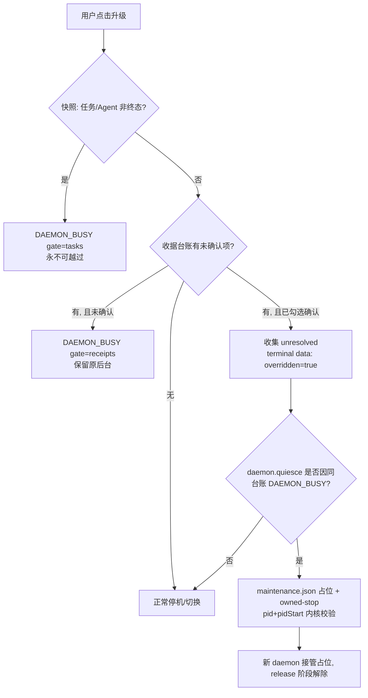

# alpha.38 本地候选交付：显式确认后越过未确认收据（契约变更）

日期：2026-10-21。本轮把用户已批准的**契约变更**与配套界面、只读 RPC 一起整合进 `0.6.0-alpha.38` 并构建 Windows x64 便携 EXE。产物留在本地，**未创建/推送提交、标签或 GitHub 发布**；公开基线仍是 alpha.36（标签 `1fef25f`），其 EXE、标签与附件未改动。

## 1. 交付范围

1. **契约变更（用户已批准）**：维护的“未确认/未知操作阻止维护”新增**显式确认后越过未确认收据**的能力。任务/Agent 门禁**永远不可越过**。
2. **两个只读 RPC**：`machine.maintenanceBlockers`、`machine.queryBlockedOperation`，供对话框实时展示前置门禁并按原 ID 核对。
3. **对话框三个可辨区块**：上次维护结果（历史）／维护前置门禁（实时阻塞项）／仅在允许越过时出现的确认勾选与升级按钮。
4. **真实阿里云现场**：一台运行旧后台的真实机器从 alpha.2 线**带外**切换到 alpha.37（**不是通过产品 UI 完成**，见第 5 节）。
5. **兼容 pin**：新增 alpha.36 与 alpha.37 两份兼容清单。

## 2. 契约变更：显式确认后越过未确认收据

### 2.1 门禁优先级

[remote-maintenance.cjs](../../../desktop/electron/remote-maintenance.cjs) 的 `idle(p, options)` 按固定顺序判定，**顺序本身是契约**：

| 顺序 | 门禁 | 是否可越过 | 行为 |
| --- | --- | --- | --- |
| 1 | 任务/Agent 门禁 | **永不可越过** | 快照中存在非终态任务或忙碌/有非终态当前任务的 Agent → 直接 `DAEMON_BUSY`，`error.details.gate='tasks'`；即使调用方传 `allowUnresolvedReceipts=true` 也不会进入收据阶段 |
| 2 | 收据门禁 | 仅 `options.allowUnresolvedReceipts===true` 时跳过 | 经 `daemon.receiptRead` 分页（128/页）收集未确认收据；未显式确认 → `DAEMON_BUSY` + `details.gate='receipts'`；显式确认 → 收集被跳过的 `{key,op,state,updatedAt}` 并返回 |

- 被跳过的收据会进入 `run()` 的终态 `data`：`overridden:true` 与 `unresolved:[...]`，即“到底越过了什么”有据可查，不是静默放行。
- 门禁错误保留远端原话，并把 `error.details={gate,tasks,agents,receipts}` 落盘。
- 早于持久收据端点的旧后台：`daemon.receiptRead` 返回 `DESKTOP_METHOD` 时视为“该版本没有收据台账可报告”，此时快照是它能表达的唯一屏障；**其他读取失败仍然终止维护并保留原后台**，不会因为读不到就当没有收据。

### 2.2 越过路径的停机

越过路径下，若旧 daemon 自己的 `daemon.quiesce` 因**同一份收据台账**抛 `DAEMON_BUSY`，worker 允许改用：

- 本地 `maintenance.json` 占位（`atomic()` 写入，记录本次 operationId）；
- 控制器 `runtime/owned-stop`（`pid` + `pidStart` 经内核校验）停机。

新 daemon 启动后接管该占位，并在 release 阶段解除。**非越过路径行为不变**：只有 `DESKTOP_METHOD` 回退仍然生效；未显式确认时遇到 `DAEMON_BUSY` 不会被转换成占位停机。

### 2.3 风险（必须向用户解释清楚）

- 越过会**跳过 daemon 自己的 `admissions || jobs.size`（在途 job）检查**。此时流程只由 worker 的 snapshot（任务/Agent）门禁保护，而**任务是唯一的硬线**。
- 也就是说：用户勾选确认时，等价于声明“这些未确认收据对应的原生操作确实不会再运行”。这不是“忽略一切保护”，而是把收据门禁的判定责任显式交给用户。
- 门禁判定与派生动作仍在同一把文件锁内完成，失败关闭；租约被活跃 worker 持有时 `recover()` 直接返回，不改写终态。



## 3. 新增两个只读 RPC

均在 [ssh-host.cjs](../../../desktop/electron/ssh-host.cjs) 中，**不进 lifecycle、不写本地或远端状态**，失败以返回值/原错误码表达而不是伪装成功。

### 3.1 `machine.maintenanceBlockers`

- 在线时经既有 relay 通道读 `snapshot`，再分页 `daemon.receiptRead`（128/页、最多 32 页）收集收据阻塞项；判定规则与 worker 一致。
- 无收据端点（`DESKTOP_METHOD`）→ `receiptsSupported:false`，其余阻塞项照常返回。
- 离线／维护中／需要凭据 → `available:false` 并给出原因（不抛异常，对话框仍能显示“为什么什么都没列出来”）。
- 返回 `{available, tasks, agents, receipts, receiptsSupported}`。

### 3.2 `machine.queryBlockedOperation`

- 只做**一次**读查询，使用**原 ID**，**不重发任务、不新铸 ID**。
- `submit`/`continue`/`verify` → `ipc request`；`reply`/`cancel` → `ipc operation`。
- 失败保留原错误码；成功返回 `{state, detail}`，state 归一到 `confirmed`/`rejected`/`unknown`。
- key 需匹配 `^[a-zA-Z0-9_.:-]{1,128}$`，op 只接受五类已记录操作。

## 4. 界面：三个可辨区块

[DaemonDialog.tsx](../../../desktop/src/DaemonDialog.tsx)（由 [NetworkApp.tsx](../../../desktop/src/NetworkApp.tsx) 接线）现在把“历史”“实时门禁”“越过动作”分成三个语义独立的区块，避免把历史记录误读成当前失败：

| 区块 | 内容 | 关键规则 |
| --- | --- | --- |
| 上次维护结果 | 持久历史记录，`aria-label="上次维护结果"` | 当**实际版本 == 本程序版本**时降级为中性 `status`：明确写“无需升级；以上只是历史记录，不代表当前失败”，不当作 alert |
| 维护前置门禁 | 实时只读阻塞项列表，每条带“按原 ID 查询” | 任务/Agent 阻塞项**永远不会长出越过控件**；无收据端点或读取失败时inline 说明，不把整个对话框判为失败 |
| 越过未确认收据 | 勾选“我已确认这些操作不会再运行（其原生会话已不存在）”＋按钮“确认升级（保留未确认收据）” | **仅在“有收据阻塞 且 无任何任务/Agent 阻塞 且 有升级目标”时出现**；未勾选时按钮禁用；下发时带 `allowUnresolved:true` 与**新的**维护 operationId |

任务或 Agent 阻塞时显示固定文案“任务或 Agent 仍在运行、等待或未知，维护前置门禁不可越过”，不提供任何越过入口。

## 5. 真实现场：从 alpha.2 带外切换到 alpha.37

本轮有一台**真实阿里云 Linux 机器**上的既有现场 profile（该机器的 IP、账号、profile/daemon 等内部标识按安全规则**不写入本记录**）长期无法维护：

| 观察 | 事实 |
| --- | --- |
| 运行版本 | alpha.2 线后台 |
| 阻塞收据 | 1 条 2026-10-18 的 `submit` 收据，`state=unknown` |
| host 侧 | 已无对应任务 |
| 按原 ID 查询 | 返回 `DESKTOP_UNCONFIRMED`（查不出确定终态，符合“未知只查原 ID、不重发”） |
| 维护尝试 | 4 次都在 `phase=validated`、`data.stopped=false` 被 `DAEMON_BUSY` 拒绝（原后台一直未被触碰） |

这正好是本轮契约变更要解决的现场：任务/Agent 门禁已经为空，只有一条无法收敛的未确认收据在永久阻止维护。

经用户批准，由 Lead 执行**一次性带外作业**把该机器切到 alpha.37：

- 保留**全部收据、历史与身份**；预留 `previous.json` 回退点；
- 逐文件校验 **1459/1459** 通过；
- daemon 身份不变、**收据一条未删**。

> **如实标注：这不是通过产品 UI 完成的。** 越过能力在本轮的形态是“用户显式确认后由产品执行”，而该机器当时的客户端仍是旧版本、也没有本轮的对话框；因此这次切换是运维侧的带外作业，**不能作为“产品 UI 越过流程已在真实远端跑通”的证据**。UI 越过路径目前只有合成 IPC + 真实前端的受控证据（第 7 节）。

## 6. 兼容 pin

新增两份，均通过包内 `compatibleDaemons` 索引发布（alpha.38 包内共 **32** 条）：

| pin | 来源 | 文件数 | manifestDigest |
| --- | --- | --- | --- |
| [0.6.0-alpha.36.json](../../../desktop/compatible-daemons/0.6.0-alpha.36.json) | 从已公开 alpha.36 EXE 内 `linux-package/manifest.json` 原样提取 | 1458 | `4f14b5f5b1dc72ca95557ac352bfc669474e4276c98887b286cb2fa5029d8a1e` |
| [0.6.0-alpha.37.json](../../../desktop/compatible-daemons/0.6.0-alpha.37.json) | 取自 alpha.37 本地候选包的 `.linux-package/manifest.json` | 1459 | `3fff4ab392c513f629299f1af01bbf038d2d4025c628f368bbb9e98eed3c7678` |

摘要口径与既有 pin 一致：`manifestDigest = sha256(JSON.stringify(manifest))`，**不是** pin 文件的字节 sha256。收录 pin 只允许客户端识别并复用已安装的对应后台，不安装旧清单、不自动升级远端 daemon。

## 7. 产物指纹

| 项目 | 值 |
| --- | --- |
| 文件 | [AgentBridge-0.6.0-alpha.38-Windows-x64.exe](../../../desktop/release/AgentBridge-0.6.0-alpha.38-Windows-x64.exe) |
| 字节 | **130038728** |
| SHA-256 | **`296260f2304b2234e7476765d407e6920738cc4d2d57fbb2e51bbaabe2de6527`** |

包校验报告：[artifacts/package-check/0.6.0-alpha.38/package.json](../../../artifacts/package-check/0.6.0-alpha.38/package.json) — `status: passed`，48 个后台 CJS、81 个核心文件、**1460** 个 Linux 资源（1459 + 新增 alpha.37 pin 文件），`linuxManifestDigest` = `451aba34ce0f55066953a897043dfb78c4c459e27986039148c1035a13a0e58e`，`coreBuildMatches`/`appAsarSourceMatches`/`frontendMatches`/`linuxBackendMatches` 全为 true。指纹取自该报告，并已用 `sha256sum` 独立复核一致。EXE **未签名**（沿用 `signExecutable=false`）。

打包命令与既有流程一致：

```bash
npm run build
cd desktop && npm run build && npm run dist:win   # stage-bridge → electron-builder portable → verify-package --portable
```

## 8. 测试证据

2026-10-21，Linux 本机 Node v22.23.1；浏览器为工作区内 Playwright chromium headless shell `156.0.8078.4`（本机无 Edge）。受控测试不调用真实模型、不切换用户 profile。

| 检查 | 实际结果 | 原始证据 |
| --- | --- | --- |
| `npx tsc --noEmit` | 0 错 | 本轮复跑 |
| `npx vite build` | 构建成功 | 本轮复跑 |
| `node --test tests/daemon-maintenance.test.cjs tests/ssh-recovery-integration.test.cjs` | **26/26**，失败/跳过 0 | [daemon-maintenance.test.cjs](../../../desktop/tests/daemon-maintenance.test.cjs)、[ssh-recovery-integration.test.cjs](../../../desktop/tests/ssh-recovery-integration.test.cjs) |
| 新 UI 用例 `ui-maintenance-blockers.cjs` | **5 checks passed**，页面错误 0、模型 0 | [界面报告](../../../artifacts/ui-maintenance-blockers/2026-10-21/report.json) |
| 既有 UI 用例 `ui-maintenance-progress.cjs` | **3 checks passed** | [进度界面报告](../../../artifacts/ui-maintenance-progress/2026-10-21/report.json) |
| 全量桌面 `node --test --test-concurrency=1 tests/*.test.cjs` | **689/689，0 失败** | [全量日志](../../../artifacts/ui-maintenance-blockers/2026-10-21/full-suite.log) |
| 包构建与分层校验 | `status: passed`，核心/ASAR/前端/Linux 后台全部匹配 | [包报告](../../../artifacts/package-check/0.6.0-alpha.38/package.json) |
| 文档检查 | `node scripts/check-docs.mjs` errors **0**；`npm run docs:test` **6/6** | 见下方“交付时检查” |

5 项新 UI 断言覆盖：① 任务与 Agent 工作被列出且**永不出现越过控件**、不下发维护；② 仅未确认收据被列出、按原 key 只查询一次、且**只有勾选后**才以新的 maintenance operationId 下发 `allowUnresolved:true`；③ 门禁被拒时显示远端原话与阻塞明细而不是笼统阶段失败，常规动作仍可用；④ 持久历史以中性记录（非 alert）显示，与实时阻塞项分别标注，已是最新版本的 daemon 不提供可点击升级；⑤ 无收据端点的 daemon inline 说明，不把整个对话框判为失败。

### 交付时检查

- `node scripts/check-docs.mjs`：errors **0**（218 篇 Markdown、14 组设计/报告、4644 条本地链接、91 张图、440 项用例）。
- `npm run docs:test`：**6/6** 通过（`tests 6 / pass 6 / fail 0`）。

首次 `docs:test` 曾因用户页面 [doc/user/machines.md](../../user/machines.md) 出现内部用语“历史记录”而被内容规则拦下（`用户正文出现内部过程或编号`）；已改写为用户口径（“上一次维护留下的结果”）后通过，未放宽任何检查规则。

## 9. 未测边界

1. **真实 Windows GUI 未测**：本机无 msedge，`tests/windows-*.cjs` Edge 套件未跑；对话框三区块与越过勾选只经 headless chromium 渲染真实生产前端验证，**不是打包 EXE 窗口**。
2. **真实 SSH 未测本轮契约**：26/26 使用真实生产 `remote-maintenance.cjs` + 受控夹具；越过路径的远端停机与占位接管未在真实用户远端跑过。
3. **第 5 节的现场切换是带外作业**，不是产品 UI 流程；不能据此声称 UI 越过路径已在真实远端验收。
4. **越过路径跳过在途 job 检查**：只有任务/Agent 门禁保护，风险如 2.3 所述；本轮没有在真实远端构造“存在在途 job 但无任务记录”的组合。
5. **未公开 GitHub**：未创建/推送提交或标签，未发布 Release；公开基线仍是 alpha.36。
6. **未签名**、未调用真实模型、未验证用户故障 profile 与独立 SSH；完整 I06C/I07C 准出不变。
7. 旧后台无收据端点的分支只覆盖“返回 `DESKTOP_METHOD`”这条路径；alpha.2/.3 daemon 源码不在仓库历史中，其真实分发块未知。

## 10. 与既有记录的关系

- 本轮的契约变更**扩展**了“未确认操作阻止维护”的既有规则，而不是替换它：默认（不显式确认）行为与 alpha.37 完全一致，未确认收据仍以 `DAEMON_BUSY` 拒绝维护并保留原后台。
- 切片 A 的未决行回收、进度可见与有界轮询继续有效，见 [维护未决行回收与进度可见](maintenance-offline/maintenance-visibility.md)、[alpha.37 本地候选交付](alpha37-delivery.md)。
- 公开 alpha.36 的交付事实（标签 `1fef25f`、EXE 130032973 字节 / `43e09dd3…`）未改动；本地 alpha.37 候选的指纹（130034719 字节 / `76e30b1e…`）亦见 [alpha.37 交付记录](alpha37-delivery.md)。
