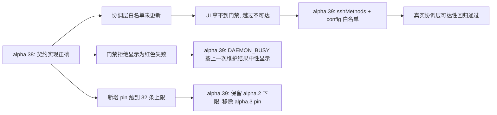

# alpha.39 本地候选交付：修复契约可达性、门禁类结果中性显示、兼容 pin 调整

日期：2026-10-21。本轮把三项修正整合进 `0.6.0-alpha.39` 并构建 Windows x64 便携 EXE。产物留在本地，**未创建/推送提交、标签或 GitHub 发布**；公开基线仍是 alpha.36（标签 `1fef25f`），其 EXE、标签与附件未改动。

## 1. 为什么需要这一轮

[alpha.38](alpha38-delivery.md) 交付了用户已批准的契约变更（显式确认后越过未确认收据）。独立验证在构建产物上发现**阻断性反例**：契约在 worker 与 SSH 层实现正确，但**协调层两处白名单没有随契约更新**，导致打包后的界面拿不到前置门禁、也无法执行越过——即“已批准的契约在产物中不可达”。同时，现场反馈暴露了一个观感缺陷：门禁在停机前的只读拒绝被显示成红色失败，容易被误读为“当前又失败了一次”。此外，新增的 alpha.38 兼容 pin 使 pin 总数触到包校验的硬上限（32），必须做一次取舍。

## 2. 三项修正

### 2.1 契约可达性（`desktop/electron/coordinator-service.cjs`）

协调层是桌面请求的必经入口（`main.cjs bridge:call` → `CoordinatorClient` → `coordinator.cjs` → `coordinator-service.cjs call()`），未登记的方法会在触达 `ssh-host.cjs` 之前被拒绝。

| 位置 | 修正 |
| --- | --- |
| `sshMethods` 白名单 | 加入 `machine.maintenanceBlockers`、`machine.queryBlockedOperation` |
| `machine.maintainDaemon` 的 config 白名单 | 加入 `allowUnresolved` |

修正后，两个只读 RPC 与显式确认标记都能到达 `ssh-host.cjs`；未登记方法仍以 `DESKTOP_ERROR` 拒绝，未登记 config 键仍以 `INVALID_INPUT` 拒绝，且协调层**不做布尔归一化**（`allowUnresolved:'yes'` 原样透传，由 `ssh-host.cjs` 严格按 `===true` 判定），避免“顺手转真”把用户未确认的操作放行。

新增回归 [maintenance-access.test.cjs](../../../desktop/tests/maintenance-access.test.cjs)（4 项，走**真实** `createCoordinatorService`，只桩 SSH 传输与本地网络）。此前两类用例都盖不到这一层：worker/SSH 用例直接调用管理对象，界面用例桩掉 `window.agentbridge.call`。

### 2.2 门禁类结果按“上一次维护留下的结果”中性显示（`desktop/src/DaemonDialog.tsx`）

历史上维护被**门禁拒绝**（`error.code='DAEMON_BUSY'`）时，判定发生在**停止后台之前**：后台没有被停止、版本没有变化、没有回滚。因此它在界面上不再是红色告警，而是中性结果，并附说明“远端门禁在停止后台之前就拒绝了这次维护，后台没有被停止、版本也没有变化，不代表现在又失败了”。

判定规则：

| 历史终态 | 判据 | 呈现 |
| --- | --- | --- |
| `rejected` + `DAEMON_BUSY` | 停机前只读拒绝 | 中性（`role=status`），保留门禁原话 |
| `rejected` + 实际版本==本程序版本 | 无升级目标 | 中性（`role=status`），说明无需升级 |
| `rejected` + 其他错误码（如 `DAEMON_STOP_TIMEOUT`、健康检查失败、所有权不匹配） | 真正停过机/校验失败 | 红色（`role=alert`） |

实时“维护前置门禁”区块与越过勾选逻辑不受影响，仍只由实时只读阻塞项驱动。界面用例从 5 项增至 6 项，新增“真实切换失败仍为红色告警”的反向断言。

### 2.3 兼容 pin 取舍（`desktop/compatible-daemons/`）

包校验对 `compatibleDaemons` 有硬上限 32 条（[ssh-install.cjs](../../../desktop/electron/ssh-install.cjs)）。alpha.37 时恰好 32 条，加入 alpha.38 后为 33 条，必须移除一条：

- 新增：`0.6.0-alpha.38.json`（manifestDigest `451aba34ce0f55066953a897043dfb78c4c459e27986039148c1035a13a0e58e`）。它必须存在，否则本客户端无法维护**已在 alpha.38 上**的机器。
- 移除：`0.6.0-alpha.3.json`（原件保存在 `artifacts/alpha39/pruned/`）。
- **影响如实说明**：仍停留在 `0.6.0-alpha.3` 的后台不再列入本客户端已验证的兼容范围，维护会以 `SSH_DAEMON_UPGRADE_REQUIRED` 明确拒绝并保留原后台（不静默降级、不破坏远端），需用对应客户端处理。选择 alpha.3 而非更旧的 alpha.2，是因为 alpha.2 是既有兼容下限，且现网仍有 alpha.2 机器在运行。

## 3. 验收证据（Lead 亲跑，原始输出见 [REPORT.md](../../../artifacts/alpha39/lead-verify/REPORT.md)）

| 检查 | 结果 |
| --- | --- |
| 产物 | `AgentBridge-0.6.0-alpha.39-Windows-x64.exe`，130042811 字节，SHA-256 `bde7bc782afcf5bb46ce8f4fad32af05924484aaa01a7ecd56b9b88fdd788e92` |
| 包校验 | `artifacts/package-check/0.6.0-alpha.39/package.json` status `passed`，48 CJS / 81 core / linuxFiles 1460 / linuxManifestDigest `1002e424961861bf824126e44e031ee5bcf02418161e4904406a1c0536f52d9d` |
| 解包一致性 | EXE 载荷 `app.asar` 与 `win-unpacked` 逐字节相同；包内版本 `0.6.0-alpha.39`；`coordinator-service.cjs`/`remote-maintenance.cjs`/`ssh-host.cjs`/`ssh-install.cjs` 的 blob 与工作区一致；渲染层含新判据文案 |
| linux-package | 1460 文件 `sha256sum -c` 全通过（0 FAILED）；32 条 pin 的 digest 与各自清单重算值 0 处不符 |
| pin 行为 | `release('0.6.0-alpha.3')` → `SSH_DAEMON_UPGRADE_REQUIRED`；`release('0.6.0-alpha.38')`、`release('0.6.0-alpha.2')` 正常 |
| 契约可达性 | 真实协调层：两个新 RPC 与 `allowUnresolved:true` 各触达 ssh-host 1 次；未登记键 `INVALID_INPUT`（0 次触达）、未登记方法 `DESKTOP_ERROR`（0 次触达）；非布尔原样透传 |
| 工程回归 | `npx tsc --noEmit` exit 0；`npx vite build` 成功；`node --test --test-concurrency=1 tests/*.test.cjs` **693/693/0**；界面用例 6 checks 与 3 checks 全通过（chromium 156.0.8078.4，`pageErrors=[]`） |
| 既有产物 | alpha.36 `43e09dd3…`、alpha.37 `76e30b1e…`、alpha.38 `296260f2…` 未改动 |

## 4. 与 alpha.38 的关系

alpha.38 记录的契约语义、worker/SSH 实现与证据**未被推翻**，仍然有效；本轮修正的是它**在打包产物中的可达性与呈现方式**。alpha.38 的 EXE 保持原样留在 `desktop/release/`，不覆盖、不删除，便于对比与追溯。

## 5. 未测边界

- 未在 **Windows 真机**运行该 EXE（便携解包、SmartScreen、窗口内实际点击均未验证），未签名。
- 未对**真实远端**做端到端维护；真实机器上的带外切换是上一轮 alpha.37 的一次性作业，**不是通过产品界面完成**，不计入本轮验证。
- `windows-*.cjs` Edge 套件未执行（本机无 msedge）。
- 未验证“超过 32 条 pin”的包行为；alpha.3 机器的真实升级路径只有 `SshInstaller.release()` 层的错误码证据。
- 本轮原计划的两名独立验证者均在产出前失败，因此**没有**第二方独立报告：上述证据全部来自 Lead 亲跑，测试文件与改动文件同源这一风险未由外部复核消除。
- 完整 I06C/I07C 准出结论不变；本轮不改变公开基线。
