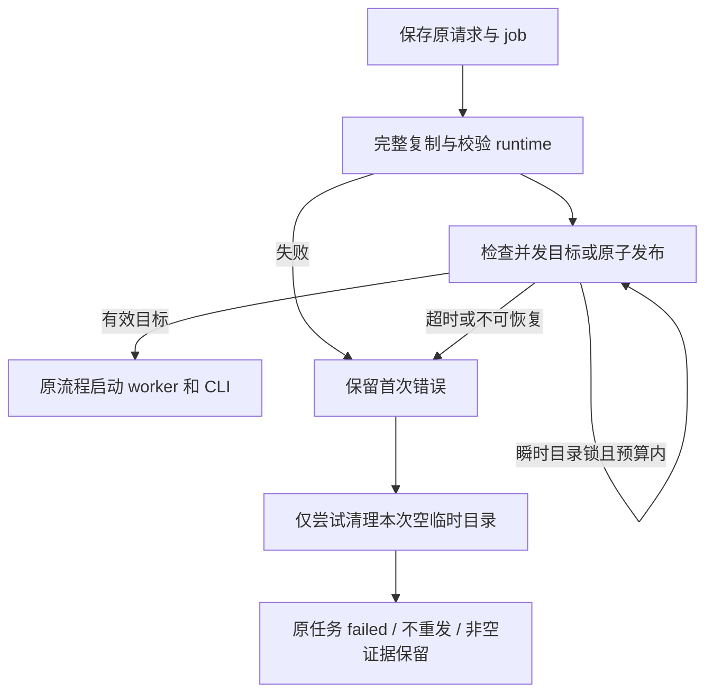

# I08 issue #30：Windows Codex 运行时发布恢复

2026-11-07。需求：[issue #30](https://github.com/wsjq5477/MA-Relay/issues/30)，AB-F07、M06-F01、M06-CX-F01。开发基线为公开 alpha.73 后的 e9557b7；本次为源码修复，不重建、不替换公开 EXE 或 daemon 兼容清单。

## 问题与修复

Windows 原生 CLI 启动前需要准备持久 Electron 资源。原默认路径发布重命名失败时只作一次有限旁路，随后的递归清理又可能抛 ENOTEMPTY，覆盖首次错误，原 Task 因而明确 failed。issue 中现场首次错误已丢失；扫描器、索引器或并发发布属于可能原因，受控注入不能证明现场锁的来源。

修改 [worker-runtime.cjs](../../../desktop/electron/worker-runtime.cjs)：

- 完整复制、写入清单并验证资源后才发布，原有 SHA-256、旧清单兼容和损坏缓存保护保持。
- 所有调用方默认使用统一发布函数，EACCES、EBUSY、EEXIST、ENOTEMPTY、EPERM 在单调时钟 5 秒预算内以 25ms 起、最大 250ms 间隔退避；不依赖可选恢复模式。
- 每轮重新检查目标，只有完整有效的并发目标可复用。已有无效目录不被替换或删除，使用独立 repair 目录；重命名耗尽或不可恢复时保留第一次错误对象。
- 清理仅尝试非递归删除本次空临时目录，锁重试最多 200ms；所有清理异常被吸收。非空临时目录保留诊断证据，不回收其他发布者或旧残留目录。
- 不修改 CodexHost。准备失败仍保存原 Task 的 failed、原错误与 accepted→failed 事件；原请求及宿主重开只读原结果，不能因此重发。用户明确的新请求才准备新运行时。



没有改变 Task、Conversation、pending、收据、协议或数据模型格式；未迁移历史或原生 Session，未更改账号、模型、MCP、权限及 Codex 原生命令。架构、数据模型和协议文档的既有契约仍适用。

## 实际验证

环境：Windows 11 Pro Insider Preview 10.0.26220、x64、Node 24.12.0、Electron 44.7.0。源码、依赖、临时目录、构建、日志和测试配置均在 D 盘。所有任务为合成隔离上下文，模型请求 0，不读写真实 profile。

| 检查 | 实际结果 | 原始证据 |
| --- | --- | --- |
| 未修复 e9557b7 + 两个新增回归 | 12 项中 10 通过、2 失败；两次锁中止发布，ENOTEMPTY 覆盖 EIO | [修复前](../../../artifacts/issue30/2026-11-07/runtime-before.txt) |
| runtime、CodexHost、ClaudeHost、NativeCliHost、原核对 | 86/86；其中 runtime 16、CodexHost 6，不重复累加 | [原生回归](../../../artifacts/issue30/2026-11-07/native-regression.txt) |
| 原请求恢复、MachineHost 路由、适配契约 | 另组 21/21 | [路由回归](../../../artifacts/issue30/2026-11-07/routing-regression.txt) |
| MCP 协议 | 独立 2/2 | [协议回归](../../../artifacts/issue30/2026-11-07/mcp-protocol.txt) |
| 实际 Electron/ICU | 两次受控锁后第三次发布，发布阶段约 87ms；持久副本实际执行、复用、损坏缓存的独立 repair 执行三组通过，隔离目录正常清理 | [实机报告](../../../artifacts/issue30/2026-11-07/windows-electron.json) |
| 根类型检查、lint、根构建、桌面 TypeScript/Vite 构建 | 四项通过；Vite 既有大 chunk 提示保留 | [类型](../../../artifacts/issue30/2026-11-07/typecheck.txt)、[lint](../../../artifacts/issue30/2026-11-07/lint.txt)、[根构建](../../../artifacts/issue30/2026-11-07/build.txt)、[桌面构建](../../../artifacts/issue30/2026-11-07/desktop-build.txt) |
| 干净 e9557b7 补丁重放 | `git apply --check`、实际应用与 diff 空白检查通过；重放后 runtime/CodexHost 22/22，属于上述回归的重复验证 | [重放日志](../../../artifacts/issue30/2026-11-07/patch-replay.txt)、[源码摘要与 marker 检查](../../../artifacts/issue30/2026-11-07/patch-check.json) |
| 文档检查 | 基线与当前均为 3062 项历史资料缺链；错误集合新增 0、移除 0，不计整体通过 | [错误差异](../../../artifacts/issue30/2026-11-07/docs-delta.json) |

覆盖五种瞬时错误、连续锁、单调 5 秒耗尽保留首错、并发完整目标、损坏目标与 repair、复制及校验失败不得发布、非空目录/其他发布者证据保留。Codex 准备失败时只有 job.json，没有 worker.log、heartbeat、events 或原生 Session；同 requestId 和重开不重发，明确新请求成功后旧失败记录仍保持。

复现命令（先把 TEMP/TMP 和工具缓存设到非 C 盘）：

```powershell
node --test desktop/tests/worker-runtime.test.cjs desktop/tests/codex-host.test.cjs desktop/tests/claude-host.test.cjs desktop/tests/native-cli-host.test.cjs desktop/tests/native-reconcile.test.cjs
node --test desktop/tests/codex-recovery.test.cjs desktop/tests/machine-host-routing.test.cjs desktop/tests/agent-adapter-contract.test.cjs
node --test desktop/tests/mcp-client-protocol.test.cjs
node desktop/tests/windows-worker-runtime-publish.cjs artifacts/issue30/2026-11-07/windows-electron.json
npm run typecheck
npm run lint
npm run build
npm run build --prefix desktop
node scripts/check-docs.mjs
```

## 验收边界

Windows 上的受控目录锁、首错保留、原请求/Session/历史保护及实际 Electron/ICU 已验证。不是现场特定扫描器的再现，也不代表永久 ACL、磁盘满或源资源损坏已得到自动恢复。

当前上游 e9557b7 不含 `desktop/tests/codeagent/`、`retry-v1` 或 CodeAgent 的 marker/isolation/seam checker；本机未找到 issue 所述参考工作区。因此该外部分支的 runtime 3 项、完整专项 17 项及专用 patch checker 未运行，不能引用 issue 作者的参考结果作为本次通过。本修复不新增或猜测该分支的模式参数；上游默认发布始终使用重试，未来集成时可保留其空残留回收作为独立可选行为。

未构建新 EXE，未验证用户真实 Codex CLI/模型/登录/工具调用、Windows 10.0.26200 + Node 22.16.0 的原现场组合及真实安全软件持锁。未修改真实用户 profile 或重发已失败任务；修复版本就绪后仍需用户明确发起新请求。
