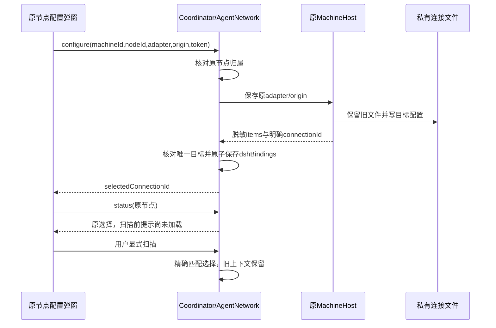

# I08：DSH连接身份与节点管理作用域修复

## 需求与基线

2026-10-23，修复 [issue #15](https://github.com/wsjq5477/MA-Relay/issues/15) 与 [issue #16](https://github.com/wsjq5477/MA-Relay/issues/16)。独立修复分支以公开 alpha.46 文档提交 `1a7dc9f` 为基线；当前工作区另有 alpha.50/51 原生MCP和WSL/图修复，集成时保留89个既有变更文件，16个本次源码/测试文件逐项验证基线后复制，未改工作区版本或日常后台。

未修复基线：生产中央的同机独立接入用例因 GRAPH_UNCONFIRMED 失败；Windows生产前端观察 independentAttachEnabled、savedAddressRetained、reopenRetainsBinding 三项均为 false。修复后三项均 true。

## 实现与失败边界

DSH保存原 machineId/nodeId/adapter，在原MachineHost写私有配置后，以原adapter+用户显式origin核对唯一返回项，校验摘要身份并原子保存节点选择。身份由配置文件名主体给出；旧远端只兼容精确executable。状态区分 unconfigured/loaded/reload_required/unmatched/missing/corrupt，只有从未配置才使用3080默认值。刷新和关闭重开在扫描前保留新B并提示尚未加载；显式扫描按B匹配，不按adapter、顺序、时间戳或随机记录回退A。加载B后保持未接入，用户显式接入才启用；不把旧Session迁移到B。

私有文件写入与中央选择写入是两个边界。后者失败返回 DSH_BINDING_PERSIST，旧选择保留，界面不报完整成功且不自动补发保存。错源/非唯一/摘要不符返回 DSH_BINDING_MISMATCH。token只在保存提交，状态/台账/日志不回显；刷新、保存和切换目标清空密码框，过期异步结果不覆盖新目标。原A文件、其他入口与原任务/上下文不删除。

node/node管理写入由GraphOperationJournal调用中央可信managementBlocks，共用原节点/同安装/共享目录判断。前端managementRowBlocks消费中央blockedNodeIds，概览、关系图、run都带目标nodeId。只有完整来源且明确独立才放行；原节点、同adapter/executable、Windows/WSL共享目录仍锁定。机器管理、relation、缺原machine/node和旧投影保持保守。终态证据、原操作参数/时间/错误和台账格式不变。

独立B保存仅恢复与B冲突的行；新增B本地意图不触发A的附加查询，常规定时只读轮询保留。B拥有一个新管理ID、一次manageNode，原A不删除、不换ID、不重派、不重解释为失败。hello新增scoped-node-management-v1，旧中央需通过“停止后台并退出”显式重开；不自动部署SSH或修改daemon协议/恢复能力。

源码：[DSH文件](../../../desktop/electron/dsh-connection.cjs)、[节点选择/可信资源](../../../desktop/electron/agent-network.cjs)、[中央台账](../../../desktop/electron/graph-operations.cjs)、[状态选择](../../../desktop/src/dsh-settings-state.ts)、[配置表单](../../../desktop/src/DshSettings.tsx)、[前端管理状态](../../../desktop/src/management-state.ts)、[门禁判定](../../../desktop/src/management-recovery.ts)。

## 分层验证

| 层级 | 实际结果与原始证据 |
| --- | --- |
| 未修复反例 | [中央失败](../../../artifacts/connection-recovery/2026-10-23/baseline-node-admission.tap)；[Windows三项false](../../../artifacts/connection-recovery/2026-10-23/baseline-ui/report.json) |
| 隔离修复分支 | WSL Node22.23.1，桌面777/777；[完整结果](../../../artifacts/connection-recovery/2026-10-23/desktop-full.json)。首次773/775中2项读取遗留旧Core产物，重建后专项5/5及本轮全量全部通过，失败日志保留 |
| Windows生产前端 | 受控IPC 10组，页面异常0、模型0；[报告](../../../artifacts/connection-recovery/2026-10-23/ui-third/report.json)。保存/刷新/重开/扫描/多入口、缺失/损坏/失败、概览与图、独立管理和保守保护 |
| 当前集成工作区 | 桌面817/817、核心68/68、构建/lint/类型检查通过；[集成桌面](../../../artifacts/connection-recovery/2026-10-23/desktop-integrated.json)、[集成Windows前端10组](../../../artifacts/connection-recovery/2026-10-23/ui-integrated/report.json)。未把其他工作区增量当成本次孤立修复 |

新增状态/SSR回归、生产Coordinator测试和真实临时DSH文件测试覆盖原始失败与9组冲突反例。所有原生连接均为受控投影/临时目录；未调用真实DSH认证或OpenDesk网关、未发送模型需求、未写用户原生配置、未部署SSH、未切换日常后台。原unknown保持，不因一次接入成功宣称旧任务成功。完整I06C/I07C/MCP02及既有图/WSL指标不由本轮测试准出。

## 候选交付

本地候选采用当前工作区源码冻结快照，版本单独标记0.6.0-alpha.51.recovery.1，不覆盖既有alpha.50/51文件或修改工作区版本。该候选包含既有未提交增量，不能等同于仅含本次修复的公开基线PR。候选 EXE 130198720 字节，SHA-256 `185890a081645354e813043d4e8d058cd5c46ea80bdc0a0789d72765744d4bed`。包核验53后台模块、84Core文件、1701Linux资源，Windows/Linux后台、Core、ASAR、生产前端与bootstrap均与冻结源码一致；[包核验](../../../artifacts/connection-recovery/2026-10-23/candidate/package.json)、[源码清单](../../../artifacts/connection-recovery/2026-10-23/candidate/source-manifest.json)。快照中仅候选package/package-lock版本改为recovery.1，后续补测试脚本和文档未修改产品代码。普通EXE结果另行补充。当前公开版仍alpha.46，本次未公开发布。
