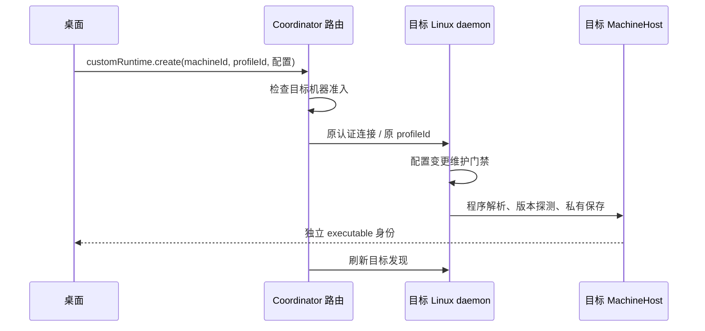

# I08 远端自定义运行时与图标选择

2026-11-07，未发布 alpha.72 工作树；不改变公开 EXE 与发布基线。关联 AB-F04/F07、M01、M03、M05。

## 需求与实现

用户要求远端 Linux 可创建自定义运行时，并参考所提供的 Multica 图片将下拉菜单改成图标选择。

目标机器的「添加 Agent」统一显示创建入口。第一步点击 Hermes 图标进入配置，支持键盘；第二步填写名称、命令和可选描述，返回保留内容。沿用现有品牌图标、共享弹窗和浅深主题变量，窄屏单列。当前自定义宿主只支持 Hermes，不因参考图展示其他品牌而开放未经适配的协议。

配置只在目标机器持有；远端 Linux 路径不经 Windows 解析。原稳定 profileId、冲突拒绝、独立安装身份、授权和原任务恢复不变。旧 daemon 未开放方法时提示维护升级，不自动升级或改用本机。架构、协议与数据文档已同步目标归属和 daemon 方法范围。

## 本次验证

环境：Windows、Node 24.12.0；浏览器使用已有 Chrome Headless Shell。临时与测试数据均放 D 盘，模型调用为零。

| 场景 | 实际结果与证据 |
| --- | --- |
| TypeScript / Vite 生产构建 | 通过；[构建日志](../../../artifacts/custom-runtime/2026-11-07/build.log) |
| 机器路由 | 19/19；含 SSH 目标配置原样路由、发现刷新、本机零创建、准入拒绝和旧后台提示。[输出](../../../artifacts/custom-runtime/2026-11-07/router.tap) |
| 宿主与帧专项 | 3 通过、1 平台跳过；受控 Hermes 原生协议与固定 argv、帧解码；Linux daemon 创建/维护用例已写入但 Windows 跳过。[输出](../../../artifacts/custom-runtime/2026-11-07/runtime-tests.tap) |
| 生产界面 + 受控后台 | 1440/1024/390 三宽度通过：SSH Linux 创建入口、无下拉框、图标键盘选择、失败、返回保留输入、重新提交和目标候选更新。[脚本](../../../artifacts/custom-runtime/2026-11-07/browser-check.cjs)、[输出](../../../artifacts/custom-runtime/2026-11-07/browser-check.log)、[图标选择](../../../artifacts/custom-runtime/2026-11-07/types-1440.png)、[窄屏表单](../../../artifacts/custom-runtime/2026-11-07/dialog-390.png) |
| Impeccable | 弹窗检测无发现。[输出](../../../artifacts/custom-runtime/2026-11-07/impeccable.json) |

首次浏览器检查失败：模拟新增节点错误继承本机 machineId，导致远端候选列表断言找不到节点；修正夹具为请求的目标机器后通过。保留[原始失败](../../../artifacts/custom-runtime/2026-11-07/browser-first-failure.log)，不计为产品链路失败或真实远端通过。

未验证：独立 Linux daemon 实际运行、生产 SSH、真实自定义命令和模型、发布 EXE。浏览器的远端行为为受控数据，不证明真实 SSH 端到端。Linux 平台用例见 [daemon 测试](../../../desktop/tests/machine-daemon.test.cjs)，路由用例见 [机器路由测试](../../../desktop/tests/machine-router.test.cjs)。

文档检查输出见[本轮日志](../../../artifacts/custom-runtime/2026-11-07/docs-check.log)；仍报告 2243 项既有错误，本轮新增记录及链接无报错，不宣称工程全绿。
