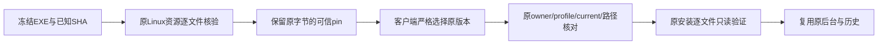

# 可信旧 daemon 清单补齐与校验错误分类

日期：2026-10-23（Asia/Shanghai）。关联I06-SSH-01/I06-NET-02、AB-F05/F06/F11/F17、M04-F04/F05/F06、M05-F01/F02、M10-F03/F06。公开仍alpha.53，上一已交付本地候选alpha.54；本轮源码候选alpha.55，不发布、不切换日常后台、不部署SSH，模型0。完整目标按[台账](completion-audit.md)推进。

后续收尾发现：本片37项目录生成的完整维护输入超过旧CLI 8MiB，alpha.55的只读复用通过不等同升级/卸载准出；当前交付转向[alpha.56维护输入修复](maintenance-input-capacity.md)，原55字节与证据保留。

## 需求与缺口

[alpha.54包审计](../../../artifacts/graph-measurements/2026-10-23/compatibility-audit.json)确认可信索引未收录公开alpha.53。源码实际共有32份旧清单，止于alpha.38，加载器上限也固定32；只增加新清单会导致整个离线包被拒绝。新增33项的受控原后台复用用例先在旧实现失败，原其余16项通过，[红灯证据](../../../artifacts/daemon-compatibility/2026-10-23/contract-before.tap)。

目标是让新客户端依据实际冻结文件验证已安装旧版本，保留原后台和记录；不能因协议同为2而信任未知版本，不能借此自动升级、覆盖远端、换owner/profile或结算unknown。

## 实现

[导入工具](../../../desktop/scripts/import-daemon-manifest.cjs)先把输入EXE复制到私有临时目录，校验调用方给定的冻结SHA-256，再只解包NSIS中的app-64.7z与Linux资源。导入过程不执行EXE；拒绝不安全成员和链接，使用生产localManifest逐文件核对原大小/摘要及清单结构。原manifest.json字节直接作为pin保存；同名相同文件幂等，内容不同拒绝覆盖。文件SHA与`sha256(JSON.stringify(manifest))`的规范manifestDigest分开记录。

[ssh-install.cjs](../../../desktop/electron/ssh-install.cjs)统一导出有界上限128与清单校验；[stage-linux-package.cjs](../../../desktop/scripts/stage-linux-package.cjs)沿用同一校验，并在暂存/编译前拒绝超过上限。33与128项通过，129项拒绝；未知版本、重复版本、路径、digest、原归属与别名校验保持。可选compatibleDaemons字段及协议2不变；旧客户端仍可能受其32项解析边界限制，不宣称其能读取新37项包。复用的是原旧清单和原服务，不要求旧daemon读取新客户端的索引。



### 实际导入

原32份文件与HEAD逐字节保持，新增5份；[原清单保留与文件SHA证明](../../../artifacts/daemon-compatibility/2026-10-23/pin-provenance.json)。新增5份，索引共37；公开来源的冻结信息见[发布登记](../release-ledger.md)，alpha.54为已交付的本地候选。

| 原版本 | 完整EXE SHA-256 | 原Linux文件数 | 导入与逐文件校验 |
| --- | --- | --- | --- |
| alpha.46 | 57f1af73f761af72d75121284b023a001dad05eb30c0c197e18851cc9a7e8c48 | 1698 | [报告](../../../artifacts/daemon-compatibility/2026-10-23/import-0.6.0-alpha.46.json) |
| alpha.51.recovery.2 | db079cb622d4fea75607758cb7e94a6f151683fb81c8f29b88b5f382f65152cd | 1701 | [报告](../../../artifacts/daemon-compatibility/2026-10-23/import-0.6.0-alpha.51.recovery.2.json) |
| alpha.52 | 46f30764b7dc769b6af3497dd71fc32b35ecbc5f0184b4e3778641af7896f28d | 1702 | [报告](../../../artifacts/daemon-compatibility/2026-10-23/import-0.6.0-alpha.52.json) |
| alpha.53 | 3f82bbc3c03ce52c348315f325fe5838de73daadfc1a6658a0170d58d8d3f4a3 | 1702 | [报告](../../../artifacts/daemon-compatibility/2026-10-23/import-0.6.0-alpha.53.json) |
| alpha.54（本地） | 101653460b158886ab3b1b711ae1d5112b53bd437a531959e4927b8a94c5ead1 | 1702 | [报告](../../../artifacts/daemon-compatibility/2026-10-23/import-0.6.0-alpha.54.json) |

## 真实文件负例发现的缺陷

隔离目录使用真实冻结alpha.53的1702文件及其原Linux Node，通过生产SshInstaller/verifyScript核验；probe与SFTP传输层受控，不是实际SSH网络。正向完整核验和原元数据保持已通过，但将一个夹具后台文件改坏后，Node未捕获异常回显了嵌有大清单的整行源码，触发64KiB stderr上限；收到SSH_BOOTSTRAP_OUTPUT而非SSH_PACKAGE_CHECKSUM。[首次真实文件负例](../../../artifacts/daemon-compatibility/2026-10-23/frozen53-readonly-first.json)。

新大清单回归在旧实现失败，[红灯TAP](../../../artifacts/daemon-compatibility/2026-10-23/checksum-before.tap)。校验脚本现在捕获同一文件/类型/UID/大小/SHA失败，仅输出固定八字节CHECKSUM并以3退出，使remoteExec按既有调用点返回SSH_PACKAGE_CHECKSUM。没有增大输出上限、回显路径/清单或改变原收据结算规则；成功仍返回verified:true。

[实际冻结文件复验](../../../artifacts/daemon-compatibility/2026-10-23/frozen53-readonly-final.json)3组通过：真实Node核验全部原文件；改坏一个文件被准确拒绝；原current/owner及合成unknown收据字节保持，SFTP变更方法0、daemon/模型命令0。夹具准备与故意损坏只发生在临时副本。此证据不含实际远端认证、原生产daemon PID/握手或用户任务，不把本地文件验证当作独立SSH准出。

## 工程与交付

兼容专项23/23、导入/打包前置保护3/3通过。[兼容TAP](../../../artifacts/daemon-compatibility/2026-10-23/contract-final.tap)、[导入保护](../../../artifacts/daemon-compatibility/2026-10-23/import-contract.tap)。初轮lint发现两处既有未用绑定，等价改为省略空闲空间字段和_unused参数后通过；未改previewId内容语义。

初轮候选及855/855发生在真实负例发现之前，其证据保留但不作为最终包：[初轮包核验](../../../artifacts/daemon-compatibility/2026-10-23/package-before-checksum-fix.json)、[初轮全量](../../../artifacts/daemon-compatibility/2026-10-23/desktop.tap)。最终桌面全量**856/856**通过、零跳过，[最终TAP](../../../artifacts/daemon-compatibility/2026-10-23/desktop-final.tap)。类型/生产前端构建和最终修改文件lint通过；Core实现未改，不把历史71/71当成本轮重跑。

最终alpha.55 EXE **130192328字节**、SHA-256 **`b294fe829a8b05dcc8cac6322efdc47d00f4f7f82d4df78a40cedb92d5ca6406`**；54后台/84Core/1707Linux文件及Core/Windows与Linux后台/ASAR/前端/bootstrap一致性通过。原清单37项全部进入文件摘要与索引；Linux manifestDigest `489718bb811abbee6650ae2a97e6df0d5ce5c331a61c8df370f11fdc8fcc6e3f`。[最终包核验](../../../artifacts/daemon-compatibility/2026-10-23/package.json)、[构建日志](../../../artifacts/daemon-compatibility/2026-10-23/package-final-build.log)。Windows包内后端**23/23契约与固定八字节诊断通过**，CJS摘要与最终源码一致，直接使用包内37份原pin，[报告](../../../artifacts/daemon-compatibility/2026-10-23/windows-contract.json)、[TAP](../../../artifacts/daemon-compatibility/2026-10-23/windows-contract.tap)。首轮23项实际通过，但Node24默认spec格式令验收器TAP断言失败；显式指定tap后复验，[首轮格式断言](../../../artifacts/daemon-compatibility/2026-10-23/windows-contract-first.json)保留。普通无调试Windows EXE**4组通过**：实际版本/目录、生产IPC与SQLite公共记录、窗口重开复用原中央和记录、隔离中央完整重启保留原记录且原生执行0。[普通EXE](../../../artifacts/daemon-compatibility/2026-10-23/windows-portable.json)。

[本地EXE](../../../desktop/release/AgentBridge-0.6.0-alpha.55-Windows-x64.exe)、[SHA256SUMS](../../../artifacts/daemon-compatibility/2026-10-23/SHA256SUMS.txt)。下载副本核对结果在实际完成后登记；未签名/未公开/未切换日常后台或部署SSH。切换时先在旧窗口“设置→后台运行→停止后台并退出”，再打开新EXE；普通关闭窗口保留旧后台。

复现导入（不连接网络）：

```text
node desktop/scripts/import-daemon-manifest.cjs FROZEN_EXE EXPECTED_SHA256 EXACT_VERSION CACHED_7ZIP
```

实际文件复用验证：

```text
node desktop/tests/ssh-frozen-package-reuse.cjs CURRENT_LINUX_PACKAGE FROZEN_LINUX_PACKAGE NEW_REPORT_PATH
```

完整I06C/I07C/MCP02、独立SSH/LAN、原生父模型、WSL稳定性、图100ms及CT-08保持原未准出范围；新客户端不会自动升级已有远端或切换日常后台。


## 收尾检查与源边界

最终CJS与新增脚本lint通过；类型与生产前端构建通过。Core未修改，不重跑/扩张历史计数；alpha.54的图尺寸修复继承，图241.069ms、WSL稳定性和其他未准出项不因本次兼容修复改写为通过。[最终lint](../../../artifacts/daemon-compatibility/2026-10-23/lint-final.log)、[构建](../../../artifacts/daemon-compatibility/2026-10-23/build.log)、[源文件冻结清单](../../../artifacts/daemon-compatibility/2026-10-23/source-manifest.json)。本地工作源码冻结不等同公开标签。
