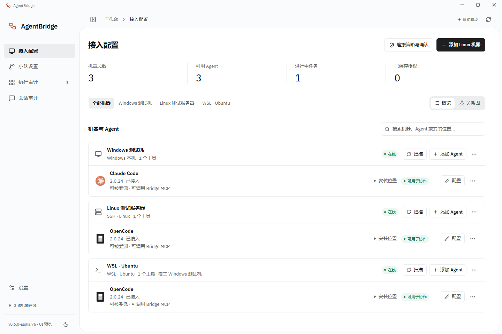
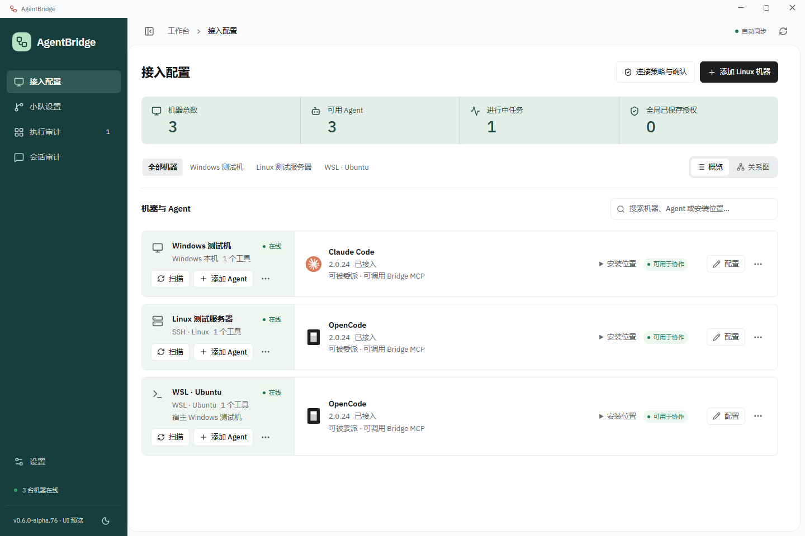
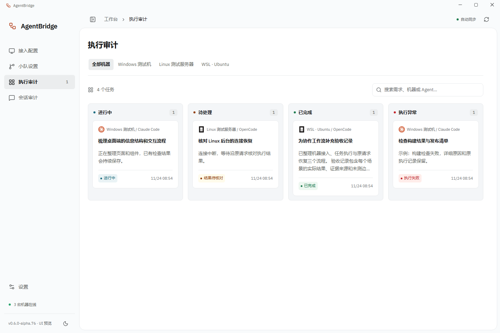
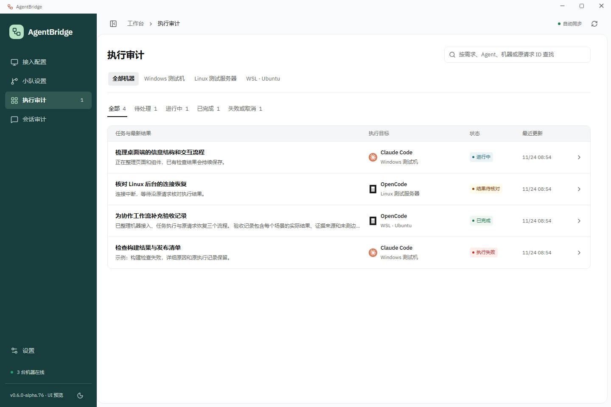

# 接入配置与执行审计更新

2026-11-24 · Windows 开发版 · AB-F01/F09、M01-F01/F04/F14

## 接入配置

接入概况汇总机器、可用 Agent、进行中任务和全局已保存授权。机器管理在左侧，所属 Agent 和自己的配置在右侧。窄窗口中机器信息移到对应 Agent 上方。搜索可匹配机器名称、工具或安装位置，安装路径仍可展开。图、授权、扫描和配置的入口继续服务原有流程。[接入页](../../../desktop/src/NetworkApp.tsx) · [机器与 Agent](../../../desktop/src/MachineInventory.tsx)

| 改前 | 改后 |
| --- | --- |
|  |  |

## 执行审计

记录按最近更新时间倒序排列。每行显示原需求、摘要、执行目标、状态和时间。可先选机器，再按全部、待处理、进行中、已完成或失败与取消筛选。搜索支持需求、机器、Agent 名称和原 ID。打开原记录可查看原请求 ID，显式进入这条原执行的恢复操作。[审计列表](../../../desktop/src/WorkspacePages.tsx) · [原详情](../../../desktop/src/App.tsx) · [用户使用说明](../../user/sessions.md)

| 改前 | 改后 |
| --- | --- |
|  |  |

## 验收

- 前后图取自同一隔离 Coordinator、同一组合成任务和 1440×960 视口。改前使用 `30539ae` 的生产 renderer，改后使用本轮生产 renderer。浏览器为 Chromium 156.0.8078.4。
- 生产前端通过 9 组浏览器检查并输出 22 张图，覆盖明暗主题、1440×960、980×660、各主要页面和关系图。未观察到页面异常、外部请求或横向溢出。可读性抽样均达到 4.5:1。
- 按「待处理」找到结果待核对记录，通过大写原请求 ID 和原任务 ID 分别定位记录。进入原执行恢复后返回只读状态。机器搜索、清空回焦、配置弹窗、侧栏折叠记忆均有浏览器断言。审计夹具模型调用数为 0。
- 桌面组件回归 76/76，TypeScript 检查通过。原始浏览器报告为本机 `artifacts/current-scope-20261122/visual-20261124/workbench-full/report.json`。[浏览器检查脚本](../../../desktop/scripts/check-workbench-design.cjs) · [M01 测试记录](../../modules/01-desktop/test-report.md)
