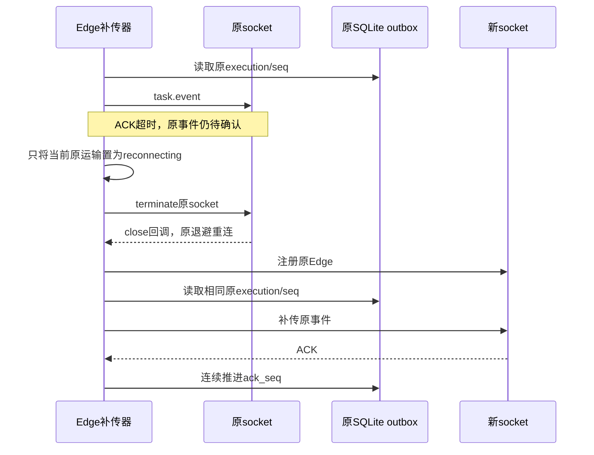

# Edge事件确认超时后的补传恢复

后续本片已随[alpha.69](alpha69-release.md)公开；下文保留原实施时点、失败和证据边界，不将发布包/新复验写成旧轮实测。

关联AB-F11/F15、M09-F05及M07-F06/F07。2026-10-29，master `10fdbb3` 派生未发布工作树；公开alpha.68冻结 `38cd637` 不变。本片由[Core跨平台续办](core-windows-installation-checks.md)的Linux完整运行实际发现，不改原未知请求、模型或原生配置。

## 原失败与需求

补齐Linux快照清单并复制本地Node后，完整运行停在I03b的Hub重启恢复场景。已通过前30项中的B01/B02，之后测试进程持续占用CPU，无法继续重连。只检查本轮准确随机源目录、测试文件和进程出生身份后，对该隔离测试采集2.5秒CPU热点：大量SQLite prepare/outbox、BridgeError与Edge补传栈。见[原运行（调试端点已脱敏）](../../../artifacts/core-windows/2026-10-29/linux-native-spin.tap)、[CPU热点](../../../artifacts/core-windows/2026-10-29/linux-spin-summary.json)、[采样](../../../artifacts/core-windows/2026-10-29/linux-spin.cpuprofile)及[准确停止记录](../../../artifacts/core-windows/2026-10-29/linux-spin-stop.json)。临时Inspector与两个测试进程已关闭，源目录/Home/Node副本已移除；没有检查或停止日常后台。

原补传器在ACK_TIMEOUT/DISCONNECTED后调用异步terminate，却保留ready=true；finally看见未确认事件后立刻再次补传。关闭中的socket同步拒绝发送，Promise微任务持续重建，close回调得不到运行机会，ready不能清除，重连也不能开始。任务事件仍在SQLite，但运输无法恢复。

新增独立子进程回归：受控WebSocket服务器保持第一条连接打开并故意不确认task.event；原实现稳定触发5秒ACK超时后无法建立第二条运输，父进程的有界计时器将其停止。修复前[0/1原日志](../../../artifacts/edge-reconnect/2026-10-29/before.tap)记录registrations=1；这是Windows Node24.12.0上的独立反例，不依赖原Linux自旋进程或Inspector。

## 最终行为

每次补传保存当次socket引用。ACK超时/明确断开后，只有该socket仍为当前运输时才立即loseConnection；只终止该原socket，迟到的旧运输错误不能清空或终止新运输。finally仅在当前连接确为OPEN、已就绪且未停止时继续补传；关闭回调与既有重连退避得到运行机会。

未确认事件不删除、不推进ack_seq；重连继续按原taskId/executionId/seq发送已持久事件。原执行、会话和调用次数不重建，原业务unknown与权限/取消收据语义不变。没有新增轮询、重派Prompt、RPC、状态枚举或生产超时预算。

源码：[edge.ts](../../../src/edge.ts)。回归：[edge-reconnect.test.ts](../../../tests/edge-reconnect.test.ts)及[隔离子进程](../../../tests/edge-timeout-child.ts)。修复后准确两次注册，第一条事件同seq补传一次，后续序列连续且全部确认；第二次运输还收到完全相同的原task.submit信封，最终SQLite仍只有原taskId/executionId、invocations=1、terminal且ack_seq=seq。子进程正常退出，临时状态实际移除。

## 实际验证

| 范围 | 实际结果 | 证据 |
| --- | --- | --- |
| Windows确定性反例 | 原实现0/1，ACK超时后仅1条运输；父计时器正常结束测试 | [原TAP](../../../artifacts/edge-reconnect/2026-10-29/before.tap)，不是模型或真实服务器 |
| Windows新回归/原Hub故障/I03b恢复 | **10/10，失败/取消/跳过0**；含新ACK超时、存储失败、Hub重启、原绑定恢复、旧ACK丢失和单次执行 | [定向TAP](../../../artifacts/edge-reconnect/2026-10-29/targeted.tap)；新回归子进程真实退出0 |
| Core构建、根typecheck与lint | 通过 | [构建](../../../artifacts/edge-reconnect/2026-10-29/build.log)、[类型](../../../artifacts/edge-reconnect/2026-10-29/typecheck.log)、[lint](../../../artifacts/edge-reconnect/2026-10-29/lint.log) |

包含本修复的Windows完整Core已完成：**79项68通过、失败/取消0、11平台跳过**，[原TAP](../../../artifacts/edge-reconnect/2026-10-29/windows-final.tap)与[实际I01摘要](../../../artifacts/edge-reconnect/2026-10-29/windows-acceptance.json)保留。I01为20成功/10失败场景、29项检查、历史丢失0、原提交10次仅1调用及故障重派0；这些是受控功能结果，不是生产模型或性能准出。

Linux包含Edge修复的首轮为**79项76通过、3失败、取消/跳过0**：[原TAP](../../../artifacts/edge-reconnect/2026-10-29/linux-first.tap)。失败分别为v1等待超时和两个预留端口关闭后仍被探测为监听的托管拒绝；后续定向**12项11通过/1失败**，取消收据实际为unknown，[原TAP](../../../artifacts/edge-reconnect/2026-10-29/linux-late-targeted.tap)保留，不能改写成取消成功。

闭端口独立观察12组，每组关闭后立即、100ms、500ms连接；多组立即仍可连接，100ms及500ms均ECONNREFUSED：[脚本](../../../artifacts/edge-reconnect/2026-10-29/closed-port-probe.cjs)、[结果](../../../artifacts/edge-reconnect/2026-10-29/closed-port-probe.json)。验证器改为等待同一个原预留端口实际ECONNREFUSED后才交给生产启动器，不换端口重试、不放宽NATIVE_OWNERSHIP。v1等待只增加失败状态诊断，没有增加生产超时、重发控制或将unknown视为confirmed。

2026-10-29续办核对工作区已冻结到`04ee6fe`（alpha.69候选），上述5个产品文件与首轮并行快照SHA-256一致；Windows原79项之前尚无这次端口辅助函数和v1诊断，不能宣称验证器逐字节相同。冻结后同三文件Windows定向**12项9通过/3明确Linux跳过**：[TAP](../../../artifacts/edge-reconnect/2026-10-29/windows-freeze-targeted.tap)；Linux独立快照定向**12/12、失败/取消/跳过0**：[TAP](../../../artifacts/edge-reconnect/2026-10-29/linux-diagnostic2.tap)、[源码快照](../../../artifacts/edge-reconnect/2026-10-29/linux-diagnostic-snapshot.json)。原v1交互失败尚未稳定定位，单次复查通过不证明消除偶发问题。冻结源码最终79项完整运行完成后另记，不与这些定向结果相加。

冻结源码完整Linux结果为**79项76通过、3失败、取消/跳过0**，耗时502724ms：[最终TAP](../../../artifacts/edge-reconnect/2026-10-29/linux-final.tap)、[最终快照](../../../artifacts/edge-reconnect/2026-10-29/linux-final-snapshot.json)、[I01摘要](../../../artifacts/edge-reconnect/2026-10-29/linux-final-acceptance.json)。I01实际208627ms完成29项检查；失败为v1取消unknown、question等待超时及早期v1协议探测超时。Windows11个平台跳过有10项在本轮Linux全量通过，剩余早期v1在此前12/12定向通过，不能宣称完整矩阵全绿。215份源输入及3份清单共218个摘要与冻结工作区一致；退出码1，独立Home/源目录/Node副本已移除，准确归属剩余夹具1个由运行器停止，[清理记录](../../../artifacts/edge-reconnect/2026-10-29/linux-final-cleanup.json)。

后续只记录请求路径/耗时/错误码与WebSocket关闭码的隔离诊断**9/9**通过，[脚本](../../../artifacts/edge-reconnect/2026-10-29/network-timing.mjs)、[日志](../../../artifacts/edge-reconnect/2026-10-29/linux-transport-diagnostic.tap)保留；多次本机HTTP响应为数百毫秒，不能据此断定所有失败仅属环境。源码核对进一步发现后台健康检查在开始时清空共享protocol，期间v1业务会落入v2默认分支；已在独立工作树`fix/opencode-protocol-refresh`构造五条确定性失败并完成本地提交`7491c47`：原0/5、扩展7/7、Windows定向30通过/2平台跳过与Linux24/24，冻结alpha.69不含该后续修复；新专项不能覆盖本片完整失败。当前[验收摘要](../../../artifacts/edge-reconnect/2026-10-29/acceptance-summary.json)明确ok=false，不将定向重跑覆盖最终失败。

## 合约与同步

架构和协议补充当前运输退役/原事件补传时序；无数据格式变化，data-model的taskId/executionId/seq/ack_seq及所有持久表不变。M09/M07设计与测试报告、整体设计/测试/路线、架构/协议和迭代索引同步。用户无需新操作，原任务/会话说明的原ID查询与不重发规则继续适用，没有新增界面流程。

模型0、未打包发布EXE、未改真实profile/日常后台、未部署SSH。受控事件恢复不等于真实原生父模型、用户现场、独立SSH、冷启动或吞吐性能准出；完整I06C/I07C/MCP02继续未准出。
