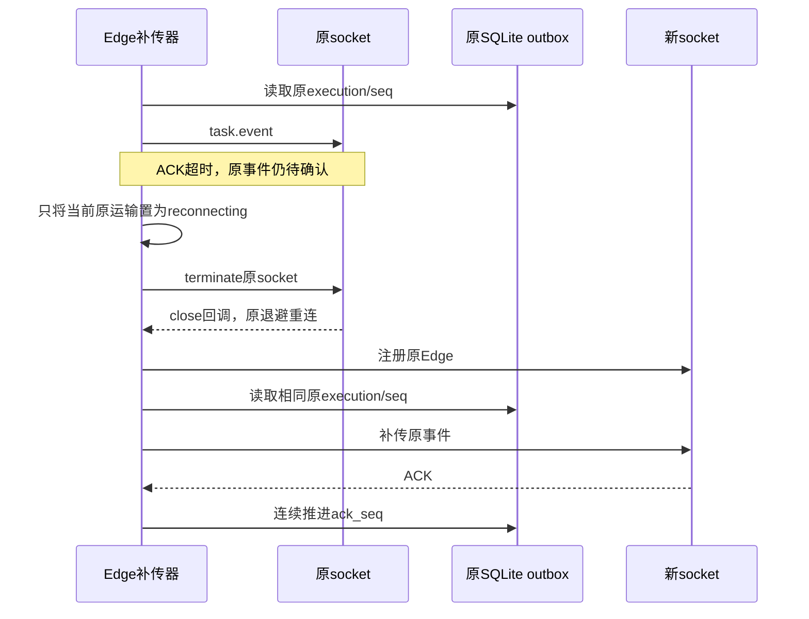

# Edge事件确认超时后的补传恢复

关联AB-F11/F15、M09-F05及M07-F06/F07。2026-10-29，master `10fdbb3` 派生未发布工作树；公开alpha.68冻结 `38cd637` 不变。本片由[Core跨平台续办](core-windows-installation-checks.md)的Linux完整运行实际发现，不改原未知请求、模型或原生配置。

## 原失败与需求

补齐Linux快照清单并复制本地Node后，完整运行停在I03b的Hub重启恢复场景。已通过前30项中的B01/B02，之后测试进程持续占用CPU，无法继续重连。只检查本轮准确随机源目录、测试文件和进程出生身份后，对该隔离测试采集2.5秒CPU热点：大量SQLite prepare/outbox、BridgeError与Edge补传栈。见[原运行（调试端点已脱敏）](../../../artifacts/core-windows/2026-10-29/linux-native-spin.tap)、[CPU热点](../../../artifacts/core-windows/2026-10-29/linux-spin-summary.json)、[采样](../../../artifacts/core-windows/2026-10-29/linux-spin.cpuprofile)及[准确停止记录](../../../artifacts/core-windows/2026-10-29/linux-spin-stop.json)。临时Inspector与两个测试进程已关闭，源目录/Home/Node副本已移除；没有检查或停止日常后台。

原补传器在ACK_TIMEOUT/DISCONNECTED后调用异步terminate，却保留ready=true；finally看见未确认事件后立刻再次补传。关闭中的socket同步拒绝发送，Promise微任务持续重建，close回调得不到运行机会，ready不能清除，重连也不能开始。任务事件仍在SQLite，但运输无法恢复。

新增独立子进程回归：受控WebSocket服务器保持第一条连接打开并故意不确认task.event；原实现稳定触发5秒ACK超时后无法建立第二条运输，父进程的有界计时器将其停止。修复前[0/1原日志](../../../artifacts/edge-reconnect/2026-10-29/before.tap)记录registrations=1；这是Windows Node24.12.0上的独立反例，不依赖原Linux自旋进程或Inspector。

## 最终行为

每次补传保存当次socket引用。ACK超时/明确断开后，只有该socket仍为当前运输时才立即loseConnection；只终止该原socket，迟到的旧运输错误不能清空或终止新运输。finally仅在当前连接确为OPEN、已就绪且未停止时继续补传；关闭回调与既有重连退避得到运行机会。

未确认事件不删除、不推进ack_seq；重连继续按原taskId/executionId/seq发送已持久事件。原执行、会话和调用次数不重建，原业务unknown与权限/取消收据语义不变。没有新增轮询、重派Prompt、RPC、状态枚举或生产超时预算。

源码：[edge.ts](../../../src/edge.ts)。回归：[edge-reconnect.test.ts](../../../tests/edge-reconnect.test.ts)及[隔离子进程](../../../tests/edge-timeout-child.ts)。修复后准确两次注册，第一条事件同seq补传一次，后续序列连续且全部确认；第二次运输还收到完全相同的原task.submit信封，最终SQLite仍只有原taskId/executionId、invocations=1、terminal且ack_seq=seq。子进程正常退出，临时状态实际移除。

## 实际验证

| 范围 | 实际结果 | 证据 |
| --- | --- | --- |
| Windows确定性反例 | 原实现0/1，ACK超时后仅1条运输；父计时器正常结束测试 | [原TAP](../../../artifacts/edge-reconnect/2026-10-29/before.tap)，不是模型或真实服务器 |
| Windows新回归/原Hub故障/I03b恢复 | **10/10，失败/取消/跳过0**；含新ACK超时、存储失败、Hub重启、原绑定恢复、旧ACK丢失和单次执行 | [定向TAP](../../../artifacts/edge-reconnect/2026-10-29/targeted.tap)；新回归子进程真实退出0 |
| Core构建、根typecheck与lint | 通过 | [构建](../../../artifacts/edge-reconnect/2026-10-29/build.log)、[类型](../../../artifacts/edge-reconnect/2026-10-29/typecheck.log)、[lint](../../../artifacts/edge-reconnect/2026-10-29/lint.log) |

包含本修复的Windows/Linux最终完整矩阵正在实际运行，完成后记录；不使用前一片Windows67通过/11跳过代替本修复的全量。

## 合约与同步

架构和协议补充当前运输退役/原事件补传时序；无数据格式变化，data-model的taskId/executionId/seq/ack_seq及所有持久表不变。M09/M07设计与测试报告、整体设计/测试/路线、架构/协议和迭代索引同步。用户无需新操作，原任务/会话说明的原ID查询与不重发规则继续适用，没有新增界面流程。

模型0、未打包发布EXE、未改真实profile/日常后台、未部署SSH。受控事件恢复不等于真实原生父模型、用户现场、独立SSH、冷启动或吞吐性能准出；完整I06C/I07C/MCP02继续未准出。
