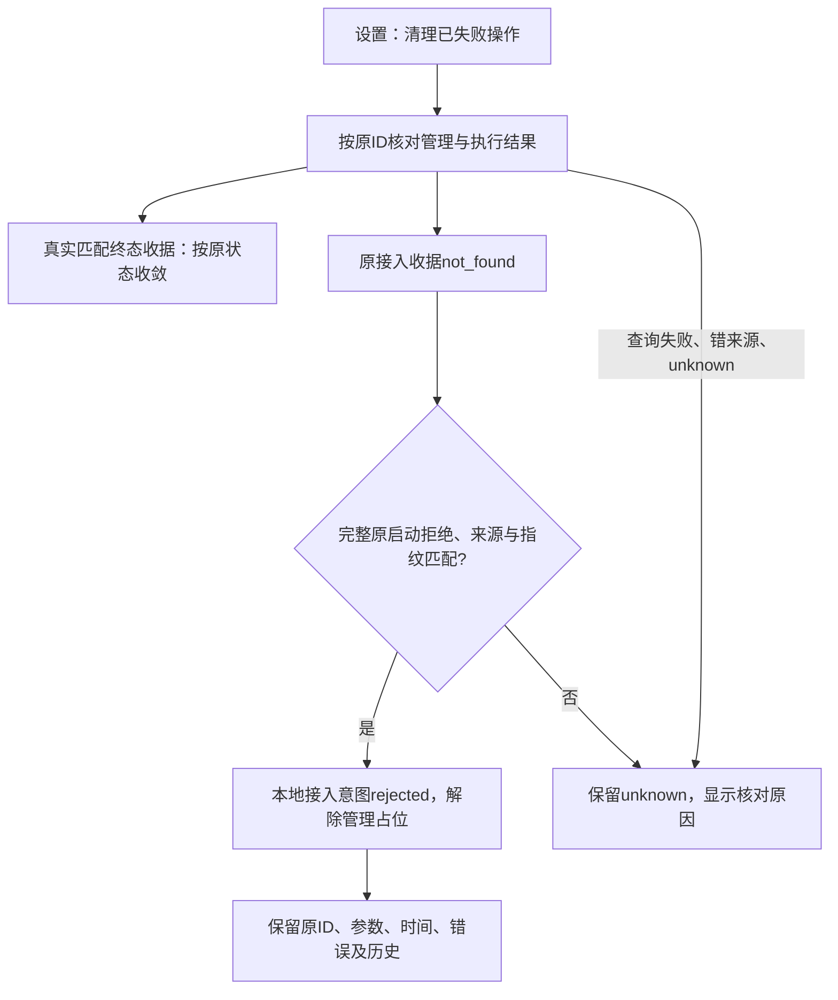

# issue #24：OpenCode 接入与失败操作清理

日期：2026-10-24；基线 d09d07f / 公开0.6.0-alpha.60；本地候选0.6.0-alpha.61。需求：[issue #24](https://github.com/wsjq5477/MA-Relay/issues/24)及用户补充“某个操作失败就卡住，希望能有清理动作”。关联 AB-F01/F02/F07，M01-F02/F04/F07、M03-F02/F04/F05、M06-F01/M06-OC-F01、M07-F01/F06/F07、M10-F01/F02/F03。

## 原因与范围

#24的协议首探缺陷与#21相同，当前基线已有[alpha.53有界协商修复](opencode-bounded-probe.md)：先短探测global/health，完整1.x契约通过后不访问挂起的api/info；2.x继续原元数据校验，监听失败与协议/认证错误分开。本轮复跑当前协议、托管启动、Session/取消/恢复回归，不把旧诊断或合成版本当作现场真实1.2.22验收。

剩余缺口是旧接入失败：当时未持久接入拒绝收据，但中央graph-pending保存了原操作的完整启动超时错误，随后查询一直not_found。原规则只识别精确ADAPTER_HOST/AGENT_UNHEALTHY接入拒绝，因此这条确定在接入提交前失败的管理意图一直占位。新版本原生上下文准备失败已有原子拒绝收据；本轮补历史证明与明确清理入口。

## 完整行为与证明



- 清理按钮复用现有查询入口，覆盖节点、机器、授权、布局及执行请求；核对中禁用，返回已解除失败管理占位、确定管理结果、执行核对和仍待确认数量。未确认/未找到/失败原因继续逐项显示。
- 历史启动拒绝要求 lane=node、method=manageNode、action=attach，原operationId与params一致，machineId/nodeId非空且params摘要匹配；原error.code=NATIVE_START_TIMEOUT，error.message必须与startNativeServer的完整固定原文相同。
- 该异常从startNativeServer抛出，context尚未成功返回，manageNode尚未提交本地接入授权；只证明本地接入失败。原native服务或上下文可能仍存在，不能推定任务完成、取消或原生进程已停止。真实同ID终态收据优先；只有原同IDnot_found配合上述完整原证明才使用历史补偿。
- 新发生的同类明确接入失败直接记录rejected；历史匹配项查询后仅更改state。原错误缺失、泛化timeout、后续查询才返回timeout、错指纹/机器/节点、其他动作/方法、错ID、unknown/pending收据都不清理。
- 不删除失败历史，不替换节点/安装/上下文/Task/Conversation/Session，不写原生配置，不重发Prompt/取消，不改变执行unknown。清理后用户可显式进行下一步；仍有执行占位或其他真实阻塞时继续按原作用域保护。
- 不新增RPC、持久字段或协议版本。架构、数据/协议、M01/M03/M06/OpenCode/M07/M10与用户机器说明同次同步。alpha.60兼容pin来自原冻结Linux manifest，仅用于识别原daemon，不自动部署/升级SSH。

源码：[中央核对](../../../desktop/electron/graph-operations.cjs)、[聚合查询](../../../desktop/src/management-recovery.ts)、[操作及计数](../../../desktop/src/NetworkApp.tsx)、[设置入口](../../../desktop/src/WorkspacePages.tsx)。

## 实际验证

环境：WSL/Linux Node22.23.1；Windows Node24.18.0、Edge155.0.4283.62。受控夹具/隔离profile，模型调用0。

| 检查 | 实际结果 | 原始证据 |
| --- | --- | --- |
| 未修复对照 | 新专项19项中17通过/2失败：旧失败不收敛、新明确启动失败仍unknown | [基线对照](../../../artifacts/issue24/2026-10-24/before-cleanup.tap) |
| 修复后清理专项 | 19/19通过；原ID/时间/错误保持、泛化错误/错来源/错指纹/非终态保留、真实终态优先、重开与再次显式接入 | [直接专项](../../../artifacts/issue24/2026-10-24/cleanup-direct.tap) |
| 生产中央专项 | 原历史接入拒绝收敛，原执行unknown不变，显式再次接入通过，原生执行0 | [最终中央专项](../../../artifacts/issue24/2026-10-24/central-final.tap) |
| 核心全量 | 71/71通过，含早期1.x挂起探针、2.x、启动错误分类、原Session/取消/恢复 | [核心TAP](../../../artifacts/issue24/2026-10-24/core-full.tap) |
| 最终桌面全量 | 921/921通过、零跳过；包含清理19项、中央与SSR用例，首次920/920为此前冻结，不叠加 | [最终桌面TAP](../../../artifacts/issue24/2026-10-24/desktop-final.tap) |
| Windows生产页面 | 4组通过；查询失败清理0、精确失败清理1、保留其他unknown、原节点后续入口可用与重开保持；pageErrors=0 | [报告](../../../artifacts/issue24/2026-10-24/ui-verified/report.json)、[截图](../../../artifacts/issue24/2026-10-24/ui-verified/cleanup.png) |

类型检查（Core与桌面）、lint、Core/生产前端构建及diff检查通过；文档检查0错误、用户站6/6、18页/19HTML构建通过，内部页面/证据导出均0。构建保留既有chunk大小提示。共享计数不跨模块相加。[Core类型](../../../artifacts/issue24/2026-10-24/typecheck.log)、[桌面类型](../../../artifacts/issue24/2026-10-24/desktop-typecheck-final.log)、[lint](../../../artifacts/issue24/2026-10-24/lint.log)、[生产构建](../../../artifacts/issue24/2026-10-24/desktop-build-final.log)、[文档检查](../../../artifacts/issue24/2026-10-24/docs-check.log)、[用户站测试](../../../artifacts/issue24/2026-10-24/docs-test.log)、[站点构建](../../../artifacts/issue24/2026-10-24/docs-build.log)。

首次结果保留：首个受限Node测试仅报告4个文件，不能当内部用例通过；基线首次在Node创建git子进程时EPERM，改为shell先导出基线再载入。中央用例首次漏传params，修正夹具后复验。Windows夹具首次缺布局自动保存入口，补完整布局后发现真实清理统计未返回：实际状态已正确收敛但通知仍为0，现已修正query返回摘要，并以实际点击复验4组通过。[首次相关回归](../../../artifacts/issue24/2026-10-24/targeted-final.tap)、[首次页面](../../../artifacts/issue24/2026-10-24/ui/report.json)、[统计失败](../../../artifacts/issue24/2026-10-24/ui-final/report.json)。首个包在产品修复并行期间捕获到源码变化，严格校验拒绝交付；冻结最终源码后重新构建，[首次包日志](../../../artifacts/issue24/2026-10-24/package-build.log)。

复现：

```bash
export PATH=/home/jiqi/.local/share/fnm/node-versions/v22.23.1/installation/bin:$PATH
npm test
node --test --test-concurrency=1 desktop/tests/*.test.cjs
npm run typecheck
npm run lint
npm run build --prefix desktop
node scripts/check-docs.mjs
npm run docs:test
npm run docs:build
npm run desktop:dist
```

Windows交互脚本：[清理页面](../../../desktop/tests/windows-failed-operation-cleanup-ui.cjs)，参数为输出目录。普通EXE脚本：[原历史与管理恢复](../../../desktop/tests/windows-agent-recovery-portable.cjs)，参数为EXE、报告路径、startup；后者使用普通无调试EXE/生产中央与SQLite/隔离合成历史，不启动真实模型。Core仍可使用[原协议包内专项](../../../desktop/tests/windows-opencode-probe-portable.cjs)。

## 交付与未测边界

本地Windows x64便携EXE **130211264字节**，SHA-256 **`f2ac27eb331b30858de0da0fbf72867adaf42d50574fdff8664b60048fdc4948`**。56后台模块、84Core文件、1714Linux资源、ASAR/前端/bootstrap与源码一致，linuxManifestDigest=`e7407ba587870fc0a8f15b705a49deca004592edfc6ae9fbf5e2cf545594b3dc`。[最终包](../../../artifacts/issue24/2026-10-24/package.json)、[构建日志](../../../artifacts/issue24/2026-10-24/package-final.log)、[175个产品/依赖冻结文件](../../../artifacts/issue24/2026-10-24/source-manifest.json)、[重算核验](../../../artifacts/issue24/2026-10-24/source-verification.json)、[EXE](../../../desktop/release/AgentBridge-0.6.0-alpha.61-Windows-x64.exe)、[SHA256SUMS](../../../artifacts/issue24/2026-10-24/SHA256SUMS.txt)。新增alpha.60原冻结兼容pin后兼容专项26/26通过，[兼容TAP](../../../artifacts/issue24/2026-10-24/compatibility-final.tap)。未签名。

普通Windows EXE包内协议专项6组通过：1.x跳过挂起info（约69ms）、2.x短候选超时后成功、明确协议/认证错误且GET写入0、无完整证明unknown保持和普通窗口重开；[包内协议报告](../../../artifacts/issue24/2026-10-24/portable-probe.json)。这是合成HTTP契约，不冒充真实原生1.2.22。

普通无调试EXE恢复专项7组通过：按原ID结算完整启动拒绝且其原参数/时间/错误/指纹保持，保留另一条泛化timeout unknown、原两轮Task/原生Session与控制记录；生产MCP只读列表/材料精确版本、普通窗口重开及完整中央重启后原记录保持，包内模块摘要匹配。[普通EXE恢复报告](../../../artifacts/issue24/2026-10-24/portable-cleanup.json)。包内查询未产生原生执行，模型0；不等于日常profile现场恢复。

最终EXE及独立命名校验文件已复制到Windows Downloads，完整SHA/字节与仓库产物一致，不覆盖其他版本。[交付副本核验](../../../artifacts/issue24/2026-10-24/download-copy.json)。

本轮本地候选alpha.61，公开alpha.60保持；尚未发布GitHub标签/附件，也未切换日常后台或部署SSH。真实WindowsApps OpenCode1.2.22、模型回复、完整原生Session、日常profile现场清理及独立SSH未测；完整I06C/I07C/MCP02、原生父模型、图100ms与WSL稳定性继续保留原未准出边界。

使用：旧版先执行“设置 → 后台运行 → 停止后台并退出”，再启动新候选；进入“设置 → 未确认操作 → 清理已失败操作”，核对显示的清理数量与保留原因。只有明确失败的占位解除后，才能显式接入或继续下一步；结果仍未知的执行请求不得重复提交。
