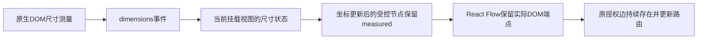

# 图节点尺寸保留与授权边重复重建修复

日期：2026-10-23（Asia/Shanghai）。关联AB-F11、M01-F04/F09、I06图交互指标。当前公开alpha.53；本轮源码候选alpha.54，不移动公开标签、不覆盖旧EXE、不切换日常后台或部署SSH，模型0。

## 需求与原始证据

继续推进[完整准出台账](completion-audit.md)。alpha.53[完整20次PNG帧样本](../I06/alpha53-current-metrics.md)仍未满足100ms，不能凭DOM/RAF或少数样本放行。本轮在同一20机器/60节点/59边、20次鼠标拖动中记录浏览器时间线，并包装原SVG `getBBox`，保持原参数/返回值、记录时间和调用来源。

真实Windows Edge155的冻结alpha.53在20次拖动中测量授权边文字**11,800次**，累计原方法约839.4ms；每个文字仍为“授权已保存”。[原测量](../../../artifacts/i06-current-metrics/2026-10-23/alpha53-traced/text-measurements.json)、[原时间线](../../../artifacts/i06-current-metrics/2026-10-23/alpha53-traced/drag-timeline.json)、[本轮诊断报告](../../../artifacts/i06-current-metrics/2026-10-23/alpha53-traced/metrics.json)。诊断轮缺少完整基线画面，不作图时延通过证据；该累计耗时也不等同单次输入延迟。

## 根因与实现

[AgentGraph.tsx](../../../desktop/src/AgentGraph.tsx)是受控React Flow图，每次坐标/布局变化重建节点对象；旧实现只处理position变化、丢弃dimensions变化，新的节点没有`measured`。项目安装的`@xyflow/system`的`adoptUserNodes/parseHandles`在新节点缺少measured时清空先前DOM端点测量，`getEdgePosition`随即返回空值；所有关联授权边先卸载，待端点重测后再挂载。`@xyflow/react`的`EdgeText`新挂载会重新getBBox。该生产依赖行为与实际11,800次文字测量相符，不将主线程总采样时长简单归因到路由算法。



候选alpha.54接受dimensions事件，按节点ID保留实际width/height；坐标、选择与布局重建时带回measured。相同尺寸不触发多余状态更新，真实尺寸变化仍接收新值。此状态只在当前挂载视图内存在，首次挂载仍测量实际DOM；角色改变的原`useUpdateNodeInternals`路径保留，不能用缓存代替新端点核对。布局pending时也可接收DOM尺寸，不能因此写布局或解锁操作。

没有将测量加入GraphLayout、后台或localStorage，没有更改布局/关系revision、operationId、unknown、Task/Session、机器/节点身份或权限门禁。架构和数据文档同步此界面状态边界；RPC与持久协议无新字段。

## 工作源码验证

alpha.54工作生产前端配冻结alpha.53后台，同样20机器/60节点/59边与20次真实鼠标拖动，授权边文字测量**0次**，原关系不变、任务/请求/委派0，确认重复重建消除。[完整工作报告](../../../artifacts/graph-measurements/2026-10-23/working/metrics.json)、[测量空集](../../../artifacts/graph-measurements/2026-10-23/working/text-measurements.json)。这不是alpha.54最终EXE或完整图指标通过证据。

该轮PNG帧观测p95 **371.745ms**，双RAF上界p95 **117.8ms**，原100ms门槛仍未满足；本地状态同步20次p95 **1501ms**通过，独立LAN未验。重复重建修复不代表PNG反馈、物理屏幕首帧或完整I06C已准出。

## 工程与最终包

桌面全量**844/844**通过，零跳过；生产前端类型检查/Vite构建和初轮脚本lint通过。Core产品代码未变，没有把历史71/71写成本轮重跑。[桌面TAP](../../../artifacts/graph-measurements/2026-10-23/desktop.tap)、[构建](../../../artifacts/graph-measurements/2026-10-23/build-working.log)。

最终EXE为**0.6.0-alpha.54**，130193428字节，SHA-256 **`101653460b158886ab3b1b711ae1d5112b53bd437a531959e4927b8a94c5ead1`**；包内54后台模块、84Core文件、1702Linux资源、ASAR/前端/bootstrap/Core/Windows与Linux后台一致性均通过，Linux清单摘要`9ad57b4eef6330c634e87a0ebd77f777e1389fc685a306d268d53fee4c56e7bd`。[包核验](../../../artifacts/graph-measurements/2026-10-23/package.json)、[最终构建日志](../../../artifacts/graph-measurements/2026-10-23/package-build-final.log)。首次受限进程环境阻止cc编译停止器，未产出完整候选；获准正常子进程环境后构建完成，[初轮限制](../../../artifacts/graph-measurements/2026-10-23/package-build.log)保留。

Windows Edge生产包前端/后台**7组回归通过**：角色与可用端点、同排反向连线避让、五种区域中键平移、窗口重开、布局unknown只查询原操作、切主旧边与放弃草稿，以及同机新增工具后真实组尺寸和新子节点位置。前三台机器交互正确性与随后20/60扩容分别标明，不代替20次时延验收。新增测试最初把排序第二位Codex当作末位而断言y>300失败；改查末位OpenCode并等待原布局落盘，产品未因此再改。[首轮断言失败](../../../artifacts/graph-measurements/2026-10-23/usability/usability.json)、[最终7组](../../../artifacts/graph-measurements/2026-10-23/usability-final/usability.json)。

普通无调试Windows EXE **4组通过**：实际alpha.54版本与Windows目录；生产IPC/SQLite公共成员、小队、文档和消息落盘；普通窗口重开复用原中央及记录；隔离中央完整重启保留原记录且没有原生任务。模型0。[普通EXE原报告](../../../artifacts/graph-measurements/2026-10-23/windows-portable.json)。最终包同一20机器/60节点/59边的20次拖动，文字测量**0次**；原采集报告因第20条未在“第二帧+100ms”的人为尾窗内找到画面而失败，保留[原报告](../../../artifacts/graph-measurements/2026-10-23/final/metrics.json)。采集已在状态同步之前停止，最后一条没有下一次指针输入，因此按最后一张已采集帧为尾界离线复核原201帧和原20条输入；前19条仍严格限于下一次原pointerdown前，没有新输入、补采或删样本。[原帧清单](../../../artifacts/graph-measurements/2026-10-23/final/frames/frames.json)、[独立离线复核](../../../artifacts/graph-measurements/2026-10-23/final/pixel-reanalysis.json)。

复核20条PNG观测p95 **241.069ms**，最大286.734ms，双RAF上界p95 **114ms**，longtask0；原**100ms门槛仍失败**。这是PNG观测链路下结果，不宣称物理屏幕首帧时延，不将修复前后不同采集轮次归纳为严格配对的性能提升。原报告在画面核对阶段失败，最终包本轮20次状态同步未运行，不以工作前端1501ms冒充最终包同步复验。验收器新增3项合成像素契约通过：最后一条晚帧仍保留真实超100ms延迟、不得借用下一条指针后的帧、拒绝缺少swap时间戳或错误方向；合成契约不计为真实画面通过。[契约TAP](../../../artifacts/graph-measurements/2026-10-23/observer-contract.tap)。

本地[EXE](../../../desktop/release/AgentBridge-0.6.0-alpha.54-Windows-x64.exe)与[SHA256SUMS](../../../artifacts/graph-measurements/2026-10-23/SHA256SUMS.txt)已交付到Windows Downloads，同名EXE与.sha256副本完整SHA一致；[复制核验](../../../artifacts/graph-measurements/2026-10-23/download-copy.json)。未签名、未公开、未切换日常后台、未部署SSH。需要切换时先在旧窗口“设置→后台运行→停止后台并退出”，再运行新EXE；普通关窗会保留旧后台。原alpha.53完整失败与诊断不覆盖、不追改；原生模型、SSH、WSL稳定性及全部原范围保持未准出。


## 复现与收尾

Windows Node/Electron RunAsNode环境下，使用隔离目录：

```text
set AGENTBRIDGE_GRAPH_FRAMES=1
set AGENTBRIDGE_GRAPH_MEASUREMENTS=1
set AGENTBRIDGE_EXPECT_RETAINED_EDGES=1
node desktop/tests/windows-i06c-current-metrics.cjs FROZEN_BRIDGE FROZEN_ASAR_FRONTEND NEW_REPORT_DIRECTORY 0.6.0-alpha.54
```

完整目录来源是包内bridge与app.asar的dist；不能用普通本地开发页面冒充冻结包。旧报告不可覆盖。离线复核使用`graph-frame-observer.cjs`导出的`analyzeCapturedFrames`，参数为原frames.json及原PNG bytes、原metrics.json的graph.samples/timeOrigin/graph.gestures；不发送任何浏览器或模型请求。

类型/构建、桌面844/844、脚本语法/lint、观察器合成契约3/3、文档检查、用户站测试6/6与构建均完成；用户站18页/19HTML、内部页和证据导出均0。[最终lint](../../../artifacts/graph-measurements/2026-10-23/lint-final.log)、[文档检查](../../../artifacts/graph-measurements/2026-10-23/docs-check.log)、[用户站测试](../../../artifacts/graph-measurements/2026-10-23/docs-test.log)、[用户站构建](../../../artifacts/graph-measurements/2026-10-23/docs-build.log)、[源码/脚本指纹](../../../artifacts/graph-measurements/2026-10-23/source-sha256.json)、[分层汇总](../../../artifacts/graph-measurements/2026-10-23/verification-summary.json)。完整准出继续按原台账，不能把本地包或这一个修复视作全部迭代完成。
