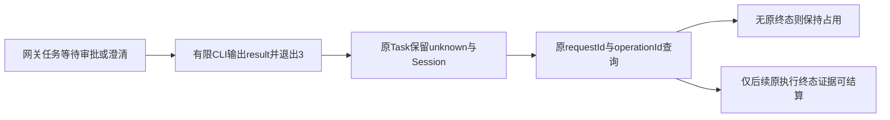

# Hermes等待输入时的查看器分离保护

日期：2026-10-28（Asia/Hong_Kong）。基线master `c40f45e9696c7c3e97ad8bf4f72486a843bed3c5`，当前公开版本仍为0.6.0-alpha.67。本次为未发布源码修复，无新EXE、标签、日常后台切换或SSH部署。

## 需求与缺口

本轮核对后续目标：真实父模型自主MCP、Hermes/Pi/DSH尚未覆盖的执行/被委派生命周期、原生取消与恢复、多主日常流程、图100ms、冷启动与完整故障矩阵均未完成；路线继续见[当前计划](../../project-plan.md)及[接入矩阵](../../agent-integration-matrix.md)。

优先检查Hermes原生网关取消时发现执行代次绑定缺口：原生`session.interrupt`要求`execution_generation`，现有stream-json未提供可供Bridge控制的该绑定，故不能把杀死查看器当作网关取消。本片先修复同一生命周期链中已确认的任务错误结算。

| 需求 | 功能 | 验收行为 |
| --- | --- | --- |
| HERMES-DETACH-01 | AB-F10/F11、M06-F01/F04、M07-F01/F02/F04/F06/F07 | 原生等待审批/澄清或排队受阻时，查看器退出3不能结算任务失败、取消或释放占用 |
| HERMES-DETACH-02 | 同上 | 原请求去重、原ID核对、观察器重开及后续原终态读取保持；不能换ID、上下文或续聊绕过unknown |
| HERMES-DETACH-03 | M06-F01/F04 | 同时识别result.exit_code与实际退出码，不依赖英文错误文案；不扩大取消或权限/表单能力 |

## 原生依据与实现

只读核对本机未修改Hermes0.22.5，安装源码固定提交`bf0203a794a07aac3ff764972ab9087baa4e4f4e`：

- [GatewayChatView](https://github.com/NousResearch/hermes-agent/blob/bf0203a794a07aac3ff764972ab9087baa4e4f4e/hermes_cli/gateway_chat_view.py)的`_finite_block`在原生权限/澄清等待时返回分离原因，输入排队在unknown后时保留原已接收输入；`_detach`以exit_code=3输出result并退出查看器，未结算网关任务。
- [StreamJsonEmitter](https://github.com/NousResearch/hermes-agent/blob/bf0203a794a07aac3ff764972ab9087baa4e4f4e/hermes_cli/stream_json.py)把退出码、Session及错误写入result。非零result不自动等于网关任务失败。
- [原生命令](https://github.com/NousResearch/hermes-agent/blob/bf0203a794a07aac3ff764972ab9087baa4e4f4e/hermes_cli/gateway_chat.py)的KeyboardInterrupt退出130仅表示查看器分离，原已接收工作继续；本片同时补齐实际进程退出码130的保守判定。

[解析器](../../../desktop/electron/native-cli-protocols.cjs)将result.exit_code为3/130或实际退出码3/130视为uncertain；没有result、原网关断线等既有规则保持。即使诊断缺失或退出码不一致，也不释放原占用。普通0/1/2沿既有结果、错误与Session核验；不把所有非零退出都泛化成unknown。

[NativeCliHost](../../../desktop/electron/native-cli-host.cjs)复用现有unknown事件与原ID读取，不新增RPC、持久字段、数据版本或后台进程。原生CLI已退出时不会自动新建观察器、重连网关或重新提交。历史已结算failed和旧unknown不迁移；取消仍false，Bridge内原生等待回复仍未适配。



## 实际验证

环境：Windows、Node24.12.0，Python用于直接加载未修改原生组件；无模型请求、网关连接或新原生Session。原始材料目录为`artifacts/hermes-detach/2026-10-28/`。

| 层级 | 结果与范围 | 证据 |
| --- | --- | --- |
| 缺陷复现 | 初版新增10项在未修改HEAD源码上4通过/6失败；等待输入与无诊断退出3真实被Host结算failed | [baseline.tap](../../../artifacts/hermes-detach/2026-10-28/baseline.tap) |
| 修复后专项 | 最终11/11；result/进程退出码、缺诊断、审批/排队、原Session、去重、重开、原核对收据、替代请求/上下文拒绝与受控后续原终态 | [测试](../../../desktop/tests/hermes-detach.test.cjs)、[最终相关TAP](../../../artifacts/hermes-detach/2026-10-28/related-final.tap) |
| 相关共享回归 | 60/60（包含上述11项）；Hermes双平台发现/MCP与四工具原核对收据，不跨模块相加 | 同上 |
| 原生组件 | 未修改0.22.5的查看器`_finite_block/_detach`与输出组件实际生成审批、澄清、排队三种退出3，生产Bridge解析均uncertain；四份原生输入摘要前后保持 | [原生驱动](../../../desktop/tests/hermes-detach-native.py)、[三场景报告](../../../artifacts/hermes-detach/2026-10-28/native-components.json) |
| 工程 | 根typecheck/lint、核心构建及桌面TypeScript/Vite生产构建通过；保留既有chunk大于500kB提示 | [类型](../../../artifacts/hermes-detach/2026-10-28/typecheck.log)、[lint](../../../artifacts/hermes-detach/2026-10-28/lint.log)、[生产构建](../../../artifacts/hermes-detach/2026-10-28/build.log) |

原生组件使用受控snapshot和原生查看器/输出实现，没有连接用户网关、修改原生配置或制造真实等待。专项后续终态为受控事件注入，只证明Host继续读取原事件；不能据此声称已实现网关重连或真实原生等待恢复。

开发前Windows混合原宿主/核对44项运行观察到41通过/3失败：Pi取消等待超时、Pi删除重复Session文件后canContinue断言失败、Hermes超大输出等待超时；来自初始工具输出，另保存[观察摘要](../../../artifacts/hermes-detach/2026-10-28/initial-run-observation.json)。这些结果没有改写成通过；此前已有Pi/Windows混合集失败见[alpha.65](alpha65-hermes-windows.md)。本轮60项没有覆盖整个旧混合集，不宣称Windows全量通过。

本轮WSL默认环境中`node`命令不可用，检查常用路径亦未找到，未运行Linux回归；不据此判定发行版内完全没有其他Node安装。未启动/切换用户日常Bridge或Hermes网关，没有重发任何旧unknown。

复现命令：

```powershell
node --test --test-concurrency=1 desktop/tests/hermes-detach.test.cjs desktop/tests/native-reconcile.test.cjs desktop/tests/hermes-windows-discovery.test.cjs desktop/tests/hermes-linux-discovery.test.cjs desktop/tests/mcp-hermes.test.cjs
python desktop/tests/hermes-detach-native.py NATIVE_SOURCE BRIDGE_ROOT REPORT
npm run typecheck
npm run lint
npm run desktop:build
node scripts/check-docs.mjs
git diff --check
```

## 同步与未完成项

整体功能、M06/M07完整设计与报告、架构/数据/协议、接入矩阵、用户Hermes说明、路线与迭代索引已同步。顺带纠正M06能力表中Hermes/Pi仍为旧false/null的过期说明，与当前静态注册表及已发布独立MCP实现一致；无能力标志变更。

文档检查原2243项历史材料缺失仍为2243项，逐项比较新增0/移除0；检查命令仍退出1，不声明完整通过。见[最终检查](../../../artifacts/hermes-detach/2026-10-28/docs-final.log)和[差异摘要](../../../artifacts/hermes-detach/2026-10-28/docs-comparison.json)。`git diff --check`通过。

待完成：真实原生审批/澄清等待及原网关恢复、可靠的取消代次绑定、Hermes自主父模型/被委派完整生命周期、新包/普通EXE/独立SSH验收。公开alpha.67、历史unknown与其他图性能/冷启动/完整故障矩阵结论保持，整体目标继续进行。
