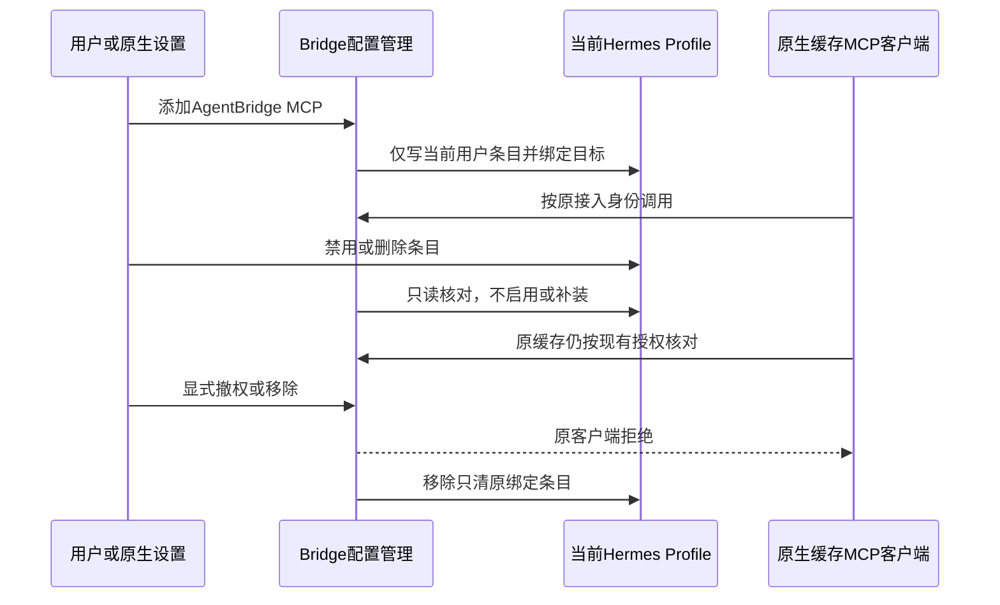

# Hermes 原生 MCP 与 alpha.50 本地交付

日期：2026-10-23（Asia/Shanghai）。alpha.50承接[Pi原生配置](pi-mcp-config.md)与本地alpha.49。公开仍alpha.46，未公开推送、打标签、切换日常后台或部署SSH。关联AB-F02/F07/F08/F11/F12/F13与M01/M03/M05/M06/M07/M08/M09/M10/M11；[全迭代台账](completion-audit.md)的完整目标不变。

## 需求与原生依据

MCP02要求所有入口使用同一个AgentBridge MCP，原生配置可以添加/禁用/删除，Bridge正确识别且不补装已删除条目。本片补齐Hermes的用户配置与原生Profile目标，和Pi一同完成alpha.50本地交付；原生组件实际调用不等于原生父模型自主委派或托管scope。

固定核对NousResearch/hermes-agent提交`484de065a821b4245697351d08327b465ffd41ba`，不使用变化中的主分支作为验收基线。官方归档六份关键源码的Git blob SHA逐项吻合；使用官方锁定Python3.14.7、uv0.12.3与MCP SDK2.3.0，隔离安装在临时目录，未修改原生产品源文件、日常Home或原生凭据。[来源及完整摘要](../../../artifacts/hermes-mcp/2026-10-23/upstream-provenance.json)。

- [hermes_constants.py](https://github.com/NousResearch/hermes-agent/blob/484de065a821b4245697351d08327b465ffd41ba/hermes_constants.py)：Windows默认`LOCALAPPDATA/hermes`，其他平台`~/.hermes`，支持原生目录后缀/环境变量展开；`config.yaml`位于生效Home。
- [main.py](https://github.com/NousResearch/hermes-agent/blob/484de065a821b4245697351d08327b465ffd41ba/hermes_cli/main.py)与[profiles.py](https://github.com/NousResearch/hermes-agent/blob/484de065a821b4245697351d08327b465ffd41ba/hermes_cli/profiles.py)：`HERMES_HOME`指向具体`profiles/<name>`时保持该Profile；根目录启动读取`active_profile`后按启动根解析。Profile名称规范化小写，命名Profile必须已存在、有身份标记且无删除墓碑；不因配置MCP而创建/恢复原生Profile。
- [config.py](https://github.com/NousResearch/hermes-agent/blob/484de065a821b4245697351d08327b465ffd41ba/hermes_cli/config.py)与[mcp_config.py](https://github.com/NousResearch/hermes-agent/blob/484de065a821b4245697351d08327b465ffd41ba/hermes_cli/mcp_config.py)：YAML `mcp_servers.agentbridge`，标准stdio `command/args/env`；`hermes mcp list`是配置列表，不证明连接；`/reload-mcp`使运行会话重新加载。

本轮CLI版本显示`vunknown`，因为固定源码归档没有安装发布戳；不能编造正式Hermes发布版本或把此环境写成用户已安装版本。原代码、锁定依赖、原生CLI/配置读写器/MCPServerTask是真实运行证据，属于固定源码的原生组件验收。未验Windows真实Hermes进程或模型。

## 产品实现

| 场景 | 当前行为 |
| --- | --- |
| 解析目标 | [hermes-mcp-config.cjs](../../../desktop/electron/hermes-mcp-config.cjs)按目标环境解析Windows/Linux默认路径、`HERMES_HOME`、变量/波浪线、后缀、sticky/pinned Profile。无效/缺失/被删除Profile或不可核对选择返回`MCP_HERMES_TARGET`，不回落默认目录；不读取身份标记的秘密内容 |
| 配置与导出 | [McpConfig](../../../desktop/electron/mcp-config.cjs)只改YAML `mcp_servers.agentbridge`，保留模型、其他MCP、注释和其他锚点。拒绝重复键、损坏结构、顶层/MCP/被管条目的合并或歧义别名；同名外部条目不接管。导出新增`agentbridge.hermes.yaml`，只生成片段和独立授权，不写原生配置 |
| 绑定与切换 | 保存可选`nativeTarget:{kind:'hermes-profile',home,root,profile,named}`。重启恢复端点不写原生配置，状态比较原绑定与当前选择。切换时展示原路径/当前路径，安装/重导出拒绝`MCP_NATIVE_TARGET_CHANGED`；移除仍只清原目标。显式移除且旧目标条目已不存在后，新接入才绑定当前目标并轮换身份；准备过程中选择变化回滚授权 |
| 禁用与清理 | 按原生bool-like规则识别false/0/off/no等禁用值；仅`enabled`控制项改变时仍保留原登记归属。禁用显示`config:'disabled'`、`installed:false`并拒绝`MCP_NATIVE_DISABLED`，不重新启用。其他字段变化仍冲突。移除先撤权，失败保留`revoked_config_pending`与原文件；目录/文件链接不会被沿用写删 |
| 探测 | 原命令解析器运行`hermes mcp list`，精确识别`agentbridge`行与原生enabled/disabled结尾，只输出安全摘要。enabled列表行仅映射nativeLoad=loaded，connection仍unknown；工具目录和授权分别核对。原生列表失败/格式不符现在保留探测原因，不能因无nativeLoad丢掉错误证据；过期观测仍失效 |
| 能力与界面 | Hermes独立MCP调用方/原生配置声明true；托管scope/小队保持false，旧后台明确false或unknown仍收窄。原Agent配置卡提示当前Profile与`/reload-mcp`，目标变更/原生禁用时安装按钮禁用；不新增模型/供应商/登录表单 |

Pi与DSH Desktop的目标选择内部统一命名为nativeSelection，持久格式/外部方法不因该内存属性改名而变化。除Hermes的可选nativeTarget分支及导出文件外，无新RPC、Task/Session状态、SSH协议、关系迁移或模型API。原operationId/requestId与unknown占用保持；原生删除/禁用不会自动撤销缓存客户端，显式revoke/remove才撤权。

## 实测、失败和限制

证据：[hermes-mcp/2026-10-23](../../../artifacts/hermes-mcp/2026-10-23/)，Pi见[专项](pi-mcp-config.md)。共享工程计数不跨模块相加。

| 层级 | 实际结果 |
| --- | --- |
| Hermes配置专用回归 | 13/13，模型/原生子进程/socket均0；原生选择、绑定/清理、竞态、目录链接、bool-like禁用、YAML注释/锚点/合并/重复键、列表反例；[config.tap](../../../artifacts/hermes-mcp/2026-10-23/config.tap) |
| 首次配置失败 | 12/13；YAML1.1合并键被库表示为Symbol，单查`has('<<')`遗漏，修复检查后13/13，保留[config-first.tap](../../../artifacts/hermes-mcp/2026-10-23/config-first.tap)；不是放宽合并断言 |
| 受限环境只读视图回归 | 首次10/11，实际stdio用例因本地listen EPERM失败；[connections.tap](../../../artifacts/hermes-mcp/2026-10-23/connections.tap)。正常审批恢复后的完整回归包含并通过该用例，不按观察超时重启原任务 |
| 完整工程 | 桌面794/794、核心68/68，0跳过；类型/lint/根及桌面生产构建通过；[desktop.tap](../../../artifacts/hermes-mcp/2026-10-23/desktop.tap)、[core.tap](../../../artifacts/hermes-mcp/2026-10-23/core.tap)、[build.log](../../../artifacts/hermes-mcp/2026-10-23/build.log)。新原生脚本另做语法/lint检查 |
| Linux Hermes原生组件 | 5组通过：真实原生CLI读取sticky Profile；原生MCPServerTask/SDK取7工具并正式只读调用；伪造参数拒绝；原生配置写入器禁用/删除后重开不补装；缓存撤权/切换Profile新身份/精确清理。源码阶段[native-first.json](../../../artifacts/hermes-mcp/2026-10-23/native-first.json)、最终包Bridge资源复验[native-package.json](../../../artifacts/hermes-mcp/2026-10-23/native-package.json)。受控父进程、模型0 |
| Linux/Windows Pi原生组件 | 官方Pi1.4.0原包各5组通过，包含最终包Bridge资源；[Pi专项](pi-mcp-config.md)。Windows原生文件SHA与原始npm代码一致 |
| Windows生产前端 | Edge155.0.4283.45、5组通过：Pi/Hermes添加、原生禁用、目标变化时安装禁用、原目标清理/新目标绑定，浏览器错误0；最终包MachineHost与生产前端、受控发现，Pi版本真实检查，模型0；[ui/report.json](../../../artifacts/hermes-mcp/2026-10-23/ui/report.json)，截图见同目录 |
| 普通Windows EXE | 4组通过：实际版本与普通窗口、真实IPC/SQLite持久化、窗口重开复用后台、完整后台重启保持原资料且0请求重放；[windows-portable.json](../../../artifacts/hermes-mcp/2026-10-23/windows-portable.json) |

[Hermes验收入口](../../../desktop/tests/hermes-native-mcp.cjs)与[原生驱动](../../../desktop/tests/hermes-mcp-native-driver.py)不修改原包；直接使用原生配置读写器和真实MCPServerTask。所有临时客户端已确认退出、原生临时Home已清理。Windows前端中的Hermes发现为受控，不当作Windows真实原生Hermes；原生父模型自主决策、托管任务scope、小队、真实模型成功/取消、独立SSH与完整MCP02/I06C/I07C仍未准出。

## alpha.50 本地交付

最终[Windows EXE](../../../desktop/release/AgentBridge-0.6.0-alpha.50-Windows-x64.exe)130184924字节，SHA-256 `0468608387c0f2894cfe1df58f3a92dec24427030c1bb2a0420f689be1f7230d`。Electron44.7.0、electron-builder26.15.3，WSL交叉构建、未签名。53后台模块、84Core文件、1701Linux资源，后台/Core/ASAR/前端与bootstrap一致性均true；Linux摘要`7f46d65d6dd81a15dd26c68163d86d3e0a1e90688fcd98b503068396688a542b`，[package.json](../../../artifacts/hermes-mcp/2026-10-23/package.json)。

已复制`C:\Users\jiqi\Downloads\AgentBridge-0.6.0-alpha.50-Windows-x64.exe`，完整SHA-256一致，旁边同名`.exe.sha256`；[副本核验](../../../artifacts/hermes-mcp/2026-10-23/download-copy.json)。旧alpha.49及公开alpha.46保留。切换时先在旧Bridge“设置→后台运行→停止后台并退出”，再打开新EXE；Windows程序不升级SSH，原unknown请求继续查询原ID。

Pi/Hermes在原节点配置中添加后，分别在原生执行`/reload`、`/reload-mcp`并核对原生列表。原生父模型改用Windows OpenCode的授权仍未收到明确答复，不因本片MCP组件成功而执行真实模型任务。

文档同步覆盖整体设计/架构/数据/协议、受影响模块及用户说明；完整资料检查通过，用户站6/6、构建18页/19 HTML且内部页/证据导出均0；[docs-check.log](../../../artifacts/hermes-mcp/2026-10-23/docs-check.log)、[docs-test.log](../../../artifacts/hermes-mcp/2026-10-23/docs-test.log)、[docs-build.log](../../../artifacts/hermes-mcp/2026-10-23/docs-build.log)。产品源码在本包冻结后未再修改，后续仅补验收脚本和文档。
