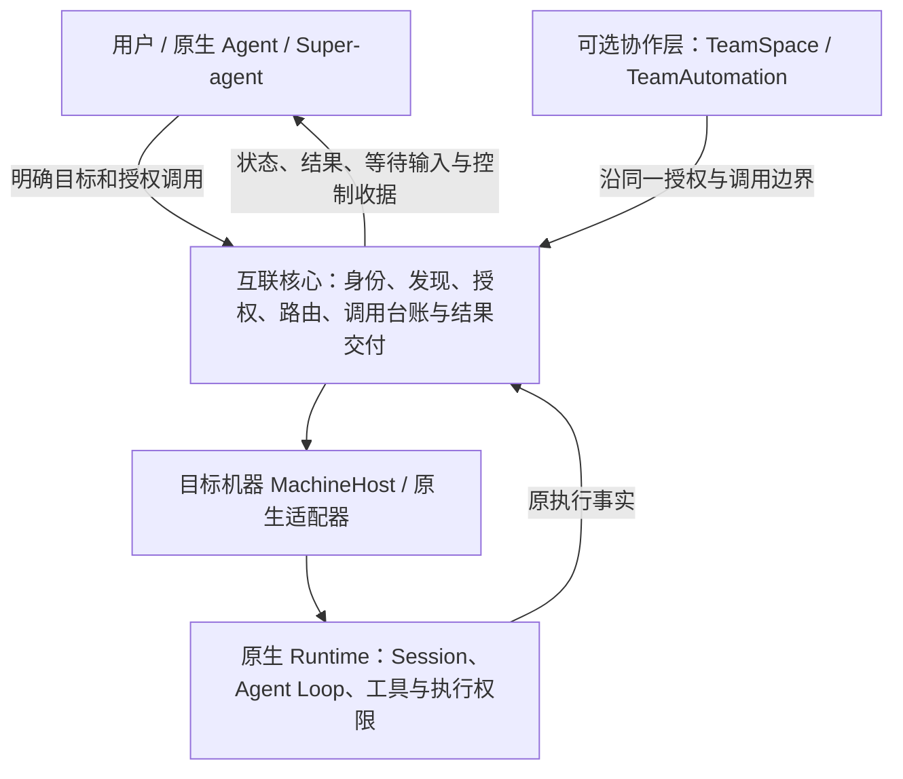

# I08：Agent 互联核心与可选协作能力边界

后续用户已授权按本决议开发与验证，当前源码切片和未完成项见[实施台账](interconnect-development.md)。本页保留边界确认时的仅文档交付与原检查证据，不作为后续能力均未实现的当前结论。

日期：2026-11-03。状态：用户已确认的产品边界与后续设计约束；本轮只同步文档，不改变源码、运行行为、数据格式、发布包或授权。公开基线仍为 0.6.0-alpha.71；工作区的未发布增量保持原验收状态。

关联 AB-F02/03/07/08/09/10/11/12/13/14/19/20/21/22，模块 M02/M03/M06/M07/M08。用户确认的是下述职责与优先级，不是新协议或数据迁移已完成，也不是授权自动迁移旧任务。

## 1. 已确认定位

AgentBridge 管理谁能调用哪个 Agent，以及一次调用如何可靠交付和核对。任务拆分、目标选择、业务规划、结果是否满足业务目标，由用户或上层 Agent 决定。

向上提供获准 Agent 的发现、调用、消息、状态、结果和交互控制；向下适配已有原生 Agent 接口。Bridge 有受授权的调用与控制能力，不实现原生 Agent Loop，不接管原生内部规划、工具引擎、模型或记忆。

这是职责分层。当前仍部署于既有 Coordinator、MachineHost、daemon 与宿主中，没有新建独立服务、进程或包。

## 2. 核心保留什么

| 核心职责 | 应承担的工作 | 权力边界 |
| --- | --- | --- |
| 身份与发现 | 注册、稳定寻址、获准目标、能力声明及其来源、可达性 | 只在授权范围发现；声明、现场观察与执行证明分开；不按任务语义推荐目标 |
| 访问控制 | 调用方认证、出站授权、操作及资源范围、即时撤权 | Agent 不能自批范围外授权；不扩大原生工具或操作系统权限 |
| 调用与通信 | 对明确目标提交新需求、原会话续聊、交互转交、消息与结果关联 | 不拆任务、不改变目标；版本化上下文包装保留原需求且不增加权限 |
| 生命周期观察与控制 | 原生接口适配、Session 绑定、进度、原生终态、回复与取消 | 通过原生能力请求动作；关闭观察器不等于任务终止；收据不等于执行成功或取消 |
| 可靠性 | 持久意图、幂等键、事件游标、原 ID 查询、unknown 占位 | 不因断线或超时重发需求，不换目标、身份、目录别名或 Session 释放未知 |
| 资源准入 | 串行/并发能力声明、忙时行为、调用限额与资源冲突 | 机械执行明确策略，不做智能选目标或计算资源调度；目录不是文件系统沙箱 |
| 接入运维与审计 | MachineHost、daemon、必要 worker、SSH 安装维护、配置和原执行恢复 | 仅服务 Bridge 与原生 Agent 接入，不提供任意远程 Shell、通用进程管理或环境租赁 |

执行能力仍按适配器声明与实际环境分别判断。无需为了满足定位而删除宿主、worker、Session 控制、SSH 或 unknown 保护。

## 3. 哪些能力归可选上层

| 现有范围 | 决定 | 后续约束 |
| --- | --- | --- |
| AB-F19 的智能体职责登记 | 保留；身份描述可为发现契约提供输入 | 登记说明不创建模型、Skill、文件权限或执行能力；身份契约仍须另行细化 |
| AB-F19 的小队/工作容器 | 可选协作层 | 基础发现和委派不要求先建立小队或工作项 |
| AB-F20 公共文档、编辑权限、群聊和工作约定 | 可选协作层，暂停扩张 | 核心只需可靠交付消息、结果及准确产物引用，不强制公共空间或共享记忆 |
| AB-F21 分工、依赖、交付/复验、返修、业务验收 | 可选协作层，暂停扩张 | 不成为通用调用状态机或 Super-agent 接入前提；业务验收不混入原生 Task 终态 |
| AB-F22 事件激活、无进展唤醒、协调预算、自动续接 | 可选协作层，暂停扩张 | 核心可交付事件及执行显式调用，但不自行决定何时让模型重新思考 |
| 固定开发员/编译员/复验员等角色 | 作为可选描述保留 | 核心按调用方、目标和授权工作，不要求所有网络具有全局主 Agent 或固定业务角色 |

“暂停扩张”不删除已发布接口、数据或历史，不停止已经授权的在途任务，不撤销用户现有策略。兼容性、可靠性和明确故障修复仍须按原行为验收。当前没有实施物理拆包、存储拆分或 UI 删除；这些实现选择不由本轮文档推定。

## 4. 已确认但待实现的核心契约

以下是设计工作范围，不是已存在的字段、RPC 或能力声明。现有 nodeId、connectionId、scope 和原台账继续生效。

| 顺序 | 契约 | 需要明确的内容 | 完成条件 |
| --- | --- | --- | --- |
| 1 | Agent 身份与端点 | 区分工具安装、可调用 Agent、接入端点、Session 与一次执行；复用已有登记，避免重复身份源 | 能描述一个独立存在的 BuildAgent；升级/重连不擅自重绑旧任务；不要求节点绑定项目、模型或供应商 |
| 2 | 调用方与调用上下文 | 区分认证主体、接入凭据、上层会话和任务所有权；非执行型调用方不必冒充受驱动工具 | 同一凭据下各上下文范围明确；重启/换回合/凭据轮换/撤权后读控规则可核对；自报上下文 ID 不授予旧任务权限 |
| 3 | 接入与生命周期归属 | 分别说明调用已有服务、获准启动原生入口、沿已有 Session 读控时的所有权 | Bridge 断开/停止/升级可关闭哪些资源、谁保存原状态、谁能恢复观察均明确；不从 PID 或连接消失推定任务终态 |
| 4 | 共享与资源策略 | 多调用方是否共享 Session、串行/并发、忙时拒绝或排队、限额与取消范围 | 首片允许仅串行、忙时拒绝、会话隔离；声明与实际门禁一致，真实多调用方不串结果或越权；隔离由原生环境落实 |
| 5 | 调用结果与事件 | 提交未发生/执行失败/结果未知、等待输入、终态、正文/产物引用/证据、事件游标与补读 | 可仅使用查询/长轮询完成恢复；事件重放不重跑执行；引用不证明文件已传输或可达 |
| 6 | 真实 Super-agent 闭环 | 优先复用 MCP，选一个真实原生调用方消费上述契约 | 自主发现、明确目标委派、等待/回复、结果消费及断线恢复；真实调用方、受控夹具和发布包证据分别记录 |

上述 1–3 先形成一致的身份、归属和生命周期设计，再切片实现、迁移与验收；4–5 随最小闭环推进。已有六工具、MCP 与 SSH 未准出项保留，不因本轮重排自动关闭。

## 5. 不纳入当前补齐范围

- 智能选目标、语义规划、自动换 Agent、失败后自动改任务重试或业务返修。
- 模型/供应商/API Key 管理、新 Agent Loop、Skill 引擎、公共自动记忆。
- 任意远程 Shell、通用计算/实验设备调度、自动代码或实体文件同步。
- 公网全局发现、多租户、中央云平台和高可用建设。
- 递归/多层委派：当前普通子任务 collaboration=false 及原作用域约束保留。
- A2A、DSH 原生 Subagent Provider：有明确需求再评估；不是本轮核心完成条件。既有 CT-03 ACP 可选试点保留，不以协议数量衡量完成度。

## 6. 当前源码核对与实现落点

| 落点 | 当前事实 | 对新设计的限制 |
| --- | --- | --- |
| [AgentNetwork](../../../desktop/electron/agent-network.cjs) | 明确 nodeId 委派；原父执行或独立 connectionId 拥有记录；续聊检查原身份、目标、原轮终态和当前授权 | 通用调用方/上下文契约不能擅自放宽当前读控交集；当前经典续聊不是缺失能力 |
| [Agent 发现视图](../../../desktop/electron/agent-connections.cjs) | list_agents 返回当前获准节点、机器与三态能力，supportedOperations 描述新增行为 | 保持先授权再发现；能力声明不等于现场推理成功 |
| [MCP 接入](../../../desktop/electron/mcp-integration.cjs) | 独立接入绑定 nodeId/adapter；重装换 connectionId，原委派历史保留 | 长期主体与凭据轮换的关系尚待设计，不能自动恢复旧授权 |
| [MCP 工具](../../../desktop/electron/mcp-client.cjs) | 经典十工具；delegate 支持原 conversationId；task_result 为查询/长轮询，没有任务订阅工具 | 现有 MCP 可先验证闭环；通用订阅和新数据映射不得写成已实现 |
| [委派上下文](../../../desktop/electron/delegation-context.cjs) | 原需求附版本化说明，不附新工具或权限 | 允许可追溯包装；不改变用户目标，不把正文当授权 |
| [TeamSpace](../../../desktop/electron/team-space.cjs)、[业务任务](../../../desktop/electron/team-work.cjs)、[自动协调](../../../desktop/electron/team-automation.cjs) | 既有小队状态、业务规则和激活器仍存在 | 可选上层是职责定位，尚未物理拆分；普通委派不依赖其业务工作流 |

## 7. 本轮同步与验证

本轮仅将用户已确认的边界写入整体设计、架构、数据/协议说明、接入矩阵、路线、模块目录及 M02/M03/M06/M07/M08 设计与报告，并登记迭代。未新增产品代码、字段、RPC、权限、迁移或适配器；未重打或发布 EXE。

Windows PowerShell，仓库 D 盘；TEMP、TMP、XDG_CACHE_HOME 与 npm 缓存均指定 D 盘。只运行文档检查，不运行原生 Agent、模型、SSH 或运行时工程测试，历史通过数保持原日期与环境。

已实际运行 node scripts/check-docs.mjs：修改前 305 份 Markdown，修改后 306 份，均为 2243 项现有缺失引用，退出码 1、检查未通过；逐项比较新增错误 0、消除错误 0。[修改前原始结果](../../../artifacts/interconnect-boundary/2026-11-03/docs-before.json)、[修改后原始结果](../../../artifacts/interconnect-boundary/2026-11-03/docs-after.json)、[差异记录](../../../artifacts/interconnect-boundary/2026-11-03/docs-comparison.json)。没有为消除历史缺失而伪造证据或更改旧验收记录。新契约和真实 Super-agent 闭环均未实现、未测试。
