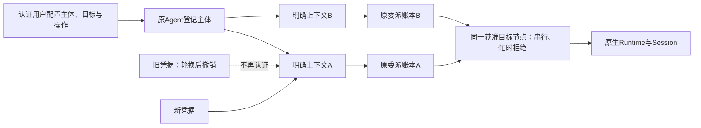

# I08：独立调用方、上下文、凭据与事件契约

状态：未发布源码已实现并有受控证据，公开alpha.71保持。依据[互联边界](interconnect-boundary.md)，当前开发与分层验收见[实施台账](interconnect-development.md)。不要求上层产品修改Router或Worker，不添加模型API层。

## 1. 归属模型

调用方主体复用原agents[]中的agentId，principalId等于该登记ID。kind=mcp可以作为只有调用资格的主体，不需要可执行工具节点；登记本身不授予调用权。用户通过callers.create明确授权目标登记ID和操作，目标固定原endpointId/nodeId/machineId，不按任务语义选择。

| 对象 | 创建与控制 | 与执行的关系 |
| --- | --- | --- |
| 主体principalId | 用户为已有登记启用调用资格 | 不创建工具节点或原生任务；停用原登记立即使调用方失效 |
| 上下文contextId | 用户openContext，后台发唯一ID | 一组调用与读控归属；上层回合可继续使用同一明确授权上下文，新上下文不继承旧任务 |
| 凭据credentialId | 后台发ID，用户显式轮换 | 认证入口引用，不是任务所有者；轮换保留contextId并撤销旧凭据 |
| Bearer秘密 | 原CollaborationBroker生成和持久保存 | 仅在原用户私有broker文件/描述文件，不进入SQLite收据或公开报告 |
| 原委派/Task/Session | 原AgentNetwork和目标Runtime | 委派保存callerPrincipalId/callerContextId，仍走原执行链、幂等和unknown门禁 |

原父Task scope与原生产品独立connectionId保持既有规则，不自动迁移到新上下文，不允许新父Task冒领旧委派。新上下文、主体或凭据不能解除目标节点的运行/unknown占位。



## 2. 用户管理接口

这些是本地认证Coordinator的用户管理方法，不在Agent MCP工具目录开放。中央声明independent-callers-v1，旧后台发送前拒绝新方法，daemon不声明中央调用方能力。

| 方法 | 关键参数 | 结果或约束 |
| --- | --- | --- |
| callers.list | 无 | 读取主体、授权和上下文元数据，无Bearer秘密 |
| callers.create | operationId、agentId，可选allowedAgentIds/operations | 默认无目标，操作默认delegate/result；不创建工具节点或任务 |
| callers.configure | operationId、principalId、expectedRevision，可选allowedAgentIds/operations | 操作只允许delegate/result/pending/reply/cancel；纯缩权不重新准入离线旧目标 |
| callers.openContext | operationId、principalId | 后台生成contextId/credentialId，返回指向私有描述文件的MCP配置 |
| callers.rotateCredential | operationId、contextId、expectedRevision | 同一上下文生成新凭据，旧Bearer立即拒绝，原任务不改归属 |
| callers.closeContext | operationId、contextId、expectedRevision | 撤销该上下文，保持原执行/unknown，不发送取消 |
| callers.revoke | operationId、principalId、expectedRevision | 撤销整个主体，不释放身份或删除历史，不自动重新启用 |
| callers.operation | 原operationId | 查询原收据/指纹；当前原凭据仍有效才重建原描述文件，过期收据返回superseded且不覆盖新凭据 |

元数据与收据同SQLite事务，复用原receipts表和用户身份，sync=false不产生自动协调事件。新增interconnect_callers单行表，body版本1含callers/contexts/credentials三组，各最多4096项，总2MiB；原TeamSpace格式3/原ID不迁移，原收据容量限制保持。

凭据、上下文和主体分别检查有效性。配置准备在异步端口就绪后再次核对原凭据；轮换时以credentialId区分broker scope，同一context使用稳定描述文件路径。stdio每次调用重读原文件，旧Token对应旧scope，不能因文件更新获得新权限。恢复只重建私有入口，不改原生配置、不新建上下文或重放任务。

同一源码管理CLI支持agents.*和callers.*，参数使用JSON文件：

```powershell
node desktop/scripts/agent-directory.cjs --directory D:\BridgeProfile callers.list
node desktop/scripts/agent-directory.cjs --directory D:\BridgeProfile callers.create --params D:\create-caller.json
node desktop/scripts/agent-directory.cjs --directory D:\BridgeProfile callers.openContext --params D:\open-context.json
```

## 3. MCP与资源准入

复用原CollaborationBroker/stdio MCP实现，在中央为非执行主体准备私有入口，不新增公网业务协议或执行网络。描述文件mode=caller，仍为经典十工具；token确定主体/上下文/凭据，工具参数或HTTP正文中的scope/身份不成为授权来源。

- list_agents只列当前获准节点及登记；caller显示principalId/contextId/credentialId，kind=independent-caller、role=caller，不冒充工具nodeId。
- delegate必须给获准agentId；单独nodeId不能绕过端点绑定，两种ID同传必须一致。
- connect_agent/disconnect_agent不能自改授权；list_connectable只读返回现有固定授权，并要求用户配置。
- 当前目录策略为native-default-only，workspace参数在创建意图前拒绝；这限制调用参数，不是文件系统沙箱。文件/工具权限由原生环境强制实施。
- 按节点串行、忙时拒绝、不排队；不同主体/上下文新调用创建各自会话，不能读控彼此Task。
- 撤目标授权阻止新委派/续聊；原任务读控按原上下文和当前操作授权核验。撤销操作、主体、上下文、凭据或原登记时即时拒绝相应访问。
- 长轮询每次读取前及返回前复核身份；回复在读取原Task之后、发送控制之前再复核。原生Prompt前用内部不可由JSON伪造的检查回调核对当前授权。

原requestId/operationId、原始指纹、confirmed不等于终态、子任务collaboration=false等保护保持。权限回复仍只允许原pending、原execution和已获用户授权的reject/once。

## 4. 结果与可恢复事件

task_result保持原字段，新增invocation和outcome。invocation关联原委派/请求/Task/Execution/Conversation及登记端点；独立调用方的原主体/上下文取自持久账本。已有Task时outcome仅说明原Task状态、真实终态、错误阶段和等待类型，evidence=original-task、businessAcceptance=not-evaluated，不把运行成功当业务验收。

读取失败Task本身可以成功：当原身份匹配且outcome.evidence=original-task时，status=failed和error描述原执行失败，不表示这次查询失败。MCP错误响应或仅含error而没有原Task关联证据时，才按调用/读取错误处理。调用方不得仅因看到error字段重发原需求；本轮真实原生认证失败Task的读取已覆盖此分层。

提交回应丢失、尚无taskId时，先list_delegations取得本上下文原delegationId，再task_result({delegationId})。发送前须原后台现场声明task.original-request-v1；它只按原机器/原requestId查询原后台，不进入nodeRequest、上下文准备或提交。若同时给taskId，必须与原委派一致。原请求/Task/会话、原持久请求的执行实例及机器/节点归属与状态须匹配才能补记原Task关联；之后仍按原Task读取事件和结果，不重新执行。

该查询要求原读控归属与当前result授权，不要求当前delegate授权或仍获准向目标新派发；目标授权撤销/停用不阻止原属主读取。上下文、主体、凭据或result操作被撤销时仍拒绝，查询原后台后再次核验。原native-parent和connectionId的失效规则保持，不迁移旧任务。

| 尚无Task时的结果 | 证据与限制 |
| --- | --- |
| 原后台未找到原请求 | status=unknown，outcome.evidence=original-request-query，recovery.state=request-not-found；不伪造Task、不释放占用 |
| 原持久准备拒绝且完整指纹一致 | status=rejected，outcome.evidence=original-preparation-rejection/errorPhase=before_execution，recovery.state=not-dispatched；这是提交拒绝，不是Task终态 |
| 原后台不可达或返回身份不符 | 保留原记录并返回原错误/RECEIPT_MISMATCH，不换机器、端点或请求 |

无Task结果的outcome.terminal=false、recovery.resubmissionAllowed=false；不能将rejected或not_found当作原生Task已完成或允许重做的授权。若请求事件页，则supported=false/reason=task-not-associated，原游标不推进。此扩展不增加工具数、远端方法或Task状态。

可选afterSeq读取同一Task原事件页，limit默认50、最大100，waitMs保持0–45000。请求事件时有新事件即可返回，否则按原等待/unknown/终态边界返回；limit不能独立于afterSeq使用。新stdio发送游标前须由原认证list_agents确认task.events-v1；旧后台不能忽略游标后伪装完成补读。底层仍读取原Task，不新增远端方法或重发Prompt。

| 返回事实 | 语义 |
| --- | --- |
| events.source=original-task-events | 原Task已持久事件的安全投影，不是新采样或重建日志 |
| cursor/afterSeq/highestObservedSeq | 原序列位置；重复读取同游标不再执行任务 |
| cursorGap | 历史不连续或未保留，不补造事件，不换Task继续 |
| supported=false | 原后台没有暴露events，明确降级到结果查询，不把空数组当完整事件 |
| detailsTruncated | 原详情或本页文本限额截断，与执行unknown分开 |

单段文本最多32KiB UTF8，事件项累计约128KiB一页，不切坏字符。native变成binding-observed，progress只保留原序列/种类并标记detailsOmitted，tool不返回参数，防止原生诊断中扁平化命令泄露；不公开原生绑定与控制对象。output、结果、错误和等待摘要仍是获准调用方可见的原正文，有长度边界，不承诺对任意正文自动去密。正文或产物引用不表示实体文件已传输或可达。

## 5. 观察器恢复与关闭

### 资源归属与停止范围

端点的ownership.runtime/session=native描述原生执行与会话状态的权威来源，observer=bridge描述Bridge观察入口；它不授予任意进程所有权。closeObserverCancels=false/disconnectCancels=false表示不据关闭观察入口自动发取消或推定任务终态，不能解释为任何后台进程都永不停止。须按实际关闭入口区分：

| 入口或资源 | Bridge关闭时可释放什么 | 原状态与恢复 | 当前证据边界 |
| --- | --- | --- | --- |
| CallerContext或凭据 | 撤销原读控资格/私有入口；不取消原Task，不删除原委派或解除unknown | 原主体/上下文与任务关联仍在原SQLite；只有仍有效的原归属及当前权限可读控，不由新上下文接管 | 三条真实failed/cancelled Task的轮换、重开、隔离、撤权读控18项；没有据此证明在途关闭 |
| existing-service（DSH Desktop/Web、OpenDesk） | 释放Bridge连接、轮询及观察器；不取得已有原生服务的启动/停止权 | Session与执行事实由原服务保存；Bridge保存原请求、绑定和收据，按原端点/原ID恢复 | 原生产宿主/受控CLI证据单列；本环境尚无真实已配置DSH服务，不能冒充真实服务模型验收 |
| native-entry（Claude、Codex、CLI等）观察门面 | MachineHost/宿主close释放观察资源；不自动向独立worker或原生Session发取消 | 原私有任务目录、worker记录及原生Session仍是恢复来源；重连只观察原执行，不重发需求 | 当前Codex失败/取消原记录及受控CLI恢复有证据；实际成功执行中的关闭/升级仍待 |
| existing-browser | 释放Bridge观察器、认证通道；不自动执行网页Stop或关闭用户页面 | 原网页与扩展持久状态、原Task/Session和事件按原证明关联；失去页面不是任务终态 | 沿现有Browser能力与原结束证明规则；不因本契约扩张网页控制范围 |
| Core OpenCode managed=false | 原Controller关闭自身Hub/Edge和观察资源，外部原生服务不在ownedNative中 | 原服务保存原生状态；重开同一原配置连接原服务，不重放Task | 原安装1.2.10低层连接/关闭/重开9项、模型0；该低层配置不自动成为新登记链的existing-service端点 |
| Core OpenCode managed=true的明确Controller停止 | 停止自己的Hub/Edge及已登记的自有原生服务句柄；在支持的托管平台，复用句柄也必须通过原出生身份/配置核验 | Bridge与原生持久记录保留；服务进程退出可能影响执行，但不能单凭退出写成成功/取消，仍按原Task/原轮证据核对 | 原平台托管归属及本轮资源释放测试分别记录，不外推Windows托管服务、真实在途或跨版本升级 |

Core的DesktopHost.close是无自有进程的门面释放，与显式Controller stop/close不同。Controller可能先关闭IPC监听，再等待链路及原生句柄退出；IPC离线不证明已释放全部资源。管理/验收代码只有在明确拥有原资源、确认实际退出且目标仍在原测试根时才可清理测试数据，不能清理真实profile或以目录别名重建原请求。

源码分别见[MachineHost](../../../desktop/electron/machine-host.cjs)、[原生宿主](../../../desktop/electron/native-cli-host.cjs)、[Codex观察器](../../../desktop/electron/codex-host.cjs)、[Browser观察器](../../../desktop/electron/browser-adapter-host.cjs)、[Core门面](../../../src/desktop-host.ts)、[Controller](../../../src/controller.ts)、[托管服务归属](../../../src/native-server.ts)。SSH断线只释放原运输；实际停止/替换/升级仍执行既有原身份、忙/unknown、可信版本及原operationId门禁，不从端点mode或观察器关闭推定获得维护权。[SSH实现](../../../desktop/electron/ssh-host.cjs)、[当前发布维护边界](alpha71-release.md)。

本表明确既有实现的资源边界，不新增进程管理API、Task状态或迁移行为。运行中原生成功任务、已有服务完整链和升级的缺证继续保留，不能因静态核对而标通过。

MachineHost并发snapshot共享同一scope恢复Promise，全部原私有入口准备完才置restored。失败保留原状态，按原入口恢复，不再让并发读取提前宣布就绪。broker关闭会拒绝未结束的就绪等待，防止关闭后重建端点；描述文件原子替换避免半写读取。这些动作不取消底层任务。

受控证据不能代替真实父模型、真实已有服务、SSH、完整生命周期或EXE验收，各层结果见[开发台账](interconnect-development.md)。

源码用户管理可使用 `agentbridge interconnect callers.list --profile-dir ABSOLUTE_DIR --json`，或agents.*方法。写入参数放`--file`指定的本地JSON对象（最大1MiB），必须预存原operationId；未知回应查callers.operation/agents.operation，not_found返回退出码3，不自动重做。该入口仅复用原认证Coordinator IPC，不经过Hub/Edge；原公开alpha.71尚不包含此命令。
