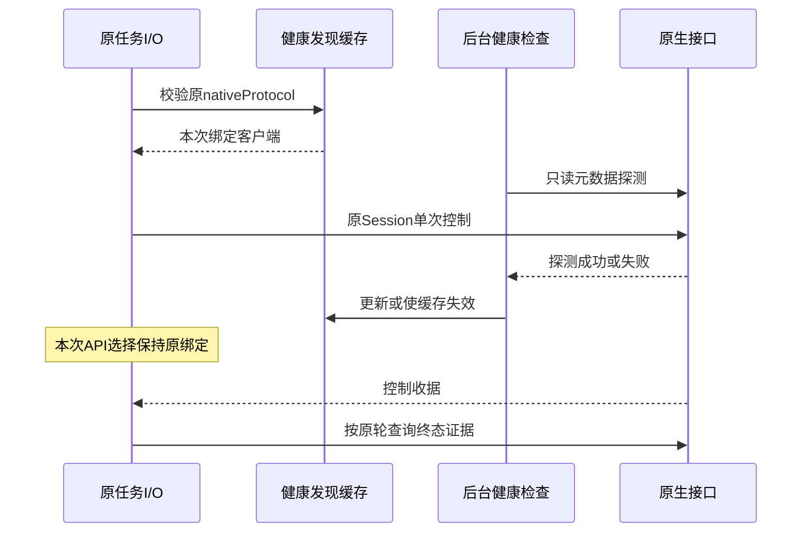

# I08：按互联边界推进的开发与验收

日期：2026-11-03。依据用户确认的[互联边界决议](interconnect-boundary.md)及后续“更新旧文档，并根据文档完成开发和验证”的授权持续实施。本文记录实现与证据；原决议保留当时仅文档交付的事实。公开版本仍为 0.6.0-alpha.71，以下均是未发布工作区增量。

关联 AB-F02/03/07/08/09/10/11/12/13/19，M02/M03/M05/M06/M07/M08/M09。小队业务工作流及自动协调保留兼容、暂停扩张；没有新模型层、智能 Router 或业务执行器。

## 1. 完整范围与当前进度

| 决议要求 | 当前实现 | 尚需证明的完成条件 |
| --- | --- | --- |
| 旧文档与新职责一致 | 整体/模块已同步职责；继续按源码逐项刷新 | 当前主文档不再把已实现登记说成全未实现；历史迭代不冒充当前证据；文档检查区分旧缺失与本次新增 |
| Agent 身份与端点 | 第一片源码已实现：复用既有登记源，独立用户管理、端点明确确认、获准发现、按登记 ID 委派 | 当前Windows桌面主模型已实际消费获准登记并委派WSL；真实结果及已有服务端点仍待，不以受控宿主代替 |
| 调用方与调用上下文 | 源码/受控证据保持；三条真实原生Task的凭据轮换、旧凭据拒绝、跨上下文隔离、原记录重开读取及权限/目标撤销已实测，累计18项 | 已证明失败/取消Task的真实读控归属；成功正文与执行中恢复、完整跨设备消费仍待 |
| 接入生命周期归属 | 端点归属投影、上下文关闭不取消、重启恢复和并发就绪屏障已实现；关闭会拒绝未结束的broker就绪等待 | 生产宿主+真实受控CLI重开3/3通过；真实模型/已有服务/SSH与完整升级矩阵未被替代 |
| 共享与资源策略 | 节点串行、忙时拒绝、上下文隔离和unknown占位保持；独立调用方目录参数在意图前拒绝 | 不同主体与上下文受控验证通过，原生权限仍由Runtime落实；真实多调用方/所有适配器矩阵仍待 |
| 调用结果与事件 | 已实现统一invocation/outcome、原事件afterSeq分页/缺口/限额、原delegationId恢复和旧后台门禁，沿原Task读取不重跑 | 两平台受控回归各104/104；Hermes/Pi/DSH真实受控子进程重开补读3/3，均模型0；当前主模型已读到真实WSL原事件，终态正文仍待 |
| 真实 Super-agent 闭环 | 当前Windows主对话已真实委派WSL，三条Task明确cancelled/failed/failed；原生认证401仍待网页登录。已有记录的轮换/重开/隔离/撤权读控18项实测通过，未新增需求 | 正文消费、成功续聊、执行中的恢复与原生交互仍未通过；不以已失败Task的读控验证代替完整模型闭环，原生工具目录与独立Windows CLI单列 |

完整目标仍在进行，第一片通过不能关闭后续契约或真实闭环。

## 2. 第一片：共享登记源和固定端点

### 身份与持久化

工具节点 nodeId 继续表示机器上的接入；Agent 身份复用 team-space.sqlite 格式3状态中的 agents[]、原 agentId 和同一 receipts 表，不建立第二份登记源、不要求 team/run，也不启动 TeamAutomation 或执行模型。现有 team.registerAgent/team.disableAgent 保持其原能力与业务规则；核心管理使用独立 agents.* 入口，不要求目标具有小队注入能力。

新原生登记增加可选 interconnectEndpoint：version=1、endpointId、revision=1、nodeId、machineId、adapter、bindingDigest、mode。绑定摘要包含节点/机器/适配器及已有 DSH 服务绑定或 Browser profile 身份，不公开 URL、路径、账号或秘密。普通原生安装升级仍保留节点身份；原任务继续回原执行上下文。mode 为 existing-service、existing-browser 或 native-entry，是既有适配行为分类，不赋予新执行能力。

旧登记不自动生成端点、不自动获得按 Agent ID 调用资格，须用户通过 agents.confirmEndpoint 明确确认原节点。已有端点不允许重绑；说明更新不改变 agentId/endpointId。停用保留登记与历史，不释放原执行/unknown、不取消任务；旧调用方仍按原归属读控。

仅协作的 kind=mcp 登记可保存职责，但没有执行端点，不能因 MCP 身份推定可以被执行；它也尚不是通用调用方凭据。

### 用户管理接口（源码已实现）

| 方法 | 参数 | 语义 |
| --- | --- | --- |
| agents.list | 无 | 本地认证用户读取同一登记源；不是对 Agent 开放的全网发现 |
| agents.get | agentId | 原登记、修订、端点及确认状态 |
| agents.register | operationId、kind、nodeId或externalKey、name、purpose，可选inputs/outputs/limitations | 复用原入口唯一性；原生仅要求已接入且支持普通委派，不要求小队；不授关系或执行任务 |
| agents.update | operationId、agentId、expectedRevision、说明字段 | 只更新说明；不接收模型/供应商/目录/授权或端点重绑 |
| agents.confirmEndpoint | operationId、agentId、expectedRevision | 仅对旧未确认原生登记确认当前原节点；已有绑定拒绝覆盖 |
| agents.disable | operationId、agentId、expectedRevision | 保留身份/历史；同步移除原小队成员资格和旧成员接入，原小队执行未核对时拒绝 |
| agents.operation | operationId | 从原SQLite收据查原指纹/结果；not_found不授权重做或换ID |

写操作与原收据同 SQLite 事务，禁止自动事件同步。旧相同 operationId/内容返回原结果，不同内容冲突；expectedRevision 防止覆盖较新说明。未知端点版本或损坏字段拒绝，不重建、不迁移原绑定。

管理请求仅通过现有认证 Coordinator IPC；中央新增 agent-directory-v1 定向能力，旧后台发送前拒绝。新方法不加入 Agent MCP 工具目录，Agent 无权登记或批准自己。

### Agent 侧发现和调用

经典 MCP 仍十工具。list_agents 在当前获准节点的每项附 agents[]，包含名称、用途、输入/输出/限制、声明来源、修订和端点确认状态。先按当前关系过滤节点，再读取其登记；撤权不返回其他目标。Agent 的描述不是系统指令，也不是授权。

delegate 接受 nodeId 或 agentId；两者都提供时必须指向同一节点。agentId 必须来自获准节点且端点已确认，解析后仍走原 nodeRequest 和原生宿主，不新增执行网络。委派记录保存 registeredAgentId/endpointId，原请求指纹包含绑定；同 requestId 不能移除或更换登记身份。准备开始及原生Prompt发送前都重新核对登记/端点，准备中撤销则确定拒绝、不发送Prompt。

新版 stdio 在发送 agentId 前查询原认证后台 list_agents 声明 delegate.agent-id-v1；与 conversationId 同时使用时还需 delegate.continue-v1。旧后台不能忽略新字段后转成原始节点调用；未证明能力时零派发。原取消查询、原父scope、独立connectionId、递归限制和unknown保护保持。

ownership/admission 为只读投影：Runtime和Session归原生、观察器归Bridge、关闭观察/断开不取消、仅沿原Session绑定；节点并发1、忙时拒绝、unknown占位，文件系统隔离由原生环境决定。这些不是可由Agent提交的策略参数，也不证明目标在线或模型可用。

### 源码用户入口

以下是未发布源码 CLI，须明确指定非C盘测试profile；写参数保存为本地JSON文件，不把秘密或完整原生配置放入参数。

```powershell
node desktop/scripts/agent-directory.cjs --directory D:\BridgeProfile agents.list
node desktop/scripts/agent-directory.cjs --directory D:\BridgeProfile agents.register --params D:\register-build-agent.json
node desktop/scripts/agent-directory.cjs --directory D:\BridgeProfile agents.operation --params D:\original-operation.json
```

编译后的正式源码CLI入口为 `node dist/cli.js interconnect agents.list --profile-dir D:\BridgeProfile --json`；同样支持callers.*与`--file`参数文件。必须明确原profile绝对目录，写入必须带已保存operationId；不启动Hub/Edge、不改原生配置。公开alpha.71尚无该新命令。

注册参数示例：

```json
{"operationId":"register-build-agent-001","kind":"native","nodeId":"node-existing-build","name":"BuildAgent","purpose":"沿用原生环境执行编译并报告结果"}
```

调用前仍须用户为原调用方授权目标节点；登记本身不授予连接。该 CLI 通过本机原 profile 的认证 IPC 工作，不使用公网 API，不修改原生模型/账号配置。

## 3. 源码落点

| 文件 | 职责 |
| --- | --- |
| [agent-directory.cjs](../../../desktop/electron/agent-directory.cjs) | 复用登记源、事务收据、端点确认/检查及描述投影 |
| [agent-network.cjs](../../../desktop/electron/agent-network.cjs) | 获准发现附登记、明确Agent ID解析、绑定指纹与派发前检查；旧执行链保留 |
| [coordinator-service.cjs](../../../desktop/electron/coordinator-service.cjs) | 原认证用户接口；登记访问不创建小队或激活器 |
| [coordinator-client.cjs](../../../desktop/electron/coordinator-client.cjs) / [runtime-capabilities.cjs](../../../desktop/electron/runtime-capabilities.cjs) | 新中央方法定向门禁，不要求daemon声明中央登记能力 |
| [mcp-client.cjs](../../../desktop/electron/mcp-client.cjs) | 可选agentId schema及真实后台能力确认；工具数不变 |
| [agent-directory CLI](../../../desktop/scripts/agent-directory.cjs) | 本地认证用户管理；参数文件输入，不代替授权 |
| [agent-directory测试](../../../desktop/tests/agent-directory.test.cjs) | 真实SQLite/Coordinator/Router/MCP stdio与受控原生宿主；不调用模型 |

## 4. 实际验证与限制

环境：Windows、系统 Node 24.12.0、PowerShell，源码和所有测试数据/日志位于D盘。TEMP/TMP/XDG缓存/配置/数据、npm缓存、USERPROFILE/APPDATA/LOCALAPPDATA均重定向D盘；没有读取用户原生账号或部署SSH。

| 验证 | 实际结果 | 原始证据 |
| --- | --- | --- |
| 第一轮登记测试 | 9项中5通过、4清理失败：并存SQLite连接未先关闭导致Windows EPERM；修正测试资源关闭顺序，产品断言没有据此宣告完整通过 | [首次输出](../../../artifacts/interconnect-core/2026-11-03/agent-directory-first.tap) |
| 第一轮定向回归 | 38/38通过，覆盖登记/续聊/获准发现/旧TeamSpace；与后续回归重叠，不相加 | [原始输出](../../../artifacts/interconnect-core/2026-11-03/identity-targeted.tap) |
| 扩大集首次运行 | 73通过、1测试夹具失败：损坏注入事务未返回结果，触发原事务封装的提交后序列化错误；修正注入夹具返回值，不改产品事务语义 | [保留失败](../../../artifacts/interconnect-core/2026-11-03/identity-regression.tap) |
| 最终受控回归 | **74/74通过、0跳过**；含真实MCP stdio的旧后台门禁、登记源共享/原收据、原Session续聊、撤销/端点变化/损坏拒绝、unknown占位、原协调器/委派列表/旧小队回归 | [最终TAP](../../../artifacts/interconnect-core/2026-11-03/identity-regression-final.tap) |
| Core类型检查 | 通过；不表示新端点已通过真实原生模型或EXE验收 | [类型日志](../../../artifacts/interconnect-core/2026-11-03/core-typecheck.log) |

第一片相关CJS lint通过；上述74项是第一片基线，与后续回归重叠，不作为当前全部代码最终统计。后续调用方/事件实现与最新证据见下节。公开alpha.71不包含本次新接口，真实父模型、真实已有服务、SSH、EXE和完整矩阵不能用受控测试关闭。

## 5. 第二片：独立调用方、生命周期与事件

源码已实现[完整调用方与事件契约](interconnect-caller-contract.md)：主体复用原登记ID，新增私有上下文/凭据控制表，用户明确目标和操作授权；不创建父工具节点或伪造原生Task。轮换保持原上下文和任务归属，旧Token拒绝；关闭/撤权不取消底层任务，过期管理收据不会覆盖新描述文件。默认仅使用目标原生目录，workspace覆盖在意图前拒绝，不把目录当沙箱。

task_result新增invocation/outcome及可选afterSeq/limit事件页，保持十工具及原状态机。事件来自原Task，缺口和不支持明确返回；原生绑定/控制正文不公开，正文和业务验收分开。MachineHost并发快照等待同一scope恢复，broker关闭拒绝未结束就绪等待，描述文件原子替换。新的用户入口和MCP均沿原准入、台账和原生适配，没有新模型或执行网络。

新增源码：[CallerService](../../../desktop/electron/caller-service.cjs)、[原事件投影](../../../desktop/electron/task-event-view.cjs)；扩展原[broker](../../../desktop/electron/collaboration-broker.cjs)、[MachineHost](../../../desktop/electron/machine-host.cjs)、[原委派列表](../../../desktop/electron/delegation-list.cjs)。测试：[调用方/生命周期](../../../desktop/tests/caller-service.test.cjs)、[事件](../../../desktop/tests/task-event-view.test.cjs)、[共享受控宿主](../../../desktop/tests/interconnect-fixture.cjs)。

| 验证 | 实际结果 | 原始证据 |
| --- | --- | --- |
| 首次调用方切片 | 11/11通过；真实SQLite、认证IPC与HTTP broker，原生执行为受控宿主 | [首次调用方输出](../../../artifacts/interconnect-core/2026-11-03/caller-first.tap) |
| 调用方与旧协作回归 | 56/56通过，含真实stdio与凭据轮换；与最终集重叠，不相加 | [回归](../../../artifacts/interconnect-core/2026-11-03/caller-regression.tap) |
| 扩大原有接入集 | 143通过、1平台跳过、1失败：Hermes重开后的真实stdio fetch failed；原进程自行结束，未被手动终止 | [保留原失败](../../../artifacts/interconnect-core/2026-11-03/identity-expanded-final.tap) |
| 关闭中就绪反例 | 新测试暴露broker.close未拒绝pending ready导致测试等待；核对后只终止隔离测试子进程。该轮60通过/1文件退出失败，不计作通过；该场景原生执行0 | [未完成回归](../../../artifacts/interconnect-core/2026-11-03/events-caller-regression.tap)、[进程核对与源摘要](../../../artifacts/interconnect-core/2026-11-03/caller-close-stall.json) |
| 第二片整集定向回归 | **99/99通过、0跳过**：登记/调用方/事件/旧协作、真实SQLite/认证IPC/stdio、原生执行为受控宿主；覆盖准备中缩权、读取中撤权、跨主体/上下文拒绝、轮换/重启与目录准入 | [当前TAP](../../../artifacts/interconnect-core/2026-11-03/interconnect-controlled-final.tap) |
| Hermes重开单独复核 | 1/1通过，生产Coordinator/MCP/MachineHost与真实受控CLI；不是正式Hermes模型 | [原请求重开](../../../artifacts/interconnect-core/2026-11-03/hermes-reopen-recheck.tap) |
| 三适配器原事件链 | **3/3通过**：Hermes/Pi/DSH生产宿主和持久worker、真实CLI子进程，新增事件分页、敏感绑定省略、重开原序列补读；原调用次数未增加，模型0 | [原生协议受控链](../../../artifacts/interconnect-core/2026-11-03/native-events-final.tap) |

99项与3项是不同场景，历史38/74/56等与其重叠不累计。这里的真实子进程是受控CLI，不是实际原生产品模型；真实父模型、已有服务、SSH、EXE与完整矩阵仍未准出。

当前Core构建与类型检查通过：[构建](../../../artifacts/interconnect-core/2026-11-03/core-build-current.log)、[类型](../../../artifacts/interconnect-core/2026-11-03/core-typecheck-current.log)；相关CJS与CLI lint通过：[后端lint](../../../artifacts/interconnect-core/2026-11-03/backend-lint-current.log)、[CLI lint](../../../artifacts/interconnect-core/2026-11-03/cli-lint-current.log)。新增编译CLI通过原认证IPC读取同一登记、零任务执行，登记/CLI最终回归15/15，含6组子例；与99项重叠，不累计：[源码管理CLI](../../../artifacts/interconnect-core/2026-11-03/directory-cli-final.tap)。

进一步复核：原生progress.text可能包含已扁平化的工具命令，因此事件页只保留该原事件序列/种类并标记detailsOmitted；原Task与结果正文不改，不能将此称为任意正文自动去密。相关调用方/事件22/22通过：[隐私反例与回归](../../../artifacts/interconnect-core/2026-11-03/progress-privacy-final.tap)；新增源码/验收脚本lint通过：[最终切片lint](../../../artifacts/interconnect-core/2026-11-03/final-slice-lint.log)。Linux Node24.13.0对应9文件受控回归79/79、0跳过，配置/临时数据在WSL的E盘存储，源码/日志在D盘：[Linux原始结果](../../../artifacts/interconnect-core/2026-11-03/linux-interconnect-current.tap)。该79项早于progress文本省略，后者有上述Windows定向复核，不把多平台数字相加。

## 6. 真实原生闭环前置（原WSL主case历史）

已实际核对：Windows默认Claude/Codex/OpenCode/Hermes入口在C盘，不用于本轮实际模型验收。Ubuntu-22.04的WSL存储位于E盘；在不加载交互shell配置的情况下定位原Linux安装，Node24.13.0、Codex0.101.0、OpenCode1.2.10可启动版本检查，模型0。已核对现有Codex/OpenCode认证文件和配置的实际路径不落到/mnt/c，不复制凭据、不输出内容、不覆盖模型配置。

这是环境/安装前置，不是登录有效、模型可用、真实委派或原生权限/表单通过。接下来须沿原Linux配置执行真实父模型与目标，保存原请求后查询恢复；未确认不换ID、节点、目录别名或模型制造成功。

首次实际选择OpenCode1.2.10目标，原接入在发送Prompt前返回OPENCODE_API_UNSUPPORTED；原Task/委派数均0。保留[首轮失败](../../../artifacts/interconnect-core/2026-11-03/native-opencode-first.json)。该早期脚本将nativeModels预填true，字段不准确：本轮只启动服务/探测，未调用模型，不能据此声称真实父模型已运行。随后沿同一原安装做只读诊断：健康接口200，六个工作目录接口各10秒未回应，诊断服务已停止，没有原生任务：[接口探测](../../../artifacts/interconnect-core/2026-11-03/native-opencode-direct-probe.json)。没有改变原模型/账号配置，也未将该失败算作通过。

在核对无请求意图/Task/委派后，改用已安装Codex0.101.0作为目标验证通信契约，OpenCode缺口保留。首轮验收脚本漏填调用方purpose，在管理校验阶段拒绝，模型0；已补参数，保留[脚本准备失败](../../../artifacts/interconnect-core/2026-11-03/native-codex-setup-first.json)。后续只使用同一固定私有根、明确上下文与原请求，脚本保存意图后才启动父执行；不因等待改ID。真实脚本为[interconnect-native-live.cjs](../../../desktop/tests/interconnect-native-live.cjs)，首次观察截止结果在[脚本截止摘要](../../../artifacts/interconnect-core/2026-11-03/native-super-agent.json)。完整真实闭环尚未准出，等待不视为成功。

当前真实Codex原父请求观察4分钟后仍为running，原生CLI进程与worker存活，但尚无Session/工具/输出事件；脚本保留同一上下文、原意图和在线恢复入口，不取消、不创建第二个父请求。原生login status退出0并报告已登录，不能据此推定模型可用或当前请求成功：[原进程只读核对](../../../artifacts/interconnect-core/2026-11-03/original-native-status.json)、[无身份内容的登录状态](../../../artifacts/interconnect-core/2026-11-03/native-codex-auth-status.json)。此处未确认模型是否已开始处理，不记模型0或通过；后续须查询原请求。真实权限/表单、凭据轮换后跨原生回合与观察器重开尚未执行。已向用户询问可用的非C盘原生环境，现有请求继续保留。

生产冻结逻辑只做源码资源检查：AgentDirectory/CallerService/事件投影及编译管理CLI均被原coordinatorRuntime完整复制且逐字节一致，中央两项能力保留，未启动原生任务；这是源码冻结检查，不是EXE验收：[冻结资源检查](../../../artifacts/interconnect-core/2026-11-03/frozen-source-runtime.json)、[当前源码摘要](../../../artifacts/interconnect-core/2026-11-03/source-manifest-current.json)。公开alpha.71不变。

本轮最终执行node scripts/check-docs.mjs，仍退出1：历史缺失引用2243项，新增0、消除0；未伪造缺失证据。[原始检查](../../../artifacts/interconnect-core/2026-11-03/docs-current.json)、[逐项比较](../../../artifacts/interconnect-core/2026-11-03/docs-comparison-current.json)。相关已跟踪源码/文档git diff --check通过；未发布、未提交，不覆盖工作区并行变更。

## 7. 无taskId时查询原委派

恢复审计发现：delegate的原回应丢失、尚无taskId时，既有list_delegations只读给出台账；再次调用delegate又要求当前目标授权和可解析端点。目标新派发授权撤销后，原属主没有直接恢复原请求的MCP路径。不能以重新授权、换ID或重做需求补这个缺口。

当前task_result接受原taskId或list_delegations给出的原delegationId；无Task关联时只走原机器ipc/request，严格匹配原请求、原执行实例/机器/节点、Task/会话和七态，再补原关联。若同时给taskId则必须一致。查询前后核验原属主/result权限；目标或delegate授权撤销不阻止原属主查询，凭据/上下文/result撤销仍拒绝。原记录未找到保持unknown；确定准备拒绝是调用级rejected/terminal=false，不构造Task或释放未知。事件游标在未关联Task时不推进，取消仍必须先取得原taskId。

经典仍十工具，新增现场能力task.original-request-v1，与task.events-v1分别验证；旧后台在任何新查询前拒绝。原中央/daemon帧、SQLite版本、Task状态和原父scope失效规则不变。[完整字段与未派发/未知语义](interconnect-caller-contract.md)。

源码：[原网络查询](../../../desktop/electron/agent-network.cjs)、[现场能力](../../../desktop/electron/agent-connections.cjs)、[MCP schema与门禁](../../../desktop/electron/mcp-client.cjs)。新增受控反例覆盖回应丢失、无taskId、撤目标/委派授权后读取、目标停用、跨上下文、读取中撤权、NOT_FOUND、准备拒绝和异源收据。真实stdio调用方从丢回应恢复同一Task并轮换凭据；原Native协议受控链也改为通过MCP查询恢复，不依靠用户IPC或重新delegate找回Task。

| 验证 | 实际结果 | 原始证据 |
| --- | --- | --- |
| 首轮定向 | 45/45，含新增五项独立调用方恢复反例；后续stdio/门禁补测另在整集 | [首轮](../../../artifacts/interconnect-core/2026-11-03/original-request-first.tap) |
| 九文件定向 | 84/84，模型0，与最终整集重叠 | [定向](../../../artifacts/interconnect-core/2026-11-03/original-request-regression-final.tap) |
| Windows整集 | **104/104、0跳过**，11文件，与此前99项相同范围并新增5项；覆盖旧scope/原上下文/原发现/登记/源码CLI/调用方/事件/旧小队兼容 | [Windows](../../../artifacts/interconnect-core/2026-11-03/original-request-full-final.tap) |
| Linux同范围 | **104/104、0跳过**，Ubuntu22.04 Node24.13.0，受控隔离HOME/缓存/数据在E盘WSL存储，源码/日志在D盘 | [Linux](../../../artifacts/interconnect-core/2026-11-03/linux-original-request-final.tap) |
| 原生协议受控链 | **3/3**，Hermes/Pi/DSH生产Coordinator/MachineHost/持久worker与真实受控CLI、真实MCP，原请求只读恢复、原事件和取消终态，模型0 | [三适配器](../../../artifacts/interconnect-core/2026-11-03/native-original-recovery-current.tap) |
| 源码工程与冻结 | 相关CJS lint通过；新增查询源码/schema/门禁与冻结运行目录逐字节一致；不是EXE验收 | [lint](../../../artifacts/interconnect-core/2026-11-03/original-request-lint.log)、[冻结检查](../../../artifacts/interconnect-core/2026-11-03/frozen-original-request.json)、[源码摘要](../../../artifacts/interconnect-core/2026-11-03/source-manifest-original-request.json) |

各集重叠，不累计；104与3是不同层级场景，均不能证明实际原生模型或发布包通过。真实原父请求保持存活、原身份和在线观察入口，未停止或重做。只读进程核对发现原生CLI具有已建立的HTTPS连接且无Session/工具/输出事件，无法据此判断模型是否开始或请求已失败：[不含地址/账号的原进程I/O核对](../../../artifacts/interconnect-core/2026-11-03/original-native-io.json)。真实闭环、真实权限/输入、已有服务、SSH及完整生命周期仍未准出。

关联校验进一步核对原持久请求中的agentId与返回targetAgent、原catalog机器/节点归属，以及已有/续聊的原conversationId；异源request/target/conversation均拒绝，原记录未找到后换requestId仍被AGENT_BUSY拒绝。最终104/104与3/3已包含此校验；中间独立调用方/事件27/27与最终集重叠：[定向归属复核](../../../artifacts/interconnect-core/2026-11-03/original-owner-final.tap)、[归属校验lint](../../../artifacts/interconnect-core/2026-11-03/original-owner-lint.log)。

2026-11-03 04:04香港时间，原请求出现新进展：同一原生Codex任务已有Session事件及MCP客户端进程，但仍为running，没有委派/结果。未创建新父请求或替换环境；Session事件只证明原生绑定，不证明模型输出。最新只读观察：[原生实时观察](../../../artifacts/interconnect-core/2026-11-03/native-live-observation-current.json)。此前无Session的记录是当时观测，不冒充当前结论。

## 8. 按原决议核查完成条件（04:14时点）

| 原要求 | 当前可核对的证据 | 完成判断 |
| --- | --- | --- |
| 核心/上层/原生Runtime职责分开 | 主设计、架构、协议、路线与模块设计已同步；原TeamSpace/自动协调源码未因本轮删除或改成前提，104项保留旧小队回归 | 设计与本轮源码范围已核对；不声称物理拆包 |
| 身份与固定端点 | 共享原agents[]/receipts、旧登记确认、说明修订、固定端点与异源拒绝，登记测试及104项 | 源码/受控实现有证据；真实原生调用方消费与已有服务仍未验成 |
| 主体/凭据/上下文/任务归属 | 独立CallerService、真实SQLite/认证IPC/stdio、跨主体/上下文、轮换/撤权/重开与读取中撤权测试 | 源码/受控实现有证据；真实上层跨回合与轮换恢复未完成 |
| 已有服务/原生入口/原Session生命周期 | 模式与只读归属契约、并发恢复/关闭就绪、原Session续聊与观察器重开、受控CLI三适配器3/3 | 契约与受控链已核对；OpenCode实际服务前置拒绝，真实生命周期/跨机未完成 |
| 共享与资源准入 | 按节点串行、拒忙、上下文隔离、目录覆盖在意图前拒绝、unknown换ID仍占用，104项 | 源码/受控门禁有证据；真实多调用方和原生文件权限仍未闭环验收 |
| 原结果/等待/控制/事件/unknown恢复 | 原Task结果与事件投影、分页缺口/截断、原委派只读查询、准备拒绝与无Task未知分层，104项及3适配器链 | 原结果/事件/原请求恢复有受控证据；真实权限/表单、取消与发布包不能由这些结果替代 |
| 一个真实Super-agent自主闭环 | 实际Codex原父进程已存活并产生Session，尚无真实委派/结果；原Task与scope保持 | **未完成**，不得用受控stdio或Session事件代替 |
| 文档与工程交付 | 主文档/模块/迭代同步，相关构建/类型/lint、冻结源码检查；文档检查保留2243历史缺失且本次新增0 | 本轮增量有证据，全文档检查仍非绿色；不伪造缺失历史或刷新alpha.71 |

整体目标保持未完成；真实闭环、原生交互与已有服务/跨设备生命周期的缺证不能被重新解释成范围外。公开alpha.71、原SSH/真实profile/性能和完整矩阵准出状态保持，未发布新包。

## 9. 真实原生验收的阻塞核对

2026-11-03 04:14香港时间，连续三个目标轮次仍缺实际原生委派/回复/结果。前一轮完成只读原委派恢复，本轮先重验具体存活进程/原工具会话，再读取原Session对应的唯一原生记录，只输出事件类型和计数，不输出原正文、模型配置、账号或Session ID。该记录含task_started与原用户需求，助手消息0、Bridge调用0、其他工具调用0、错误标记0；记录已约15分钟未更新，原Task/worker/CLI/MCP客户端仍存活。[原Session元数据证据](../../../artifacts/interconnect-core/2026-11-03/original-native-session-evidence.json)、[最新原请求观察](../../../artifacts/interconnect-core/2026-11-03/native-live-observation-current.json)、[具体存活进程](../../../artifacts/interconnect-core/2026-11-03/original-native-status.json)。

本轮性质为原请求的已验证等待及阻塞定位，不是新的产品修改或模型通过。缺少的是原生运行时返回可消费结果；目前没有证据支持通过Bridge改配置、放宽权限、换模型/目标或重发需求解决。OpenCode的原API前置失败也保留。已询问可用非C盘原生环境，尚未收到补充；因此整体目标按外部原生验收条件阻塞记录，不能标记完成。

目标的blocked状态不写入Task状态机：原Task仍为running，原作用域、凭据、请求、native进程和在线观察入口全部保留，未取消、未终止、未重发。恢复目标时先查询同一原请求；原验收进程仍活跃时不重复启动脚本或改profile。确认原父/子执行都已终态后，才可关闭该观察器并沿原checkpoint继续真实跨回合、凭据轮换和观察器重开验收。没有用观察超时或日志静默推断原任务失败。

## 10. 用户明确Windows主、WSL从后继续

用户选择Windows Codex主、WSL Codex从，替代此前WSL主的验收安排。旧原请求沿原cancel operation实际观察到Task cancelled后结束，旧收据/数据保留，没有换节点/profile释放unknown。当前实际Windows0.164.0与WSL0.101.0的生产宿主已接通；Windows主Task在委派前分别遇到本地代理Provider缺base_url、选定原生default认证401，均已明确failed且子请求0。

已准备非C盘原生安装/登录与新attempt保护；新增受控10/10、脚本lint和登录脚本ValidateOnly通过。上述独立Windows CLI仍可在已准备的D盘profile完成原生设备登录后续验；它不是用户指定Windows主Agent必须另起CLI的要求，也不构成当前桌面对话继续工作的前提。

当前Windows Codex桌面对话已直接作为主调用方：由本模型选择list_agents中的WSL BuildAgent，通过薄stdio客户端调用真实MCP delegate，生产MachineRouter/WSL HostConnection/MachineHost接受一次原需求并启动实际Codex0.101.0。没有假父Task、新模型层或直接Shell执行子需求；首轮随机验收材料未被主调用方直接读取。当前子Task仍running，原事件只有accepted/started、游标2，原生Session和正文均无。task_pending返回空列表；该适配器不声明权限/表单能力，不据此增加准出。

只读原执行检查发现既有WSL OAuth访问令牌过期，原生进程存活；无认证HEAD探测认证站点时TCP已连、TLS超时（curl28、HTTP000），不能把该探测当作原Task认证失败或终态。已询问用户现有WSL代理/VPN方式，当前不换账号/模型、不重发需求。原Task、调用方上下文、请求和游标保持；续聊/轮换/重开等待首轮明确终态。两个当前入口脚本lint已通过，实际恢复分支尚未运行；本轮未改产品协议、数据模型或运行时，只增加验收入口与同步证据。拓扑、原始失败、配置来源、C盘边界及后续恢复见[完整Windows/WSL记录](interconnect-windows-wsl.md)。

## 11. 自行进入WSL修复网络与原生认证

用户要求直接进入WSL处理。读取原进程/原生stderr后确认，原生刷新曾因请求发送失败而未完成，过期本身不能推出账号不可用。原生HTTP HEAD对比实测：Windows认证站点TLS/200、WSL直连TLS超时；WSL的现有shell无额外代理设置。为本次验收增加仅回环监听、独立传输凭据及三个原生官方域名443白名单的CONNECT转发，借用现有Windows出网，不解密TLS或新增模型API。WSL经该通道已TLS/200，原全局网络/模型配置未改。[网络对比与通道验证](interconnect-windows-wsl.md)。

原卡住Task沿原MCP取消操作实际cancelled且收据confirmed后，才关闭/重开观察器。仍沿原CallerContext、原登记端点和原来的子会话发送新的明确续聊消息，原生服务返回401 invalid_refresh_token，Task明确failed。只读核对Windows原生缓存与WSL为同一账号、来源更新；备份WSL原文件后尝试恢复，模型/供应商配置不改，仍被原生服务以同一错误拒绝，第三条Task明确failed，缓存试验已回滚。没有以换ID/profile释放unknown、把代理200当认证成功或把收据当Task终态。

已打开WSL原生登录窗口；设备码入口退出1后改用浏览器登录，目前等待账号持有人验证。授权链接/验证码/Token不进入公开日志。三条原Task已明确终态，同一上下文/子会话与原生绑定保留；登录完成后仍在该会话验正文及成功续聊、凭据轮换。网络四项拒绝门禁及原绑定覆盖拒绝实际通过，相关CJS lint、两份shell语法与登录ValidateOnly通过；这些均不是模型通过。本轮只改验收支持与证据，产品协议/数据模型保持。[当前无敏感正文汇总](../../../artifacts/interconnect-core/2026-11-03/wsl-native-repair-current.json)。

## 12. 用户普通终端输入codex卡住

已查实普通zsh未继承验收通道，原交互登录进程已退出但started标记过时；纠正此前仅凭窗口启动推定登录仍存活的说明。为codex添加命令级出网包装及有E盘备份的.zshrc管理块，不导出全局代理、不改原模型/安装/账号。真实交互shell解析函数及原版本约3.3秒，PTY完整原生界面约8.2秒出现目录信任提示，未提交业务消息。未盲目结束身份已变化的用户进程，旧窗口由用户退出后重新加载配置。

新的独立Linux登录观察器实际核对PID/出生值，授权URL在私有状态内交给D盘隔离浏览器，输出不进入日志；观察器、原生进程与浏览器均已核对活跃，实际网页登录尚未完成。成功后才继续原CallerContext/原子Agent会话，不据启动界面关闭模型缺口。当前改动仍只属于本机验收支持与文档，[源码、原始证据和普通终端命令](interconnect-windows-wsl.md#7-普通wsl终端的codex启动修复)。

## 13. 基于三条真实原生Task的读控恢复验收

上一目标轮次为progress：实际修复普通WSL命令、验证原生TUI及登录进程。本轮先重新确认原登录观察器和原生进程仍活跃但未完成；然后执行不依赖模型成功正文的契约验收。使用[原记录验收脚本](../../../desktop/tests/interconnect-native-owner-recovery.cjs)，连接原认证Coordinator和真实stdio MCP，严格保留原主体/CallerContext/三条Task/原生Session，不创建模型父Task或替代执行。

实际轮换原上下文凭据，读取原delegationId关联的三条已知Task和原事件；旧Bearer在原服务以及观察器重开后的当前服务端口均被明确拒绝。另开同主体上下文无法读原Task，关闭该上下文不改变原记录。撤销delegate操作仍能读原结果但不可续聊，撤销result操作立即拒读；撤销目标授权后获准发现为空，原结果仍能读。各项操作权限及原目标端点授权均已恢复，原生Session与Task状态不变。原请求与委派计数均3→3，本轮新需求0；原网页登录与网络通道未重启。

累计18个不同检查项通过，分阶段报告重叠，不能相加：[轮换](../../../artifacts/interconnect-core/2026-11-03/native-owner-recovery-rotate.json)、[关闭并重开观察器](../../../artifacts/interconnect-core/2026-11-03/native-owner-recovery-reopened.json)、[操作权限](../../../artifacts/interconnect-core/2026-11-03/native-owner-recovery-policy.json)、[目标授权](../../../artifacts/interconnect-core/2026-11-03/native-owner-recovery-grant.json)、[最终只读复核](../../../artifacts/interconnect-core/2026-11-03/native-owner-recovery-verify.json)。新增CJS lint通过：[工程记录](../../../artifacts/interconnect-core/2026-11-03/native-owner-recovery-lint.log)。首次验收脚本误把原Task的error当作查询失败，在任何权限写入前触发断言；修正为核对原Task身份及outcome.evidence后通过，未改产品行为。[保留首轮](../../../artifacts/interconnect-core/2026-11-03/native-owner-recovery-rotate-first.log)。调用方契约已明确该错误分层。

验收仅适用于本次已有原记录的私有根，需显式设置AGENTBRIDGE_REAL_NATIVE=1、AGENTBRIDGE_CURRENT_CHAT_ROOT及AGENTBRIDGE_NATIVE_BASE。rotate/policy/grant为一次性管理阶段；完成后只使用verify只读复核，脚本拒绝再次执行已完成的变更阶段。原管理回应不明时按原operationId查询，脚本不会凭not_found重发已记录的写意图。最新实际认证文件仍为过期缓存，原登录观察器与原生进程均存活但未完成：[无敏感正文的认证观察](../../../artifacts/interconnect-core/2026-11-03/native-owner-login-observation.json)。

文档检查实际执行后仍为2243项历史缺失引用，较原基线新增0、消除0；53份本轮文档/公开证据按实际认证值、原生Session、调用方身份及新旧Bearer检查，未发现明文，秘密不在检查输出中。[当前文档结果](../../../artifacts/interconnect-core/2026-11-03/docs-native-owner-recovery.json)、[逐项比较](../../../artifacts/interconnect-core/2026-11-03/docs-native-owner-recovery-comparison.json)、[公开证据检查](../../../artifacts/interconnect-core/2026-11-03/native-owner-recovery-redaction.json)。

这些是真实原生失败/取消Task的读控验证，不是模型成功，也未模拟真正的提交回应丢失；本轮没有证明在途原属主上下文关闭、并发多调用方执行、已有服务切换/升级、SSH或EXE。产品运行时、数据格式与协议字段未改，仅增加验收入口并同步当前证据。关联T-M02/03/05/06/07/08-314及T-M06-CX-314，共用18项只计一次。

### 按原决策逐项复核

| 原决策要求 | 当前权威证据 | 完成审计结论 |
| --- | --- | --- |
| 1 身份与固定端点 | 原AgentDirectory/SQLite登记及104项受控；真实主调用方已消费获准BuildAgent并委派 | 源码与当前原生目标有证据；已有服务端点完整真实运行仍缺，不能全项关闭 |
| 2 主体/上下文/凭据与归属 | 当前原三Task的轮换、撤权、跨上下文拒读及原生绑定核对18项 | 原失败/取消Task的真实读控已补证；成功运行及完整跨设备消费未证明 |
| 3 生命周期观察/控制/恢复 | 原取消Task终态与原收据分别核对；原观察器实际关闭/重开、旧凭据拒绝、原Task/Session保持 | 原记录恢复有实证；在途关闭、已有服务完整生命周期/升级及原未准出项仍待 |
| 4 共享与资源准入 | 节点串行/unknown占位/拒忙的104项；真实不同上下文不串读 | 不扩为文件系统隔离或真实多调用方并发执行证明 |
| 5 原结果与事件 | 原真实failed/cancelled Task、事件及授权变化下查询；无taskId恢复另有104项和3适配器受控链 | 真实读取已补证；没有成功正文/产物验收或真实丢提交回应，不得混为通过 |
| 6 真实Super-agent闭环 | Windows当前主对话真实MCP→WSL原生Task；普通TUI已显示，原生登录进程仍活跃 | 尚无成功正文、成功会话回忆续聊和原生交互；本目标保持未完成 |

原始范围保持：主文档与模块继续按当前证据维护，不能将18项读控缩成新的完整目标。公开alpha.71、既有服务/真实profile/SSH/EXE/性能及原完整矩阵准出不因本轮新增通过而改变。

## 14. 已有OpenCode服务的协议检查与观察器归属

本节保留上一轮实测；后续两项失败的根因、源码修复及当前回归见第15节，不改写原失败记录。

2026-11-03，T-M06-OC-315 / T-M09-315，未发布源码。原生环境只读盘点未发现已配置的DSH服务；已有OpenCode 1.2.10及原配置可用。原安装只读启动复验中，健康接口及`/agent`均返回200，Agent元数据约1.3秒返回；未复现旧轮六接口超时，旧超时原因仍未确定，不归因于插件或网络。[盘点](../../../artifacts/interconnect-core/2026-11-03/existing-service-environment-inventory.json)、[原安装启动检查](../../../artifacts/interconnect-core/2026-11-03/native-opencode-startup-readonly.json)。

真实服务接入复验发现产品错误：OpenCodeClient已选择V1并成功检查，Core Controller随后却硬编码读取V2的`/api/agent`，最终把已连通覆盖为NATIVE_UNAVAILABLE。新增真实HTTP契约夹具先复现约16秒后错误报告failed，[修复前回归](../../../artifacts/interconnect-core/2026-11-03/opencode-controller-regression-before.log)。当前修复复用同次协议握手的Agent可用性，V1仍按原规则拒绝缺失Agent，V2仍按id/name判断可用/不可用；Controller不再追加跨协议请求。配置、外部检查报告字段、Task/Session、请求ID、权限和模型继承不变，没有新增供应商API层。

通过[真实验收入口](../../../desktop/tests/interconnect-existing-opencode-live.cjs)，由验收操作者先启动原服务，再以managed=false接入原Controller/Client。原生1.2.10的9项检查通过：只读连接、非自有进程、无Task创建、关闭观察器保留进程、重开复用同一出生身份、无重放、第二次关闭仍保留进程及原生模型/供应商配置摘要不变。最后仅由操作者停止其自行启动的服务并观察退出，模型消息0。当前TypeScript在Windows Node24.12.0构建；真实服务与Controller在Ubuntu22.04/WSL、Node24.13.0运行，临时/配置/日志在D/E。[实际原生日志与结果](../../../artifacts/interconnect-core/2026-11-03/existing-opencode-lifecycle-after-fix.log)。

该项仅验证原低层Controller/Client，不经过AgentDirectory或MachineHost，不证明互联登记端点的已有服务完整闭环、运行中升级、在途关闭或模型成功。没有替换Windows Codex主 / WSL Codex从；原登录观察器和原生登录进程仍存活、尚未完成，[实际观察](../../../artifacts/interconnect-core/2026-11-03/opencode-followup-login-observation.json)。第13节六项原决策仍未全闭合，第1/3项仅补充此低层已有服务证据。

首次验收因配置修订号设置错误在启动Controller前失败；旧报告的throughOriginalController曾预填true，不能作为实际经过Controller的证据。修正夹具后第二次才经过Controller并暴露产品错误；两次无Task，操作者已停止自有服务。失败原件保留；重试仅在出生身份不存活、原记录证明无业务消息且已观察退出后复用同一验收根，不换根或释放unknown。[首轮夹具失败](../../../artifacts/interconnect-core/2026-11-03/existing-opencode-lifecycle-first.log)、[第二轮产品失败](../../../artifacts/interconnect-core/2026-11-03/existing-opencode-lifecycle-final.log)。

新增Controller四个回归覆盖V1挂起的V2地址、V2仅id/仅name及目标不存在，均不调用模型。Windows六文件22项实际19通过、1失败、2平台跳过；既有3.x恢复用例清理临时目录EPERM，单独复查仍失败，不报全量通过。初期新增夹具误传inheritNativeCli=false（只允许true或省略）、类型错误及CJS套用TS导入规则的失败均保留，已修正测试并结束仅属于本轮的受控子进程。[Windows最终原件](../../../artifacts/interconnect-core/2026-11-03/opencode-controller-regression-final.log)、[清理单独复查](../../../artifacts/interconnect-core/2026-11-03/opencode-controller-windows-cleanup-recheck.log)、[中间夹具失败](../../../artifacts/interconnect-core/2026-11-03/opencode-controller-regression-after.log)。

Core[构建](../../../artifacts/interconnect-core/2026-11-03/opencode-controller-build.log)、[类型检查](../../../artifacts/interconnect-core/2026-11-03/opencode-controller-typecheck-final.log)、[相关TS lint](../../../artifacts/interconnect-core/2026-11-03/opencode-controller-lint-final.log)及[允许CommonJS require的验收脚本lint](../../../artifacts/interconnect-core/2026-11-03/opencode-existing-lifecycle-lint-final.log)通过。Linux运行D盘当前TypeScript编译副本；首次缺少相对desktop支持路径导致MODULE_NOT_FOUND，补齐指向原源码的链接后再运行，未改变生产模块。[首次布局失败](../../../artifacts/interconnect-core/2026-11-03/opencode-controller-linux-regression.log)、[编译记录](../../../artifacts/interconnect-core/2026-11-03/opencode-controller-linux-compile.log)。

Linux同六文件22项实际21通过/1失败/0跳过；新增四回归通过，失败在V1取消用例首次收据期望confirmed而实际unknown，单独复查仍失败，原占位未绕过。Windows清理和Linux取消均保留为当前扩展验证限制；不能以四个新回归或9项真实低层检查替代完整回归通过。[Linux完整原件](../../../artifacts/interconnect-core/2026-11-03/opencode-controller-linux-regression-final.log)、[取消单独复查](../../../artifacts/interconnect-core/2026-11-03/opencode-controller-linux-cancel-recheck.log)。

文档检查仍为2243项历史缺失引用，相比前轮新增0/消除0；比较同时保留总数和去重数，避免重复错误导致统计不一致。实际私有原生认证、调用方身份/新旧Bearer、授权URL和现有服务Basic凭据均只在内存读取用于公开证据检查，未发现明文泄露，不输出值。[当前文档检查](../../../artifacts/interconnect-core/2026-11-03/docs-opencode-existing-service.json)、[逐项比较](../../../artifacts/interconnect-core/2026-11-03/docs-opencode-existing-service-comparison.json)、[公开证据检查](../../../artifacts/interconnect-core/2026-11-03/opencode-existing-service-redaction.json)、[源码摘要与分层结果](../../../artifacts/interconnect-core/2026-11-03/opencode-existing-service-result.json)。交付前再次实际核对原登录进程仍活跃、未完成，普通交互shell约3秒返回原CLI版本，[最终观察](../../../artifacts/interconnect-core/2026-11-03/opencode-final-login-observation.json)。这些检查与9项真实元数据/生命周期分层，不累加为模型通过数；公开alpha.71保持。

## 15. 原任务协议与健康检查并发、停止后的资源释放

2026-11-03，T-M06-OC-316 / T-M07-316 / T-M09-316，未发布源码。上一轮为progress：修复检查地址并补已有服务低层证据。本轮先实际核对原WSL登录观察器及原生登录进程仍存活、未完成，再处理两项扩展回归失败，未重启登录或重发原生业务需求。

取消问题由可控真实HTTP夹具复现：暂停一次只读Agent元数据响应，使原V1协议已准入且健康检查尚在途，然后取消原Session。旧probe在开始时清空共享protocol，interrupt将undefined当V2而访问错误地址，夹具收到V2控制请求、返回404；[修复前失败](../../../artifacts/interconnect-core/2026-11-03/opencode-control-race-before.log)。此证据证明具体错误路径，不能再把取消失败笼统归为环境问题。

当前源码健康检查成功前保留上次协议，失败时仍使发现缓存失效；执行使用独立客户端，原Session观察、等待/权限回复及取消使用校验后绑定原nativeProtocol的客户端。后续健康检查失败或变化不能把已准入操作切到另一代API；原任务协议不匹配仍拒绝，不迁移绑定或增加控制重试。新增第二个反例验证发现失败后原绑定仍使用V1，以及V2绑定请求在任何原生写入前拒绝。取消confirmed仍只是原生收据，Task必须有原轮中断证据才变cancelled；真正unknown按原操作/原轮查询，不因本次修复重放。[四项探测与并发回归](../../../artifacts/interconnect-core/2026-11-03/opencode-control-protocol-regression.log)、[V1链回归](../../../artifacts/interconnect-core/2026-11-03/opencode-control-race-after.log)。

源码落点为[协议客户端](../../../src/drivers/opencode-client.ts)、[执行与观察](../../../src/drivers/opencode.ts)、[原控制操作](../../../src/edge.ts)；可控在途与失败反例位于[探测测试](../../../tests/opencode-probe.test.ts)。



Windows 3.x用例清理失败为测试生命周期错误：原IPC停止监听后后台进程尚未退出，旧清理立即删除目录。现在核对本测试原Controller的PID，只等待其实际退出，不强杀或变更产品close协议；再删除原测试根。实际诊断ipcOfflineBeforeProcessExit=true、ownedControllerExitObserved=true，原用例通过。[修复后的原用例](../../../artifacts/interconnect-core/2026-11-03/opencode-controller-cleanup-wait.log)。这不是将IPC消失作为任务终态，也不授权清理真实profile。

Windows Node24.12.0七文件25项实际23通过/0失败/2平台跳过，含新增并发及原绑定反例、原取消/回复/恢复、Controller只读检查与事件ACK重连只执行一次。Linux Node24.13.0对应当前TypeScript编译副本检查另列；D盘编译、E盘测试数据，Windows/Linux环境与原生模型分层。[Windows完整记录](../../../artifacts/interconnect-core/2026-11-03/opencode-control-windows-final.log)、[Linux编译记录](../../../artifacts/interconnect-core/2026-11-03/opencode-control-linux-compile.log)。Core[构建](../../../artifacts/interconnect-core/2026-11-03/opencode-control-build.log)、[类型检查](../../../artifacts/interconnect-core/2026-11-03/opencode-control-typecheck.log)、[受影响TS lint](../../../artifacts/interconnect-core/2026-11-03/opencode-control-lint.log)通过。

上述是受控协议/恢复证据，模型0，不重记上一轮真实服务9项为本轮新实测。原生模型成功正文、原会话成功续聊、在途属主关闭及新登记链的已有服务完整运行仍无完成证据；公开alpha.71、既有SSH/EXE/矩阵和性能未准出项保持。没有新增持久字段、外部API、供应商接口或模型配置，原Task/Session/operationId及unknown占位语义不变。

Linux原先失败的取消及3.x清理均通过；七文件初轮25项实际24通过/1失败/0跳过，唯一失败是ACK用例子进程硬编码从仓库根启动TypeScript，因载入Windows esbuild而未开始运输验证，不是本轮产品逻辑失败。测试改为相对自身URL选择TS或已编译JS子文件；没有安装跨平台依赖、改变运输实现或放宽断言。Windows及Linux单独补验该项均1/1，后者证明两次运输后原seq补传、出箱ACK完成、原执行次数1及正常退出。未再次运行整个Linux集，不声称单次25/25，也不把补验和初轮累计成26项。[Linux初轮完整原件](../../../artifacts/interconnect-core/2026-11-03/opencode-control-linux-final.log)、[Windows ACK补验](../../../artifacts/interconnect-core/2026-11-03/opencode-control-windows-ack-recheck.log)、[Linux ACK补验](../../../artifacts/interconnect-core/2026-11-03/opencode-control-linux-ack-recheck.log)、[更新测试后的编译/类型](../../../artifacts/interconnect-core/2026-11-03/opencode-control-linux-compile-final.log)、[夹具lint](../../../artifacts/interconnect-core/2026-11-03/opencode-control-test-harness-lint.log)。

当前产品源码及编译文件摘要、分平台原件计数与[结果汇总](../../../artifacts/interconnect-core/2026-11-03/opencode-control-result.json)一并保留；最新[实际登录观察](../../../artifacts/interconnect-core/2026-11-03/opencode-control-login-observation.json)仍为原观察器/原生进程活跃且未完成。Windows主/WSL从拓扑和原三Task不变，没有以受控通过代替成功原生正文。

最终消费者核对发现doctor原样展开内部check对象，会把上一轮新增的nativeAgentAvailable一并输出。两代真实HTTP夹具先证明旧JSON字段漂移2/2失败，再改为显式投影原version/workspace/model/healthy/serverUrl/agentId，模型不可用时原action条件保持；不新增CLI字段。[修复前](../../../artifacts/interconnect-core/2026-11-03/opencode-control-doctor-before.log)、[Windows两代2/2](../../../artifacts/interconnect-core/2026-11-03/opencode-control-doctor-windows.log)、[Linux两代2/2](../../../artifacts/interconnect-core/2026-11-03/opencode-control-doctor-linux.log)。最终Core[构建](../../../artifacts/interconnect-core/2026-11-03/opencode-control-doctor-build.log)、[含新用例的编译/类型检查](../../../artifacts/interconnect-core/2026-11-03/opencode-control-doctor-compile.log)及[相关lint](../../../artifacts/interconnect-core/2026-11-03/opencode-control-doctor-lint.log)通过；这两项单独验证，不伪装已经重跑七文件全量。

doctor实现见[原CLI入口](../../../src/local.ts)，字段与无Session反例见[两代兼容测试](../../../tests/opencode-doctor.test.ts)；ACK夹具的TS/JS子入口见[原重连测试](../../../tests/edge-reconnect.test.ts)。

文档检查仍为2243项历史缺失引用，较上一轮新增0/消除0；当前字段、源文件与分平台结果已同步主文档和M06/M07/M09设计/报告。实际凭据及内部身份只在内存用于公开证据检查，未发现明文，不输出值。[文档原件](../../../artifacts/interconnect-core/2026-11-03/docs-opencode-control.json)、[逐项比较](../../../artifacts/interconnect-core/2026-11-03/docs-opencode-control-comparison.json)、[公开证据检查](../../../artifacts/interconnect-core/2026-11-03/opencode-control-redaction.json)。

## 16. 当前源码与完整决策的完成审计

2026-11-03。上一轮为progress，完成原任务协议并发、Windows测试资源释放、ACK跨平台夹具及doctor JSON兼容。本轮按原六项决策核对现有实现与实证，不重定义目标，也不新增产品需求或测试编号。

当前源码与最近original-request回归清单的76文件逐字节一致；更早current清单的三处差异属于已记录的原delegationId查询增量，不能把旧清单当最新基线。上一轮运行时记录中的12份源码/测试与6份编译文件也均无漂移，因此保留原104项与定向25项等各自证据，不为增加通过数重复运行。[本轮源码与状态审计](../../../artifacts/interconnect-core/2026-11-03/completion-source-audit.json)。

文档仍有一处“待细化生命周期”与实际实现不一致，现补齐[按入口区分的资源归属表](interconnect-caller-contract.md#资源归属与停止范围)：CallerContext撤权、观察器释放、明确停止自有后台不同；Core Controller可停止经原身份核验的自有原生句柄，managed=false服务不归其所有。IPC先离线并不证明资源已退出，PID/连接消失也不结算原Task。现有低层OpenCode服务配置不自动成为新登记链的existing-service端点；各模式、SSH维护、原Session及未实测边界分别说明。本轮未改运行时、存储、协议、账号/模型、发布包或用户策略。

再次通过原认证Coordinator和真实stdio MCP执行既有verify只读阶段：三条原Task仍为cancelled/failed/failed，原CallerContext/原Session、权限及目标保持，累计18项原记录检查有效，新业务请求0。18项不能因再次核对而记为36项，且不是在途关闭或模型成功。[本轮原属主复核](../../../artifacts/interconnect-core/2026-11-03/completion-original-owner-observation.log)。

| 原决策要求 | 当前可核对证据 | 未获完成证明的部分 |
| --- | --- | --- |
| 1 身份与固定端点 | 最新76文件无漂移、原104项；真实主调用方已发现登记并向原端点委派，三条原记录仍一致 | 真实已有服务登记端点完整运行/升级仍未验成 |
| 2 主体、上下文与归属 | 实际原记录的轮换、跨上下文拒读、撤权恢复累计18项；SQLite/认证IPC/stdio受控验证 | 不能把失败/取消原记录等同成功正文与执行中恢复 |
| 3 生命周期与所有权 | 各入口归属表、原记录重开，低层真实已有服务9项、受控CLI重开3项、当前停止资源/协议回归 | 成功原生执行中的属主关闭、完整服务链及运行中升级仍无实证 |
| 4 共享与资源策略 | 节点串行拒忙、原属主隔离、目录意图前拒绝、unknown保护及跨上下文实际拒读 | 真实多调用方成功执行与完整适配器矩阵未关闭；目录不等于沙箱 |
| 5 原结果与事件 | 原Task/原请求恢复与原seq补读受控证据、真实失败/取消Task读控及事件 | 尚无成功正文/产物验收、真实丢提交回应；引用不证明实体文件传输 |
| 6 真实Super-agent闭环 | 当前Windows Codex主对话→真实MCP→WSL Codex，原三Task明确终态；原网络修复有效 | 成功正文消费、原会话成功续聊、真实原生交互及在途恢复仍待 |

原WSL认证文件实际最后刷新仍为2026-02-17，当前访问凭据过期；只在内存读取JWT有效期，不输出Token或账号claims。原登录观察器出生身份匹配、原生登录子进程实际存活、未完成；D盘隔离登录浏览器也仍活跃。与先前三轮观察为同一未完成的原生认证条件，不重启原登录、复制当前桌面凭据、换模型/账号或生成新业务请求来绕过。[本轮认证文件与真实进程观察](../../../artifacts/interconnect-core/2026-11-03/completion-native-auth-observation.json)、[实际隔离浏览器观察](../../../artifacts/interconnect-core/2026-11-03/completion-login-browser-observation.json)。

完整目标保持未实现。下一项实际闭环依赖账号持有人完成原WSL官方网页登录；恢复认证后仍须沿原调用方/原子Agent会话验证上述缺证，不能仅凭登录成功关闭目标。已有服务完整链、生产SSH、EXE、真实profile、跨版本矩阵与性能的原未准出项继续保留，不因源码核对或本轮纯文档补齐改为通过。所有新增日志/审计均在D/E；纯文档核对只运行文档检查和实际只读观察，不伪造需求或模型测试。

文档检查实际仍为2243项历史缺失引用，较第15节新增0/消除0；实际私有凭据、原调用方身份及原生绑定用于内存扫描，公开文档/证据未发现明文。本轮未重打或发布包。[文档原始检查](../../../artifacts/interconnect-core/2026-11-03/docs-completion-audit.json)、[逐项比较](../../../artifacts/interconnect-core/2026-11-03/docs-completion-audit-comparison.json)、[公开证据检查](../../../artifacts/interconnect-core/2026-11-03/completion-public-evidence-redaction.json)、[本轮汇总](../../../artifacts/interconnect-core/2026-11-03/completion-audit-result.json)。

## 17. 原生登录恢复后的真实调用与模型退役门禁

2026-11-03，T-M06-CX-317 / T-M07-317 / T-M08-317，共用一组证据，不按模块重复累计。用户完成原WSL官方网页登录，并明确选择“改用官方推荐的gpt-6.1-sol，继续验收”。本轮沿当前Windows Codex桌面主对话→真实stdio MCP→原Coordinator/固定WSL端点→生产CodexHost执行。没有另起Windows模型父Task，没有新增模型API、智能Router、Worker Runtime或递归委派；公开alpha.71和原EXE不变。

**环境恢复与保留的失败。** 原生认证文件11:40 UTC实际刷新，原登录进程自然完成；不再把第16节的过期认证/等待登录当当前状态。[认证实证](../../../artifacts/interconnect-core/2026-11-03/native-authenticated-current.json)。沿原主CallerContext/Conversation/Native Session的首个登录后请求被原CLI0.101.0拒绝：gpt-5.3-codex不支持当前ChatGPT登录。用户选定Sol后，仅修改原生TOML顶层model，其余字节/配置、原账号与Session保持；第二个请求仍被旧CLI明确拒绝gpt-6.1-sol，两次均为已知failed，不重放原请求。[首个失败](../../../artifacts/interconnect-core/2026-11-03/native-after-login-model-rejected.json)、[Sol在旧CLI的失败](../../../artifacts/interconnect-core/2026-11-03/native-sol-old-cli-rejected.json)。首个失败证据中的“等待选择”是当时快照，已被本节用户选择及后续实测替代。

原npm安装在原路径原位升级0.101.0→0.166.0，CLI `--version`已实际核对；配置、认证和bin链接前后保持。旧包及原配置备份在E盘，安装缓存/日志/临时文件在D/E。首次安装因npm的userconfig/globalconfig指向同一空文件而在安装前退出；改为两个独立空配置后安装成功。安装专用registry CONNECT仅允许registry.npmjs.org、TLS端到端且已关闭；不改变原Codex通道允许目标。[安装与失败证据](../../../artifacts/interconnect-core/2026-11-03/native-sol-cli-upgrade.json)。官方[模型页](https://learn.chatgpt.com/docs/models?surface=cli)说明ChatGPT登录的旧模型退役，配置默认模型仍由原生Codex所有；[CLI安装指南](https://learn.chatgpt.com/docs/codex/cli)提供原生安装/更新入口。官方说明不代替本次实际可用性证明。

**原主上下文的实际结果。** 升级后仍用原CallerContext、原Conversation、原Native Session与原工作目录：

| 登录后轮次 | 原生版本/模型 | 实际结果 |
| --- | --- | --- |
| 1 | 0.101.0 / gpt-5.3-codex | 明确failed，原生模型不可用，无成功正文 |
| 2 | 0.101.0 / 用户选定gpt-6.1-sol | 明确failed，旧CLI仍拒绝模型 |
| 3 | 0.166.0 / gpt-6.1-sol | succeeded，读取原工作目录挑战文件，回复与预期一致 |
| 4 | 同上、同Session | succeeded，无工具回忆上轮挑战并加约定后缀；实际JSONL确认该轮无工具调用 |
| 5 | 同上、同Session | succeeded，原生工具等待90秒；执行中关闭/重开观察器后，沿原delegationId和原seq取得正确恢复正文 |
| 6 | 同上、同Session | 原生工具等待期间发一次取消；首收据unknown，仅查询原operation后confirmed，另读原Task实际cancelled |

原生JSONL中的turn_context也核对为gpt-6.1-sol与原cwd，不能仅凭配置文件或CLI版本声称模型通过。[原生Session与正文核对](../../../artifacts/interconnect-core/2026-11-03/native-sol-session.json)。Windows主模型实际消费了这三条成功正文；未验证桌面原生工具目录持久安装，不冒充另一个Windows CLI父模型完成自主工具调用。

**在途观察器恢复。** 真实夹具[当前Windows主对话入口](../../../desktop/tests/interconnect-current-chat-live.cjs)原本只允许所有原Task已知终态时关闭。现新增显式测试开关：仅当指定原Task、原CallerContext、running及原生绑定均匹配时，允许释放观察器；其他未知/未匹配任务仍拒绝。关闭收据不发送取消。实际关闭后核对原Linux worker及原生子进程存活；重开相同私有根后，先读到原Task running/原进度，随后读到succeeded及正确正文，无新执行替代。[在途恢复证据](../../../artifacts/interconnect-core/2026-11-03/native-sol-observer-recovery.json)。

**在途属主上下文关闭。** [独立真实验收脚本](../../../desktop/tests/interconnect-native-context-close.cjs)在同主体下明确新开辅助上下文，未冒用原主上下文/会话。第一次辅助Task遇到原Codex临时转发进程退出，原生workspace routing discovery failed，明确failed；没有误记为上下文关闭通过。恢复原转发地址/原凭据后，待原失败终态，在同辅助上下文/Conversation发送新的明确需求；原请求未重发。原Task running且已具原生绑定时，主上下文跨读被拒绝；关闭该Task自己的CallerContext后，原凭据立即拒读、管理员仍读到running，随后独立观察到原生succeeded与约定正文。没有恢复已关闭调用方读权，也没有把管理员读取说成调用方可读。[属主关闭证据](../../../artifacts/interconnect-core/2026-11-03/native-sol-owner-context-close.json)。

最终原三Task保持cancelled/failed/failed；新增主会话六Task、辅助上下文两Task，总请求/委派3→11。真实成功正文为主会话3、辅助原生1；新增主会话取消1、模型拒绝2及辅助网络失败1均保留。管理员核对原生Task均已知终态；辅助上下文已撤销，委派账本的该条缓存仍可能为running，不能据此推断原生仍在运行，也不能手改缓存释放占位。当前验收覆盖此分层，没有承诺撤权后自动刷新委派缓存。[汇总与未验项目](../../../artifacts/interconnect-core/2026-11-03/native-sol-acceptance-result.json)。

本轮关闭了单一Windows主/WSL从的正文、原Session续聊、在途观察器恢复、原取消和执行中属主撤权缺证。完整目标仍未完成：已有服务登记端点运行/升级链、真实丢提交回应、原生权限/问题转交、产物实体交付、完整适配器/多机/性能、真实profile及生产SSH/EXE矩阵继续保留。临时网络通道曾退出，不能据本机修复声称生产网络持续性准出。本轮未改产品Runtime/协议/存储；模块设计/报告和主文档同步当前证据，不累加旧104项或18项。

交付检查实际完成：两份受影响验收脚本语法检查及定向lint均通过；普通WSL交互zsh的codex命令实际返回0.166.0。本轮仅改验收夹具和环境，不为重复计数重跑旧模型/受控全量。`node scripts/check-docs.mjs`仍退出1，2243项/2185种历史缺失引用，与第16节逐项比较新增0/消除0；不能称文档检查全绿。公开材料142份用实际私有值在内存中检查，未发现已知凭据/调用方或原生ID明文。[工程检查](../../../artifacts/interconnect-core/2026-11-03/native-sol-engineering-checks.json)、[文档原始检查](../../../artifacts/interconnect-core/2026-11-03/docs-native-sol.json)、[逐项比较](../../../artifacts/interconnect-core/2026-11-03/docs-native-sol-comparison.json)、[公开证据扫描](../../../artifacts/interconnect-core/2026-11-03/native-sol-public-evidence-redaction.json)。
