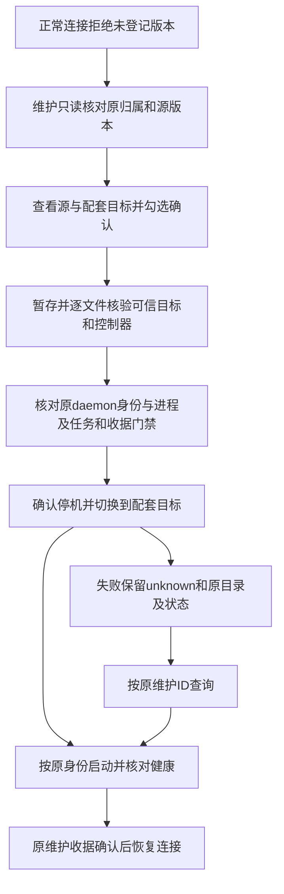

# #29：不受支持后台的明确确认替换

日期：2026-10-29（Asia/Hong_Kong）；基线master 1b7da57，公开alpha.70。关联AB-F04/F05/F06/F17，M01/M02/M04/M05/M10。本轮为未发布源码修复，不覆盖alpha.70的标签、EXE或SHA文件。

## 需求与最终范围

[issue #29](https://github.com/wsjq5477/MA-Relay/issues/29)最初建议登记一份特定定制alpha.46的精确清单。用户随后明确“不用管产物”，并要求Windows客户端变化不应让用户卡在某个特定Linux后台版本；即使校验失败，也应有可选的强制替换按钮。本次按最新指令实现独立的明确确认替换路径，不再把该原始EXE或特定后缀的1707文件清单作为修复前置条件。

本机没有该原冻结EXE或目标SSH连接，未取得该定制manifest；没有猜测完整后缀、伪造1707条文件或将远端自报清单加入信任。正常连接的精确兼容复用规则保留，强制替换只使用当前客户端自带的可信目标。

## 原因与最终行为

原machine.daemonPreview内部调用正常probe，未知版本立即SSH_DAEMON_UPGRADE_REQUIRED；机器清单、关系图与中央又要求机器在线才能维护，导致页面提示升级却无法进入升级。

现在版本拒绝的离线SSH机器可以打开维护：只读核对原安装、owner/profile/UID、无链接目录、current及release标记，返回源/目标版本和明确替换提案。正常probe仍拒绝未知版本。用户先选择“强制替换后台”，再勾选确认并提交replace；缺确认、普通upgrade或更改源/目标摘要均拒绝。任务、Agent工作、原图unknown和未确认收据不允许通过替换绕过。

旧来源目录保留，当前和previous指针有原意图绑定；替换失败不执行未知来源中的Node或代码回滚。原ID恢复核对可信目标、当前指针、原身份和原进程结束证明，只完成同一个目标；目标已运行时只健康核对，不重复停机或切换。普通可信升级仍沿原有受信回滚流程。最终补充持久sourceProcess（原PID/起始时间）：即使socket和锁同时消失，也必须证明原进程已结束，不能仅凭端点不在就启动目标；实际活进程反例保持unknown及原current字节。

## 实际验证

| 环境与检查 | 实际结果及原证据 |
| --- | --- |
| 原1b7da57安装器反例 | 新专项5项1通过/4失败，失败为旧维护预览仍拒绝未登记版本；[原TAP](../../../artifacts/issue29/2026-10-29/baseline-replacement.txt)。仅安装器替换为原源码，中央测试使用当前源码，不冒充全基线运行 |
| Windows源码专项 | 最终134项133通过/1平台跳过，失败/取消0；[TAP](../../../artifacts/issue29/2026-10-29/regression-complete.txt)，包括6项新替换/CAS/确认/原ID/中央入口与UI只读门禁 |
| Windows管理回归 | 61/61；[TAP](../../../artifacts/issue29/2026-10-29/management.txt)，原图台账、机器管理、失败清理、持久进度；与专项部分共享，不相加 |
| WSL Ubuntu22.04/Node22.23.1 | 29/29，零跳过；[TAP](../../../artifacts/issue29/2026-10-29/linux-final.txt)，真实隔离daemon进程/原身份/原数据/内核停机和健康恢复。旧来源Node故意替换为退出93的陷阱，替换成功和失败恢复均不执行它；目标坏摘要、原归属变化、未知任务及原unknown收据阻止停机；另以真实分离CLI三次同ID启动核对单worker/单收据及原ID幂等，见[最终分离替换6/6复验](../../../artifacts/issue29/2026-10-29/linux-detached-replacement-final.txt) |
| Windows生产renderer | [浏览器结果](../../../artifacts/issue29/2026-10-29/ui-final.txt)、[验证脚本](../../../artifacts/issue29/2026-10-29/ui-check.cjs)：合成RPC，离线维护可达、取消0写入、未勾选禁用、确认后只发一次replace、unknown不补发、pageErrors0、980宽度无横向溢出。截图[1440](../../../artifacts/issue29/2026-10-29/replacement-confirm-1440.png)/[980](../../../artifacts/issue29/2026-10-29/replacement-confirm-980.png)；不是EXE或真实SSH |
| 工程 | 桌面类型/生产前端与Core构建通过，[构建日志](../../../artifacts/issue29/2026-10-29/build-complete.txt)；根类型与lint通过，[类型](../../../artifacts/issue29/2026-10-29/typecheck.txt)/[lint](../../../artifacts/issue29/2026-10-29/lint.txt)；相关CJS语法检查通过；用户文档站测试6/6通过，[原日志](../../../artifacts/issue29/2026-10-29/docs-test.txt)。原大chunk提示保留 |
| 文档 | 按check-docs完整执行，原2243项缺失与本次错误集合差异分别核对；无新增链路错误，最终摘要见[文档差异](../../../artifacts/issue29/2026-10-29/docs-delta.json) |

首次Windows专项35通过/3失败来自夹具缺少previous标记且预览不应依赖未知previous；改为仅正常受信维护读取previous后38/38。初轮WSL21/22失败来自合成意图未写真实launch固有的action字段；修正夹具为真实持久形状后替换4/4、最终29/29，原日志保留。首次浏览器选择器匹配到嵌套菜单；重复演练因前一次合成unknown正确禁用维护，清理本验证器自身origin的测试记录后重新验证；不修改真实profile或产品恢复规则。

## 边界与交付

本轮模型调用0、真实用户profile写入0、生产SSH部署/替换0。未构建或修改任何公开EXE，未把issue中另一台机器的历史只读结果记为本轮实测；本机WSL受控进程不是独立生产服务器。原Windows完整矩阵1030通过/1失败/41跳过、文档2243缺失、依赖high1、未签名及完整I06C/I07C/MCP02/父模型/取消/性能边界保留。

源码入口：[维护预览](../../../desktop/electron/ssh-install.cjs)、[原意图派发](../../../desktop/electron/ssh-host.cjs)、[远端切换/恢复](../../../desktop/electron/remote-maintenance.cjs)、[中央离线门禁](../../../desktop/electron/coordinator-service.cjs)、[维护弹窗](../../../desktop/src/DaemonDialog.tsx)、[新回归](../../../desktop/tests/ssh-unsupported-replacement.test.cjs)。M01/M02/M04/M05/M10完整设计与报告、整体设计、架构/数据/协议及用户机器说明同步。
