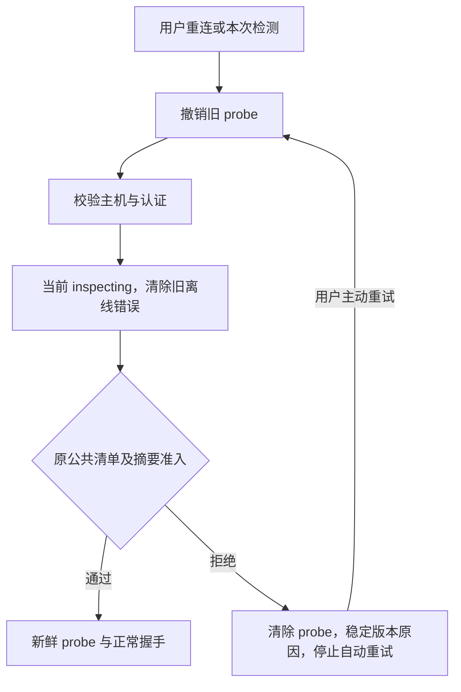

# I08：#27 关系恢复与 #28 SSH 当前观察修复

日期：2026-10-29（Asia/Hong_Kong）；基线 master `7eceec8`、公开 alpha.69。本次工作分支 `codex/fix-issues-27-28`，候选alpha.70尚未发布，不改写 alpha.69 的发布证据。关联 AB-F02/F12/F13/F16，M01/M02/M04/M05/M08。

## 最新 issue 与当前代码的差异

开工重新读取 #27/#28 正文与评论。#27 最新正文声称另一份本地 recovery.2 候选已完成真实 profile 验证，但当前工作区无该候选源码、包或原始证据，master 仍使用旧恢复器；不能把该状态描述当成本次验收。#28 指出 probe 与错误的新鲜度问题，公共兼容清单的拒绝规则本身保持正确。

## #27：按原操作区分关系变更与关系观察

旧恢复器把所有修订相同的 nodeOperations 都当成候选关系变更，因此正常 attach 的关系观察、无关节点 disconnect 的无变更观察也会导致“多个候选”。现在先核对原指纹及原节点来源，attach 只能成为观察；撤权必须从上一关系状态实际推导出该修订才算变更。观察必须与该修订的已证明状态相等，撤权观察还必须证明目标已不在关系中。存在多个真正变更候选、观察矛盾、缺来源或未知收据仍拒绝，不根据修订大小猜测。

图观察器可能丢失回应而留下 unknown，但原网络内已经持久确认。恢复时只读核对同一 operationId 的原方法、完整参数指纹及原确认结果；准确匹配才能继续。未知行、原参数及原收据均不改写，不释放原占位，不重发或另造 ID；缺少原确认或指纹不符继续阻止恢复。

既有逐字节备份、摘要复查、原子替换、selected/envelope 同步和原恢复 ID 幂等保持。已证明在selected基线内的策略/连接历史不再一概阻止后续明确的变更；基线后的策略结果与无法证明顺序的机器旧收据仍要求人工核对；不扩大授权或清空历史。

新增中央能力 `relation-recovery-observations-v2`，新窗口不能静默向只有旧索引同步能力的中央发送恢复调用；返回明确停止旧后台并重开新版的提示，不自动停止后台。

## #28：probe、连接阶段和错误的当前事实

开始 test 和用户重连重新探测时清除旧 probe；探测或 connect 失败均清除。状态合并先撤销旧 probe，再合入当前投影。validating_host/authenticating/inspecting/ready/installing/starting/handshaking/reconnecting 等阶段不继承业务快照的旧离线错误，保持 online=false，不将检测就绪解释为已连接。在线但实际业务 RPC 失败仍显示该失败，不能被 SSH 运输在线掩盖。

机器当前 connectionError 优先；节点只从当前 SSH 阶段和错误投影展示与禁用状态。清单外版本稳定显示“不受当前客户端支持”，提供更新远端或使用明确支持该版本可信客户端的说明。此拒绝不可自动重试；用户主动重连仍可重新输入本次凭据、从空 probe 重新探测。重启中央后仍保留版本错误并阻止自动重试。

新增中央能力 `ssh-current-observation-v1`，有 SSH 连接时的 snapshot 和 SSH 管理调用拒绝旧中央继续提供过期状态，用户可通过已有设置停止后台并重开。能力仅针对中央，不要求升级受信兼容 daemon。公共 compatibleDaemons、manifestDigest、身份校验、协议、凭据存储和信任规则均不变；不自动安装、上传、停止或替换 daemon。

## 当前验证

- [旧源码反例](../../../artifacts/issue27-28/2026-10-29/baseline-relation-original.txt)：Git归档原基线恢复器11通过/5失败；[SSH 基线](../../../artifacts/issue27-28/2026-10-29/baseline-ssh-original.txt)2通过/3失败，保留原输出，不将失败隐藏。
- [定向最终](../../../artifacts/issue27-28/2026-10-29/frozen-targeted.txt)：98/98，通过原 ID/未知、关系存储、旧中央、probe、状态优先级、原兼容清单、正常恢复、上传故障与界面文案受控检查。
- [真实旧写入代码](../../../artifacts/issue27-28/2026-10-29/legacy-writer-report.json)：使用 Git v0.6.0-alpha.46 的原 AgentNetwork、受控依赖宿主，在临时合成目录调用旧保存/attach/remove；索引停1、兼容视图到3，旧恢复器拒绝，新恢复器确认后恢复且原收据不变。是原旧写入代码的受控复现，不冒充旧 EXE 或真实用户 profile。[脚本](../../../artifacts/issue27-28/2026-10-29/legacy-writer-check.cjs)。
- [回环 SSH](../../../artifacts/issue27-28/2026-10-29/ssh-loopback-final.txt)：真实 TCP/SSH 认证与生产 probe 命令，受控只读 SFTP 数据；拒绝未登记版本、空 probe、自动重试停止、再次主动认证通过到相同拒绝，远端写入0。首轮验收器忘记为第二次认证重新提供一次性测试密码，返回 needs_credentials；补齐测试输入后通过，未放宽凭据策略。[原失败](../../../artifacts/issue27-28/2026-10-29/ssh-loopback.txt)。
- [首次全量](../../../artifacts/issue27-28/2026-10-29/desktop-full.txt)：1028通过、2失败、41平台跳过。失败为30ms WSL截止断言在并行负载下超时，以及上传故障夹具未提供新鲜 probe；后者已补齐同一原预览的只读 probe，前者未改生产超时或放宽断言。[相关复验](../../../artifacts/issue27-28/2026-10-29/full-failure-followup.txt)24/24，原失败保留。第二轮以并发2执行，1072项中1030通过、1失败、41平台跳过；失败为DSH自然完成/取消竞态。当前单独复验失败，基线单独检查两次通过、一次相同失败，不能宣称取消已修复或全量全绿。[第二轮全量](../../../artifacts/issue27-28/2026-10-29/desktop-full-final.txt)、[基线相同竞态](../../../artifacts/issue27-28/2026-10-29/baseline-dsh-repeat-2.txt)。之后新增的格式/SSH身份反例由最终定向集覆盖，未再跑完整全量。
- Core/前端构建、类型检查、lint 已执行，详细结果见[构建](../../../artifacts/issue27-28/2026-10-29/build.txt)、[类型](../../../artifacts/issue27-28/2026-10-29/root-typecheck.txt)、[lint](../../../artifacts/issue27-28/2026-10-29/lint.txt)。界面构建保留大 chunk 提醒。

模型调用、原任务重发/取消、真实用户 profile 写入、生产远端修改均为0。浏览器生产renderer合成RPC的阶段/拒绝展示与旧错误抑制已通过，pageErrors=0、980宽度无横向溢出；[脚本和结果](../../../artifacts/issue27-28/2026-10-29/ui-result.txt)。候选包内关系/SSH检查33/33；[冻结后台](../../../artifacts/issue27-28/2026-10-29/frozen-windows.txt)。普通portable EXE合成现场恢复、重开与完整中央重启通过；实际包内UI完成提案/取消/确认及原数据保全，实际包内SSH UI与回环SSH/SFTP也已通过，详见下节。发布仍 alpha.69，不以源码改动更新已发布包结论。

## 候选实际运行与原失败

alpha.70候选EXE132301726字节，SHA-256 b284d076732c0189814818b588439171be6496e08c2218356ef859d0e1d1070d。60后台、84Core、1728Linux文件及实际EXE提取3405资源匹配，225项本轮输入未漂移。[包核验](../../../artifacts/issue27-28/2026-10-29/package-check.json)、[实际载荷](../../../artifacts/issue27-28/2026-10-29/exe-payload-check.json)。

- [普通portable EXE](../../../artifacts/issue27-28/2026-10-29/portable.json)：5→7→6、原接入观察与丢回应图unknown合成现场，启动字节不变、确认恢复/备份、原ID幂等和完整中央重启保持通过；两次启动193226/156474ms，不作为性能准出。原窗口和后台已正常关闭，模型0。
- [实际包内恢复UI](../../../artifacts/issue27-28/2026-10-29/packaged-ui.json)：使用打包后解包目录的真实EXE/ASAR/后台，调试传输仅用于验收。取消不写、未勾选禁用、明确确认后修订13→15及6成员、备份和原请求/收据/其他关系保全通过。调试SDK的app.close曾等待未结束，首轮观察器随后重复连接已关闭后台报path参数错误，保留[原报告](../../../artifacts/issue27-28/2026-10-29/packaged-ui-first.json)。最终验收器在功能检查完成后显式退出自己拥有的调试应用，不把该收尾当作普通窗口生命周期；正常生命周期由上项无调试portable独立证明。
- [实际包内SSH UI](../../../artifacts/issue27-28/2026-10-29/packaged-ssh-ui.json)：真实打包中央通过回环TCP/SSH/SFTP先得到可信当前manifest的ready/probe，再由受控服务切到未登记版本，暂停第二次probe以实际观察inspecting；机器和节点一致显示当前阶段，无旧probe/离线错误。随后三轮快照及界面稳定拒绝版本，自动重复0、远端写入0、非probe命令0，原身份/任务unknown保持。服务器版本切换仅是夹具构造，不是客户端升级/停止真实daemon。
- SSH UI验收器最初在端点存在前attach，遇ENOENT后过早结束；改为对同一待启动端点重试。第二次使用已消耗的一次性测试密码，重连正确停在needs_credentials；最终使用隔离profile中当前用户加密保存的synthetic测试密码，通过原认证流程，不改凭据策略。失败事实保留，实际用户配置和密码未读取或导出。

[恢复提案截图](../../../artifacts/issue27-28/2026-10-29/packaged-recovery-proposal-final.png)、[恢复结果截图](../../../artifacts/issue27-28/2026-10-29/packaged-recovery-success-final.png)、[真实包内inspecting](../../../artifacts/issue27-28/2026-10-29/packaged-ssh-inspecting.png)、[真实包内版本拒绝](../../../artifacts/issue27-28/2026-10-29/packaged-ssh-refusal.png)。截图仅保留匿名恢复内容或Synthetic机器卡片，原profile、认证文件和备份不公开。

## 验收逐项核对

| Issue要求 | 当前证据与边界 |
| --- | --- |
| #27 严格冲突、不启动自动覆盖 | relation-state回归及普通EXE启动前后原字节比较 |
| #27 脱敏诊断/最近收据/匿名成员提案 | 生产恢复面板、实际包内提案截图与最近收据投影；不含原节点/Session/认证 |
| #27 唯一原收据、明确确认、5→7→6及envelope | 原旧写入代码复现、18项恢复回归、普通EXE与实际包内UI的13→15/6成员 |
| #27 unknown、缺来源、跳号、矛盾、重复与多候选拒绝 | 未证明unknown仍阻止；已持久确认仅查原ID核对，不改原unknown；反例和原字节保持 |
| #27 备份/原子替换/幂等、失败保全 | 备份创建/摘要/写入/替换故障注入与原ID重复、真实包内逐字节比较 |
| #27 旧后台门禁及其他关系/历史不变 | 自动启动前与真实旧握手拒绝测试；新恢复能力门禁；全对象/原收据比较 |
| #28 失败probe失效、阶段优先、版本稳定、重试停止 | 包内33项、真实包内SSH UI及回环SSH/SFTP；重启不改版本错误 |
| #28 原公共信任、健康反例、身份/凭据/历史不迁移 | 原兼容清单/摘要反例，公开alpha.69原payload精确pin，实际SSH先ready后拒绝；原IDs/unknown与0写入 |
| 工程/文档/边界同步 | 构建/类型/lint、定向/包内、两轮全量与基线失败分别保留；主文档及M01/M02/M04/M05/M08/M10同步 |

尚未把外部issue中提到的真实profile结果计为本轮证明，未写真实profile、未新增模型/取消/生产远端操作，未提升完整矩阵或性能结论。源码/包的正式公开状态按[alpha.70交付记录](alpha70-release.md)为准。
