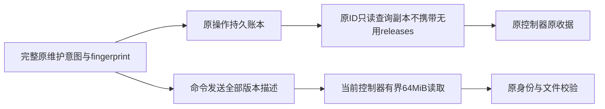

# 完整维护清单输入容量与原 ID 查询

日期：2026-10-23（Asia/Shanghai）。关联I06C维护、AB-F05/F06/F07/F11、M04-F06/F08、M05-F01/F02、M07恢复与M10-F03/F06。公开仍alpha.53；本地alpha.55的清单/只读复用修复保留，但本轮发现其完整维护输入不能通过旧8MiB接收器，不能将55作为完整维护准出。[前片实际证据](daemon-compatibility-refresh.md)。本轮候选alpha.56，不发布、不切换日常后台或部署SSH，模型0。

## 需求与实际缺陷

SshManager为维护携带from/target/controller及全部可信releases，保证升级、回滚和卸载能核验原版本。加入37份精确pin后，实际构造的alpha.55维护输入为**8,665,233字节**，超过remote-maintenance CLI的8,388,608字节上限，原接收器会在解析前拒绝。[原包完整输入尺寸](../../../artifacts/daemon-compatibility/2026-10-23/maintenance-input-size.json)。这不是SSH网络不稳定或后台失联；原RPC帧限制不是此stdin控制面的限制。

要求保留全部原版本描述及校验，原operationId/owner/profile/daemon/UID、完整意图和fingerprint；不能删掉旧版本目录或漏发旧版本清单来满足容量。旧控制器上的原操作仍需只读查询，不重发维护或更换ID。

## 实现与边界

[remote-maintenance.cjs](../../../desktop/electron/remote-maintenance.cjs)新增readMaintenanceInput：按Buffer字节累计，超过**64MiB**即拒绝；收齐后一次拼接并UTF-8/JSON解析。保留完整输入内容，不逐chunk反复扫描累积字符串。解析发生在动作/身份核对之前，超限或无效JSON不能进入launch/query。协议格式仍是原JSON，原Daemon RPC帧仍1MiB；64MiB不是任务消息或MCP工具输入预算。

新维护控制器沿原stageMaintenance从已逐文件验证的当前包复制，不要求运行中的旧daemon改变其代码。旧控制器仍保留自己的8MiB上限。[ssh-install.cjs](../../../desktop/electron/ssh-install.cjs)只对action=query的线端副本设releases=[]：查询不消费版本目录清单，原operationId、身份与其他参数保持；客户端持久remoteInput原对象和fingerprint不改。upgrade/rollback/stop/uninstall命令仍逐字发送完整原意图；全部版本保留，查询不新增维护动作或Task。

新增alpha.55的原清单从已交付EXE完整SHA与1707文件核对后导入，[导入证据](../../../artifacts/daemon-compatibility/2026-10-23/import-0.6.0-alpha.55.json)。当前56索引38项，上限128不变；原32份及此前5份不改。没有新持久字段、关系变更、Task/Session迁移或unknown结算规则。

## 定向验证

- [输入契约](../../../desktop/tests/maintenance-input.test.cjs)：实际完整冻结版本目录超过8MiB，分块读取后所有字段、版本数量和fingerprint一致；逐字节拆分UTF-8保持，第一超限字节拒绝；无效JSON拒绝。**3/3通过**，[TAP](../../../artifacts/maintenance-input/2026-10-23/input-contract.tap)。这是解析契约，不是网络/模型证据。
- [传输与严格复用](../../../desktop/tests/ssh-compatibility.test.cjs)：大查询发送低于旧8MiB限制、原完整意图对象不变，返回原ID unknown；upgrade仍发送完整大目录，未缩减任何版本。加入55精确pin后的专项**26/26通过**，[TAP](../../../artifacts/maintenance-input/2026-10-23/transport-contract.tap)。受控传输，无真实SSH认证。
- [实际维护CLI](../../../desktop/tests/daemon-maintenance.test.cjs)：受控真实daemon进程上，经实际stdin CLI读取完整大清单并查询原unknown，原收据文件字节、原PID/daemonId保持，没有新维护动作。属于本地合成宿主，不是用户原服务器。最终全量中按该测试名登记。

删除既有未用privateDirectory解构并将既有回调三元表达式改为等价if/else，以通过本次整文件lint；没有新增行为或改错误处理语义。最终桌面全量**863/863**通过、零跳过，[TAP](../../../artifacts/maintenance-input/2026-10-23/desktop.tap)。包含实际CLI大输入查询、原daemon身份/收据保持及既有升级/回滚/unknown保护；不是用户原SSH。

包内Windows后端**26/26**严格复用/查询契约、固定短诊断、**8,914,703字节**完整目录解析与fingerprint保真通过，38份包内pin逐文件与源码相符。[报告](../../../artifacts/maintenance-input/2026-10-23/windows-contract.json)、[TAP](../../../artifacts/maintenance-input/2026-10-23/windows-contract.tap)。

alpha.56最终EXE **130191853字节**、SHA-256 **`9c87e70332d9f11b219467793a41b0aed1f16eaa10a8a252232b187890e1f5cd`**；54后台/84Core/1708Linux资源及Core/Windows与Linux后台/ASAR/前端/bootstrap一致性通过。Linux manifestDigest `62c488ff787ca820fd7b92e0c3e07e58e770e4d2274431107350ccca9c136559`。[包核验](../../../artifacts/maintenance-input/2026-10-23/package.json)、[构建](../../../artifacts/maintenance-input/2026-10-23/package-build.log)。普通无调试Windows EXE**4组通过**：实际56版本/目录，生产IPC与SQLite公共记录，窗口重开复用原中央及记录，隔离中央完整重启后记录保持/原生执行0。[报告](../../../artifacts/maintenance-input/2026-10-23/windows-portable.json)。

[alpha.56本地EXE](../../../desktop/release/AgentBridge-0.6.0-alpha.56-Windows-x64.exe)与[SHA256SUMS](../../../artifacts/maintenance-input/2026-10-23/SHA256SUMS.txt)已交付Windows Downloads，同名EXE和.sha256副本完整SHA一致；[下载副本核验](../../../artifacts/maintenance-input/2026-10-23/download-copy.json)。此前55字节保留，不作为完整维护输入修复版推荐。未签名、未公开、未切换日常后台或部署SSH；切换前先在旧窗口“设置→后台运行→停止后台并退出”，再打开新EXE。

## 收尾与未准出

语法/最终lint、前端类型/生产构建通过；文档检查、用户站6/6与构建通过，用户页18/HTML19，内部页面与证据导出0。Core未改，不重复/扩张旧71/71；alpha.54图指标241.069ms仍未准出，本轮没有新图/WSL/原生模型或独立SSH证明。完整I06C/I07C/MCP02和CT-08保持原范围，目标active。

[最终lint](../../../artifacts/maintenance-input/2026-10-23/lint-final.log)、[构建](../../../artifacts/maintenance-input/2026-10-23/build.log)、[文档检查](../../../artifacts/maintenance-input/2026-10-23/docs-check.log)、[用户站测试](../../../artifacts/maintenance-input/2026-10-23/docs-test.log)、[用户站构建](../../../artifacts/maintenance-input/2026-10-23/docs-build.log)、[源冻结清单](../../../artifacts/maintenance-input/2026-10-23/source-manifest.json)、[验收脚本指纹](../../../artifacts/maintenance-input/2026-10-23/scripts-sha256.json)、[原32份与当前38份清单证明](../../../artifacts/maintenance-input/2026-10-23/pin-provenance.json)、[分层汇总](../../../artifacts/maintenance-input/2026-10-23/verification-summary.json)。源冻结是本地工作树证据，不是公开标签。
