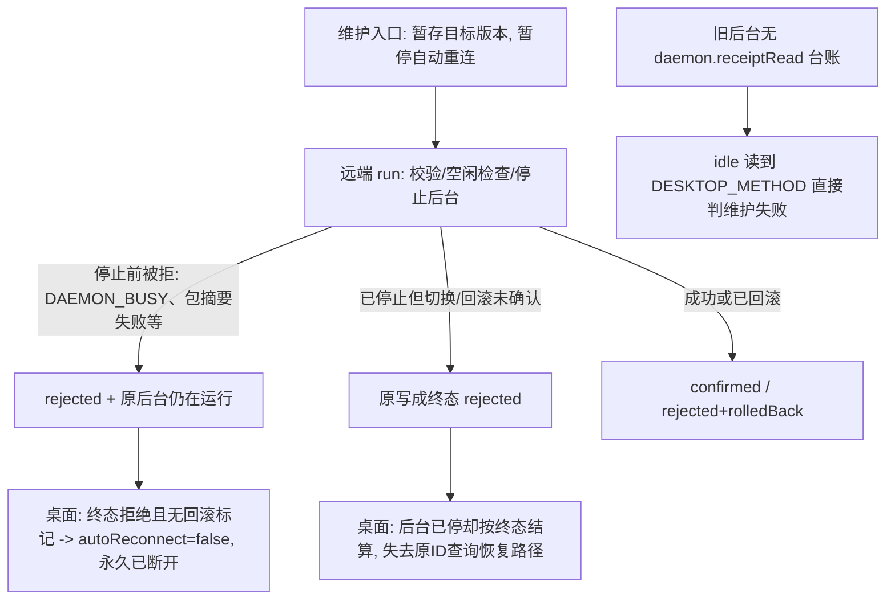

# I08 维护被拒后的离线恢复与旧后台维护兼容

日期：2026-10-21（北京时间）。环境：Linux 本机 / Node v22.23.1；源码工作区版本 `0.6.0-alpha.36`（本轮产品改动尚未提交，最终提交以 Lead 合并为准）。本仓库公开预发布仍是 alpha.36 标签 `1fef25f`，本轮没有重新打包或发布 EXE。

关联整体功能 AB-F01/F06/F11/F17，影响模块 M01、M04、M05。用户恢复步骤见[维护失败后的恢复](recovery.md)；旧后台能力事实见[旧版本远端后台维护能力事实清单](old-daemon-capabilities.md)。

## 1. 需求与现象

用户在一台 SSH Linux 机器的“后台维护 → 升级后台”被拒绝后，机器卡片显示“已断开”；关闭并重开桌面也不恢复；Agent 行仍提示“来源后台需要升级，请使用后台维护”。横幅“远端机器当前离线，已接收任务仍由远端后台保留。”只描述桌面与远端之间的通道，用户看不到维护为何被拒绝，也没有直接的重连入口。现场反馈中该机器远端版本记录仍为 `0.6.0-alpha.2`。

| 编号 | 要求 | 不变量 |
| --- | --- | --- |
| R01 | 维护终态为拒绝、但可证明原后台仍在运行或已恢复时，不得把桌面永久留置为已断开 | 不重发维护、不重发任务；原 operationId/身份/历史不变 |
| R02 | 只有“后台已被停且未确认切换/回滚”才保持不可达；该情形不得写成终态拒绝 | 原 ID 查询/恢复仍能重启原版本，不伪造终态 |
| R03 | 收据要能区分“后台仍在运行/已回滚”与“后台已停且未恢复” | 收据新增字段是对既有 JSON 的可选增量，无协议/身份迁移 |
| R04 | 早于持久收据端点的旧后台不能因为“没有台账可读”而被判维护失败 | 其它读失败仍必须阻断维护（失败关闭） |
| R05 | 拒绝原因对用户可见（机器卡片与未确认操作） | 不泄露秘密或远端任意原文，只展示安全错误码/文案 |
| R06 | 重启桌面后按已落盘收据得到同样的重连结论 | 复用 `ssh-connections.json` 原行与 `autoReconnect` 语义 |

## 2. 根因

本轮未连接用户远端，也没有拿到该机器 `ssh-connections.json` 的维护行，因此**不能定论用户那次维护的具体拒绝码**。以下根因来自源码阅读与受控复现（[发现报告](../../../../artifacts/maintenance-offline/lifecycle/findings.md)）：

1. **桌面把“拒绝且无回滚标记”当成维护完成。** 维护开始时先置 `autoReconnect=false`；终态落地只对 `confirmed` 或 `rejected + data.rolledBack===true` 恢复观察，`rolledBack` 为 false/缺失时保持 `disconnected_manual`、无重连定时器，并随 `ssh-connections.json` 持久化，重开桌面也不恢复。而“拒绝但根本没停过后台”是真实组合：`DAEMON_BUSY`、目标包摘要校验失败等在停后台之前就结束，远端进程与版本原样存活（受控真 daemon 行级证据）。
2. **停机后未确认切换/回滚被写成终态拒绝。** 一旦旧后台已停、新版本未确认启动、回滚也没能确认，写终态 `rejected` 会让桌面按“维护已结束”结算，机器失去可达性且没有恢复证明；正确做法是保留 `unknown`，只允许原 operationId 查询/恢复。
3. **旧后台没有持久收据端点时维护被误判失败。** `idle()` 在 `snapshot` 之后循环 `daemon.receiptRead`；早于持久收据端点的后台对该方法返回 `DESKTOP_METHOD`。当时这被当成读失败直接结束维护，尽管该版本根本没有台账可读（`snapshot` 已是它能表达的唯一空闲门禁）。
4. **拒绝原因不可见。** `publicState().daemonMaintenance` 只声明了操作/状态/动作，没有错误，界面也没有消费；机器离线时旧的能力位 `objectRoutingSupported===false` 仍显示“来源后台需要升级”，与在线状态无关。

`0.6.0-alpha.2`/`alpha.3` 的 daemon 源码不在本仓库历史中（最早提交 `2b6f4f7` 已是 alpha.9）：其是否支持 `daemon.receiptRead`、`daemon.lock` 是否含 `pidStart` 均**未知**。本轮修复覆盖的是“旧后台返回 `DESKTOP_METHOD`”这条已由夹具实测的代码路径，不等于已证明 alpha.2 的实际字节行为。

## 3. 实现与设计取舍

### 3.1 远端收据：新增 `stopped` / `phase`，停机未恢复保持 unknown

[remote-maintenance.cjs](../../../../desktop/electron/remote-maintenance.cjs) 的 `run()` 在所有终态收据的 `data` 中写 `stopped`、`phase`、`rolledBack`、`version`、`historyPreserved`，成功路径同样写出（不再只在 catch 分支写 `rolledBack`）：

- `stopped=true` 表示本次操作确实停过后台（`checkpoint('stopped')` 之后）；
- `rolledBack=true` 只表示已切换过版本且回滚三步全部成功（原版本已重启）；
- `phase` 记录最后阶段（`validated/stopped/activated/healthy/uninstalling/uninstalled`），供诊断与恢复判定。

升级/回滚在“已停止且未确认切换/回滚”时强制 `state='unknown'` + `DAEMON_ROLLBACK_UNCONFIRMED`，由原 operationId 查询/[recover()](../../../../desktop/electron/remote-maintenance.cjs) 恢复；`recover()` 的收据同样补 `stopped/rolledBack`。错误 message 带具体安全错误码，便于用户与诊断看到实际原因。

取舍：**宁可保持 unknown，也不写终态拒绝**。终态会让桌面把机器当“维护已结束”，而 unknown 保留原 ID 查询与恢复路径，让 `recover()` 能停掉残留进程、切回原版本并重启。这与既有“unknown 只查询原 ID、不重发”的规则一致，没有引入新的重试语义。

### 3.2 旧后台空闲兼容：只容忍“没有台账”

`idle()` 对 `daemon.receiptRead` 返回 `DESKTOP_METHOD` 时视为“该版本没有可查台账”，保留前面的 `snapshot` 空闲门禁继续维护；**其它**读失败（超时、身份、通道等）仍然抛出并阻断维护。这样早于持久收据端点的旧后台（无 quiesce/shutdown/releaseMaintenance/receiptRead）可以走“本地 `maintenance.json` + 控制器 `runtime/owned-stop`”完成升级，而不是被误判失败。设计上仍是失败关闭：只有“明确不存在的方法”才降级，不把任意错误当作无台账。

### 3.3 桌面：终态收据证明后台可用才解除暂停

[ssh-host.cjs](../../../../desktop/electron/ssh-host.cjs) 新增纯函数 `daemonAvailable(result, action)`：`stop`/`uninstall` 一律返回 false；其余动作下，终态收据只有在 `data.stopped===true && data.rolledBack!==true && state!=='confirmed'` 时才视为“后台被留置停止”，否则视为原后台仍在运行或已恢复。旧形状收据（无 `stopped` 字段）作为兼容回退同样恢复：旧版本多数终态拒绝发生在停机之前（`DAEMON_BUSY`、包摘要失败、停机校验失败），但也可能来自“已停但未确认切换”的旧路径；此时兼容回退会尝试重连，而重连只会恢复观察或按 `current.json` 启动该版本（`installIfNeeded:false` 且 `installNeeded` 为真时直接要求重新确认安装），不重发任务或控制操作，也不会伪装成功。

`queryMaintenance()` 据此分流：可证明可达 → `autoReconnect=true`、`state('reconnecting')` 并立即排一次只读重连；已停且未恢复 → 保持 `disconnected_manual`；`stop`/`uninstall` 保持断开。重启桌面后按 `ssh-connections.json` 落盘收据走同一判定。重连只恢复观察，不重发任务或维护。

### 3.4 拒绝原因可见

`connection.maintenance.error` 记录拒绝原因（未发送/持久化失败分支同样带上 error），经 `publicState().daemonMaintenance.error` 暴露。离线机器卡片在维护终态为 rejected 时直接显示远端原因与“可重新连接核对远端后台版本”提示（[MachineInventory.tsx](../../../../desktop/src/MachineInventory.tsx)、[types.ts](../../../../desktop/src/types.ts)）；查询得到的 rejected 收据也把原因经 [management-state.ts](../../../../desktop/src/management-state.ts) 的结算通知显示，不再只显示“已收到确定拒绝”。

### 3.5 遗留维护屏障不再顶死后续维护

独立验证的证伪用例（`artifacts/maintenance-offline/verify/`）发现：修复前构建可能留下“收据已终态、远端 `maintenance.json` 仍属原 operationId”的状态。此时 daemon 会以 `DAEMON_MAINTENANCE` 拒绝任何新 operationId 的 `quiesce`，新操作与它自己的 `recover()` 都会停在 `unknown`，形成永久卡死。

[remote-maintenance.cjs](../../../../desktop/electron/remote-maintenance.cjs) 新增 `clearStaleBarrier(input,p)`，在 `stop()` 的 `idle()` 之后、`quiesce` 之前执行：只有当 `maintenance.json` 属于**另一个** operationId，且 `maintenance-operations.json` 中该 operationId 的收据已是 `confirmed`/`rejected` 终态时，才尝试 `daemon.releaseMaintenance`；只有 release 成功或返回 `DESKTOP_METHOD`（该版本无此方法）才删除文件，`DAEMON_MAINTENANCE`/`DAEMON_OFFLINE`/`ENOENT` 一律不删（“不删除未经证明的屏障”），其它错误照旧抛出。unknown 或缺失的行保持屏障；属于本次 operationId 的屏障不处理。这样遗留状态在下一次维护时自愈，而不会绕过真正的未决维护。

## 4. 代码落点

| 文件 | 本轮改动 |
| --- | --- |
| [remote-maintenance.cjs](../../../../desktop/electron/remote-maintenance.cjs) | `idle()` 旧后台无台账降级；`run()` 收据 `stopped/phase`、成功路径写 `stopped/rolledBack`、停机未恢复 → unknown + `DAEMON_ROLLBACK_UNCONFIRMED`、错误 message 带码；`recover()` 收据补字段；`stop()` 前 `clearStaleBarrier()` 清理已终态操作遗留的维护屏障 |
| [ssh-host.cjs](../../../../desktop/electron/ssh-host.cjs) | 新增 `daemonAvailable(result,action)`；`queryMaintenance()` 终态重连分流；`connection.maintenance.error` 记录与暴露 |
| [MachineInventory.tsx](../../../../desktop/src/MachineInventory.tsx) | 离线且维护终态 rejected 时显示原因与重连提示 |
| [types.ts](../../../../desktop/src/types.ts) | `daemonMaintenance.error?` 类型 |
| [management-state.ts](../../../../desktop/src/management-state.ts) | rejected 结算通知显示原收据原因 |

未改动远端协议版本（仍为 2）、daemon 身份、任务/会话/收据 ID，也没有新增数据库或文件格式版本；`maintenance-operations.json` 只是新增可选 `data` 字段。

## 5. 复现与测试证据

**受控夹具**：`desktop/tests/daemon-maintenance.test.cjs` 使用真实生产 `remote-maintenance.cjs`、真实本机 daemon 进程/Unix socket/磁盘，仅把原生 host 换成受控合成 host；“旧后台”夹具通过按大括号匹配删除 `daemon.quiesce`/`daemon.releaseMaintenance`/`daemon.shutdown`/`daemon.receiptRead` 分发块构造，不使用模型。`ssh-recovery-integration.test.cjs` 使用受控 SSH 服务器 + 假 client/installer。**没有真实用户远端、没有真实 EXE/GUI 端到端验证。**

2026-10-21 本机复跑（与代码改动同工作区）：

| 命令 | 结果 |
| --- | --- |
| `cd desktop && node --test tests/daemon-maintenance.test.cjs` | 12/12（新增 4：无 quiesce/shutdown/receiptRead 的旧后台可升级且身份/收据保留；磁盘遗留屏障不顶死新维护；daemon 重启后持有遗留屏障 → release 后升级成功；停机后切换被中断 → unknown，recover 复原原版本） |
| `cd desktop && node --test tests/ssh-recovery-integration.test.cjs` | 8/8（新增 1：终态收据解除重连暂停，`stopped:true` 保持已断开） |
| 上述两文件合计 | 20/20 通过 |
| 相关专项 `daemon-rejection-ssh` / `ssh-security` / `ssh-progress-persistence` 合计 | 38/38 通过（本轮复跑） |
| `cd desktop && npx tsc --noEmit` | 通过（本轮复跑，退出码 0） |
| 全量桌面 node 套件 `node --test tests/*.test.cjs` | 679 项：676 通过、3 失败；失败项为 `installed OpenCode 3.x remains visible but cannot create a context or start a native backend`、`installed OpenCode 1.x reaches production context preparation instead of a 2.x rejection`、`prefixed native versions are recognized and a broken earlier installation does not hide a working tool`。这三项位于本轮未触碰的 [machine-host-readiness.test.cjs](../../../../desktop/tests/machine-host-readiness.test.cjs)、[tool-discovery.test.cjs](../../../../desktop/tests/tool-discovery.test.cjs)，会扫描本机真实安装，属本机环境下的既存失败；alpha.36 冻结基线记录为 WSL 桌面 676/676，本轮没有在本机复现该全绿，如实记为本机未通过 |

受控复现与佐证（只读证据，未改产品代码）：[run-upgrade.cjs](../../../../artifacts/maintenance-offline/repro/run-upgrade.cjs)（升级真实旧后台的三场景脚本）、[fixed-behavior.test.cjs](../../../../artifacts/maintenance-offline/lifecycle/fixed-behavior.test.cjs)（修复后 6 场景契约）、[rows-run-after-fix.log](../../../../artifacts/maintenance-offline/lifecycle/rows-run-after-fix.log)（真 daemon 行级 `stopped/phase`）、[final-check.log](../../../../artifacts/maintenance-offline/lifecycle/final-check.log)、[findings.md](../../../../artifacts/maintenance-offline/lifecycle/findings.md)。

## 6. 未测边界

1. **无真实用户远端**：没有连接现场机器，无法确认用户那次维护的真实拒绝码、`authKind`、是否保存凭据，也不能把本轮结论写成“用户现场已恢复”。
2. **无真实 EXE/GUI 端到端验证**：界面文案与重连结论来自源码 + 受控状态测试；没有在打包后的 Windows EXE 上复现。
3. **旧版本覆盖有限**：alpha.9/alpha.10 与 alpha.15/alpha.35 的能力由清单摘要比对确认；`alpha.2–alpha.5` daemon 源码不在仓库历史中，其是否支持 `receiptRead`、`daemon.lock` 是否含 `pidStart` 未知。本轮只覆盖“返回 `DESKTOP_METHOD`”这条路径，没有覆盖“旧后台返回其它错误码”或“缺 `pidStart` 被 `DAEMON_OWNERSHIP` 拒绝”的分支。
4. **全量桌面套件本机有 3 项既存失败**（tool-discovery/OpenCode 版本类，扫描本机真实安装、本轮未触碰的文件）；alpha.36 冻结基线的 676/676 未在本机复现，本轮不把该结果写成全绿，也不声称已定位这三项的环境根因。
5. **未打包未发布**：本轮改动只存在于工作区，不包含在任何已发布 EXE 中；I06C/I07C 整体准出状态不变。
6. **独立验证已记录的反例与残留风险**（见 [verify-report.md](../../../../artifacts/maintenance-offline/verify/verify-report.md)）：(a) 无已保存凭据的机器在解除暂停后会停在 `needs_credentials`，仍需用户重输密码才真正上线；(b) 被拒绝的 `stop`（后台仍在运行）按既有 `action` 守卫保持“已断开”，属设计语义；(c) `manualDisconnect` 与维护暂停共用 `autoReconnect=false`，后到的终态收据会覆盖手动断开——当前界面仅对未接入草稿提供断开入口，属白名单 IPC 层面的潜在风险，本轮未引入独立标记；(d) `unknown`/`not_found`/`operationId` 不符/查询失败一律不解除暂停；(e) 修复前遗留的已停机收据需要靠下一次维护触发 §3.5 自愈，或按原 operationId 查询核对，不能声称旧收据全部安全。
