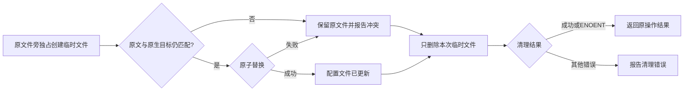

# MCP原生配置失败后的临时文件清理

后续本片已随[alpha.69](alpha69-release.md)公开；下文保留原实施时点、失败和证据边界，不将发布包/新复验写成旧轮实测。

关联AB-F13、M06-F02/F05及Claude/Codex/OpenCode/OpenDesk子适配。2026-10-29，基于master `10fdbb3` 与原未提交工作树的未发布源码维护；公开alpha.68冻结 `38cd637` 不变。延续[上轮Windows清理核查](windows-regression-and-native-probes.md)，本轮只修改共享MCP配置写入器与新增回归，不覆盖上轮Pi/Claude/凭据/列表或界面预览改动。

## 需求、复现与实现

原生MCP配置先写入原文件旁的UUID临时文件，再复核原文、原生目标并原子替换。冲突或替换失败时，原`rmSync(force:true)`在本机Windows系统Node24.12.0的中文profile路径下返回成功但实际留下临时文件；其中包含待写入的原生配置和连接信息。十种布局的添加/移除、两种失败触发共40项在修复前全部因临时文件残留失败；原配置保持及预期错误断言先于残留检查，不能解释为配置写入成功。

修复仅将该单文件清理改为准确`unlinkSync`，只忽略ENOENT。正常原子替换后临时路径已不存在仍成功；并发修改、原生目录切换、替换失败时删除本次临时文件，保留目标文件及无关临时文件；其他清理错误继续报告。没有扫描历史残留或递归删除用户配置目录，没有新建连接或补发原任务。

- 产品源码：[mcp-config.cjs](../../../desktop/electron/mcp-config.cjs)。
- 回归源码：[mcp-config-cleanup.test.cjs](../../../desktop/tests/mcp-config-cleanup.test.cjs)。
- 修复前：[40项原始失败](../../../artifacts/mcp-config-cleanup/2026-10-29/before.tap)；修复后加入三种原生目标切换与清理拒绝检查：[44项专项](../../../artifacts/mcp-config-cleanup/2026-10-29/after.tap)。

十种配置布局为Claude JSONC、Codex TOML、OpenCode V1/V2 JSONC、Pi严格JSON、Hermes YAML、DSH CLI/Web/Desktop补丁YAML及OpenDesk Desktop JSONC。OpenDesk CLI仍仅导出，不因共享写入器支持其内部格式而开放安装。用例只使用临时合成home与合成连接信息；并发变更、替换拒绝及目录切换均为受控注入，不冒充真实原生程序竞态。



## 实际验证与运行时边界

| 场景 | 实际结果 | 原始证据与限制 |
| --- | --- | --- |
| Windows11、系统Node24.12.0专项 | 原40项0/40；修复后扩展44/44，失败/取消/跳过0 | [前](../../../artifacts/mcp-config-cleanup/2026-10-29/before.tap)、[后](../../../artifacts/mcp-config-cleanup/2026-10-29/after.tap)；配置级真实文件系统与受控竞态 |
| Windows相关MCP集合 | 118项117通过、失败/取消0、1个原Linux平台跳过 | [最终TAP](../../../artifacts/mcp-config-cleanup/2026-10-29/windows-final.tap)；9文件，含配置归属/撤权、原生目录绑定、协议、路由及原列表启动；早期40专项版本集合114项113通过/1跳过另[保留](../../../artifacts/mcp-config-cleanup/2026-10-29/windows-related.tap) |
| Electron44.7.0 / Node24.21.0组件 | 原实现同40项40/40，修复后44/44；两个进程退出0 | [旧实现TAP](../../../artifacts/mcp-config-cleanup/2026-10-29/electron-before.tap)、[修复后TAP](../../../artifacts/mcp-config-cleanup/2026-10-29/electron-after.tap)、[运行时报告](../../../artifacts/mcp-config-cleanup/2026-10-29/runtime-comparison.json)；因此不能声称公开普通EXE也复现该系统Node缺陷 |
| WSL Ubuntu22.04 / 包内Node22.23.1相关集合 | 118/118，失败/取消/跳过0；独立临时Home已移除 | [完整TAP](../../../artifacts/mcp-config-cleanup/2026-10-29/linux-related.tap)、[隔离启动脚本](../../../artifacts/mcp-config-cleanup/2026-10-29/run-linux.cjs)；相同9文件，含Windows原平台跳过，不是独立SSH |
| 根typecheck / lint、两份CJS语法与未使用/不可达检查 | 通过 | [类型日志](../../../artifacts/mcp-config-cleanup/2026-10-29/typecheck.log)、[lint](../../../artifacts/mcp-config-cleanup/2026-10-29/lint.log)、[CJS规则日志](../../../artifacts/mcp-config-cleanup/2026-10-29/cjs-lint.log) |
| 用户文档测试与生产构建 | 6/6；18页/19HTML/158资源审计通过，内部页面/证据导出0 | [测试](../../../artifacts/mcp-config-cleanup/2026-10-29/docs-test.log)、[构建](../../../artifacts/mcp-config-cleanup/2026-10-29/docs-build.log) |
| 完整文档检查 | 281份Markdown，仍退出1、原2243缺失，新增0/移除0 | [检查JSON](../../../artifacts/mcp-config-cleanup/2026-10-29/docs-after.json)、[差异](../../../artifacts/mcp-config-cleanup/2026-10-29/docs-delta.json)；未生成占位证据掩盖历史缺失 |

Electron旧实现取自本轮前未修改的HEAD模块，以测试进程内预加载编译到原模块路径；没有替换工作树。对照只运行原40项，两组测试均不加载真实账号或调用模型。首次比较脚本误算仓库根目录，`git show`以128退出、测试未启动；修正脚本路径后得到上表结果，不能算产品失败。

以上是本轮实际定向运行，不复用上轮全量计数；跨平台共享场景不相加为独立功能数量。

## 合约、文档与后续

已核对architecture/data-model/protocol：无新增RPC、字段、持久格式、进程层或权限；保留原独占临时写入、原文/目标复核及原子替换。配置加载、原生连接、工具可用和授权仍独立；unknown、原requestId/operationId、任务/Session及撤权策略未改。因此上述三份合约正文无需制造新接口。完整设计、四个子适配设计/报告、整体设计、测试、路线、接入矩阵、用户连接说明与迭代索引同步。

同步时修正OpenCode子设计中“仅支持V2”的过期说明：实际源码与既有受控回归已按原生代际支持V1/V2，本轮没有新增V1产品能力。整体设计中已进入alpha.68的原生保护改回当前发布状态，不将历史源码待发布说明当作新功能。

复现：

```powershell
node --test desktop/tests/mcp-config-cleanup.test.cjs
node artifacts/mcp-config-cleanup/2026-10-29/runtime-comparison.cjs
node scripts/check-docs.mjs
```

本轮模型0、未打包或发布新EXE、未切换日常后台、未接独立SSH、未读写真实原生profile。完整I06C/I07C/MCP02、真实父模型、冷启动与普通EXE准出不变。下轮可继续核查运行时目录与SSH归档的失败清理，但需分别复现，不把单文件问题泛化为递归删除方案。
