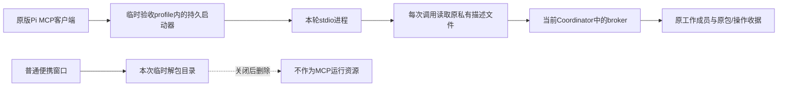

# alpha.63 原生 MCP 窗口生命周期与 WSL 持续连接

后续已随[alpha.63](../I08/alpha63-release.md)公开：源码与EXE/校验文件分发及匿名完整下载核验通过，原实际验收范围与未准出边界保持；开发目标按用户要求暂停。

日期：2026-10-25（Asia/Shanghai）。关联 I08-MCP02-R10/T16、I06C、CT-05/06/07/08 和 M01/M02/M03/M05/M06/M07/M08/M10。仅增强验收器与更新证据，无产品运行行为、架构/数据/协议或版本变化。本地仍为[alpha.63](../I07/context-delivery.md)，公开alpha.60；未签名、未切换日常后台、未部署SSH、模型0。完整目标继续进行中。

## 本轮补齐的缺口

此前普通EXE六组验证了原包/收据持久化，但其stdio客户端在窗口关闭前已退出，不能据此证明关闭窗口后原生MCP仍可用。本轮保持真实原版Pi的MCP客户端在线，先确认原窗口和包装进程退出、原解包文件实际删除，再进行只读工具调用；另明确重开原生客户端及整个Coordinator，核对同一配置和身份。

本轮Pi使用原工作MCP22工具，属于外部成员连接组件，不能推定Pi托管任务注入、经典10工具长期独立授权或父模型自主调用已通过。WSL另按原生Codex列表和Linux通用stdio客户端区分证据。

## Windows普通EXE与原版Pi

最终验证输入为alpha.63便携EXE **130203473字节**、SHA-256 `2ba100ea01ceee057bed3a03763b92a442c75bd4b094ed70873608f49157b40a`，普通窗口没有调试参数。系统Node24.18.0，原版Pi1.4.0的配置加载器、MCP运行期、认证存储、CLI和package.json共5份与[保留原包摘要](native-policy-components.md)逐项一致。只使用本次临时profile/Home与受控文档，未复制日常原生配置或模型账号。

[原生补验器](../../../desktop/tests/windows-native-mcp-lifecycle.cjs)由[普通EXE验收器](../../../desktop/tests/windows-portable-mcp-defaults.cjs)显式可选启用。生产Coordinator创建原工作连接；原版Pi加载器读取该临时MCP配置，其实际McpServerConnection连接生产stdio。每阶段读取原工作、原传递和原接收operation收据；核对原run/agent、私有端点令牌（只在内存比较，不输出）、完整原确认收据/指纹和配置字节。

| 阶段 | 当次实际结果 |
| --- | --- |
| 第一次普通窗口打开 | Pi发现22工具，原成员/工作与原包接收状态、原操作收据匹配 |
| 第一次关闭、原解包文件已删除 | 同一个原生MCP传输对象继续成功读取；不以仅窗口消失为准 |
| 明确关闭并重开Pi MCP客户端 | 仍用原配置/启动器/描述文件，保持原工作成员、端点身份和原收据 |
| 第二次普通窗口打开 | 采用另一个实际解包目录；原生传输没有被替换 |
| 第二次关闭、原解包文件已删除 | 同一原生传输仍可成功读取 |
| 完整Coordinator停止、第三次普通窗口打开 | 新Coordinator PID与第三个解包目录；同一原生传输从更新的描述文件访问新broker，私有授权身份/原收据保持 |
| 第三次关闭、原解包文件已删除 | 只读调用再次通过；随后原生客户端和原Coordinator确认退出 |

这是普通EXE既有六组要求加一组原生生命周期要求，共**七组通过**；上表七次原生观察为该附加要求的分阶段证据，不相加成十四组。三次主窗/包装进程退出码均0、残留原PID为空；三个解包路径真实不同且各次关闭后旧文件不存在。新任务/原生attempt/模型数均0。

[最终普通EXE报告](../../../artifacts/native-mcp-lifecycle/2026-10-25/final-closed/ordinary-final.json)、[实际驱动退出码0](../../../artifacts/native-mcp-lifecycle/2026-10-25/final-closed/ordinary-driver-result.json)、[驱动](../../../artifacts/native-mcp-lifecycle/2026-10-25/final-closed/windows-runner.ps1)。较早配置/成员检查的七组[原报告](../../../artifacts/native-mcp-lifecycle/2026-10-25/initial/ordinary.json)和增强端点/收据的[中间报告](../../../artifacts/native-mcp-lifecycle/2026-10-25/final/ordinary-final.json)分别保留，最终只引用末次严格收尾结果。

同时发现原验收脚本的finally会忽略最后一次关闭错误，且检查完成就先标passed。现改成 `checks_passed_cleanup_pending`，必须最后一窗/原生客户端/原Coordinator均确认退出才最终passed；关闭失败、剩余包装进程、原Coordinator30秒内未确认退出均以cleanup_pending和非0驱动码保留。早期报告实际三次退出均有原始通过证据，不据此改写历史产品结果。本次修复只影响验收器，不改变产品关闭行为。

## WSL实际持续连接

当前alpha.63实际Windows→WSL **15分钟/180样本通过**，连续窗口900173ms、每5秒一组；随后删除/重开/撤权/轮换/移除和清理均通过，共六组要求。[完整结果](../../../artifacts/wsl-sustained/2026-10-25/sustained.json)、[实际驱动退出码0](../../../artifacts/wsl-sustained/2026-10-25/driver-result.json)、[显式验收器](../../../desktop/tests/windows-wsl-sustained-mcp.cjs)。

环境为Windows10.0.22000、系统Node24.18.0→原生产Coordinator/AgentNetwork/HostConnection→实际Ubuntu（内核5.10.16.3-microsoft-standard-WSL2），原生Codex0.162.1。Linux通用stdio观察客户端由随包Linux Node启动；宿主bootstrap仍沿产品既有Node选择逻辑，没有替换启动时序、握手或发送路径。包完整SHA与Linux清单63、关键模块逐项匹配，独立临时Codex Home/Bridge目录；Windows日常Codex配置只读摘要前后保持。

| 组 | 当次实际结果 |
| --- | --- |
| 当前原生配置 | 生产路由写独立Linux Codex Home，Codex自身列表加载；Bridge原探测得到经典10工具，不冒充Codex父模型消费 |
| 真实Linux协议 | Linux通用stdio客户端调用生产broker/Windows协作路由；原node作用域匹配、伪造身份拒绝 |
| 原连接持续窗口 | 180次均为同一个原Windows WSL子进程、原Linux驱动、原connectionId；配置摘要保持，执行/委派0 |
| 外部删除与宿主重开 | 确认原WSL启动进程退出后才重开；外部删除的原生配置保持缺失、不自动补装，旧缓存客户端仍可读取 |
| 撤权与身份轮换 | 显式撤权立即拒绝旧客户端；重新添加轮换身份，只有新客户端可用，旧客户端继续被拒绝 |
| 最终移除与清理 | 原配置移除、新缓存客户端也被拒；两个客户端停机标记、原WSL启动进程退出确认，无cleanupPending |

每组持续样本包含一次Linux stdio工具读取与一次mcp.status，包含验收邮箱观察开销，往返p50 **114ms**、p95 **155ms**、最大189ms；它不是图反馈或UI同步指标，不用于关闭图100ms门禁。[180条派生统计](../../../artifacts/wsl-sustained/2026-10-25/derived-metrics.json)。成功运行结束后只读Linux进程核对：本测试宿主、驱动、stdio客户端残留均0，[核对](../../../artifacts/wsl-sustained/2026-10-25/linux-cleanup-audit.json)。

首轮在创建WSL进程前，测试辅助windowsToLinux只接受盘符而拒绝当前UNC资源路径；没有启动WSL/客户端。按产品现有linuxResourcePath转换修正测试路径后才开始上述运行，未改产品或重试已派发请求。[首次失败stderr](../../../artifacts/wsl-sustained/2026-10-25/sustained.stderr.prelaunch-path-failure)、[原驱动失败码](../../../artifacts/wsl-sustained/2026-10-25/driver-result.json.prelaunch-path-failure)、[实际执行脚本副本](../../../artifacts/wsl-sustained/2026-10-25/runner-executed.cjs)。

没有停止、冷启动或升级WSL发行版。此窗口证明本次已运行发行版中的持续协议和重开/撤权，不将历史9/20、80探针中的首写前失败或其他环境改成通过；整体WSL稳定性、冷启动、系统重启与故障恢复矩阵仍未准出。

## 指定父模型验收前置

本次[严格只读原日常端点检查](../../../artifacts/native-mcp-lifecycle/2026-10-25/parent-availability.json)返回ENOENT，原身份字节不变、原私有验收意图不存在。本次父/子模型提交0，未启动日常后台或创建关系；Windows OpenCode一次心算许可保留。此检查仅认证hello，不因端点不可达猜测当前正式目标列表。

[只读检查器](../../../desktop/tests/windows-parent-availability-readonly.cjs)直接读取既有身份并按原协议连接；没有调用会创建身份/调整私有目录ACL的ensure/open路径，不写原意图、关系或业务状态。已向用户询问原日常环境的可用时间，同时继续其他验收，不重复申请同一个模型许可，也不换目标或重建关系绕过原限制。

## 当前准出边界

MCP02-T16在Windows原工作连接/Pi客户端/本次最终EXE生命周期这一子范围已通过；其他原生入口、经典独立连接、跨版本升级/回滚、托管Task/父模型和SSH不能由此推定完成。WSL持续窗口与收尾单列；原始启动器首写之前故障、冷启动/持续故障恢复、图100ms、完整I06C/I07C/MCP02与日常多主仍未准出。

## 交付与工程核对

本轮仅验证器/文档变化，未新建alpha.64、未重打包或改生产文件。[180个构建前冻结产品/依赖文件](../../../artifacts/native-mcp-lifecycle/2026-10-25/product-unchanged.json)再次一致，[包核对](../../../artifacts/native-mcp-lifecycle/2026-10-25/package-unchanged.json)57后台/84Core/1715Linux和ASAR/前端/bootstrap一致；原EXE及Downloads完整摘要保持。最终[Windows进程核对](../../../artifacts/native-mcp-lifecycle/2026-10-25/final-process-audit.json)AgentBridge进程0，不终止用户进程或改变日常环境。

相关脚本lint与文档检查、用户站测试/构建结果见[最终分层汇总](../../../artifacts/native-mcp-lifecycle/2026-10-25/verification-summary.json)。上一分片944/944与Core71/71保留原日期和源码范围，本轮不重跑未受影响的产品全量，不把本次观察组加成新的单元测试数。[Windows验证器摘要](../../../artifacts/native-mcp-lifecycle/2026-10-25/verification-scripts.json)、[WSL验证器摘要](../../../artifacts/wsl-sustained/2026-10-25/verification-scripts.json)。
