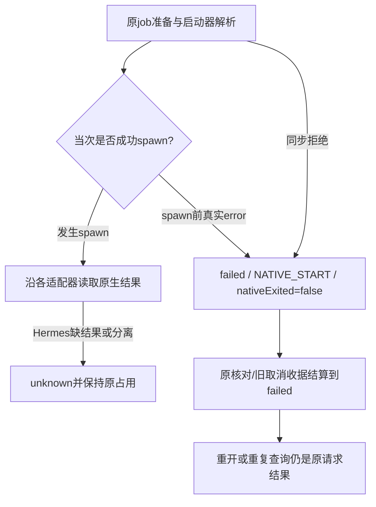

# 原生CLI启动前失败与原请求结算

日期：2026-10-28（Asia/Hong_Kong）。基线master `c40f45e9696c7c3e97ad8bf4f72486a843bed3c5`加工作树已有[Hermes分离保护](hermes-detached-input.md)、[Pi目录绑定](pi-session-workspace.md)。当前公开仍为0.6.0-alpha.67；本片为未发布源码修复，无新EXE/标签、日常后台切换或SSH部署。

## 需求与缺口

关联AB-F07/F10/F11、M06-F01/F04、M07-F01/F04/F06/F07。沿原ID查询而不重发的前提，是准确区分“明确未启动”和“已经启动但结果不明”。本轮检查共用NativeCliHost worker发现两个问题：

1. 实际所选原生可执行文件无法spawn时，ChildProcess先报error再close，没有正式result。Hermes原有缺result规则把这种明确未启动也留为unknown，占用原上下文；Pi/DSH虽报failed，却使用一般NATIVE_FAILED及默认nativeExited=true，缺少正确的启动边界和控制收据含义。
2. 启动器解析同步拒绝时，原代码已有NATIVE_START，但未显式写nativeExited=false，原核对/旧取消收据可能被描述为“已读取原生终态”。

| 需求 | 验收行为 |
| --- | --- |
| NATIVE-START-01 | 参数/启动器同步拒绝或真实ChildProcess在spawn事件前报告error时，以原Task failed/NATIVE_START及nativeExited=false结算 |
| NATIVE-START-02 | 原requestId重复/重开仍返回原失败，不重派；原核对/旧取消收据可confirmed，但data.status=failed、nativeExited=false，不表示取消成功 |
| NATIVE-START-03 | 发生过spawn后的失联、缺结果、stderr文本及当前安装文件缺失不能作为未派发证明；原历史unknown保持占用与原ID查询 |

## 实现与边界

[共用worker](../../../desktop/electron/native-cli-host.cjs)在当次内存记录spawned与spawnFailed。Node的真实ChildProcess事件是判断依据；不从stderr搜索ENOENT、不从非零退出码或缺少文件倒推。对启动器解析/参数构造的同步异常同样显式写nativeExited=false。

处理过程先等待ChildProcess close并清理本轮计时器，再将spawn前error输出为既有terminal事件；Hermes/Pi/DSH未启动证明优先于各自“缺原生结果”的解析分支。发生过spawn则继续原结果/未知规则；Hermes客户端退出不等于网关任务终止。



只更改当前worker产出的证据，不在snapshot/reconcile中根据当前安装缺失、PID不存在或无日志清理旧unknown。旧复制worker不会被热替换；历史Task/Conversation/Session/requestId/operationId、原图和占用均不迁移，也不自动重试失败请求。

使用现有terminal.code/status/nativeExited与原控制收据格式，没有新增持久字段/数据版本/RPC。原取消confirmed只说明原操作已核对；data.status=failed和nativeExited=false不能展示成原生退出或任务已取消。Hermes取消仍false，没有增加网关恢复、权限/表单或MCP能力。

JS启动器若已经spawn了Node，而脚本稍后报错，本片不会仅凭错误文案认定未启动；缺少更强证明时继续原有保守规则。Bridge启动worker本身的失败继续使用已有failLaunch逻辑。DSH服务/OpenDesk服务适配及Claude/Codex独立worker不在本片改动范围。

## 实际验证

Windows、Node24.12.0；所有新场景为隔离临时目录/受控进程，模型0。缺失exe触发实际OS/Node spawn错误，缺失且无法解析的cmd触发实际启动器同步拒绝；未启动任何已安装原生Agent、网关或模型。

| 层级 | 结果与范围 | 证据 |
| --- | --- | --- |
| 修改前复现 | 新专项8项中2通过/6失败；Hermes缺失exe为unknown、Pi/DSH代码为NATIVE_FAILED，同步拒绝的nativeExited为true | [baseline TAP](../../../artifacts/native-start/2026-10-28/baseline.tap) |
| 启动专项 | 8/8：三工具各两种明确启动失败；原收据/原ID/重开；已启动Hermes即使stderr写ENOENT仍unknown；三工具历史unknown不按现文件清理 | [测试](../../../desktop/tests/native-start-boundary.test.cjs)、[修复后TAP](../../../artifacts/native-start/2026-10-28/start-fixed.tap) |
| 当前组合回归 | 64/64，失败/跳过0；启动8、共用原宿主22、原核对23、Hermes分离11，含前片Pi目录/旧44项混合集；共享用例不跨模块相加 | [最终TAP](../../../artifacts/native-start/2026-10-28/related.tap) |
| 工程 | 根typecheck/lint、CJS未使用/不可达检查、核心构建与桌面TypeScript/Vite生产构建通过，保留既有大chunk提示 | [类型](../../../artifacts/native-start/2026-10-28/typecheck.log)、[lint](../../../artifacts/native-start/2026-10-28/lint.log)、[CJS](../../../artifacts/native-start/2026-10-28/cjs-lint.log)、[构建](../../../artifacts/native-start/2026-10-28/build.log) |

测试中的旧取消和核对意图由fixture按原Task/operationId受控持久种入，再让真实生产观察器按当次启动证据结算；不是通过Hermes不支持的取消入口提交新取消。后续断线用真实受控Node查看器，成功spawn并输出Session后退出，验证不会因stderr错误文本或无result释放unknown。历史unknown用独立旧状态文件，禁止任何新worker启动。

构建日志结束于06:04:55 UTC；收尾只读核对发现AppShell/MachineInventory/NetworkApp/workbench.css存在06:08–06:09 UTC的同期改动，另有界面验收脚本。它们不由本片修改，保持原样；上述构建通过仅证明执行时源码，64项回归不覆盖这些界面改动，整合候选前须重新冻结与验证。

复现：

```powershell
node --test --test-concurrency=1 desktop/tests/native-start-boundary.test.cjs desktop/tests/native-cli-host.test.cjs desktop/tests/native-reconcile.test.cjs desktop/tests/hermes-detach.test.cjs
npm run typecheck
npm run lint
npm run desktop:build
node scripts/check-docs.mjs
git diff --check
```

## 同步与未完成项

整体功能、M06/M07完整设计及报告、架构/数据/协议、接入矩阵、Hermes用户说明、路线/测试与迭代索引已同步；原有两个原生模块仍在worker复制/打包范围，没有新依赖或M10清单变化。

文档检查仍为原2243项历史材料缺失，新增0/移除0，命令退出1；见[最终检查](../../../artifacts/native-start/2026-10-28/docs-final.log)和[差异摘要](../../../artifacts/native-start/2026-10-28/docs-comparison.json)，不把原缺失或历史失败改成通过。`git diff --check`通过。

尚待冻结含三项修复的候选包，并验证包内/普通EXE、真实原生执行/续聊/等待/取消/恢复、自主父模型/普通被委派、独立SSH及图性能/冷启动/完整故障矩阵。源码受控通过不是上述完整准出，整体目标继续进行。
