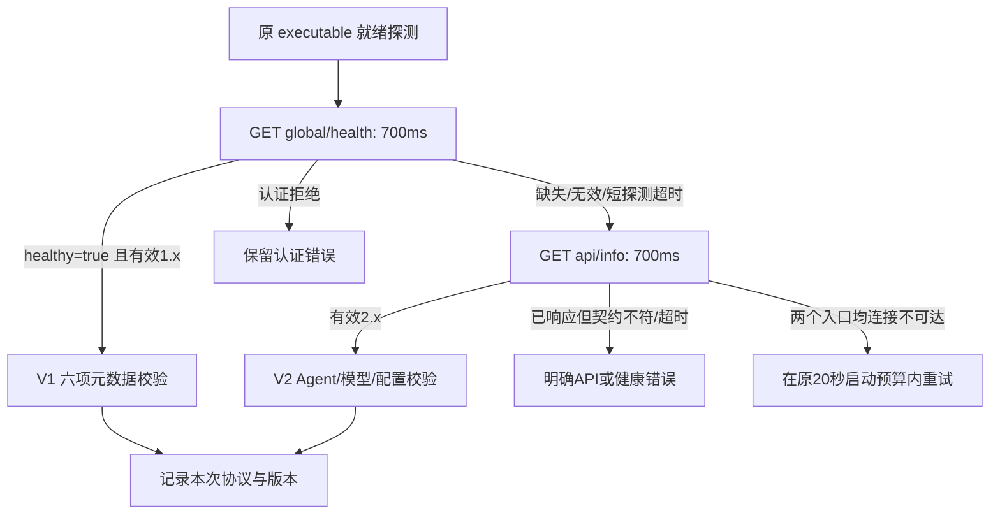

# issue #21：OpenCode 有界协议协商与原安装保护

日期：2026-10-23。需求：[issue #21](https://github.com/wsjq5477/MA-Relay/issues/21)。关联 AB-F01/F02/F07、M01-F02、M03-F01/F02、M06-F01、M06-OC-F01、M10-F01/F02/F03。

实现阶段交付本地候选 **0.6.0-alpha.53**，承接 alpha.52 既有增量；当时未发布标签或附件。用户随后明确要求发布EXE，已在已公开源码5269d65创建alpha.53预发布并通过匿名完整下载核验，见[发布记录](alpha53-release.md)。未切换日常后台或部署SSH。工作区已有大量修改，本轮保留并在其上限定修复。

## 需求与根因

旧 OpenCodeClient 首探 `/api/info`，只在 404/405 或格式错误时回退 V1。早期 1.x 会在该路径进入初始化并挂起；15秒业务超时变为 NATIVE_UNAVAILABLE，启动循环吞掉后最终报 NATIVE_START_TIMEOUT，无法进入本已可用的 V1 健康与元数据接口。

验收要求：有效 V1 不触碰挂起的 `/api/info`；发现/元数据时限独立，2.x 继续完整校验；监听与协议、认证、配置错误可区分；只读、原安装与观察版本一致、界面状态一致，旧 unknown 不因新探测释放。

## 实现



- 整次探测（含响应体与元数据）限4000ms；托管启动另传剩余启动预算。每次复验清除内存协议选择，不跨重启缓存；有效V1只请求一次健康入口并保留全部元数据校验。可选V1健康路径的非认证HTTP错误（含500）允许继续检查2.x，不能遮蔽有效的2.x接口；共享认证401/403立即保留。
- 已响应却不满足契约、候选/元数据超时为 OPENCODE_API_UNSUPPORTED。401/403、版本、Agent、配置及其他明确HTTP错误保留自身类别。启动只重试 NATIVE_UNAVAILABLE，不再把已监听的HTTP500/503等确定失败吞为20秒超时。普通请求仍限15秒，未改其取消/错误语义。
- OpenCode API未就绪时快照投影 connected=false、executionSupported=false、available=false，原持久接入意图保留。界面即使收到旧 connected=true 的 needs_check 数据，也显示“待检查原生 API”。
- 显式接入复验原 executable 并更新观察版本，再记录同版本API结果。已管理、接入、存在兼容记录或上下文的节点保留原安装；PATH发现另一安装不能静默换绑。原安装未发现则显示原安装不可用。
- 没有新RPC/持久格式，也没有修改原模型、供应商、配置、Session、Prompt、任务、取消或恢复协议。没有查询后重放、删除unknown或伪造历史confirmed/rejected；仅新显式操作按既有收据规则处理。

实现：[协议客户端](../../../src/drivers/opencode-client.ts)、[V1](../../../src/drivers/opencode-v1.ts)、[启动](../../../src/native-server.ts)、[节点投影与接入](../../../desktop/electron/agent-network.cjs)、[状态呈现](../../../desktop/src/MachineInventory.tsx)。

## 实际检查与证据

环境：WSL/Linux，Node22.23.1；Windows Node24.18.0、Edge155.0.4283.45。均为受控契约/合成profile；模型调用 **0**。

| 检查 | 实际结果 | 原始证据 |
| --- | --- | --- |
| 修复前协议对照 | 失败：同一挂起夹具约15018ms返回NATIVE_UNAVAILABLE | [日志](../../../artifacts/issue21/2026-10-23/before-probe.log) |
| 修复前托管启动对照 | 失败：原源码临时副本约33秒后NATIVE_START_TIMEOUT，证明旧循环跨越20秒预算 | [日志](../../../artifacts/issue21/2026-10-23/before-startup.log) |
| 修复后托管启动 | 早期V1型夹具通过；跳过api/info，启动/核验低于5秒，GET写入0 | [最终启动](../../../artifacts/issue21/2026-10-23/startup-final.log) |
| 1.x/2.x、等待/取消/原Session恢复 | 首批定向12/12通过 | [定向回归](../../../artifacts/issue21/2026-10-23/probe-tests.log) |
| 核心全量 | 71/71通过；最末启动错误分类另跑定向回归，见下方最终记录 | [全量](../../../artifacts/issue21/2026-10-23/core-final.log) |
| 桌面全量 | 844/844通过；原unknown、上下文和安装保留，显式接入版本更新、状态/能力一致；共享计数不跨模块相加 | [全量](../../../artifacts/issue21/2026-10-23/desktop-tests.log) |
| Windows生产前端 | 2组通过，pageErrors=0；失败/成功状态、实际版本与零业务写入 | [报告](../../../artifacts/issue21/2026-10-23/ui/report.json)、[失败截图](../../../artifacts/issue21/2026-10-23/ui/failed.png)、[成功截图](../../../artifacts/issue21/2026-10-23/ui/success.png) |

最终启动专项、工程/文档检查与EXE证据在本页末登记。

Windows Node另跑本轮后端状态契约2/2通过。源码SSR在Windows因仓库仅安装Linux esbuild而未能执行；该项Linux10/10及Windows生产构建/Edge2组已经通过，不把跨平台依赖缺失当产品通过。Node --test 的UNC发现失败改为直接载入文件后才运行后端用例。[后端通过与SSR环境失败](../../../artifacts/issue21/2026-10-23/windows-state-tests.log)、[最初UNC启动失败](../../../artifacts/issue21/2026-10-23/windows-state-launch-first.log)。

首轮检查失败保留：SSR缺Props、托管清理先删workspace后停进程，均在夹具修正；原生CLI默认模型继承夹具新增只读global/health响应后，核心由70/71复验为71/71。[首次核心](../../../artifacts/issue21/2026-10-23/core-tests.log)、[首次SSR](../../../artifacts/issue21/2026-10-23/node-ui-tests.log)、[清理次序](../../../artifacts/issue21/2026-10-23/startup-test.log)。最初清理次序失败留下的自有合成服务已按原命令、同用户与pidfd核验并停止，[清理证据](../../../artifacts/issue21/2026-10-23/cleanup.json)。首次普通EXE已通过协议检查，但完整台账字节比较被合法新增的自动布局confirmed记录打断；改为严格比较原operationId的全部字段，保留其他记录而不清理。[首轮普通EXE](../../../artifacts/issue21/2026-10-23/portable-first.json)。

复现命令（先将Node22.23.1的bin加入PATH）：

```bash
npm test
node --test --test-concurrency=1 desktop/tests/*.test.cjs
node --import tsx --test tests/opencode-probe.test.ts tests/opencode-version.test.ts tests/native-identity.test.ts
npm run typecheck
npm run lint
npm run build --prefix desktop
node scripts/check-docs.mjs
npm run docs:test
npm run docs:build
npm run dist:win --prefix desktop
```

Windows脚本：[生产前端](../../../desktop/tests/windows-opencode-probe-ui.cjs)、[普通EXE与包内Core](../../../desktop/tests/windows-opencode-probe-portable.cjs)。参数分别为输出目录，以及EXE路径/报告路径。脚本仅在临时profile和HTTP夹具运行，不发送模型需求。

## 边界与使用

本轮没有重新定位并运行issue现场的WindowsApps OpenCode1.2.22.h0.r1；上述1.2.22为合成契约版本，不能作为真实原生验收。issue内诊断仍属原日期现场证据。真实模型、原生完整Session、独立SSH以及完整I06C/I07C/MCP02未测/未准出。

切换到本地候选前，在旧窗口执行“设置 → 后台运行 → 停止后台并退出”，再打开alpha.53。普通关闭窗口会保留旧后台。原NATIVE_START_TIMEOUT unknown必须继续按原operationId查询；本版不会自动解除，若仍not_found则保留占位和历史。不要重复接入原未知操作或改ID绕过保护。只有原操作被既有严格证据规则确认后，才能显式进行下一步。

## 最终交付记录

最终启动专项 **9/9**通过，含HTTP500/503快速失败、认证/不支持协议、原进程归属、两个候选与元数据挂起；清理容器按lint调整后另复验启动1/1。[最终专项](../../../artifacts/issue21/2026-10-23/final-native-tests.log)、[启动清理复验](../../../artifacts/issue21/2026-10-23/startup-final.log)。核心全量71/71先通过，最后将启动重试条件收紧为NATIVE_UNAVAILABLE并增补500/503，以及可选V1健康HTTP500不遮蔽有效V2，此后以该专项复验；桌面产品代码未再变更，不重复扩张全量计数。

类型、lint、Core与生产前端构建、diff检查通过；文档检查0错误，用户站6/6、18页/19HTML构建通过，内部页面与证据导出均0。构建有既有前端chunk大小提示，不影响通过。[类型](../../../artifacts/issue21/2026-10-23/typecheck-final.log)、[lint](../../../artifacts/issue21/2026-10-23/lint-final.log)、[Core构建](../../../artifacts/issue21/2026-10-23/build-final.log)、[文档检查](../../../artifacts/issue21/2026-10-23/docs-check.log)、[站点测试](../../../artifacts/issue21/2026-10-23/docs-test.log)、[站点构建](../../../artifacts/issue21/2026-10-23/docs-build.log)。

最终Windows x64便携EXE **130190405字节**，SHA-256 **`3f82bbc3c03ce52c348315f325fe5838de73daadfc1a6658a0170d58d8d3f4a3`**。本地文件重新计算摘要/字节均一致。包核验54后台模块、84Core文件、1702Linux资源，Core/Windows与Linux后台/ASAR/前端/bootstrap均匹配源码，linuxManifestDigest为`cd70e10faaedd92364a92d4cfb9c601becb5eb7403c3a62e869a8fdcd16a7a3c`。本地构建时以131个产品/依赖清单文件的路径、字节与SHA固定本轮工作源码。[源码清单](../../../artifacts/issue21/2026-10-23/source-manifest.json)、[包核验](../../../artifacts/issue21/2026-10-23/package.json)、[构建原始输出](../../../artifacts/issue21/2026-10-23/package-build.log)。

[本地EXE](../../../desktop/release/AgentBridge-0.6.0-alpha.53-Windows-x64.exe)、[SHA256SUMS](../../../artifacts/issue21/2026-10-23/SHA256SUMS.txt)。未签名；后续已按[发布记录](alpha53-release.md)公开，未切换日常后台/部署SSH。

最终普通无调试Windows EXE **6组通过**：正确版本启动、包内V1跳过挂起info（约90ms）、V2健康候选挂起后成功、明确协议/认证错误且GET写入0、生产中央原unknown只读核验、普通窗口重开后原operationId/参数/时间/错误/state逐字段保持。验证实际包内Core的三个修改文件与最终dist摘要一致；HTTP是合成契约，不能当作真实OpenCode1.2.22。[最终普通EXE报告](../../../artifacts/issue21/2026-10-23/portable.json)。
