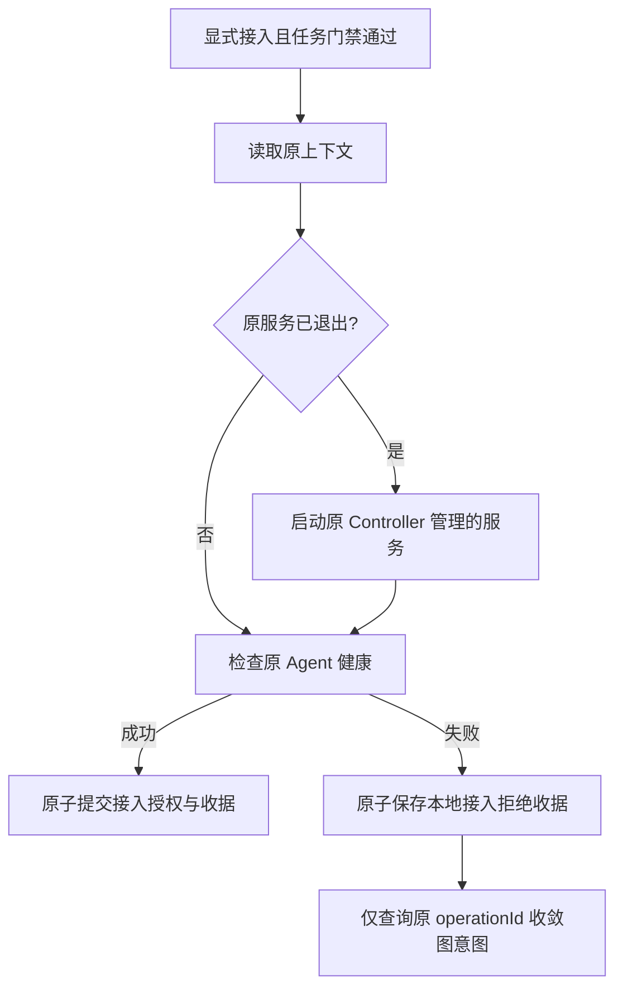

# OpenCode OOM 后原上下文恢复与接入拒绝收据

日期：2026-10-21。关联 AB-F03/F07/F11，M02、M03-F02、M05-F02、M06-OC-F01、M10。公开版本仍为 alpha.36；本次源码基于现有 alpha.39 工作区增量，候选版本 alpha.40，不覆盖旧 EXE，不推送源码或标签。

## 需求与现场根因

用户报告阿里云 OpenCode 接入失败，未确认操作显示 AGENT_UNHEALTHY。只读核对现有 Windows 中央与远端后台均为 alpha.37，OpenCode 为 2.0.26，SSH 机器在线。原接入的节点收据查询返回 not_found，原图意图保存了准确的派发错误与参数指纹。该结果本身不能证明未执行。

原 Controller 报 NATIVE_UNAVAILABLE；托管身份对应的进程已经消失，内核 OOM 日志中的被杀进程与原托管进程完全匹配。现场可用内存约 290 MiB，Swap 为 0。此为实际服务器故障，不能把工具发现 healthy 或 SSH 在线当成原生服务可用，也不能误判为账号错误。

Bridge 的两个缺口：已有 context 保存 agentId 后只轮询 snapshot，原生服务退出后不会在显式接入时恢复；接入准备抛错发生在本地授权提交前，但没有持久拒绝收据，图台账把错误留为 unknown。

## 开发与最终行为

1. [MachineHost](../../../desktop/electron/machine-host.cjs) 仅在显式 context 准备且原 Agent 报 NATIVE_UNAVAILABLE 时，对原后台调用 ipc.start，再读取原 Agent。保留 contextId、agentId、安装、目录和 Session；不调用 connect 创建替代身份，不提交 Prompt。本次新增恢复不放在 MachineHost 快照或原请求查询分支。原 Agent 缺失明确报 CONTEXT_STATE；启动错误按原 code/message 快速返回。
2. [AgentNetwork](../../../desktop/electron/agent-network.cjs) 在 OpenCode context 准备失败时，将 apiCompatibility=false 与该本地 attach 的 rejected 收据原子保存。收据沿用原 operationId、内容 fingerprint、machineId、nodeId 和 action；不改变 connected、授权、Task 或 Conversation。节点操作容量在准备前与提交时均检查。
3. [GraphOperationJournal](../../../desktop/electron/graph-operations.cjs) 在 attach 抛错后只读查该原收据。未来错误以匹配的持久拒绝收据收敛；历史记录只额外接受原派发已落盘的准确 AGENT_UNHEALTHY 中文消息、attach 来源、ID 和完整输入指纹，且先读原收据。泛化健康错误、只在查询时出现的同名错误、错机器/指纹/ID、其他动作及通信失败均保留 unknown。有真实 confirmed 收据时优先采用收据；历史本地已 confirmed 记录即使后来原后台返回 not_found，也不降级为 rejected。

## 现场恢复与证据

用户明确批准检查磁盘后添加 2 GiB 临时 Swap，不写开机配置，再恢复原服务。实际检查：ext4 根盘约 18 GiB 空闲、无既有 Swap、目标文件不存在。以独占创建和 0600 权限写满 2 GiB 后 mkswap/swapon，未修改 fstab，未停止其他进程。

沿原 Controller 的 ipc.start 恢复服务后：healthy=true、online=true，原设置字节相同、同一个原 Agent，Task 1→1、Conversation 1→1，未发新 Prompt。按修复后的生产图台账恢复逻辑只查询原接入并收敛为 rejected；保留原 ID/输入/错误/历史。随后一次新的节点管理健康核验 confirmed，原节点 connected=true、apiCompatibility.compatible=true，无新增模型任务。没有部署新 daemon，远端仍为 alpha.37；此次现场恢复是受控带外修复，不冒充产品界面全流程验收。

现场恢复日志：[restore.log](../../../artifacts/opencode-aliyun/2026-10-21/restore.log)。原始诊断与核对脚本留在私有 artifacts，不进入用户站点、提交或发行包。

## 验收

- WSL Node 22.23.1，定向 **97/97**：[最终 TAP](../../../artifacts/opencode-aliyun/2026-10-21/targeted-final97.tap)，包括原上下文恢复、启动失败/原归属缺失、只读查询不启动、历史准确拒绝与错指纹/查询错误反例、拒绝收据重开/去重。受控测试，模型 0。
- 最终全桌面 **705/705**：[TAP](../../../artifacts/opencode-aliyun/2026-10-21/desktop-final.tap)，覆盖最后新增的只读保护及 confirmed 终态保护；定向97/97为其子集，不重复相加。
- 根构建、类型检查与 lint exit 0；桌面 TypeScript/Vite 构建成功，[构建日志](../../../artifacts/opencode-aliyun/2026-10-21/desktop-build.log)。核心全量 **57/57**，见[核心 TAP](../../../artifacts/opencode-aliyun/2026-10-21/core-all.tap)；Windows Node 相同定向 **97/97**，见[Windows TAP](../../../artifacts/opencode-aliyun/2026-10-21/windows-final.tap)。文档与用户站点边界检查通过，见[检查结果](../../../artifacts/opencode-aliyun/2026-10-21/docs-check.log)。最终包校验见下节。
- 初次受限沙箱 Node 子进程 stdout 为空，导致既有版本夹具假失败；移到完整进程环境后原夹具通过。初次新增图收据立即查询扩大到 remove 导致既有丢回应门禁测试失败，已限定为 attach；上述最终结果均包含修正，原失败保存在同目录 TAP。

## 协议、交付与边界

沿用原 context/ipc.start/nodeOperation 接口与既有收据结构，无新增 RPC、wire 版本、能力标记、模型或供应商层；architecture 的进程归属不变。data-model/protocol 同步本地 attach 拒绝语义。已有活跃/unknown 任务的门禁不放宽，服务启动与节点 rejected 均不代表任务成功或取消。

候选 [Windows EXE](../../../desktop/release/AgentBridge-0.6.0-alpha.40-Windows-x64.exe) 已构建：130035302 字节，SHA-256 `fd24294cac1f993dc55c65335f24a6e8146a7b66d15e162523ea140f075ba362`。[包校验](../../../artifacts/package-check/0.6.0-alpha.40/package.json) passed：48 CJS / 81 Core / 1460 Linux 文件，linuxManifestDigest `e336d224a75da3f9e2547f2016aa855fc5d1699d35ada283aafafde012939ef3`；EXE 内 app.asar 与 win-unpacked 逐字节相同，EXE 内三个受影响 Linux CJS 与当前源码相同，见[解包结果](../../../artifacts/opencode-aliyun/2026-10-21/exe-check/result.json)。兼容清单沿用当前32项，包含现场alpha.37和alpha.38，未新增alpha.39 pin；旧EXE均保留。未签名、未公开发布、未部署alpha.40 daemon。打包首次缺npm命令、第二次Windows npm入口CRLF导致Linux shebang失败，最终改用/tmp中LF包装器后成功；均属构建环境修正，没有改产品打包逻辑。临时 Swap 在服务器重启后不会自动启用；长期资源安排由用户决定。本次未发模型需求，未验证模型推理、完整 I06C/I07C 或新 EXE 的用户profile与真实远端联合运行。Windows普通EXE隔离profile的启动、拒绝恢复、后台保留、关闭重开四组检查已通过（无调试参数、模型0），最终包重验结果见[普通EXE报告](../../../artifacts/opencode-aliyun/2026-10-21/portable.json)。公开版本仍为 alpha.36。

最终冻结另外包含已 confirmed 收据不降级保护；最初本地中间EXE与四组隔离运行记录已另存 `artifacts/opencode-aliyun/2026-10-21/pre-final/`，最终交付以本页最终SHA-256、[源文件冻结摘要](../../../artifacts/opencode-aliyun/2026-10-21/freeze.json)、705/705全量与97/97定向结果为准。旧公开与候选alpha.36–39摘要复核不变，见[旧EXE核对](../../../artifacts/opencode-aliyun/2026-10-21/prior-exe-sha256.txt)。
