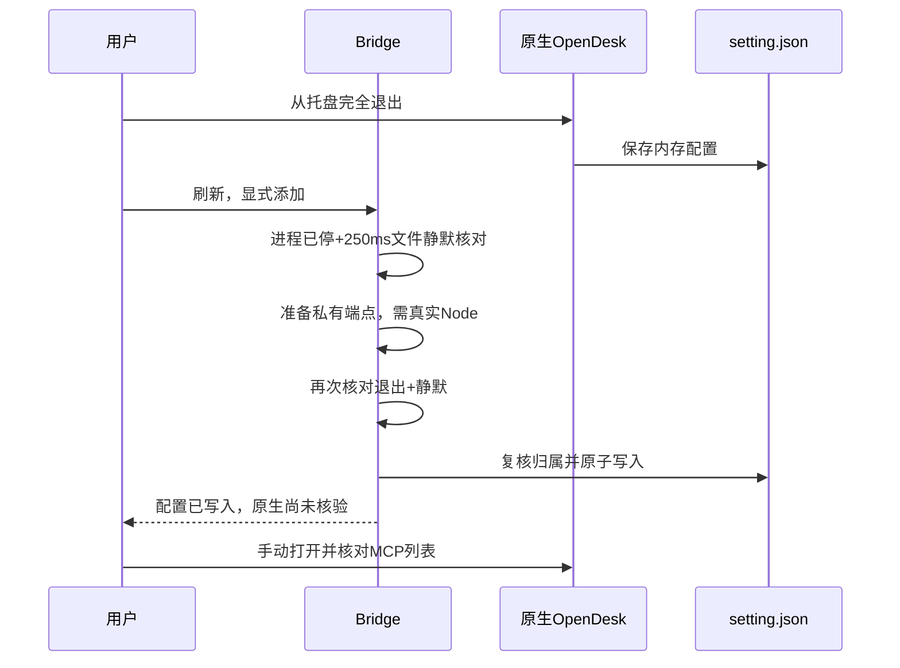

# I08：OpenDesk 生命周期与关系资源作用域

## 需求、基线与开发

2026-10-23，修复 [issue #19](https://github.com/wsjq5477/MA-Relay/issues/19) 与 [issue #20](https://github.com/wsjq5477/MA-Relay/issues/20)。alpha.52 候选基于完整已公开 alpha.51.recovery.2 的产品树及发布记录提交 `57a7bd7`；使用附加隔离工作树，保留主目录已有未提交工作、旧标签和EXE。公开版本仍 alpha.51.recovery.2；本轮未合并默认分支或公开新附件。

未修复生产反例：运行中/未知进程状态两项应拒绝安装却实际写入，中央独立关系保存返回 GRAPH_UNCONFIRMED，Windows生产界面 DSH/OpenDesk 设主均禁用且理由误导为能力。固定[生命周期反例](../../../artifacts/native-lifecycle-scope/2026-10-23/baseline-lifecycle.tap)、[中央反例](../../../artifacts/native-lifecycle-scope/2026-10-23/baseline-relation.tap)、[生产界面反例](../../../artifacts/native-lifecycle-scope/2026-10-23/ui-baseline/report.json)。

### OpenDesk 原生写入

原生运行中外部写盘会在退出时被旧内存快照覆盖；网关离线不能证明进程退出。新增[生命周期模块](../../../desktop/electron/opendesk-lifecycle.cjs)，Windows 使用绝对系统 tasklist 路径，仅解析完整CSV进程快照；所有匹配官方进程名的实例都会阻止写入（含其他Profile，保守限制）。未支持的平台、查询失败或格式不完整保持unknown。只返回状态和观测时间，不记录PID/命令行。

准备前拒绝不创建登记；准备期间重新启动或文件变化在最终检查拒绝，回滚登记，新端点无有效授权。检查后立刻进入同步原子配置更新，保留已有归属/CAS与并发编辑检测；不声称跨操作系统进程启动和文件替换具有事务锁。运行、不可核验、退出写回未稳定分别报 MCP_NATIVE_RUNNING / MCP_NATIVE_STATE_UNKNOWN / MCP_NATIVE_EXIT_PENDING，缺Node报MCP_OPENDESK_NODE_REQUIRED。移除始终先撤权；不能安全清理时保持revoked_config_pending，原生文件不改。只清理原Bridge拥有的条目，其他应用与默认headers兼容保持。

配置卡持续提示退出、刷新、添加、重开和原生人工核对；原节点已断开不再妨碍添加，机器必须可用且身份未移除/替代。Bridge不退出/杀死/重启OpenDesk，不修改其程序。nativeProbeSupported=false，mcp.probe只读unsupported，不执行Bridge工具探测冒充原生证据；nativeLoad仅需重开/无法核验，connection/tools保持unknown或撤权事实，六项事实仍分开。

### 关系资源作用域

[前端](../../../desktop/src/management-recovery.ts)仅在来源machine/node和中央blockedNodeIds完整可信时允许按目标节点编辑；relation或machine待核对、存储/读取失败及缺失范围继续全局禁用，并显示真实原因。目标断开、执行/MCP能力缺失或占用仍拒绝。设主只是草稿，不产生任何后台写入。

[中央](../../../desktop/electron/agent-network.cjs)对新关系与原node管理unknown，核对**旧关系与新关系的leader/member资源并集**，复用原节点、同adapter/executable与Windows/WSL共享目录保护。原关系unknown、机器或无法解析原来源仍保守阻塞。保存一个operationId，同ID幂等；无ID兼容调用也进日志并在确认后返回旧数据格式。独立B保存只恢复冲突行，不为A附加query或重放，定时只读查询保持；A的ID、参数、时间、错误、占用和unknown均保留。布局规则与授权能力不变。

新增中央必需能力scoped-relation-management-v1；旧中央需“设置→后台运行→停止后台并退出”后手动重开。运行能力opendesk-mcp-lifecycle-v1仅限制旧SSH后台的OpenDesk原生增删，不阻止其读取/撤权或其他产品；本轮不升级远端、不改帧版本、Task/Session/台账格式或模型配置。

## 实际验证

| 层级 | 2026-10-23实际结果与证据 |
| --- | --- |
| 定向生产后端/临时文件 | 生命周期、节点/关系资源及既有原生配置131/131；[日志](../../../artifacts/native-lifecycle-scope/2026-10-23/targeted-third.tap)。受控进程观察；覆盖退出写回/准备中启动/先撤权/探测不伪造、原新关系并集及同ID幂等。 |
| 后台兼容/断开身份 | 9/9；[日志](../../../artifacts/native-lifecycle-scope/2026-10-23/remote-final.tap)。包含旧后台OpenDesk写入拒绝和断开原节点准入。 |
| Windows生产前端 | Edge155.0.4283.45，12组通过，pageErrors=0；[报告](../../../artifacts/native-lifecycle-scope/2026-10-23/ui-second/report.json)。受控IPC、生产构建，点击草稿0派发、保存1次、A零附加查询；9类禁用反例与持久MCP提示。 |
| Windows真实进程检查 | 默认tasklist观察到日常OpenDesk运行；对隔离setting.json拒写且端点创建0；[报告](../../../artifacts/native-lifecycle-scope/2026-10-23/windows-process-guard.json)。没有读取/修改真实设置，没有退出应用。 |

完整桌面841/841（初次共享全量840项通过，补充断开原节点用例后远端组9/9，最终汇总不重复计数），[最终报告](../../../artifacts/native-lifecycle-scope/2026-10-23/desktop-final.json)；核心68/68、类型/lint通过，[核心日志](../../../artifacts/native-lifecycle-scope/2026-10-23/core.tap)。用户站6/6及18页/19HTML构建和边界审计通过，内部页/证据导出0；[站点测试](../../../artifacts/native-lifecycle-scope/2026-10-23/docs-test.log)、[构建](../../../artifacts/native-lifecycle-scope/2026-10-23/docs-build.log)。最终包一致性与普通EXE结果在完成后补录。本轮模型0；未测真实用户Profile停写/重开原生GUI、原生父模型自主委派、独立SSH/远端部署；未切换日常后台。受控observer不冒充真实退出证明，Bridge端点目录不冒充原生加载。完整I06C/I07C/MCP02、WSL稳定性/图指标继续未准出。

复现：Node22.23.1运行`node --test desktop/tests/native-lifecycle-scope.test.cjs desktop/tests/mcp-integration.test.cjs desktop/tests/agent-network.test.cjs desktop/tests/management-recovery.test.cjs`；Windows Node运行`desktop/tests/windows-native-lifecycle-scope.cjs <报告目录>`与`desktop/tests/windows-opendesk-lifecycle.cjs <报告JSON>`。这些脚本使用临时配置/受控IPC，不调用模型或远端。
