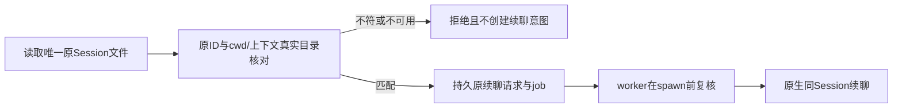

# Pi续聊目录绑定与Windows测试器修正

日期：2026-10-28（Asia/Hong_Kong）。基线master `c40f45e9696c7c3e97ad8bf4f72486a843bed3c5` 加工作树已有[Hermes分离保护](hermes-detached-input.md)；当前公开仍为0.6.0-alpha.67。本片是未发布源码修复，无新EXE、标签或远端部署。

## 需求与实际缺口

关联AB-F08/F11、M06-F01/F04、M07-F01/F02/F06/F07。原设计要求原Session与原上下文一起保持，不能用另一个目录或新会话冒充续聊；本轮核对发现Pi续聊只检查唯一Session ID/文件，未在原生派发前核对会话头cwd。

Pi原生SessionManager.open会恢复文件头中的cwd。同一ID文件被移动、还原或改写为另一目录时，原代码仍可能显示canContinue=true并构造续聊参数，直到原生启动后的session事件才发现不符；这时原需求已经发出，不能靠事后错误弥补。

| 需求 | 验收行为 |
| --- | --- |
| PI-CWD-01 | 唯一原Session文件的cwd与原Agent.workspace均须是绝对路径，并解析到同一可用真实目录 |
| PI-CWD-02 | 异目录、目录缺失、相对/空/缺失cwd、文件路径均禁用canContinue，实际续聊在持久请求/Task前以CONVERSATION_CONFIG拒绝；原状态字节/调用次数保持 |
| PI-CWD-03 | 原ID查询、重开和原Session保持；恢复原文件后沿原Session续聊并去重，等价目录写法不误拒；worker在spawn前复核 |

## 原生依据与实现

下载固定npm原包`@earendil-works/pi-coding-agent@1.4.0`，未执行安装脚本，没有修改日常安装或原生账号/模型配置。包大小7.6MB，npm SHA-1 `7f5dd2a4f7fa46ed252465ac4d341831896b1fc2`与本地全部字节匹配；SHA-256 `d155c16ef6fa00960fbf58b2911536e80b05f33700e0b14fbd08967ede0c7428`。[下载记录](../../../artifacts/pi-session/2026-10-28/npm-pack.log)、[原包](../../../artifacts/pi-session/2026-10-28/native/earendil-works-pi-coding-agent-1.4.0.tgz)、[原包/源码摘要](../../../artifacts/pi-session/2026-10-28/provenance.json)。

只读核对原包`dist/core/session-manager.js`的`SessionManager.open`：在未提供cwdOverride时，采用原文件头cwd构造SessionManager；文件缺失时可能初始化新会话。Bridge继续在派发前拒绝缺失或不唯一原文件，不借原生自动新建路径续聊。

[piSessionFile](../../../desktop/electron/native-cli-protocols.cjs)新增workspace参数：唯一ID核对后，header.cwd和原workspace须为绝对路径，realpath相等且workspace为目录；解析失败与不符均以既有CONVERSATION_CONFIG拒绝。原64KiB会话头读取上限不改，也不新增自动迁移、重写原文件或绑定新Session。

[NativeCliHost](../../../desktop/electron/native-cli-host.cjs)的conversationView从原targetAgent取得workspace，共用校验来投影canContinue；实际continue在写job/请求/Task前通过argumentsFor核对，worker在spawn前再调用同一参数构造。原Task/Conversation/Session/operationId/requestId与unknown不迁移，无新RPC/数据版本或权限能力。



检查不持有跨进程文件锁，外部程序在最终检查与原生打开间改写文件的竞态仍未消除；不能把本片表述成对原生文件的事务锁定。目录校验也不是文件系统沙箱。普通执行、原生模型/账号/权限及取消协议保持。

## Windows测试器修正

先复现此前Pi原文件测试失败，随后最小文件实验发现：本机Windows Node24.12.0、含非ASCII字符的临时路径中，fs.rmSync返回后文件仍存在；fs.unlinkSync与fs.promises.rm实际删除成功。本轮没有据此泛化到所有Windows/Node版本。[实际实验](../../../artifacts/pi-session/2026-10-28/removal-probe.json)。

测试改用unlinkSync删除单个重复文件、await fs.promises.rm删除会话目录与fixture。保留删除后的同样断言，没有把重复文件忽略掉。仅修正重复文件删除后，中间运行20/21仍因会话目录未实际删除而失败，继续修正目录删除后通过。原工作数据、用户目录与原任务不参与这些实验。

宿主测试等待上限从150次×30ms改为15秒墙钟截止时间，覆盖worker启动、原3秒SIGKILL升级和Windows taskkill/退出观察；产品超时与取消实现没有放宽，收据仍须原进程退出证据才确认。上一轮Windows取消/超大输出等待超时的历史结果保留；当前56项已实际覆盖并通过原混合集。

## 实际验证

环境：Windows Node24.12.0，固定Pi1.4.0原包。受控CLI fixture执行与未修改原生SessionManager组件分别记录；模型0，不是实际Pi模型执行/取消或EXE验收。

| 层级 | 实际结果 | 证据 |
| --- | --- | --- |
| 既有删除失败 | 修改前Pi原会话文件测试1/1失败；受控追踪确认“删除后”仍有重复文件 | [初始TAP](../../../artifacts/pi-session/2026-10-28/baseline.tap)、[追踪](../../../artifacts/pi-session/2026-10-28/debug.tap) |
| 测试器中间结果 | 修正重复文件删除和等待预算后20/21，仍有目录未删失败，未登记通过 | [中间原宿主TAP](../../../artifacts/pi-session/2026-10-28/native-host.tap) |
| 新缺口复现 | 原代码对同ID/异目录投影canContinue=true，新用例1/1失败 | [目录绑定baseline](../../../artifacts/pi-session/2026-10-28/workspace-baseline.tap) |
| 目录/文件专项 | 2/2；六种目录异常无新意图/无派发，原状态字节保持，恢复/重开/原Session续聊与去重通过 | [专项TAP](../../../artifacts/pi-session/2026-10-28/workspace-fixed.tap)、[测试](../../../desktop/tests/native-cli-host.test.cjs) |
| 当前共享受控回归 | 56/56，失败/跳过0；宿主22、原核对23、Hermes分离11，包含之前原44项混合集，不跨模块/专项相加 | [最终TAP](../../../artifacts/pi-session/2026-10-28/related.tap) |
| 原生SessionManager组件 | 三组通过：原ID/目录无改写；原生同ID恢复异目录而Bridge参数构造拒绝；恢复原头与等价目录后原ID保持。原模块SHA不变，未发Prompt | [驱动](../../../desktop/tests/pi-session-native.cjs)、[原生报告](../../../artifacts/pi-session/2026-10-28/native-session.json) |
| 工程 | 根typecheck/lint、专用CJS未使用/不可达检查、核心及桌面TypeScript/Vite生产构建通过；保留既有大chunk提示 | [类型](../../../artifacts/pi-session/2026-10-28/typecheck.log)、[lint](../../../artifacts/pi-session/2026-10-28/lint.log)、[CJS](../../../artifacts/pi-session/2026-10-28/cjs-lint.log)、[构建](../../../artifacts/pi-session/2026-10-28/build.log) |

原生组件直接加载npm原包bundle导出的SessionManager，输入是临时受控会话文件；没有修改原包，没有加载用户Pi登录、没有启动CLI推理或其他Agent。当前Windows结果不代替Linux/SSH或完整I07C/MCP02生命周期。

复现：

```powershell
node --test --test-concurrency=1 desktop/tests/native-cli-host.test.cjs desktop/tests/native-reconcile.test.cjs desktop/tests/hermes-detach.test.cjs
node desktop/tests/pi-session-native.cjs BRIDGE_ROOT PI_PACKAGE REPORT
npm run typecheck
npm run lint
npm run desktop:build
node scripts/check-docs.mjs
git diff --check
```

## 同步与后续

整体功能、M06/M07完整设计/报告、架构/数据/协议、接入矩阵、用户Pi说明、路线/测试和迭代索引已同步；M10没有新依赖或文件清单变化，worker仍复制现有两个原生模块。发布基线保持alpha.67，未构建新EXE、未替换日常后台或部署SSH。

最终文档检查仍为原2243项历史材料缺失，新增0/移除0；命令退出1，不声明完整通过。见[检查](../../../artifacts/pi-session/2026-10-28/docs-final.log)和[差异摘要](../../../artifacts/pi-session/2026-10-28/docs-comparison.json)，原缺失不删除或伪造。`git diff --check`通过。

仍待：Pi真实模型执行/原Session续聊/取消/被委派与自主父模型、Hermes原生等待/网关恢复与可靠取消、新包/普通EXE/独立SSH和完整图性能/冷启动/故障矩阵。目标继续进行，不以本轮源码与组件通过关闭整体准出。
