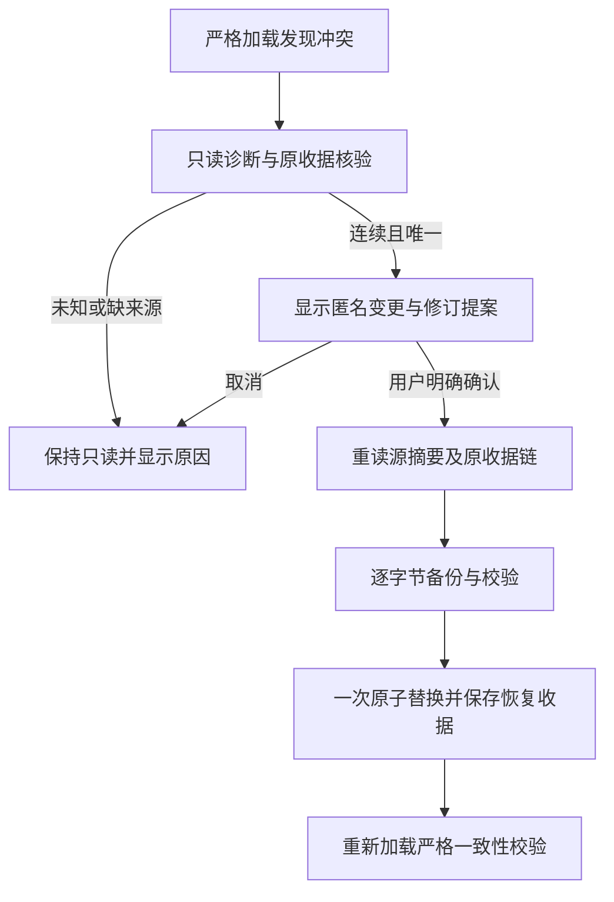

# I08：issue #27 关系冲突检查与人工恢复

## 需求与当前范围

2026-10-28，Windows，当前工作区 alpha.68 源码，公开仍 alpha.67。关联 AB-F02/F12/F13/F16、M01/M02/M08。初轮只交付诊断基础，未完成修复；本轮继续补齐受控恢复路径，未发布 EXE，未修改真实 profile、原生配置或远端，没有模型调用。

## 实现与边界

冲突仍返回 RELATION_STATE_CONFLICT，正常加载前先校验，避免创建 SSH 管理器或可变 AgentNetwork。错误诊断只包含两视图修订、成员数量、selected/enabled、三类收据数量与最近最多八条确认结果的修订/成员数量，不含节点身份、原 operationId、请求或 Session。

独立 relationRecovery.inspect 在构造业务网络前读取原文件，验证完整索引格式与其他关系约束。提案必须从 selected 下一修订起连续走到 collaboration；每步只能存在一份 confirmed 关系或节点撤权收据，保留原 operationId 核对，检查指纹、来源和最终投影。关系保存按原输入重算指纹；节点撤权用原节点及 remove/disconnect 指纹重算撤销结果。未知、重复 ID、跳号、多候选、错误指纹或缺来源均拒绝。graph-pending 非布局管理未知也阻止提案，不修改占位。

确认的连接/策略收据也因缺少完整授权结果顺序而保守拒绝，避免丢失后续策略撤权。旧机器移除/卸载收据只有机器修订，没有关系修订顺序，无法证明它发生在关系授权之前还是之后；遇到这类收据保守拒绝自动提案，提供人工核对原因。不是按较高修订、集合大小或时间选择权威，也不承诺任意现场均可恢复。

桌面错误区提供只读检查、匿名成员增删保留、原收据步骤、关系及 envelope 修订变化。用户勾选明确确认后，relationRecovery.confirm 才重新读取并校验 sourceDigest、原收据链及管理台账；创建独占、0600 的逐字节备份，fsync 并逐字节校验，再检查源未变，原子替换。只更改 selected 行及其 envelope，并增加 relationRecoveryOperations 恢复收据；collaboration 已与证据终点一致而保持原值。其他关系、节点、任务、请求、委派及原管理收据不变。envelope 按原人类保存/撤权顺序演算，保留未撤销的额外预授权。原恢复 ID 与源摘要绑定，成功后重复调用返回原收据。

写入仅发生在同一中央进程的同步提交段；不能阻止用户另外启动任意旧二进制并发写文件。当前客户端在自动复用握手及自动启动进程之前检查版本存在、multi-parent-relations-v1 与 relation-index-sync-v1。运行时 manifest 记录版本及能力，缺声明拒绝；旧后台须用户自行停止并打开新版。客户端不会自动关闭旧后台或改写旧 EXE。

## 验证与证据

- [定向受控回归](../../../artifacts/issue27/2026-10-28/targeted.txt)：137/137 通过，覆盖旧写入冲突保全、5→7→6 恢复、原 ID 幂等、历史不变、缺失/歧义/未知/指纹反例、备份失败/摘要不符/写入失败/替换失败、旧后台真实 IPC 握手和进程启动前拒绝。
- [前端构建](../../../artifacts/issue27/2026-10-28/build.txt)：类型检查与生产构建通过，存在原有大 chunk 提醒。
- [浏览器受控脚本](../../../artifacts/issue27/2026-10-28/ui-check.cjs)：生产 renderer、合成 RPC，未确认/取消均零提交，确认后一次提交；受控失败仍显示原提案，再次明确提交成功后展示备份和摘要；980×660 与 1440×960 无横向溢出。[980 截图](../../../artifacts/issue27/2026-10-28/recovery-980.png)、[1440 截图](../../../artifacts/issue27/2026-10-28/recovery-1440.png)。不是普通 EXE 或真实用户恢复。
- 桌面全量：1001 项，926 通过、74 失败、1 跳过。失败包含原生 CLI 探测、Linux-only daemon、symlink 和运行时断言；未进行同一工作区变更前全量对比，不能全部认定历史失败。本次定向全部通过不能替代全量准出。
- 文档检查 2243 条缺失材料错误，与提供的历史基线数量相同，新增 issue27 材料无链接错误；不删除历史引用或伪造证据。

未测：真实用户 profile 恢复、普通 EXE 生命周期、独立 Linux/SSH、任意旧 EXE 的手动写入隔离、完整无障碍验收。当前修复为源码与受控验收，不改变发布和完整矩阵基线。
