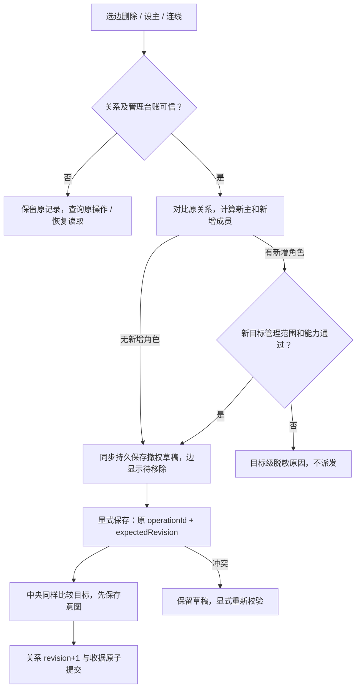

# I08：issue #25 关系撤权与目标作用域

后续交付：用户合并PR #26后已授权构建、验收并公开alpha.64。本文保留原修复轮的版本/环境与失败事实；新EXE、同一profile生命周期补验与匿名完整下载见[alpha.64发布](alpha64-release.md)。

## 需求、基线与范围

2026-10-27，修复 [issue #25](https://github.com/wsjq5477/MA-Relay/issues/25)。基线为公开 `0.6.0-alpha.63` 产品提交 `da60054` 及发布说明提交 `8833d01`，修复位于 `codex/fix-issue-25`。版本字段保持 alpha.63，本轮是其后的源码修复，未构建或发布新 EXE，未切换日常后台。M01/M03/M06/M08 对应 AB-F02/F03/F12/F16。

原实现将机器管理未知、布局不可用及旧关系全部角色的能力检查扩散到关系写，导致删除授权无法进入草稿或无法保存。目标是恢复独立操作及降低权限的路径，同时保留关系自身未知、不可信台账、修订与原 ID 的保护。设为主 Agent 不自动增加成员；最初原生接入超时原因不在本修复内。

## 当前实现

| 保存内容 | 新准入目标 | 原管理未知的处理 |
| --- | --- | --- |
| 同一主节点，严格缩小成员集合 | 无，纯撤权 | 来源可信则不冲突，不查询或结算原 node/machine 未知 |
| 主节点与成员全部清空 | 无，纯撤权 | 同上 |
| 新增成员 | 相对原关系新增的成员 | 核对目标原节点、同安装、共享目录或机器范围及执行/委派能力 |
| 更换主节点 | 新主；另有新增成员时也检查新增成员 | 新主检查执行/MCP调用能力与同一可信资源范围；不重检未变化旧成员 |
| 任意关系写 | 仍须原 ID、指纹、期望修订、合法且无重复/自连的集合 | 关系自身 unknown、不可信来源或台账无法读取继续保守阻止 |

`relationAdmissionTargets` 在前端及中央按各自当前关系计算新增角色，不接受 IPC 传入放行范围或“纯撤权”标志。指定 `relationId` 时以该行作为原集合，其他关系保持。关系自身待核对仍保持全局关系屏障；其他管理写对原 relation 未知的保护不变。



关系锁不再依赖全局 `metadataBusy` 或布局读取成功。布局读取失败和原 layoutPending 仅限制布局；授权仍依赖关系台账与自身收据。删除已保存边不检查待移除或保留角色的连接、能力与管理阻断。草稿编辑先同步写本机缓存；存储失败保持原草稿、显示原因并阻止后续关系写。保存仍先持久原操作 ID，再发送一次。修订冲突保留“待移除”，显式重新校验后提交；较低 revision 快照与重开不恢复已经确认撤销的成员。

新增成员和设主按钮继续给出目标级理由。连线的现任主只按其当前连接/MCP能力提供源端点，不把其管理未知反向用于其他新增目标。设主清空旧成员草稿，用户需明确重新授权。新实际执行/委派仍按原当前能力、身份与授权检查，不因保存旧角色而放宽执行。

源码：[图与按钮](../../../desktop/src/AgentGraph.tsx)、[入口与恢复提示](../../../desktop/src/NetworkApp.tsx)、[草稿与能力差集](../../../desktop/src/graph-state.ts)、[可信恢复范围](../../../desktop/src/management-recovery.ts)、[中央目标比较](../../../desktop/electron/relation-admission.cjs)、[图意图冲突](../../../desktop/electron/graph-operations.cjs)、[关系保存](../../../desktop/electron/agent-network.cjs)。Coordinator 已有可信回调接线同时用于 node/machine lane，无需新增 RPC。

## 实际验证

环境：2026-10-27，Windows、Node `24.12.0`、Edge `157.0.4341.16`。所有图/后端测试使用临时目录、受控机器与生产 Coordinator/存储；浏览器使用生产构建和真实按钮点击。模型调用 0，没有连接真实原生 Agent、写真实用户 profile、修改日常 unknown 或部署 SSH。

| 检查 | 实际结果与原始证据 |
| --- | --- |
| 未修复反例 | 从 `8833d01` 冻结的后端加载相同新增回归，14项5通过/9失败，撤销自身未知/能力失效成员、机器未知下撤权等失败，保守保护反例仍通过；[最终原基线结果](../../../artifacts/issue25/2026-10-27/baseline-verified.tap)。首次测试夹具修改 lane 时误追加一行的失败不作为产品反例，修正后使用此日志 |
| Windows 定向回归 | **155/155**；[日志](../../../artifacts/issue25/2026-10-27/targeted-delivery.tap)。覆盖原ID幂等、纯撤权/清主、保留失效成员时新增或换主、新目标阻断、显式关系ID与其他行不变、关系未知/缺来源/损坏台账、原未知和历史保持 |
| Windows 生产前端与生产 Coordinator | **12组通过**，pageErrors=0；[报告](../../../artifacts/issue25/2026-10-27/ui-delivery/report.json)。无关node、自身未知不可执行、machine未知、布局不可用、layout未知各完成删除草稿→保存→旧快照与重开；关系未知/缺来源/损坏/读取失败保守锁定，独立设主无自动授权，revision冲突重校验及本机草稿写盘失败保持 |
| 工程 | 根构建/类型检查/lint与桌面类型检查/生产构建通过；[根构建](../../../artifacts/issue25/2026-10-27/core-build.log)、[类型](../../../artifacts/issue25/2026-10-27/core-typecheck.log)、[lint](../../../artifacts/issue25/2026-10-27/core-lint.log)、[桌面构建](../../../artifacts/issue25/2026-10-27/desktop-build-final-delivery.log) |
| Windows 桌面全量 | **959项：872通过、86失败、1跳过**，不报全绿；[最终日志](../../../artifacts/issue25/2026-10-27/desktop-delivery.tap)。未修复基线944项853通过/90失败/1跳过，[基线日志](../../../artifacts/issue25/2026-10-27/baseline-windows-full.tap)；失败类型比较见[对照](../../../artifacts/issue25/2026-10-27/full-comparison.json) |
| 根测试全量 | Windows **71项：53通过、18失败**；[日志](../../../artifacts/issue25/2026-10-27/core-full.tap)。Linux脚本/原生服务归属等平台相关失败保留，未修复基线71项51通过/20失败，当前失败名称均在基线出现；[基线日志](../../../artifacts/issue25/2026-10-27/baseline-core.tap)、[对照](../../../artifacts/issue25/2026-10-27/core-comparison.json)。不能用历史71/71代替本轮 |
| 用户站 | 构建及实际发布边界审计通过，18页/19HTML、内部页面与证据导出0；[构建](../../../artifacts/issue25/2026-10-27/docs-build.log)。`docs:test`为5/6，生成目录删除后仍触发页面清单检查，未修复基线同型失败；[当前日志](../../../artifacts/issue25/2026-10-27/docs-test.log)、[基线](../../../artifacts/issue25/2026-10-27/baseline-docs-test.log) |

全量完成后补回前端自连提示的原保护，155项定向及12组浏览器已在最终源码重新通过；全量平台失败不由此改写。

首次工程检查因依赖缺失未运行到 TypeScript；按锁文件安装后通过。并行 npm 安装遇 Windows 缓存文件 EBUSY，桌面改用隔离缓存后完成，未改锁文件。首次浏览器脚本点 SVG 组的空白未选中边，改为现有图验收使用的可见边标签后完成真实点击；原失败保留于 [ui/report.json](../../../artifacts/issue25/2026-10-27/ui/report.json)。新增能力测试漏填 MCP 声明、附加新增授权反例后的查询统计范围错误均已修正，最终定向结果如上，不将这些测试夹具错误描述为产品缺陷。

WSL `Ubuntu-22.04` 本轮启动失败：`Wsl/Service/CreateInstance/CreateVm/HCS/HCS_E_SERVICE_NOT_AVAILABLE`。未修改系统服务或重配虚拟化，因此未运行本轮 Linux 全量。Windows 的全量失败包含 Linux daemon 平台拒绝、`cc`缺失、POSIX脚本启动与符号链接/路径假设；没有为获得全绿而放宽产品平台校验或修改无关测试。

复现：

```powershell
node --test desktop/tests/relation-revocation.test.cjs desktop/tests/agent-network.test.cjs desktop/tests/management-recovery.test.cjs desktop/tests/graph-operations.test.cjs desktop/tests/connection-ui.test.cjs desktop/tests/connection-recovery-state.test.cjs desktop/tests/connection-recovery-ui.test.cjs
npm run build --prefix desktop
node desktop/tests/windows-relation-revocation.cjs artifacts/issue25/2026-10-27/recheck-ui
node scripts/check-docs.mjs
```

回归源码：[中央撤权](../../../desktop/tests/relation-revocation.test.cjs)、[前端能力](../../../desktop/tests/connection-ui.test.cjs)、[恢复范围](../../../desktop/tests/management-recovery.test.cjs)、[实际浏览器](../../../desktop/tests/windows-relation-revocation.cjs)。这些测试禁止真实模型派发，临时机器通道只实现受控发现/快照。

## 同步与未测项

已更新整体功能、M01/M03/M06/M08完整设计及测试报告、架构/数据/协议、用户关系/机器说明、验证状态与迭代路线。RPC参数、关系/图台账字段、revision与收据格式不变，未添加新能力标记；旧后台需更新并完整重开才采用本修复。已执行文档检查，当前与未修复基线均为2243条历史证据链接缺失，新增错误0；未伪造历史文件使检查变绿。[当前日志](../../../artifacts/issue25/2026-10-27/docs-check.log)、[原基线](../../../artifacts/issue25/2026-10-27/baseline-docs-check.log)、[逐项对照](../../../artifacts/issue25/2026-10-27/docs-comparison.json)。

真实 Windows EXE、真实原生多主、模型、WSL运行和独立SSH本轮未测；全量基线仍受上述环境失败限制。公开alpha.63源码/EXE/SHA不变；图100ms、冷启动、父模型与完整I06C/I07C/MCP02继续未准出。撤权不等同节点断开、任务取消或业务成功，接收收据和原父读控边界不变。
