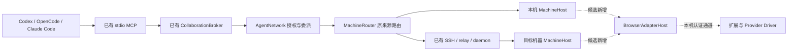

# Browser Agent：现有架构审查

核对日期：2026-10-30，Windows / PowerShell；本地源码 `6e7ec6f8a114be30dcf61d4a24282bd4e98a7943`。这是用户要求的第一阶段静态审查与候选设计依据，**没有修改产品代码，没有确认新功能范围**。公开版本仍为 0.6.0-alpha.71；其 EXE、独立 Ubuntu 和原生 Agent 验收只引用[历史交付](alpha71-release.md)，本次没有重新验证这些结果。

阅读依据：[整体功能](../../product-design.md)、[架构](../../architecture.md)、[数据](../../data-model.md)、[协议](../../protocol.md)、[接入矩阵](../../agent-integration-matrix.md)、[开发规则](../../development-guide.md)，以及 M02/M03/M06/M07/M08 的设计与报告。完整方案见[技术设计](web-agent-design.md)，任务及验收见[实施计划](web-agent-implementation-plan.md)。

## 1. 审查结论

现有系统能承载被动 Browser Agent，但不能只登记一个 adapter 名称：注册契约、发现身份、上下文准备、节点聚合和 MCP 续聊都含 CLI 或现有协作方式的假设。应在现有静态 Registry 中增加 BrowserAdapterHost，经原 AgentNetwork/MachineRouter 连接目标机器；扩展只执行该 Host 发来的浏览器命令。继续使用原 Coordinator、授权关系、请求意图、Task/Conversation、控制收据和 SSH transport。

Core 不增加 ChatGPT/Kimi 分支，不连接模型 API，也不把 Provider 账号、模型、项目写进关系身份。Provider 差异放入扩展 Driver。没有必要引入另一套 Broker、节点目录、跨机发现或路由。

当前 Bridge→Agent 没有通用 ACP Client；MCP 是原生 Agent→Bridge 的工具调用方向，不能把它说成当前已有的 ACP/浏览器驱动。`dsh-web` 是 DSH 原生认证服务接口，也不是 ChatGPT/Kimi 浏览器 DOM 自动化。

## 2. Registry、发现与能力

| 当前入口 | 实际职责与关键函数 | 对 Browser 的影响 |
| --- | --- | --- |
| [agent-adapter-contract.cjs](../../../desktop/electron/agent-adapter-contract.cjs) `defineAdapter`、`createAdapterRegistry`、`assertAdapterHost` | 源码静态注册；校验、冻结描述符，按 id 创建 Host；Host 必须同步返回 `call()` / `close()`，拒绝 Promise 工厂 | 复用工厂和生命周期，不允许扩展发模块路径或动态加载代码 |
| 同文件第 78–80 行 | `driver` 仅允许 `native-cli` / `cli-http`；`commands` 必须至少一项 | 必须增加明确的 `browser-extension` 路径及相应空 commands 规则，不能伪造 executable |
| [builtin-adapters.cjs](../../../desktop/electron/builtin-adapters.cjs) `adapters`、`connectionCapabilities` | 当前十入口；静态能力为上限，观察值只能收窄；MCP 调用方与托管 scope 独立 | Browser 声明 execution/delegation；MCP client、托管 scope、原生 MCP 配置均为 false |
| [tool-discovery.cjs](../../../desktop/electron/tool-discovery.cjs) `scanTools` | PATH/安装位置/version 与已支持服务发现 | 保留 CLI 发现；Browser 改由已配对扩展的只读 presence 合并，不扫描账号或 Provider 凭据 |
| [machine-host.cjs](../../../desktop/electron/machine-host.cjs) `discover`（54）、`backend`（45） | 合并工具发现、执行能力；按私有 context 创建注册 Host | 在同一机器 Host 合并浏览器发现；Host 工厂注入该机器共用 BrowserChannel |

**发现不等于授权**：扩展在线、页面可见、用户登录、可执行、新委派权限须分别表达。发现候选仍经原 `manageNode` 明确接入和原关系授权。页面不能自行授予 delegation 或主角色。

## 3. Transport、Router 与 Coordinator

图中 Browser 部分尚未实现。BrowserChannel 只是一种机器内适配器运输，不持有主从关系、不做跨机路由、不向调用方提供第二套工具服务。

| 层 | 实际实现 | 复用及缺口 |
| --- | --- | --- |
| 中央认证 IPC | [coordinator.cjs](../../../desktop/electron/coordinator.cjs) `identity`、`endpoint`、`startCoordinator`：Windows named pipe / Unix socket，认证 hello，protocol=2 | 不把中央 token 发给扩展；浏览器专用凭据隔离 |
| 中央门面及恢复 | [coordinator-service.cjs](../../../desktop/electron/coordinator-service.cjs) `createCoordinatorService`、`connection`、`call`：方法白名单、pending、资源准入、图管理锁 | 原 submit/continue/cancel 继续经过这些门禁；配对管理仅加受限用户方法 |
| 节点与请求路由 | [agent-network.cjs](../../../desktop/electron/agent-network.cjs) `nodeRequest`（226）、`execute`（391）、`scopedCollaborationTool`（317） | 复用来源检查、请求指纹、dispatched、原 ID 查询、普通被委派路径 |
| 机器及对象路由 | [machine-router.cjs](../../../desktop/electron/machine-router.cjs) `route`（232）、`execute`（261）、`project`、`qualified` | 保留 machineId 与 `machineId::objectId`；结果不按当前活动标签或显示名改路由 |
| Windows / WSL Host | [rpc.cjs](../../../desktop/electron/rpc.cjs) `HostConnection.start/call/close`：stdio JSONL、WSL 就绪握手、业务超时 | 新浏览器实例应属于实际运行浏览器的机器；Windows 浏览器不因为调用者在 WSL 就注册成 WSL 节点 |
| SSH | [ssh-host.cjs](../../../desktop/electron/ssh-host.cjs) `SshHost.call`；[machine-relay.cjs](../../../desktop/electron/machine-relay.cjs) `runRelay`；[machine-daemon.cjs](../../../desktop/electron/machine-daemon.cjs) 原收据；[machine-protocol.cjs](../../../desktop/electron/machine-protocol.cjs) `FramedStream` | 复用现有认证和帧、事件补偿。扩展连接目标 Node 的 loopback；不将浏览器 WS 端口暴露到 LAN |

### 3.1 不能遗漏的平台差异

`coordinator-service.cjs` 的 `connection()` 当前在 Windows 的 Coordinator 进程内创建 MachineHost；Linux/WSL 使用 HostConnection 启动 `src/desktop-host.ts`，通常由该子进程再创建 MachineHost。只有 `--opencode-only` 叶子模式才跳过这个门面。Linux 桌面外层另组合 `localMcpHost` 处理 MCP 配置，远端 daemon 也使用机器执行宿主。**差异是 MachineHost 的进程归属与注入位置，不是 Linux 缺少 MachineHost**。依据：[desktop-host.ts](../../../src/desktop-host.ts) 的主入口与 [rpc.cjs](../../../desktop/electron/rpc.cjs) 的 leaf 参数。

MVP 先支持 Windows Chromium 与 Windows MachineHost。Linux 浏览器进入后续阶段时，要在上述子进程入口注入 BrowserChannel，并明确一个 Node profile 唯一的监听进程；保留 legacy Core Host 与外层 MCP 配置分工，不重新搭一套执行门面。不能只改 `machine-host.cjs` 就宣称 Linux 桌面和远端浏览器均已接入。

### 3.2 节点聚合含单安装假设

`MachineRouter.connection()` 当前从 executable 生成 connectionId。`AgentNetwork.snapshot()` 按 `machineId:adapter` 归组并选择一个安装/节点，还会设置 `supersededBy`。Browser 可能有多个显式配对的浏览器 profile；沿用这个归组会合并不同 profile，并把一个误判为另一个的升级。

候选改动：CLI 维持原规则；Browser 用 `machineId + adapterId + browserInstanceId` 作为稳定分组与节点绑定。还须统一修改 connection/importSnapshot/discovery 身份、siblings/superseded 与 instance 归属匹配，避免后续步骤重新按 adapter 合并；discover→connection→node 保留 Browser 身份和受静态上限约束的动态能力。browserInstanceId 是配对时分配的安装/profile 范围标识，不是 Provider 用户账号、模型或项目。MVP 可只开放一个配对 profile，但数据规则仍须避免后续误合并；标签页 ID 不能成为持久节点 ID。

## 4. Adapter 接口与生命周期

当前统一的是 Host 门面，并非所有工具都实现 `src/drivers/driver.ts` 的 AgentDriver：

1. `MachineHost.context()`（59）先重新发现并匹配 adapter/executable，再校验或创建真实 workspace；保存 node-contexts 行。
2. `backend()` 用 `adapters.createHost()` 同步得到 Host；第一次 `connect` 后保存 backend agentId。
3. `call('snapshot')` 只读观察各后端；`call('ipc')` 按 agentId 或原对象归属定位。
4. `readOwnedObject()`（20）从后端自己的快照确认 task/conversation 唯一来源；冲突拒绝，不以客户端指定 agent 取代来源。
5. 原 request 查询不会创建 context、发送 Prompt、恢复成新 Session。`close()` 释放观察器和拥有的连接，不代表任务取消。

[native-cli-host.cjs](../../../desktop/electron/native-cli-host.cjs) 的 `call/handle`、`startWorker`、`sync` 说明当前实现方式：持久 requestId/fingerprint、Task、Conversation 后启动独立 worker；按原轮次同步事件，cancel/reconcile 另存 operationId。此 Host 含 CLI profile、arguments、进程、Session 文件等假设，Browser 不应继承后伪造进程退出。新 Host 保持同一外部契约，复用持久化工具与语义；只为浏览器派发证据建立适配器内记录。

`src/drivers/driver.ts` 的 AgentDriver 是 Core Hub/Edge 路径的 `health()` 与 `execute(): AsyncIterable<TaskEvent>`。`src/core.ts` 的 descriptor 目前还限定 mock/opencode，native reference 有原生服务 URL/passwordFile 等字段。MVP 不把浏览器伪装成 OpenCode，也不批量扩大 Core schemas；新增门面按既有桌面适配器路径接入，后续若要支持独立 Hub/Edge 浏览器才另审相关 schema。

## 5. Task、Session、幂等与恢复

| 当前事实 | Browser 必须保留的语义 |
| --- | --- |
| `AgentNetwork.nodeRequest` 在调用原后端前保存 requestId、fingerprint、dispatched；同 ID 不同内容拒绝，已有派发只查原请求 | Node→扩展增加持久提交围栏；浏览器点击之后不能靠超时、刷新、重连或换标签再发一次 |
| 中央 pending.json、agent-network requests、原 Host 任务、远端 daemon 收据分工明确 | Browser 私有记录只是该 Host 的执行证据，不替代中央授权和请求账本 |
| Task 的七状态：queued/accepted/running/succeeded/failed/cancelled/unknown；unknown 非终态并保持资源占用 | 浏览器细阶段作为适配器字段，不给 Core 新增 waiting_user 等未经全链路支持的状态 |
| bridge conversationId、native Session、taskId、requestId、operationId 各有归属 | bridgeSessionId 对应原 Conversation；网页会话定位只在目标机器/扩展私有保存；tabId 可变 |
| 控制收据 confirmed 与实际任务完成/取消分开 | 点到 Stop、收到 cancel ACK 均不能单独记 cancelled；关闭页面不是取消证明 |
| 历史快照不能确认未知收据 | DOM 缺消息、扩展 request.not_found、旧页缺失都不足以证明未发送 |

### 5.1 被动调用已能复用的链路

`MCP list_agents → AgentNetwork.scopedCollaborationTool → 当前关系过滤`；`delegate → 持久 delegation → nodeRequest(collaboration:false) → MachineHost → AdapterHost`；`task_result/cancel_task → 原子任务来源`。被调用子节点只要求 delegation/execution，不要求 MCP client，因此 Browser 不需要也不应伪造 MCP 能力。原生父节点仍按各自已有的独立 MCP 或托管 scope 使用。

### 5.2 持续对话确实缺少的调用方入口

当前 `scopedCollaborationTool('delegate')` 固定调用 `op:'submit'`，没有 continuation 参数；`task_result` 返回状态/结果/summary，但不返回 conversationId。底层 `nodeRequest(op:'continue')` 已存在，不等于 MCP 调用者已能继续这个被委派的会话。

候选改动为 Provider 无关的 `delegate` 可选 conversationId，去重指纹同时绑定它；只有原授权主体创建、同目标且上轮确定终态的子会话才可续聊。`task_result` 补 conversationId 与经过校验的 canContinue。托管父 Task scope 仍受原生命周期限制，不将下一父轮自动视为旧子会话的所有者；独立 MCP 则按原 externalConnectionId。详见[接口与授权设计](web-agent-design.md)。

当前 MCP `task_result` 是最多 45 秒的状态/summary 等待，不是回答文本的 token stream。MVP 的浏览器流式输出首先落到原 Task 事件与快照；不能把 WS 的 streaming 宣称为父模型已经收到了逐 token MCP 输出。

## 6. 必须复用与确需新增

| 类别 | 内容 |
| --- | --- |
| 必须复用 | 静态 Registry/Host 生命周期；Machine/Node ID；Coordinator；MachineRouter；既有 MCP、关系/连接授权；请求指纹与原 ID 查询；Task/Conversation 与控制收据语义；SSH/relay/daemon；历史审计与打包门禁 |
| 需窄改 | 注册与发现的非 executable 路径；Browser profile 归组；Browser context 与资源身份；Windows Host 注入；能力协商；delegate 续聊及结果投影；打包/文档 |
| 确需新增 | 本机 BrowserChannel 配对/认证；BrowserAdapterHost；适配器派发/事件证据；MV3 扩展；标签/页面代次与锁；Provider Driver；DOM 完成/未知判定及测试夹具 |
| 本次不纳入 | 第二 Broker/云端中继；新模型 API；Provider 登录自动化；Cookie/Token/密码提取；网络流 hook；主动 Web Agent 协作；ACP 通用 Client；多账号自动选路；附件、深度研究等复杂模式 |

本次只是审查及方案。实际产品功能变更发生后，须在同次实现同步 M01/M02/M03/M06/M07/M08/M10 相关设计和报告、整体功能/架构/数据/协议/接入矩阵；本次不把主文档的当前状态写成已支持 Browser。
