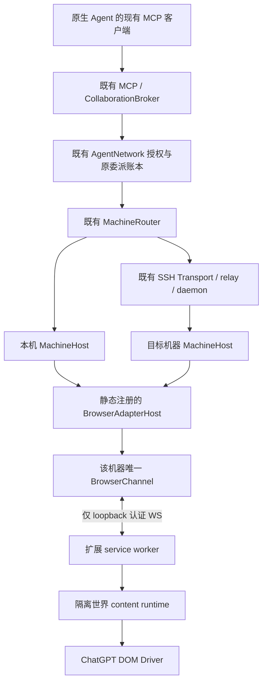
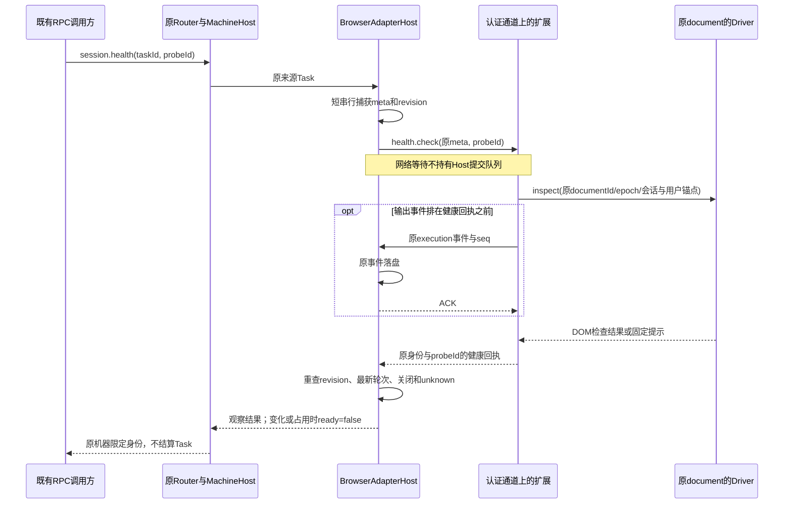
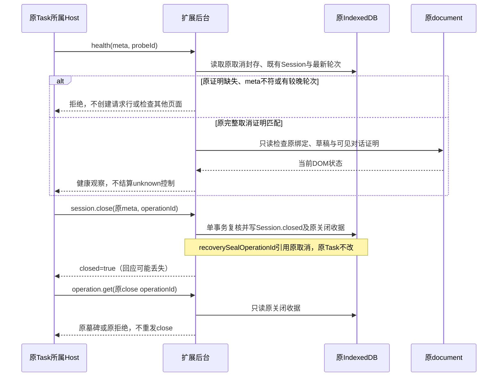
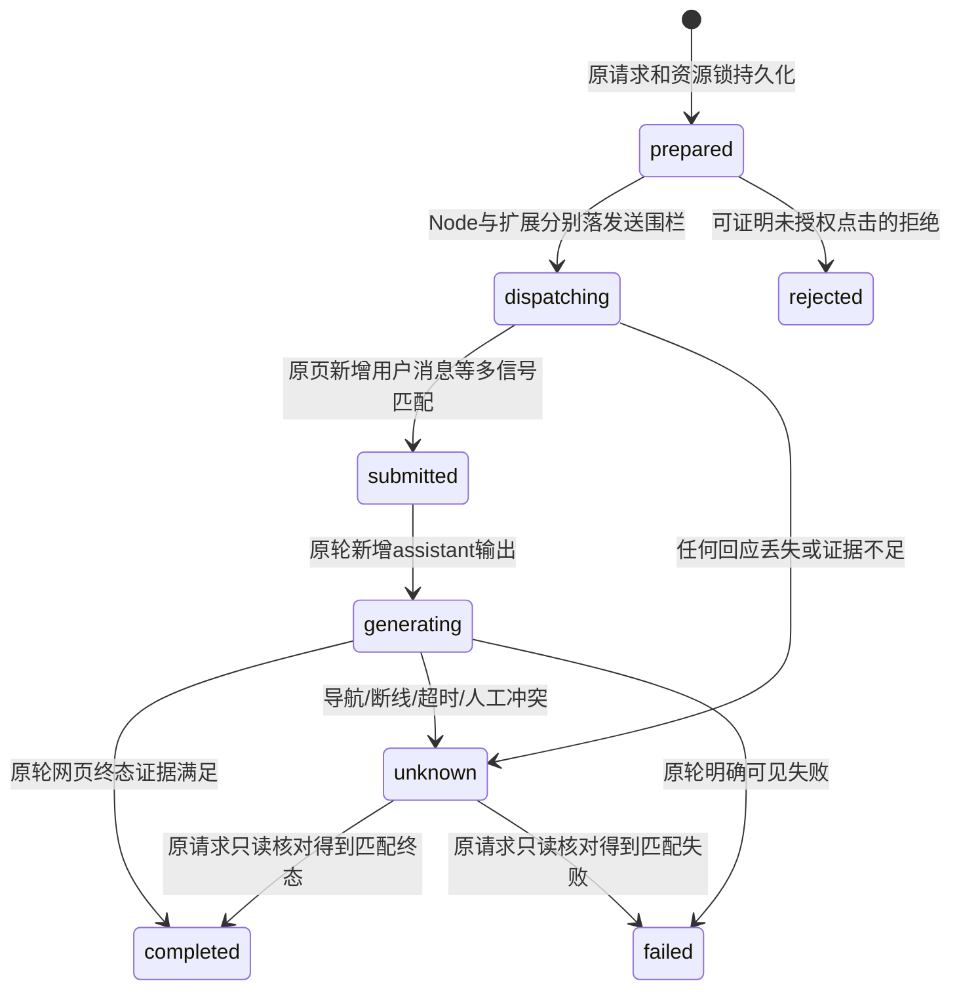
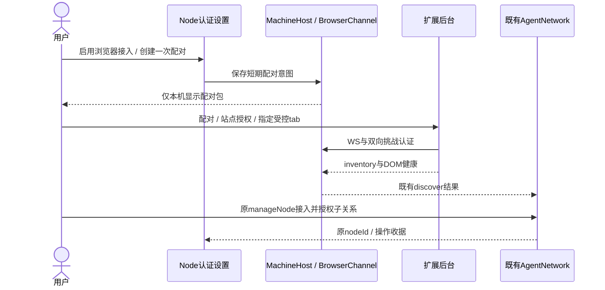
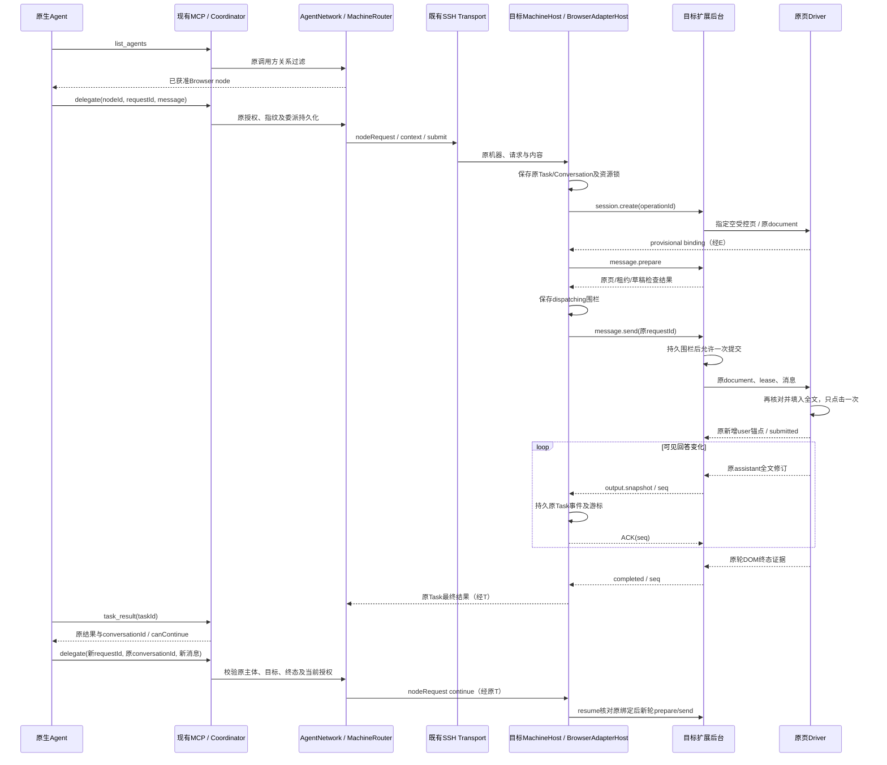
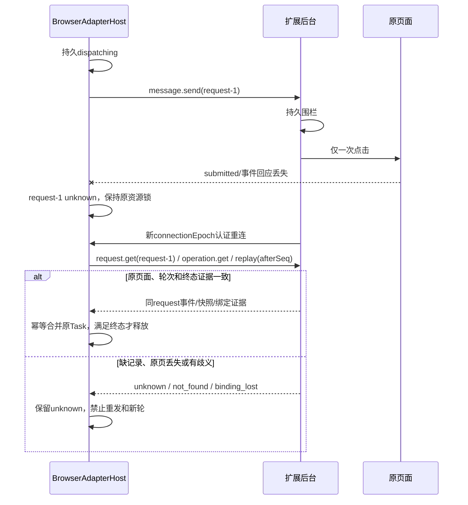
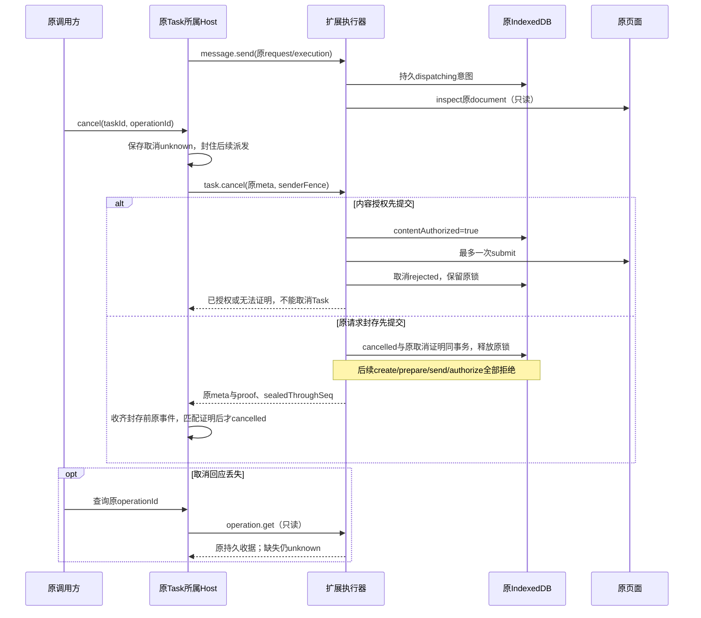
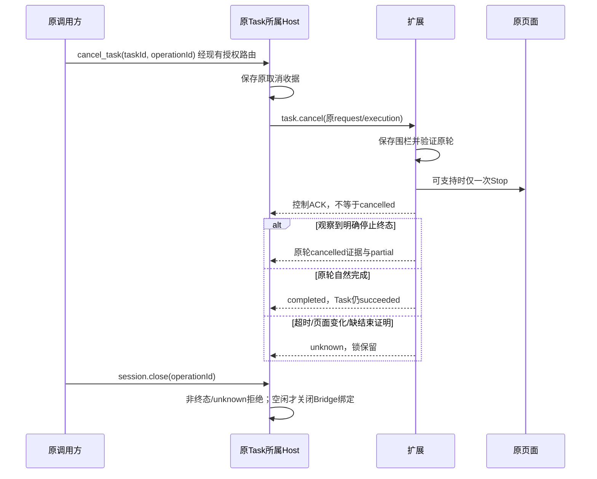

# AgentBridge Web Adapter 与浏览器扩展技术设计

当前源码已实现经典与匿名新版ChatGPT DOM、异步ARIA就绪的一次发送、原生完成/Stop解除/稳定正文联合判定。原output.subscribe可选择只读原结束失败结算，不能把当前匹配正文当作历史完整性证明。真实四轮及失败恢复的准确范围见[本轮设计、时序与证据](web-agent-live-chatgpt.md)。

当前开发及验收范围：依用户最新指令，仅ChatGPT Web；Kimi已移出本轮范围。本文原有多Provider/Kimi规划作为历史设计保留，不作为当前待实现或准出项。Core的Provider无关边界保持，当前扩展仅声明ChatGPT站点权限。

日期：2026-10-30（2026-10-31更新当前实现）。用户已授权开发；原方案中的候选契约按[当前开发台账](web-agent-development.md)逐项实现/验收。原Registry接入、通道/配置、原MCP续聊、只读核对/健康、空闲Session关闭和未授权内容的证明取消已有受控证据；真实Provider/权限同意、完整控制/跨机/包仍待，公开alpha.71不包含本功能。本文未实现项不因授权自动成为可调用接口。

阅读顺序：[现有架构审查](web-agent-architecture-review.md) → [三项目对比](web-agent-source-comparison.md) → 本文 → [实施与验收](web-agent-implementation-plan.md)。涉及现有功能 AB-F03/F07/F08/F09/F10/F11/F12/F13，模块 M01/M02/M03/M06/M07/M08/M10；沿用稳定编号，不为候选方案预先改写主文档状态。

## 1. 决策与第一版范围

采用现有静态 Registry + BrowserAdapterHost + 本机认证 BrowserChannel + MV3 扩展 + 独立 Provider Driver。优先 Windows Chromium / ChatGPT Web 文字新会话、同原会话多轮、可见回答流、原请求查询和保守恢复。当前不实现Kimi Driver。

Core 只认识节点、能力、Task/Conversation、请求及控制收据；ChatGPT/Kimi 选择器、页面路径和 UI 结束信号只存在于 Driver。关系不绑定模型、供应商账号或项目。Provider adapterId 是实现身份，不是新增模型路由参数；上层仍选择原 nodeId。

第一版不处理附件、图片、语音、临时聊天、Projects/GPTs、深度研究、工具交互或历史分支编辑；遇到不支持页面/模式在点击前拒绝。使用用户已登录的正常网页，不提取 Cookie、Token、密码，不拦截 fetch/XHR/WebSocket，不解析私有接口，也不访问 React/Lexical 私有状态。原生父 Agent 沿已有 MCP 调用，Browser 不获得主动工具权限。

## 2. 系统边界与 ACP 选择



BrowserChannel 只接收已授权 Host 的浏览器操作，不认识 leader/member，不接受任意 nodeId 选路，也不向扩展开放通用 Coordinator RPC。现有 CollaborationBroker 保持原调用方向；不将第三方 Broker 部署到 Bridge 旁。

### 2.1 明确选择：MVP 不使用 ACP 作为浏览器线协议

ACP 的 `session/new`、`session/prompt`、`session/update` 和可选恢复能表达对话，技术上可以由 BrowserAdapter 提供 ACP facade；仓库当前没有通用 ACP Client，直接采用会新增通用 Client、ACP server 包装及浏览器协议映射，不能减少本轮改动。协议也不会自动提供网页提交幂等、浏览器认证、标签租约、DOM 版本、事件落盘回放。

因此 MVP 定义**适配器内部** `agentbridge-browser-v1`，外部仍为原 MCP / Node IPC / SSH 帧。ACP 不参与跨机路由或替代请求账本。后续 CT-03 若交付通用 ACP Client，可在 Host 内映射，保留同一个 BrowserChannel、原对象和持久围栏；不另建进程级 Broker。

| ACP v1 能表达的语义 | Browser 映射及额外需求 |
| --- | --- |
| initialize / 能力 | 对应协议 hello；仍需独立本机配对与认证 |
| session/new、可选 session/load / session/resume | 对应 create/resume；不能把新 tab 当恢复原会话 |
| session/prompt、session/update | 对应 send/output；JSON-RPC id 不能代替持久业务 requestId |
| session/cancel | 是取消通知；必须另查原任务，不把通知送达当取消成功 |
| 扩展 | 如果采用 ACP，可协商 `_meta` 和 `_agentbridge/...` 方法承载原请求查询、ACK/回放、绑定、健康及本地关闭；不伪造标准方法或强制不支持的客户端 |

官方依据：[ACP v1 总览](https://agentclientprotocol.com/protocol/v1/overview)、[会话](https://agentclientprotocol.com/protocol/v1/session-setup)、[Prompt](https://agentclientprotocol.com/protocol/v1/prompt-turn)、[取消](https://agentclientprotocol.com/protocol/v1/cancellation)、[扩展](https://agentclientprotocol.com/protocol/v1/extensibility)。本次只核对规范，没有运行 ACP 兼容测试；v2 Draft 不作为本方案基础。

## 3. 注册、发现与 Host 接口

### 3.1 静态 Adapter

候选 id：`chatgpt-web`、`kimi-web`；后者在 Driver 验收前不开放 execution。注册 descriptor 新增 `driver:'browser-extension'` 与显式发现类型，只有该类型允许空 commands；不往 PATH 塞假命令，不让扩展声明源码加载地址。继续使用同步 `createHost(options)` 与 `call()/close()`。

| 能力 | Browser 候选值 / 启用条件 |
| --- | --- |
| execution / delegation | Driver 完成文字执行与未知恢复验收后 true；动态离线/草稿/模式不支持可收窄 |
| resume | 仅对可核验原绑定的会话开放；临时页、缺绑定、手动分支或 unknown 均不可续聊 |
| cancellation | 原轮 Stop 与终态观察通过专项后才 true；否则 false，接口返回明确不支持且不点击 |
| mcpClient / bridgeMcp / nativeMcpConfig | false；Web Agent 不作为调用方，不安装 MCP |
| hostManagedTask / teamCollaboration | false；不注入托管 scope，不作为小队自动化入口 |
| permissions / forms / verification | false；验证码和登录不是可由 Bridge 代答的权限表单 |

### 3.2 发现对象与平台归属

扩展只能上报已授权站点和显式受控页面；Node映射既有discovery/connection/node。当前`online`是认证通道，发现投影的`healthy`仅为通道与站点授权可用，`loginChecked=false`，不代表网页已就绪。指定原Session的`ipc.session.health`另报DOM检查、页面提示、资源占用与陈旧性；其ready只是观察结果，执行仍重新检查当前授权和原页面。`login_required` / `unsupported_page` / `manual_busy`不新增Core Task状态。

稳定节点键：`machineId + adapterId + browserInstanceId`；browserInstanceId 为 Node 配对时创建并持久绑定的浏览器 profile 范围标识。扩展安装 ID 只是认证客户端标识，tabId/windowId/documentId 只是运行期定位。页面刷新、开新会话、模型选择变化不生成新节点。

一台机器不同 profile 不再沿 `machineId:adapter` 归并。同一 profile 的多个标签属于一个 Browser 节点；MVP 每节点最多一个活跃或未知轮次。Windows 浏览器属于 Windows MachineHost，WSL 的调用经既有中央选此节点，不建立 Windows 浏览器的 WSL 别名。

### 3.3 BrowserAdapterHost 门面

| 现有 Host 方法 / op | Browser 候选行为 |
| --- | --- |
| `connect` | 绑定已配对 browserInstanceId；创建后端 agentId，不登录、不发消息 |
| `snapshot` | 返回原格式 agents/tasks/conversations 与浏览器诊断；允许只读同步原事件，禁止重发 mutation |
| `ipc submit` | 原 Task/Conversation 与请求指纹落盘后，准备网页会话并只提交一次 |
| `ipc continue` | 校验原 Conversation、上轮/控制终态和原页面绑定；不重建缺失会话 |
| `ipc request/task/conversation` | 查询持久原对象；断线返回原 unknown/partial，查询不创建页面或发送 Prompt |
| `ipc cancel/operation/reconcile` | 原 operationId 收据、原任务可观察核对；不从 ACK 推导任务终态 |
| `close()` | 关闭观察、WS 引用和定时器；原 Task 及 unknown 保留，网页生成可能继续 |

MachineHost 的 Browser context 使用 Bridge 私有上下文目录作为持久存储归属，默认不读取项目目录。第一版 Browser 委派携带非空 workspace 时明确拒绝，而非假装可访问该目录。原生上下文、目录锁和配置路径全部保持；Browser 另加下述可信资源键，不能用本地虚拟 workspace 取代浏览器占用。

## 4. 身份、持久数据与锁

### 4.1 分开的身份

| 标识 | 所有者 / 含义 |
| --- | --- |
| nodeId / machineId / agentId | 原 AgentBridge 网络与机器宿主 |
| conversationId（本文也称 bridgeSessionId） | 原 Host 的 Conversation；每轮 Task 独立，ID 不复用为 requestId |
| requestId / executionId / taskId | 原业务提交及执行；重连查询原值 |
| operationId | create/resume/close/cancel 等操作收据；取消与消息请求分开 |
| browserInstanceId / pairingId | Node 分配的 profile 资源身份 / 配对凭据记录；不是 Provider account |
| tabId / documentId / pageEpoch / leaseEpoch | 当次页面、文档代次和租约围栏；页面脚本不能自行提升 epoch |
| providerConversationKey / branchAnchor | 目标机器私有网页定位与原轮次锚点；来自允许的 URL/可见 DOM，不含账号凭据 |
| transcriptFingerprint / assistantAnchor / historyRevision | 原完成时可见消息序列SHA-256、最新回答锚点与原document历史版本；不公开给MCP，不证明账号 |
| eventId / seq / outputRevision | 原事件去重键 / 该 execution 连续序号 / 同一输出块替换版本 |

网页首次发送前可能只有新对话 URL，不能捏造 Provider conversationId。先用 bridgeSessionId + tab/document + provisionalBinding；只有同一原请求的新增用户消息和 URL 转换都匹配时，才原子提升为已绑定会话。临时/无稳定定位模式第一版拒绝续聊。

### 4.2 存储责任

Node 每个 Browser context 以单一 `browser-state.json` 保存原 agents/tasks/conversations/requests/operations、必要私有页面绑定、有界保留事件、browserSeq→TaskSeq 映射、终态、锁与 ACK 游标，使用现有 atomicWrite/私有目录工具。**同一份权威状态成功提交后才 ACK 或释放锁**。可另导出 `browser-bindings.json` / `browser-events.jsonl` 作非权威诊断投影，恢复不得用投影覆盖权威游标；它们分别 rename 不等于跨文件事务。损坏状态保留副本并阻止新派发，不能当空表重发。这些是 Adapter 执行证据，与 Claude/Codex 等 Host 私有任务记录同层；不新建产品 Session 服务，不改变 Core Hub/Edge SQLite。后续容量需要 WAL 时另定义提交序号及恢复协议，不在首版混用两套权威来源。

扩展 service worker 用 IndexedDB 事务持久保存 requests、sessions、operations、locks、未 ACK 事件。提交围栏写入并完成事务后才允许 DOM 发送；优先请求严格 durability，仍不宣称浏览器断电跨存储与网页动作的原子性。存储异常拒绝 mutation；Node 已有派发记录但扩展记录缺失时继续 unknown。`storage.session` 只放运行缓存，不能承载重启恢复。

配对秘密仅在 Node 私有凭据文件和扩展 `storage.local` 的受信上下文区；调用 `setAccessLevel({accessLevel:'TRUSTED_CONTEXTS'})` 后才使用。content 不拿配对秘密。Node 任务记录只保存必要 Prompt/回答，扩展 ACK 后尽快清除正文；未终态围栏、请求指纹与锁不因清理期限删除。容量达到阈值拒绝新任务，不淘汰 unknown。日志不记录认证消息、页面存储或完整页面 HTML。

### 4.3 排它与人工操作

Node 和扩展共同锁定 `machineId/browserInstanceId/adapterId`，再绑定具体网页会话；同一网页会话在两个 tab 中打开只允许一个显式所有者，歧义拒绝。锁来自可信 Node 绑定，不接受 caller 自填 resourceKey。当前 Coordinator 的 pendingResource/managementBlocks 需识别此浏览器资源；旧未知执行不能靠新 node、workspace、扩展重装或连接别名释放。

lease 仅阻止旧观察器/旧 content 执行命令；lease 到期或断线不代表网页停止，不释放业务占用。用户移除扩展、取消配对或关 tab 也只撤销未来访问，原 unknown 保留。重装/清空扩展后随机身份无法证明不是原 profile 的别名：Node 有相关孤儿 unknown 时，无法证明独立的新配对仅允许认证和只读观察，不开放该机器该 adapter 的新执行绑定；已知独立的原配对按既有资源规则处理。关联回原资源后仍只读核对，不因重新配对解除原 Task。此保守隔离须在设置明确呈现，不能自动赋予另一个可执行身份。

采用用户明确指定的专用受控 tab；保留其他标签的正常操作。提交前检查空 composer、无附件/编辑历史态、无正在生成、没有未处理人工输入。运行时监听可信 input/beforeinput/paste/composition、发送/停止、导航、历史编辑/分支、DOM 会话锚点变化。检查与点击在同一个同步页面执行段再次比较 epoch、内容与锚点；不吞用户输入、不把手动文本混入任务。

发现人工接管：若能证明尚未经过提交围栏，明确拒绝；若已经允许点击或无法确定，停止自动操作、保存 partial、将原任务 unknown 并保持锁。单纯 DOM 事件不能覆盖所有辅助技术或外部扩展操作，无法证明归属时同样 unknown。检查不能被描述为跨浏览器绝对互斥。

### 4.4 已实现的可见对话续聊证明

ChatGPT完成事件新增可选私有continuation={transcriptFingerprint,assistantAnchor,historyRevision}。Driver对当前可见消息按DOM顺序序列化[role,messageId,text]数组，以UTF-8 JSON计算SHA-256；用户消息保留可见全文与换行，assistant使用当前公开DOM答案文本。仅可见DOM参与，不读取隐藏推理、账号、页面存储或私有Provider状态。完成前在Web Crypto返回后再同步核对快照、历史版本、原用户/回答、会话与Stop，匹配才提交完成事件。可见序列最多1MiB、历史锚点跟踪最多8192；达限unknown且不以截断内容建立证明，性能边界仍须实测。

content文档在原pageEpoch内维护MutationObserver历史版本及逐锚点版本，跟踪消息文字、角色、ID、增删和相关可见性变化；编辑后恢复原文也会改变版本。公开编辑/重生成/分支按钮的可信点击提升历史版本，并在运行中使所有权失效；composer草稿及其清空不当作旧对话修改。运行时持续核对原用户内容和旧锚点版本，不能把同ID的人工改写混为本轮流；新的自动回答正常流动不会改写旧消息版本。

扩展原IndexedDB在completed同一事务保存Session.continuation与终态，Node在原完成事件同次保存私有Task/Conversation binding；ACK后这些证明仍随原终态保留。续聊必须匹配Node/扩展原证明、原tab/document/pageEpoch、原用户及最新assistant；先只读验证哈希与历史版本，异步哈希后重查，实际填入/点击的同步段再查同一快照与版本。摘要相同但版本变化仍拒绝，不自动重绑。Node不计算Provider文本哈希，只验证协议形状、原事件/游标/页面归属；Core仍不感知Provider。

旧完成记录缺证明仍保持成功历史，canContinue=false，不补造哈希。submitted清除上轮证明，新完成才更新；未授权内容取消保留上一轮真实证明，人工草稿清空后仍须正常预检。原会话资格与页面就绪分开：canContinue是Bridge侧资格，不能代替即时DOM检查。TRANSCRIPT_CHANGED、CONTINUATION_UNVERIFIED或TRANSCRIPT_LIMIT不证明未提交，仍按原阶段/取消封存处理；原已成功结果不因后续人工编辑而改写。

## 5. 本机认证通道与协议封包

### 5.1 配对与连接

候选使用 `ws://127.0.0.1:<用户配置端口>/browser/v1`，只在启用 Browser 接入后监听；端口占用明确报错，不扫描 LAN、不开放远端 WS，也不复用 `/tools` bearer。选择 WS 是因为项目运行包已有 `ws`，可双向推送事件；Native Messaging 可作后续部署选项，但首版不新增 native host 安装器。

1. 用户在 Node 本机认证设置入口创建一次性配对包：loopback 地址、Node 身份、pairingId、256-bit 随机秘密、两分钟有效期；通过本机用户复制到扩展 options。它是 Bridge 通道秘密，不是 Provider Token；不得进 URL、日志或 Provider DOM。
2. 配对入口仅在该有效期开放，限流；Node 只接受发行版允许列表里的完整 `chrome-extension://<id>` Origin（开发版显式登记自己的完整 ID），不接受任意扩展格式。Origin 只是辅助检查，不能代替秘密认证。
3. 双方以 fresh clientNonce/serverNonce、Node/pairing/client identity、协议版本构造规范 transcript；使用 Web Crypto HMAC-SHA256，分别以 client/server 角色标签证明持有秘密，防反射/重放。握手五秒未完成断开；恒时比较、nonce 单次、过期拒绝。长期每安装秘密通过 HKDF 从共享秘密及固定配对 transcript 派生，支持本机撤销。
4. 认证后每帧带 connectionEpoch、单向递增 frameSeq 和 MAC；MAC 覆盖规范化完整消息、方向及连接 transcript。旧连接、缺字段、重复 frameSeq、超限/未知 method 拒绝。content 不直接建立 localhost 连接。

配对本身也须幂等：Node 在分配 browserInstanceId/长期凭据前持久 pair intent，双方保存派生凭据后进行 pair.commit。确认丢失时沿原 pairingId 查询或完成同一事务，返回原 browserInstanceId，绝不再分配资源。bootstrap 秘密只允许短期恢复这个配对记录，不允许业务执行；业务只接受已 commit 的长期凭据。过期中断保留原意图，由本机用户明确处理，不自动新建别名。

MVP 固定 loopback WS 的边界是不向网络提供保密通道；同机已取得浏览器或用户权限的进程不在此凭据隔离保证内。部署需要更强传输保护时选 Native Messaging 或本机 WSS，不能把 HMAC 认证写成加密。配对实现不同时保留多套未使用的认证机制。

撤销配对先持久撤销凭据、再断连接；不取消网页任务。远端服务器上的浏览器只连接该服务器 Node，调用方通过已有 SSH 抵达它。浏览器不向远端中央持有通用执行凭据。

### 5.2 封包示例

以下仅示意认证完成后的逻辑 JSON，实际 MAC/nonce 用占位值，不在文档放真实凭据：

```json
{
  "protocol": "agentbridge-browser-v1",
  "kind": "command",
  "id": "rpc-demo-3",
  "method": "message.send",
  "connectionEpoch": "conn-demo",
  "frameSeq": 3,
  "params": {
    "requestId": "request-demo-1",
    "taskId": "task-demo-1",
    "executionId": "execution-demo-1",
    "bridgeSessionId": "conversation-demo-1",
    "bindingRevision": 1,
    "leaseEpoch": 4,
    "message": {"type": "text", "text": "示例需求"},
    "payloadFingerprint": "sha256-placeholder"
  },
  "mac": "placeholder"
}
```

rpc `id` 只关联一次传输回应；业务重连仍查 requestId/operationId。fingerprint 由 Node 和扩展分别对规范化原字段重算，不能信任 caller 给出的摘要。候选限制：单消息 UTF-8 ≤64KiB、封包≤1MiB、事件文本≤64KiB 分片、结果总量≤现有 Task 输出上限；超过上限保留 truncated 标志，不假装完整。具体配额须在实现时与原 schema/实际序列化共同冻结。

## 6. 七类接口与原请求查询

| 接口（候选） | 输入 | 返回 / 事件及规则 |
| --- | --- | --- |
| `agent.discover` | scanId、已配对 profile 范围 | provider driver/version、页面能力/健康；Node 映射既有 discovery，不能创建关系 |
| `session.create` | operationId、bridgeSessionId、adapterId、browserInstanceId | 原 Session 的 provisional binding、bindingRevision；显式分配受控 tab；只建空网页，不发 Prompt |
| `session.resume` | operationId、bridgeSessionId、原 bindingRevision、原会话/分支锚点 | 严格核对现存原会话；只读恢复观察或按明确控制重开原 URL；缺失/歧义/账号身份无法核验拒绝，绝不新聊天替代 |
| `message.prepare` / `message.send` | requestId、task/execution、Session、leaseEpoch、原内容 | prepare 只读检查并保留租约；send 先持久围栏后最多点击一次；相同 ID 返回收据，不重新点击 |
| `output.subscribe` / `output.ack` | executionId、afterSeq / throughSeq | 持久事件回放；正文使用 revision 的 replace snapshot 或受 baseRevision 约束的 delta；gap 返回明确 gap+已验证快照 |
| `task.cancel` | operationId、原完整meta、senderFence | 当前支持内容未授权时原子封存；匹配证明及事件游标后才取消。已授权内容不点击Stop，仍明确不支持 |
| `session.close` | operationId、bridgeSessionId、expectedRevision | 空闲时解除 Bridge 页面绑定，不删除 Provider 历史；非终态/unknown 或取消未确认拒绝；不以关 tab 取消 |
| `health.check` | adapter/profile、只读探测标识 | 通道、Driver、DOM、登录提示、人工状态、原未知占用分别报告；不探测生成、不发送测试 Prompt |
| `request.get` / `operation.get` | 原 requestId / operationId 与原归属 | 原阶段、指纹、绑定、lastSeq、Task/控制状态；not_found 不是未执行证明；查询绝不重新发送 |

create/resume/close 与 cancel 都按 operationId 幂等，同 ID 不同 payload 冲突。close 只关闭桥接 Session 的未来写入；底层 Host.close() 是观察器生命周期，两者均不是网页删除或取消。必要的用户配对/启用/撤销 RPC 只向认证设置入口开放，原生 MCP 无权审批配对。

### 6.1 已实现的原会话健康检查

源码RPC为`ipc {op:'session.health',taskId,probeId,executionId?}`；taskId沿原机器限定ID路由，probeId是一次只读观察的关联ID，不是operationId，不新增收据或Task事件。Node从原Task派生完整meta，经既有BrowserChannel的`health.check`读取原扩展日志与指定document。缺页面、权限、编辑器、原锚点或回应时保留原任务，不创建tab、resume、点击或发送测试Prompt。

返回`online`、`storageReady`、`sitePermission`（未知为null）、`domChecked`、`pageReady`、`loginChecked:false`、`sessionClosed`、`blocked`、`stale`、`taskStatus`、`ready`和`observedAt`；`code`是整体诊断，`pageCode`可保留独立DOM提示。缺编辑器的登录提示并不核验账号。检查前后Node revision或原最新轮次变化，ready=false/stale=true；unknown/关闭/离线不能被一份页面健康回应释放；已知存储写入失败锁定也使ready=false，不被健康DOM掩盖。ready也不授予后续关系或执行权限。

新中央/daemon以`browser-session-health-v1`定向声明；旧peer在发出新健康请求前拒绝，原读取不因此要求升级。Host仅在短串行段捕获/重查状态，等待网络时释放队列，允许同WS排在健康回执前的原输出事件先落盘/ACK。扩展只读原IndexedDB和原document，健康本身不改变Task/Session/锁。



原用户锚点须仍是页面最后一条用户消息；任务完成后的人工新轮不能被自动续聊接管。当前已增加可见对话摘要与历史版本，对受控同锚点编辑/助手重生成拒绝；该机制仍不等于真实Provider全部分支/账号/虚拟化的完整冲突证明。当前实现、分层日志和失败记录见[开发台账](web-agent-development.md)。

### 6.2 Provider 无关的 MCP 续聊窄改

保留现有十个经典工具名，扩展 `delegate({nodeId,requestId,message,conversationId?})`，及 `task_result` 的 conversationId / canContinue 字段。conversationId 缺省时行为与旧版相同；给定时走现有 `nodeRequest(op:'continue')`。不增浏览器专用 MCP 工具。

准入顺序：原 ID/指纹检查 → 原 caller/source/connection 或父 Task scope → 原 delegation 所有权 → 当前允许的目标关系 → 原会话 targetAgent/node/machine → 原页面绑定/分支 → 上轮和取消已确定 → 新轮独立 requestId 落盘。新轮 ID 只表示用户的新消息，不能用于重发旧消息或绕过 unknown。

托管调用的所有权仍为原 leader + parent request/task/conversation；父 Task 终态后旧 scope 失效，不自动授予下一父轮旧子会话。独立 MCP 以原 externalConnectionId 长期归属，不伪造父 Task。关系撤销后旧结果按现有规则可读，新续聊仍需当前授权。fingerprint 与 delegation 索引补入 conversationId/op，历史缺字段保持原 submit，不重写旧摘要；并发两次续聊只有一个可取得原会话锁。

浏览器输出先经原 Task events/summary/results 返回；现有 `task_result` 仍是轮询等待，MVP 不承诺父模型收到每个文本块。若以后需要 MCP 文本流，另设计受原委派授权的通用只读 events 工具，不能借扩展 WS 绕过关系。

### 6.3 原取消的 MCP 只读查询

经典十工具保留，cancel_task新增可选queryOnly:boolean。缺省/false沿既有取消动作；true仅沿原delegation所有权和machine/task/operation调用ipc.operation，Browser Host再以operation.get查询原扩展封存收据，不创建或重发取消。新stdio客户端在发送true前只读list_agents验证supportedOperations包含cancel.query-v1，旧后台无声明时返回MCP_CANCEL_QUERY_BACKEND_UPGRADE_REQUIRED且不发送cancel_task，防止旧处理器忽略该字段并执行取消。非布尔字段在发往后台前拒绝。

返回必须匹配原taskId/operationId、可核验kind=cancel及合法操作状态；其他操作种类、旧格式无法证明种类或任务的收据不能冒充取消，缺失原记录不创建替代操作。源机器、原父执行/独立connectionId及委派归属不变；关系变化不把历史读取变为新委派授权。confirmed只表示原取消控制收据，调用方仍通过task_result读取原执行结局，不能从普通取消收据推断native退出。该字段不改变Core数据格式或Browser帧，也不新增MCP工具。

### 6.4 已确认取消后的原 Session 恢复

resume或prepare前取消时，Node已有原Task/Conversation，但扩展可能只有原Session和取消操作，没有该轮request行。health/close通过Journal内部controlTarget核对完整原meta；无请求行必须有同原请求的confirmed task.cancel、content-not-authorized-v1及contentAuthorized=false，缺记录本身从不作证明。原Session必须属于同adapter/profile，且同Session不存在另一requestId、leaseEpoch大于或等于该轮的请求/操作意图；较晚轮次即使尚未完成resume或已被拒绝，也不允许旧取消接管。存在原请求行的旧控制同样遵守这一最新轮次检查。

health只读同一IndexedDB快照的原封存、既有Session和占用，沿原tab/document/pageEpoch检查DOM；不补request行、不结算Node未知取消、不创建控制或重发。原request.get/output.subscribe仍严格要求真实请求行，缺失继续NOT_FOUND。close在同一原事务写既有Session.closed及confirmed关闭操作，派生恢复的关闭记录私有recoverySealOperationId指向同meta原取消，读库时验证引用；不新建Session/页面、不删除历史。回应丢失仍仅查原close operationId，Task保持cancelled，旧成功结果保持。

继承旧Session绑定的prepared任务也先保存取消unknown，并以before-message-send取得原扩展封存；延迟派发回调看到该终态后不能再resume/prepare/send。仅全新、无旧绑定且尚未派任何浏览器命令的prepared可本地取消。旧本地confirmed没有扩展封存时不自动补造证明；离线/缺证据按原操作保持不确定性，不能用健康提示或NOT_FOUND释放。



## 7. 一次提交、输出和异常状态

### 7.1 发送阶段与不确定窗口



图是 Adapter 阶段，映射为原 Task accepted/running/succeeded/failed/unknown；取消另见下文。不允许 unknown 自动回到 dispatching，也不因更换 tab/node/workspace 解锁。目标是有持久证据时不重放，**不声称网页系统提供端到端 exactly-once**。

1. Node 在原请求/Task 与浏览器资源锁保存成功后才准备命令。扩展准备原 tab/document/锚点，不提前清 composer。
2. Node 在发 send 前保存 dispatching。扩展收到后在事务中核验指纹、lease、未知占用并保存 dispatching，再交给指定 content；重复业务 ID 只回原收据。
3. content 在原 document 的命令表登记点击围栏，核对 composer 空值、用户输入代次、会话与内容；通过可见 DOM 输入填充后比较规范化全文，并在点击前同步重查 document/lease、原会话锚点、人工输入代次和控件身份，防止填充触发同步重挂载或页面切换；通过后才点击一次。填充失败不试另一种发送动作；进入可能点击阶段后禁止 Enter/再次 click 回退。
4. `.click()` 返回仅说明动作已尝试。只有新增用户消息、其规范化内容/顺序锚点、原会话及页面状态组合匹配，才上报 submitted。composer 变空、按钮禁用或 Stop 出现任一单项都不够。普通相同内容的历史消息不能作确认。
5. 点击到 submitted ACK 之间崩溃、worker 消失、导航或断链，一律保持原 unknown。prepared 丢回应也查询原记录；not_found 不自动新建。背景 script 重启不得把请求重新交给新文档执行。

### 7.2 DOM 输出与完成证据

Driver 用 MutationObserver 加有界采样读取**绑定原轮**新增的 assistant 容器，不取全页“最后一条回答”。同时绑定页面代次、原 user 锚点、assistant 块及可见分支。代码、列表、表格、链接经受控 DOM 序列化为纯文本/Markdown；只返回内容，不返回脚本、HTML 或页面执行能力。

DOM 会重排、替换和回写，因此默认 `output.snapshot {blockId,revision,text}`；优化为 delta 时必须携带 baseRevision，不连续则取 snapshot。Node 将可见正文映射原 output/summary，文本修订存在 Adapter 事件包中，不把 replace 当字符串追加。只输出用户可见回答，不采集隐藏推理或网页缓存。

完成候选要求：同一原轮 assistant 非空、原 Driver 验证过的最终 UI 标志出现、Stop/生成指示消失、无工具/模式等待、内容在候选稳定窗口内不再变化、二次核验无新增人工轮次/导航/错误。候选采样 250ms、稳定窗口 1500ms 仅为调优初值，不能把“静默一会”作为唯一完成条件。只有阶段进度不算文本 streaming，只有 partial 不算成功。

DOM 证据证明网页呈现的本轮完成，不证明服务器内部状态。Driver 必须先用当前真实页面确认组合信号；若网站没有可区分完成/暂停/断网的信号，就返回 unknown/partial，不能为可用率降低标准或退回私有 API。完成后冻结原轮输出；后续手动消息不并入该 Task。

### 7.3 事件、ACK、回放与背压

扩展为每个 execution 在事务中分配连续 seq；Node 按 executionId+seq 去重，并校验相同序号正文摘要一致。Node 持久化映射后的 Task 事件和游标后才 ACK。ACK 丢失只补同一事件，不重新执行网页消息。Node 的 Task.lastSeq 与 browserSeq 映射原子保存，防重开重复追加。

通道重建使用新的 connectionEpoch/frameSeq；业务 event seq 不重置。乱序暂存有界，缺口查原事件；已 compact 的文本块可返回带 throughSeq 的完整 snapshot，控制/终态及提交证据不得仅靠快照删去。Node 只有验证该快照和原绑定后才推进游标。显式 gap、上限和截断均可见。

事件缓存按字节/条数有界。MVP 只在分配 seq 和持久化**之前**合并尚未发出的文本采样；已持久化且未 ACK 的事件不改写、不删除、不跳号。ACK 后才按已确认游标清理普通输出，保留最新完整快照及原提交/控制/终态证据。无法保存终态或围栏时停止新的网页动作并 unknown。不能用数据库写失败触发 Prompt 重试。

### 7.4 取消、关闭与超时

当前实现将派发意图与页面内容授权分开。新扩展请求持久保存`contentAuthorized=false`；claimSend只写dispatching/inputFingerprint，完成原页只读预检后，必须另一次严格IndexedDB事务将contentAuthorized写为true，才能调用pages.submit。标记一旦为true不回退；旧记录缺字段不是false。页面错误码、未找到记录、超时或普通ACK均不证明尚未提交。

Node在phase=prepared、无旧绑定且未发送任何扩展命令时可本地取消。继承旧绑定的prepared及creating/preparing/dispatching先持久保存原取消意图并冻结后续派发，携原完整meta及senderFence发送一次task.cancel；前三种发送前阶段为before-message-send，dispatching为message-send-issued。扩展原子检查并封存：有请求必须明确contentAuthorized=false且没有submitted/终态；无请求仅接受Node的before-message-send围栏。封存与内容授权由同一IndexedDB事务队列裁决，只有一方可成功。确认记录包含proof=content-not-authorized-v1、contentAuthorized=false、sealedThroughSeq和原全部身份；取消自身不触碰页面、草稿或Stop，也不新建虚假Session。尚未结束的原create/resume操作写为rejected/BROWSER_REQUEST_CANCELLED，旧完成回调和所有prepare/send/authorize入口受封存约束，不能复活原请求；只移除该request的锁。

Node只在完整meta、operationId、senderFence、证明及原事件游标全部匹配后将原Task.cancelled与取消收据confirmed同次提交；事件尚未收齐时继续unknown，原查询恢复。丢回应仅operation.get原取消操作，重复cancel原ID不重发，另一ID不能替代未知取消。contentAuthorized=true或旧记录无法证明时，扩展持久拒绝BROWSER_CONTENT_ALREADY_AUTHORIZED/BROWSER_CANCELLATION_UNPROVEN；取消操作结算不等于原Task已结束。已知submitted阶段仍BROWSER_CANCEL_UNSUPPORTED，cancellation能力保持false。原页Stop与停止终态观察尚未实现，不因生成标志消失、关tab或撤销配对推断cancelled。

候选预算：认证5秒，页面/编辑器准备20秒，提交观察15秒，无输出/无进展90秒，单轮总预算10分钟。Node/MCP 等待超时与网页任务预算分开；任一预算耗尽后只停止本地等待/观察，不自动点击 Stop、刷新或重发。最终限值配置于 Node，Driver 不自行无限延长。

通道重连采用有抖动退避1/2/4/8/最高30秒；只重连运输。连接后先 inventory、request.get/operation.get 和事件回放，拒绝旧 epoch。Chrome service worker 使用20秒心跳，30秒 alarms 兜底唤醒；运行内存不是恢复依据。Chrome 116 起 WebSocket 收发可重置空闲计时，120 起 alarms 最短周期为30秒，但这不保证浏览器不休眠/不崩溃。[生命周期](https://developer.chrome.com/docs/extensions/develop/concepts/service-workers/lifecycle)、[WebSocket 官方示例](https://developer.chrome.com/docs/extensions/how-to/web-platform/websockets)、[storage 权限与访问级别](https://developer.chrome.com/docs/extensions/reference/api/storage)。

## 8. 扩展模块设计

| 模块 | 职责与边界 |
| --- | --- |
| manifest / 构建 | MV3，minimum_chrome_version=120；background module；ISOLATED content；严格 CSP，只加载包内脚本；Chrome/Edge 分别实测 |
| permissions | storage、alarms；仅ChatGPT 站点以 optional_host_permissions 显式授权。不要求 cookies、debugger、webRequest、identity、nativeMessaging 或 `<all_urls>`；页面脚本注入由授权后的 scripting 注册，故需要 scripting |
| background channel | 本机配对、HMAC、WS、重连、版本与能力协商、消息限额；不接触 Provider DOM/账号存储 |
| background registry / sessions | 指定 tab/document、profile identity、Session绑定、租约、人工占用、tab removed/updated；不按 active tab 选路 |
| background journal / events | IndexedDB 事务、围栏、控制收据、seq、ACK、回放、配额；worker 重启后先恢复日志 |
| content runtime | 后台收到 content 事件时核验 sender.id、tab.id、frameId=0、documentId、允许URL与绑定；content收到后台命令时核验sender.id及自身document binding nonce/epoch/lease，不要求该方向必带sender.tab。双方严格schema、串行执行指定Driver；不开放window.postMessage控制入口 |
| provider-driver contract | probe / ensureSession / inspectBinding / prepareInput / submitOnce / observeOutput / requestCancel / detach；各方法明确是否有副作用，cancel 可不支持 |
| ChatGPT Driver | 仅 chatgpt.com 允许页面；支持的编辑器、发送、消息锚点、Stop、完成/错误标志独立 selector 集；禁 React fiber 和私有对象路径 |
| Kimi历史候选 | 已移出当前实现与验收，不申请其站点权限或注册Driver |
| popup / options / 受控页提示 | 显式配对与站点授权、指定受控页、当前任务/人工接管提示、原请求查询和撤销配对；不做第二个任务列表或聊天管理产品 |

MV3 中 popup 的生命周期不能拥有任务，关闭 popup 不影响日志。完整 URL 只保存在扩展/目标机器私有绑定，不进入跨机节点发现。没有用户授予站点权限时只显示未配置，不尝试自动操作。[MessageSender 官方定义](https://developer.chrome.com/docs/extensions/reference/api/runtime#type-MessageSender)说明tab/frame字段的方向性，不能把来自content与来自background的消息用同一条件放行。

## 9. 错误与 Task 映射

| 错误 | Task/收据处理 |
| --- | --- |
| BROWSER_AUTH_REQUIRED / AUTH_FAILED / PROTOCOL_UNSUPPORTED | 未授权新操作拒绝；已派发原 Task 不据此清理 |
| BROWSER_OFFLINE / LOGIN_REQUIRED / UNSUPPORTED_PAGE / DRIVER_CHANGED | 点击前且有完整未派发依据才拒绝；点击可能发生则 unknown |
| BROWSER_MANUAL_BUSY / DRAFT_PRESENT / SESSION_BUSY | prepare 阶段明确拒绝，不覆盖草稿；历史未知不被该码释放 |
| BROWSER_SESSION_MISMATCH / SESSION_AMBIGUOUS / BINDING_LOST | 禁止续聊/改绑；在途原 Task unknown |
| REQUEST_CONFLICT / OPERATION_CONFLICT / STALE_LEASE | 拒绝新 mutation；返回原收据入口，旧事件不污染当前轮 |
| BROWSER_SUBMISSION_UNKNOWN / OUTPUT_TIMEOUT / PAGE_CLOSED / USER_INTERFERENCE | 保留原 partial/阶段/绑定和资源占用；只读 reconcile |
| BROWSER_RATE_LIMIT / PROVIDER_ERROR | 有原轮明确错误 UI 才 failed；不自动新建会话、换账号或重试 |
| BROWSER_CANCEL_UNSUPPORTED / CANCEL_UNKNOWN | 控制收据拒绝/unknown；Task 独立观察，不自动 cancelled |
| BROWSER_TRANSCRIPT_CHANGED / BROWSER_CONTINUATION_UNVERIFIED / BROWSER_TRANSCRIPT_LIMIT | 不重绑原可见历史；旧成功结果保留，新轮依原阶段处理，不能仅凭错误码释放unknown |
| MCP_CANCEL_QUERY_BACKEND_UPGRADE_REQUIRED / RECEIPT_MISMATCH | 旧后台无只读查询声明或原收据身份/状态不符，拒绝推断；不发送或重发取消 |
| BROWSER_STORAGE_ERROR / EVENT_GAP / OUTPUT_LIMIT | 停止新 mutation；输出限制显式标记，提交和终态证据不足 unknown |

错误码不是“未执行”的证明；必须结合保存的原输入、阶段、页面绑定、派发围栏和在途命令核对。裸错误码、not_found、健康恢复或用户声明均不能解除原任务 unknown。

## 10. 通信时序

### 10.1 发现、配对与授权



### 10.2 完整跨设备调用、新建会话、流与续聊



本机调用省略 SSH，不改变业务路径。图中 output 是目标 Host 的流，MCP task_result 按现有方式轮询原结果。

### 10.3 点击后断链与只读恢复



### 10.4 取消与关闭

以下为当前已实现的未授权内容取消；扩展WS命令按接收顺序执行，不抢占正在等待的create/inspect。尚未取得证明时维持unknown，不能借取消超时释放占用。



以下Stop为候选能力，当前不会执行；空闲session.close已实现且独立于Task终态。



## 11. 待验证的设计边界

最大的可行性门槛是当前 ChatGPT 纯 DOM 输入和完成证据：本次没有加载真实页面，不能承诺线上 selector、合成输入接受率、Stop/完成判据、后台节流及账号切换可判定。先做受控 fixture 与用户自己的专用测试页实测；若不满足，保留明确限制或停止该 Driver，不扩大到私有 API。

跨重启不能仅从浏览器 profile 或 URL 推定仍为同一 Provider 账号。恢复须核对原会话/分支与可见锚点；无法证明时只读显示原历史，必要时由用户重新授权观察原页。重新授权不构成旧任务终态证明，不能释放 unknown。自动重开原 URL必须是明确 resume 控制，不由 snapshot/request.get 触发。

扩展商店审查、各平台分发、长期休眠、独立远端桌面浏览器、真实多主、性能与完整故障矩阵均为未来验收项，不由本调研准出。
