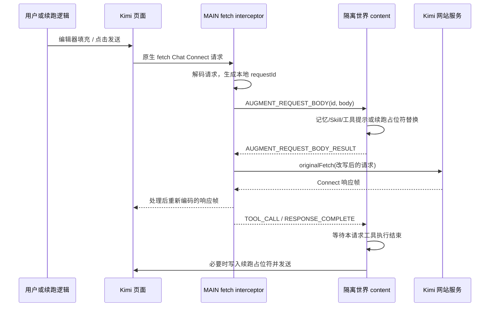

# kimi-pp 源码研究：浏览器 Agent 可借鉴范围

本材料是 Web Agent 候选方案的研究附件，不代表 AgentBridge 已实现或发布 Browser Adapter。

## 1. 取证基线与结论

| 项目 | 实际记录 |
| --- | --- |
| 核对日期 | 2026-10-30 |
| 仓库 | [springrain1/kimi-pp](https://github.com/springrain1/kimi-pp) |
| 固定提交 | `6edf5494532845102e174d5f22669548309f5d18` |
| 提交日期 | 2026-08-02，+08:00；研究日期不等于提交日期 |
| 取证方法 | Windows PowerShell 执行 `git clone --depth 1 https://github.com/springrain1/kimi-pp.git <系统TEMP独立目录>`；核对 `git rev-parse HEAD`、`git log -1 --format=fuller`，逐文件静态阅读；另打开 GitHub 仓库与固定提交源码 |
| 实际执行范围 | 只下载、搜索、阅读源码；未安装依赖、构建、加载扩展、登录网站、发送 Prompt 或运行仓库测试 |
| 版本差异 | 根 `package.json` 的两个 `version` 字段均为 `1.10.0`；README 使用 `1.14.0` 文案。不能以 README 标题推定实际构建版本 |

**结论：可以借鉴 Kimi 编辑器检查、请求隔离、工具结束屏障和 Native Messaging 的实现思路；不能整体复用为符合本需求的被动 Web Agent。** 当前 Kimi 主路径会改写网站内部 Connect 请求及响应；侧边栏聊天与定时任务仍调用 DeepSeek 实现；没有查到可直接供外部 Agent 调用的被动 AgentBridge 注册、会话管理和任务协议。下面的“存在”均指静态源码存在，不是今天实测可用。

## 2. 扩展结构与权限

构建入口是 WXT 配置，而非已提交的生产 `manifest.json`。[wxt.config.ts:44](https://github.com/springrain1/kimi-pp/blob/6edf5494532845102e174d5f22669548309f5d18/wxt.config.ts#L44) 的 `createManifest()` 按 Chrome、Edge、Firefox 生成权限和入口，WXT 根据 `entrypoints/` 生成 background/content 声明；本次没有构建，未核对最终 manifest。

| 文件与入口 | 源码事实 | 对本需求的意义 |
| --- | --- | --- |
| [wxt.config.ts:47](https://github.com/springrain1/kimi-pp/blob/6edf5494532845102e174d5f22669548309f5d18/wxt.config.ts#L47) | 基础权限有 `storage`、`alarms`、`nativeMessaging`、`contextMenus`；Chromium 还加入 `offscreen`、`debugger`、`tabs`、`identity`、`sidePanel`，含广泛可选主机权限和云同步主机 | AgentBridge 被动桥应重新设计最小权限，不能照搬浏览器控制、云同步、命令执行能力 |
| [entrypoints/main-world.content.ts:55](https://github.com/springrain1/kimi-pp/blob/6edf5494532845102e174d5f22669548309f5d18/entrypoints/main-world.content.ts#L55) | `www.kimi.com`，MAIN world，`document_start`；安装 Kimi fetch interceptor | 这是网站内部协议拦截入口 |
| [entrypoints/content.ts:489](https://github.com/springrain1/kimi-pp/blob/6edf5494532845102e174d5f22669548309f5d18/entrypoints/content.ts#L489) | 同域隔离世界脚本，`document_idle`；连接 MAIN bridge，维护工具执行、UI、记忆及续跑 | 可参考世界隔离与明确消息类型，不能把页面消息视作本地认证 |
| [entrypoints/background.ts:311](https://github.com/springrain1/kimi-pp/blob/6edf5494532845102e174d5f22669548309f5d18/entrypoints/background.ts#L311) | `runtime.onMessage` 进入 `handleMessage()`，再访问设置、工具、自动化与聊天 | 这是扩展内部命令分派，不是现成的外部被动调用服务器 |

MAIN 与隔离世界间通过 `window.postMessage` 交换 `MessagePort`，随后使用 `MessageChannel`；`validateBridgeMessage()` 检查 source/type 和部分字段。[桥接入口](https://github.com/springrain1/kimi-pp/blob/6edf5494532845102e174d5f22669548309f5d18/entrypoints/main-world.content.ts#L114)、[消息 schema](https://github.com/springrain1/kimi-pp/blob/6edf5494532845102e174d5f22669548309f5d18/core/messaging/schema.ts#L57)。这些检查不能替代扩展与 AgentBridge Node 间的配对认证。

## 3. Prompt 注入、发送及实际调用链

### 3.1 当前 Kimi 主链：网站请求改写

1. [core/kimi/fetch-interceptor.ts:45](https://github.com/springrain1/kimi-pp/blob/6edf5494532845102e174d5f22669548309f5d18/core/kimi/fetch-interceptor.ts#L45) 的 `initFetchInterceptor()` 替换 `window.fetch`，仅处理 URL 包含 `/apiv2/kimi.gateway.chat.v1.ChatService/Chat` 的请求；其他请求转给原 fetch。
2. [core/kimi/request-adapter.ts:10](https://github.com/springrain1/kimi-pp/blob/6edf5494532845102e174d5f22669548309f5d18/core/kimi/request-adapter.ts#L10) 的 `decodeKimiRequestForAugmentation()` 读取单个 Connect JSON 数据帧，将 `message.blocks[0].text.content` 暴露为通用 `prompt`；`applyAugmentedBodyToKimiRequest()` 只改该位置，保留其余字段。
3. [entrypoints/content.ts:767](https://github.com/springrain1/kimi-pp/blob/6edf5494532845102e174d5f22669548309f5d18/entrypoints/content.ts#L767) 的 `handleAugmentRequestBody()` 优先认领已登记的续跑占位符，否则调用 `augmentRequestBody()` 拼入记忆、Skill、项目与工具描述。

该链依赖网站内部端点及载荷，不属于公开 Provider API，也不是单纯观察可见 DOM；本需求明确不依赖非公开 Provider API，因此应排除这套 Connect 拦截、解码、改写及响应重编码路径。

### 3.2 编辑器原语与发送证据边界

[core/kimi/lexical-editor-adapter.ts:44](https://github.com/springrain1/kimi-pp/blob/6edf5494532845102e174d5f22669548309f5d18/core/kimi/lexical-editor-adapter.ts#L44) 的 `applyKimiLexicalEditorValue()` 通过 DOM 元素上的 `__lexicalEditor`，读取、解析、设置 Lexical state；检查 `expectedCurrentText` 防止覆盖已变化的编辑内容，再等待 state、DOM 文本与发送按钮同步。它访问网站私有编辑器对象，不是稳定公共 DOM 合约，不能把它描述成无私有依赖的通用输入法。

[core/kimi/dom-adapter.ts:86](https://github.com/springrain1/kimi-pp/blob/6edf5494532845102e174d5f22669548309f5d18/core/kimi/dom-adapter.ts#L86) 的 `submitKimiChatWhenReady()` 检查编辑器文本与按钮状态，默认最多等待 2 秒，每 50ms 检查一次，只在条件满足时点击按钮。返回 `ok` 证明函数执行了 `.click()`，不能证明网站已接收消息。`KIMI_SELECTORS.stopButton` 自带“需要验证实际 selector”的注释，不能据此承诺 Kimi 取消可用。

[core/kimi/prompt-interceptor.ts:38](https://github.com/springrain1/kimi-pp/blob/6edf5494532845102e174d5f22669548309f5d18/core/kimi/prompt-interceptor.ts#L38) 还定义了捕获 Enter/click 后改写编辑器的 `startKimiPromptInterceptor()`；检索生产调用未发现该入口被调用。它不能与实际 MAIN fetch 路径混为一谈。

## 4. 流式回答、结束检测与提取

主路径是网络流处理，不是 MutationObserver 回答提取。`interceptResponseStream()` 用 `TransformStream` 缓存任意字节分块，按 1 字节 flag + 4 字节大端长度拆帧；trailer 帧直接转发，JSON 数据帧进入 `KimiToolStreamAdapter`，再编码回网页。[fetch-interceptor.ts:155](https://github.com/springrain1/kimi-pp/blob/6edf5494532845102e174d5f22669548309f5d18/core/kimi/fetch-interceptor.ts#L155)、[protocol.ts:20](https://github.com/springrain1/kimi-pp/blob/6edf5494532845102e174d5f22669548309f5d18/core/kimi/protocol.ts#L20)。

`KimiToolStreamAdapter.processPayload()` 提取 `block.text.content`，共享 parser 识别工具标签，同时累积可见文本、记录 assistant message ID、隐藏工具原始文本。`isCompletionPayload()` 接受 `done` 对象或 assistant 的 `MESSAGE_STATUS_COMPLETED`；`flush()` 在流关闭时也调用 `emitComplete()`，且内部布尔值防止重复发完成事件。[tool-stream-adapter.ts:39](https://github.com/springrain1/kimi-pp/blob/6edf5494532845102e174d5f22669548309f5d18/core/kimi/tool-stream-adapter.ts#L39)、[结束判断:122](https://github.com/springrain1/kimi-pp/blob/6edf5494532845102e174d5f22669548309f5d18/core/kimi/tool-stream-adapter.ts#L122)。流关闭并不天然等于任务成功；它没有提供符合 AgentBridge unknown 语义的独立成功证明。

[core/kimi/response-observer.ts:15](https://github.com/springrain1/kimi-pp/blob/6edf5494532845102e174d5f22669548309f5d18/core/kimi/response-observer.ts#L15) 确实定义 `startKimiResponseObserver()`：扫描 assistant DOM 中的工具 XML，以 message ID、工具名和 raw 长度去重；隐藏工具代码仍有未完成注释。生产源码检索只发现定义，未发现调用。它既不能证明当前生产链使用 DOM stream，也没有实现完整被动回复、最终状态或事件重放。

## 5. 多标签页、会话及并发

Kimi MAIN 每个请求有独立随机 `requestId`；请求适配层从载荷候选字段提取 `chatSessionId`、`parentMessageId`。隔离世界每页创建 `KimiContinuationCoordinator`，使用带唯一 token 的占位符关联续跑请求，`prepare()` 对 sourceRequestId 去重，`claimRequestBody()` 只认领登记内容；`ToolExecutionBarrier` 按 requestId/callKey 等待本请求工具完成。[continuation-coordinator.ts:61](https://github.com/springrain1/kimi-pp/blob/6edf5494532845102e174d5f22669548309f5d18/core/kimi/continuation-coordinator.ts#L61)、[tool-execution-barrier.ts:8](https://github.com/springrain1/kimi-pp/blob/6edf5494532845102e174d5f22669548309f5d18/core/kimi/tool-execution-barrier.ts#L8)。

上述是页内工具续跑关联，没有持久化的 `AgentBridge agentId ↔ extension instance ↔ profile ↔ tab/document ↔ session` 绑定，也没有浏览器任务租约。续跑前的 `expectedCurrentText: ''` 能拒绝覆盖已存在草稿；点击前还检查占位符文本，但不能消除检查与点击间的人工竞态。跨页、重复打开同一会话、导航中发送、用户点击停止、扩展重启等行为均未由本次运行验证。

必须另外指出侧边栏路径的差异：[entrypoints/background.ts:247](https://github.com/springrain1/kimi-pp/blob/6edf5494532845102e174d5f22669548309f5d18/entrypoints/background.ts#L247) 使用模块级 `chatSessionId`、`chatParentMessageId`、`officialApiChatMessages`；[CHAT_NEW_SESSION:1229](https://github.com/springrain1/kimi-pp/blob/6edf5494532845102e174d5f22669548309f5d18/entrypoints/background.ts#L1229) 清空这些共享字段。[handleWebChatSubmitPrompt():2313](https://github.com/springrain1/kimi-pp/blob/6edf5494532845102e174d5f22669548309f5d18/entrypoints/background.ts#L2313) 导入并调用 DeepSeek session/API，不能算成每个 Kimi 标签页已有隔离的被动会话。没有发现按 tabId 分配独立侧边栏聊天 session 的映射。

## 6. 本地通信与恢复

本地能力主要通过扩展向外调用 MCP，方向与本需求相反。

| 路径 | 原理与限制 |
| --- | --- |
| [core/mcp/transports/native.ts:51](https://github.com/springrain1/kimi-pp/blob/6edf5494532845102e174d5f22669548309f5d18/core/mcp/transports/native.ts#L51) `getPortState()` | `chrome.runtime.connectNative(nativeHost)`；每 host 维护 Port 和 pending RPC map，响应以 RPC ID 结算；断线拒绝 pending 并清除 Port，下次新请求重新连接；不是重放已提交任务 |
| [native.ts:137](https://github.com/springrain1/kimi-pp/blob/6edf5494532845102e174d5f22669548309f5d18/core/mcp/transports/native.ts#L137) `sendAndWait()` | 请求超时删除 pending，返回 `mcp_native_timeout`；没有 provider 任务提交日志、unknown 占位和查询原请求合约 |
| [packages/shell-host/native/shell-mcp-host.mjs:346](https://github.com/springrain1/kimi-pp/blob/6edf5494532845102e174d5f22669548309f5d18/packages/shell-host/native/shell-mcp-host.mjs#L346) | stdin 读取 4 字节小端长度 + JSON，stdout 同格式写回；支持 MCP 工具而非外部向 Kimi 发送 prompt；命令执行不属于本需求 |
| [packages/shell-host/lib/installer.mjs:175](https://github.com/springrain1/kimi-pp/blob/6edf5494532845102e174d5f22669548309f5d18/packages/shell-host/lib/installer.mjs#L175) | Host manifest 限定 `allowed_extensions` 或 `allowed_origins`；可参考注册机制，不需要复制该 Shell Host 或另建 Broker |
| [core/mcp/transports/http.ts:71](https://github.com/springrain1/kimi-pp/blob/6edf5494532845102e174d5f22669548309f5d18/core/mcp/transports/http.ts#L71) | HTTP/Streamable HTTP 使用 JSON-RPC，维护 MCP session/version；`credentials: 'omit'`，自定义认证头取 MCP 设置；其认证不是网站 Cookie 提取 |
| [core/mcp/transports/sse.ts:36](https://github.com/springrain1/kimi-pp/blob/6edf5494532845102e174d5f22669548309f5d18/core/mcp/transports/sse.ts#L36) | GET SSE 取得 endpoint，再 POST 并等待匹配 RPC ID；这是工具客户端传输，不是现成的 Web Agent 输出订阅 |

MAIN bridge 初始化每 50ms 请求一次，最多 100 次；prompt 增强默认 8 秒超时，可有界延长；未连接时保留原请求，增强异常后 Kimi fetch 仍继续走原请求。[main-world.content.ts:29](https://github.com/springrain1/kimi-pp/blob/6edf5494532845102e174d5f22669548309f5d18/entrypoints/main-world.content.ts#L29)、[fetch-interceptor.ts:82](https://github.com/springrain1/kimi-pp/blob/6edf5494532845102e174d5f22669548309f5d18/core/kimi/fetch-interceptor.ts#L82)。这是增强失败时维持用户网站操作的策略，不是可用于远程任务的可靠送达保证。

续跑链 `startInlineAgentIfNeeded()` 依次写入占位符、最多 3 秒等发送条件、最多 5 秒等请求被 interceptor 认领。失败会清理匹配占位符并记录 cancelled；`KimiContinuationCoordinator.cancel()` 会移除 processed sourceRequestId。这只能解释扩展自身续跑控制，不能映射为 Provider 任务已取消，更不能直接用于 AgentBridge unknown 原 ID 保留。[content.ts:2998](https://github.com/springrain1/kimi-pp/blob/6edf5494532845102e174d5f22669548309f5d18/entrypoints/content.ts#L2998)、[coordinator.cancel():136](https://github.com/springrain1/kimi-pp/blob/6edf5494532845102e174d5f22669548309f5d18/core/kimi/continuation-coordinator.ts#L136)。

侧边栏有 service worker 中断标记，15 秒后可报告中断并清理；不是恢复旧流。[core/chat/active-loop.ts:65](https://github.com/springrain1/kimi-pp/blob/6edf5494532845102e174d5f22669548309f5d18/core/chat/active-loop.ts#L65)。自动化 scheduler 对可重试失败最多执行两次，间隔 10 秒、总预算 180 秒；超时 wrapper 不负责取消底层 promise。这条链属于 DeepSeek runner，且不满足“提交不确定不得自动重发”的 AgentBridge 约束，不能直接搬用。[scheduler.ts:201](https://github.com/springrain1/kimi-pp/blob/6edf5494532845102e174d5f22669548309f5d18/core/automation/scheduler.ts#L201)、[runner.ts:37](https://github.com/springrain1/kimi-pp/blob/6edf5494532845102e174d5f22669548309f5d18/core/automation/runner.ts#L37)。

## 7. Cookie、Token、内部 API 与复用边界

Kimi 当前 fetch interceptor 复用网页自身已发起的 fetch，并保留原请求参数；该 Kimi 文件没有读取 Cookie 或 Token。**不能把这一局部事实写成整个仓库不提取凭据。** 仓库仍保留并调用 `core/deepseek/adapter.ts`：`readDeepSeekUserToken()` 读取 localStorage 登录 token，`createClientHeaders()` 生成 Authorization，`saveClientHeadersToStorage()` 保存请求头到扩展 local storage。[adapter.ts:189](https://github.com/springrain1/kimi-pp/blob/6edf5494532845102e174d5f22669548309f5d18/core/deepseek/adapter.ts#L189)、[token读取:640](https://github.com/springrain1/kimi-pp/blob/6edf5494532845102e174d5f22669548309f5d18/core/deepseek/adapter.ts#L640)。隔离世界还有 `REFRESH_DEEPSEEK_AUTH` 与 `HEADERS_CAPTURED` 持久化入口；MAIN 更新旧 hook state，但没有实际调用旧 `installFetchHook()`，因此不能推定 Kimi 路径已捕获 Kimi Authorization。

候选复用建议：

| 内容 | 判断 |
| --- | --- |
| DOM selector 分组、编辑器现值对比、发送就绪轮询与细分错误 | 可参考；selector 和真实行为仍须 Kimi 人工实测；MVP 先做 ChatGPT |
| requestId 隔离、续跑状态阶段、工具屏障、RPC pending map | 可参考模式；新的持久任务日志、租约和 unknown 规则必须服从 AgentBridge 现有机制 |
| `__lexicalEditor`、Connect codec、fetch 响应重写、网站私有端点 | 不进入本方案；由 Provider Driver 使用可见网页操作与 DOM 观察重新实现 |
| DeepSeek token/header缓存、PoW、内部 API runner | 排除；不提取网站 Cookie、Token、密码，不新增模型 API 层 |
| Shell MCP、浏览器 debugger 控制、云同步、Skill/记忆平台 | 非被动调用需求，无需复制权限、服务或路由 |

根 [LICENSE](https://github.com/springrain1/kimi-pp/blob/6edf5494532845102e174d5f22669548309f5d18/LICENSE) 与 [package.json](https://github.com/springrain1/kimi-pp/blob/6edf5494532845102e174d5f22669548309f5d18/package.json) 声明 Apache-2.0；若将来复制代码，应逐项登记来源、保留适用声明并标注修改。根许可证不能替代仓库内第三方素材和依赖各自的授权核对；本轮没有复制其代码或素材，也没有进行法律结论或依赖漏洞审计。

运行依赖声明包括 Dexie `^4.4.2`、Pyodide `^314.0.0`、React/ReactDOM `^19.2.4`、react-markdown `^10.1.0`、Sucrase `^3.35.1`；开发工具包括 WXT `^0.20.26`、TypeScript `^5.9.3`、Vitest `^4.1.8`、jsdom `^29.1.1`。这些是 manifest 范围，不代表本次安装版本、兼容性或安全结论。被动桥没有引入完整 UI/记忆/Python 沙箱依赖的必要。

## 8. 证据与未验证项

已静态核对 manifest 配置、MAIN/content/background 调用链、Kimi Connect 请求及响应处理、DOM/Lexical 写入与发送、Native Messaging 收发与 host 注册、工具屏障、侧边栏 DeepSeek 调用、自动化重试和 token 缓存。仓库含 `tests/kimi-dom-adapter.test.ts`、`tests/kimi-lexical-editor-adapter.test.ts`、`tests/kimi-continuation-coordinator.test.ts`、`tests/kimi-tool-execution-barrier.test.ts` 等受控测试源码；本次未运行，不填写通过数。

未验证：当前 Kimi 实站 DOM/selector、模型回复结束判据、浏览器真正冻结/唤醒、登录过期、网站限制、人机校验、跨 profile/多 tab 人工冲突、真实 Native Host 安装、超长输出、任务取消、提交不确定恢复，以及所有 README 所称端到端能力。没有读取仓库所附 HAR 内容，未收集或复制任何真实凭据。
