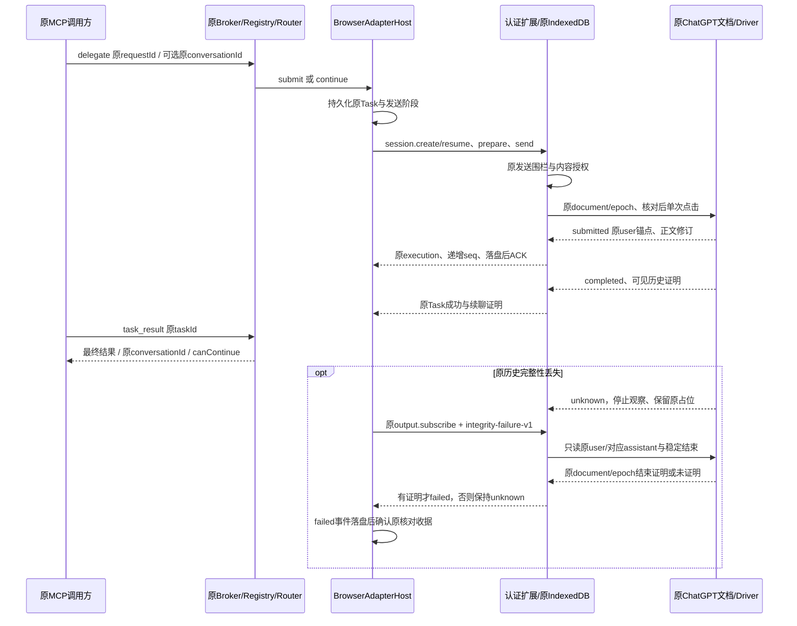

# 真实ChatGPT公共DOM与布局适配

2026-11-01更新：已交付包含当前ChatGPT源码及19文件扩展的browser.3 Windows体验包。通过同目录非C盘启动脚本使用，包内Node 72/72及实际EXE载荷核验通过；本包尚无普通GUI/真实模型验收，旧browser.2证据保留为历史。[最新体验包与准确边界](web-agent-browser3-preview.md)。

当前范围：按用户最新指令，仅开发和验证ChatGPT Web；Kimi不开发、不验收、不作为本轮准出条件。原三项目研究作为历史材料保留。当前manifest、构建权限策略和设置文案均仅启用ChatGPT；保留的协议身份校验分支不代表存在Kimi Driver。

2026-10-31；用户已授权开发与验证。接[开发台账](web-agent-development.md)和[开发包交付](web-agent-packaging.md)。本轮在真实`https://chatgpt.com/`使用独立、内存隔离的Chromium148匿名会话，没有登录或读取生产浏览器profile；通过Playwright CLI0.1.22操作普通DOM。最初两轮真实网页回复是直接DOM原型；后续当前源码的实际MV3/认证通道/原MCP四轮持续会话已通过。父模型为受控夹具，不能冒充真实Codex/Claude模型端验收。

## 实际观察

| 场景 | 结果与证据 |
| --- | --- |
| 真实页面与编辑器 | 页面可达，匿名编辑器为`textarea#mobile-composer-prompt`；[属性](../../../artifacts/browser-agent/2026-10-31/chatgpt-public-editor.txt)、[可见DOM检查](../../../artifacts/browser-agent/2026-10-31/chatgpt-public-dom.txt) |
| 第一轮DOM发送 | 仅一次`.click()`，同段核对完整原输入与按钮状态；实际返回`AB_WEB_DOM_20261031`，路径转为`/uc/…`；[原探测请求](../../../artifacts/browser-agent/2026-10-31/chatgpt-public-operation.json)、[点击记录](../../../artifacts/browser-agent/2026-10-31/chatgpt-public-click.txt)、[脱敏快照](../../../artifacts/browser-agent/2026-10-31/chatgpt-public-after-send.txt) |
| 公共消息绑定 | `main li[data-message-role=user|assistant]`，原生`id`均36字符且唯一；`data-message-complete`为已完成助手消息上的空布尔属性；[角色/属性结构](../../../artifacts/browser-agent/2026-10-31/chatgpt-public-mobile-schema.txt)、[内容容器与唯一性](../../../artifacts/browser-agent/2026-10-31/chatgpt-public-content-schema.txt) |
| 内容提取 | 用户内容在`[data-submit-message-animation-target]`的首个内容DIV，动作/干预为后续兄弟；助手内容位于可见`[aria-label="DIL content"]`区域。不得把“你说”标题或复制/分享控件文字拼入正文。未读取hidden input的value或框架绑定对象 |
| 原生textarea写入 | 原生value setter和标准InputEvent可保留完整多行文字。事件返回时`aria-disabled=true`，后续更新为无该属性；`.disabled`始终false，故只检查JS disabled或立即点击不足；[同步观察](../../../artifacts/browser-agent/2026-10-31/chatgpt-public-native-input.txt)、[后续状态](../../../artifacts/browser-agent/2026-10-31/chatgpt-public-native-input-later.txt) |
| 同会话第二轮 | 保留第一轮原生消息ID及`/uc`路径；再次仅一点击，真实回复正确引用上文并追加`_TWO`，多行用户正文完全匹配；[原第二请求](../../../artifacts/browser-agent/2026-10-31/chatgpt-public-operation-02.json)、[真实观察序列](../../../artifacts/browser-agent/2026-10-31/chatgpt-public-continuation.txt) |
| 流式/结束 | 第二轮284ms出现新轮、2372ms正文63字符且未complete，2616ms正文135字符并complete，但停止按钮仍保留；3980ms才恢复发送状态。结束须同时满足原生完成、停止控件解除、正文稳定及原绑定，不以complete属性单独结算 |

发送控件为`form[data-mobile-composer] button[data-composer-submit]`，没有data-testid。发送时type=submit，生成时type=button、aria-label等于该控件公开的data-stop-label；本环境对应“发送消息/停止生成”。aria-disabled用于实际输入就绪；data-visually-disabled空属性在可用状态也保留，不能将其存在直接当作不可用。

Native URI、消息ID及URL查询在存档快照中脱敏，未保留原始副本；[脱敏记录](../../../artifacts/browser-agent/2026-10-31/chatgpt-public-redactions.json)。没有调用私有Provider接口、读取Cookie/Token/密码、导出storage state或注入框架/网络hook。页面自身正常请求不等于Adapter直接使用这些接口。原型两请求均已观察到回复，没有因不确定重复点击。

## 对当前产品的影响与实施边界

此前browser.2内的Driver只认识`#prompt-textarea`/send-button、`/c`及data-message-author-role/data-message-id；当前源码已补新版布局。真实匿名页使用另一套公共DOM，故[开发包browser.2](web-agent-packaging.md)的组件/窗口验证不能证明可以自动调用该布局。已登录布局尚未实测，不推定它也发生相同变化。

实现已复用同一ChatGPT Driver和现有Registry/Router/Transport/Session/Broker；增加DOM布局策略，不引入第二路由或模型API。保留经典布局并为上述布局采用原生可见消息ID、`/uc`独立sessionKey、正确正文区域及完成/停止联合门禁。只在拥有的原textarea写入后短暂等待ARIA就绪；等待期间持续核对原输入、元素、页面/文档、所有权版本与历史证明。仅最终完整检查通过才单次点击，任何不确定仍保留原request/operation与占位，不自动重发。

已补真实Chromium受控DOM回归，覆盖异步可用、原生锚点/多行、结束先于停止解除、等待时人工输入/控件替换/导航、同会话续聊和旧经典布局。并以实际MV3、原认证通道/Registry/MCP链路完成真实匿名网页四轮验证；原生Codex/OpenCode/Claude父模型、站点权限同意、账号模式、跨设备及完整故障矩阵仍分别验收。真实原型不能代替这些准出项。

## 当前实现与实际Bridge验收

2026-10-31，Windows、Node24.12.0、Chromium148.0.7778.96。源码支持经典布局与实际观察到的匿名新版布局，未覆盖已登录账号模式。没有拦截Provider网络或读取Cookie/Token/框架状态；所有发送仍只有一次点击。

| 层级 | 实际结果 | 原始证据 |
| --- | --- | --- |
| 实际MV3/本机认证通道/Registry/Router/stdio MCP/真实ChatGPT | 同一Bridge会话三轮均succeeded，答案匹配，原会话与canContinue保持；原生父模型为受控夹具 | [三轮记录](../../../artifacts/browser-agent/2026-10-31/chatgpt-layout-live.json) |
| 同一原MCP会话第四轮流式输出 | succeeded，8次输出事件、2295字符，最终标记和第60行匹配；原会话可续 | [流式记录](../../../artifacts/browser-agent/2026-10-31/chatgpt-stream-live.json) |
| 受控HTML、真实Chromium DOM | 新布局、异步ARIA就绪、正文/原生锚点、完成与Stop联合门禁、两种编辑器、续聊、人工冲突和只读结束观察39/39 | [最终DOM报告](../../../artifacts/browser-agent/2026-10-31/driver-layout-after-fix.json) |
| 原生IndexedDB/Web Crypto、受控Chrome API | 原结束证明、正文指纹、document/epoch变化、错误证明、旧数据与事务恢复69/69 | [IndexedDB报告](../../../artifacts/browser-agent/2026-10-31/indexeddb-integrity-final.json) |
| Node Host与构建器/ASAR | 50+13项共63/63；不与网页/跨平台测试累加 | [TAP](../../../artifacts/browser-agent/2026-10-31/host-package-chatgpt-final.tap) |
| 当前ZIP真实解压与MV3 | 19组通过，受控Provider HTML；含原MCP三轮、草稿、健康、关闭、worker中断/原终态核对、实际配置表单与响应式界面 | [ZIP实际运行](../../../artifacts/browser-agent/2026-10-31/mv3-chatgpt-current-zip.json) |
| 原通道/网络/daemon/MCP恢复回归 | 45项44通过/1平台跳过，失败0；不是跨设备实测 | [TAP](../../../artifacts/browser-agent/2026-10-31/chatgpt-network-regression.tap) |

### 保留的失败与原请求恢复

第一组真实Bridge试验首轮成功，第二轮在submitted之后出现BROWSER_USER_INTERFERENCE，第三轮未派发。原请求/profile/文档与锁保留，没有换ID、换目录或重复发送。[原失败报告](../../../artifacts/browser-agent/2026-10-31/chatgpt-adapter-live-01.json)。原页只读检查证明同一document/epoch、原user及对应助手已结束；先前历史当前摘要也相同，但不能据此追溯证明没有编辑后还原，因此不补记成功。

当前新增原结束只读观察：Node的[reconcileOutput](../../../desktop/electron/browser-output-reconcile.cjs)携原请求元数据和原消息正文；[ChromePages.observeIntegrityFailure](../../../browser-extension/src/background/pages.mjs)校验原消息指纹、站点权限、原document及前后epoch；[terminal.js](../../../browser-extension/src/providers/chatgpt/terminal.js)只读原user与唯一对应assistant、原生完成标记/Stop解除及1500ms稳定正文，再由[BrowserJournal.settleIntegrityFailure](../../../browser-extension/src/background/journal.mjs)原子保存证明并追加failed。错误码BROWSER_CONTEXT_INTEGRITY_LOST，不是成功或取消；没有证明则继续unknown。

该旧运行中的worker未识别新增观察策略；两次只读请求均明确拒绝，未释放占位。实际恢复使用同一原扩展options origin中的当前生产Executor/Journal/Pages受控调用，读取原IndexedDB、核对原结束证明；failed事件仍经过原认证通道落入原Task，并同事务确认原reconcile收据。[原恢复证据](../../../artifacts/browser-agent/2026-10-31/chatgpt-original-integrity-resolution.json)。这证明原状态的受控恢复，**不算新策略从Node命令到worker的完整线上验收**。新策略契约另由Host、原生IndexedDB及受控DOM覆盖。

原失败和原Session关闭确认后，才在原扩展路径/profile/配对上重载当前源码并发起不同内容的明确新测试，未重放原消息。开发模式未打开导致一次重载后扩展不可用；通过该隔离Chrome自己的扩展管理页打开开发模式并重新启用后，原配对恢复。未换profile或配对。随后才完成上表四轮实测。

原失败缺少完整MutationRecord轨迹，不能断言唯一根因。新增受控反例实际复现“旧消息正文/锚点未变，仅容器与LI的布局style更新也被判人工改写”：修复前38通过/1失败，[原报告](../../../artifacts/browser-agent/2026-10-31/driver-layout-before-fix.json)。Driver仅对新版原生消息忽略style属性作为历史改写的信号；每个围栏仍核对完整可见正文/锚点，并保留正文、结构、身份、hidden与可信输入记录。修复后39/39，用户/助手正文编辑再还原均继续拒绝。未据此宣布所有框架重绘、虚拟化或账号切换已覆盖。

## 新增与修改文件及交付边界

上图展示当前源码契约；成功四轮实际走通，原失败恢复的受控调用边界见上文，不能把整图全部分支均标成真实端到端通过。

新增[terminal.js](../../../browser-extension/src/providers/chatgpt/terminal.js)、[browser-output-reconcile.cjs](../../../desktop/electron/browser-output-reconcile.cjs)、[真实网页显式探测脚本](../../../desktop/tests/browser-chatgpt-live.cjs)。修改Driver/content runtime、ChromePages/Executor/Journal/IndexedState、Host核对任务、manifest/设置/INSTALL、构建文件白名单及Host/DOM/原生IndexedDB测试；实际诊断脚本与分层报告在本迭代artifacts路径，不包含配对秘密或Provider凭据。

当前开发ZIP为19个生产文件、162097字节，SHA-256 `f41be4b385772fc24c1c648bde4f7d44d9553b737a4e9c1edea9b869fe77062d`，sourceDigest与上表真实四轮记录一致。ZIP：[当前扩展](../../../artifacts/browser-extension/AgentBridge-BrowserAgent-0.1.0-dev-f41be4b385772fc2.zip)、[逐文件清单](../../../artifacts/browser-extension/AgentBridge-BrowserAgent-0.1.0-dev-f41be4b385772fc2.manifest.json)、[SHA](../../../artifacts/browser-extension/AgentBridge-BrowserAgent-0.1.0-dev-f41be4b385772fc2.sha256)。开发browser.2 EXE仍是此前18文件/旧DOM版本，不冒充已包含本轮新代码；没有刷新公开alpha.71。

仍需单独验收：真实原生父模型及其配置生命周期、生产站点权限同意、登录账号模式、Browser跨设备/Linux Chrome、当前源码重新构建后的实际包内Web链路，以及完整并发/故障/性能矩阵。已提交网页Stop仍不支持；提交前可证明取消和原请求查询保持。Kimi不在范围内。

实际网页验证结束后，5个成功Task与1个原失败Task均保留；所有原控制收据已结算、原Session均由原关闭收据关闭，无unknown。隔离测试Chrome与所属Node已正常退出，原profile/配对/台账保留。[收尾状态](../../../artifacts/browser-agent/2026-10-31/chatgpt-live-final-state.json)。文档检查仍为原2243条错误，新增0、移除0，不伪称检查通过；[当前检查](../../../artifacts/browser-agent/2026-10-31/docs-chatgpt-final.json)、[基线差异](../../../artifacts/browser-agent/2026-10-31/docs-chatgpt-final-delta.json)。
