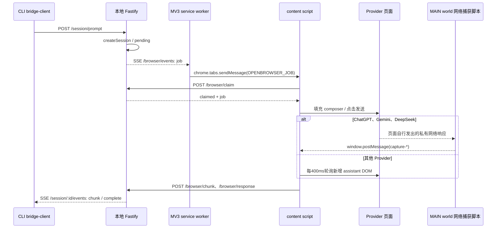

# OpenBrowser 源码研究

本页是 Web Agent 候选设计的输入，不表示 AgentBridge 已实现浏览器接入。研究日期：2026-10-30；环境：Windows / PowerShell / Git；证据级别：拉取源码后的静态分析，未安装依赖、加载扩展、调用真实模型或执行上游测试。

## 1. 版本与研究范围

- 仓库：[1129Aliasgar/OpenBrowser](https://github.com/1129Aliasgar/OpenBrowser)。
- 固定提交：`2f090f0954435efb07ee35f95e04576b7c6d65fa`，提交时间 `2026-08-02T15:51:27+05:30`。
- 实际执行：`git clone --depth 1 https://github.com/1129Aliasgar/OpenBrowser.git <系统临时目录>`，随后 `git rev-parse HEAD`、`git show -s --format='%cI %s'` 和逐文件阅读。拉取副本不进入 AgentBridge 产品源码。
- 根 package 版本 `0.1.0`，扩展 manifest 版本 `0.8.2`；两者不能合称为同一个已验证发行版本。
- 下文文件链接均固定该提交；行号是该副本的源码行号。README 的功能介绍没有作为运行成功证据。

## 2. 结构与调用链

这是完整的独立 CLI / server / browser harness，且有文件操作执行能力；AgentBridge 只需要其中有限的网页驱动经验，不应再部署它的 server、session-store、操作执行器或 CLI 来形成第二套路由系统。

| 源码入口 | 关键函数与实际职责 |
| --- | --- |
| [manifest.json:11](https://github.com/1129Aliasgar/OpenBrowser/blob/2f090f0954435efb07ee35f95e04576b7c6d65fa/browser-extension/manifest.json#L11) | MV3；`activeTab/alarms/scripting/storage/tabs`；本地 `127.0.0.1:5000` 和多个站点 host 权限。普通脚本在 `document_idle` 注入；ChatGPT/Gemini/DeepSeek 另在 `document_start`、`world: MAIN` 注入网络捕获脚本。没有 Kimi host/driver。 |
| [background.js:61](https://github.com/1129Aliasgar/OpenBrowser/blob/2f090f0954435efb07ee35f95e04576b7c6d65fa/browser-extension/src/background.js#L61) | `OPENBROWSER_REGISTER` 注册 tab；`BRIDGE_REQUEST` 代理 content script 的本地 HTTP。`bridgeRequest` 在 106 行，`connectBridgeStream` 在 148 行，读取 fetch SSE 后调用 `dispatchJob`。 |
| [content-script.js:183](https://github.com/1129Aliasgar/OpenBrowser/blob/2f090f0954435efb07ee35f95e04576b7c6d65fa/browser-extension/src/content-script.js#L183) | `handleIncomingJob → runJob → claimJob → processJob`；单页 `running` + FIFO 防止本扩展任务同时写 composer。 |
| [server/index.ts:116](https://github.com/1129Aliasgar/OpenBrowser/blob/2f090f0954435efb07ee35f95e04576b7c6d65fa/src/server/index.ts#L116) | `/session/prompt` 新建一次 prompt job，`broadcastBrowserJob` 分发；`/browser/claim` 抢占；`/browser/chunk` 保存全文快照并通知；`/browser/response` 直接标记 complete/error。 |
| [session-store.ts:42](https://github.com/1129Aliasgar/OpenBrowser/blob/2f090f0954435efb07ee35f95e04576b7c6d65fa/src/server/session-store.ts#L42) | 内存 `Map`；状态只有 pending/claimed/complete/error；`tryClaimSession` 在 77 行执行 pending→claimed。无持久恢复、未知提交状态或事件序号。 |
| [sse-hub.ts:78](https://github.com/1129Aliasgar/OpenBrowser/blob/2f090f0954435efb07ee35f95e04576b7c6d65fa/src/server/sse-hub.ts#L78) | 没有 browser client 时把 job 放内存队列；有 client 时广播。连接时排空队列；没有 SSE id / Last-Event-ID 事件回放。 |
| [bridge-client.ts:72](https://github.com/1129Aliasgar/OpenBrowser/blob/2f090f0954435efb07ee35f95e04576b7c6d65fa/src/client/bridge-client.ts#L72) | `waitForSessionResponse` 先查状态，再读 SSE；默认 120 秒超时。此 timeout 取消的是本地 reader，不是网页生成。 |

## 3. Prompt 注入与发送

`processJob` 先记 assistant 消息数量；非附件任务经 `buildOutboundMessageForThread`，仅在空线程把 systemPrompt 作为普通用户文本前缀追加。它不具有网页原生 system role 语义。[processJob / buildOutboundMessageForThread:285](https://github.com/1129Aliasgar/OpenBrowser/blob/2f090f0954435efb07ee35f95e04576b7c6d65fa/browser-extension/src/content-script.js#L285)

`injectPrompt` 根据元素类型选择 `injectTextarea`、`injectLexical` 或 `injectProseMirror`。textarea 用 prototype value setter + input/change；contenteditable 尝试 `execCommand('insertText')`、合成 paste、最终 innerHTML。非保留附件模式会清空 composer，既没有检查原有手动草稿，也没有比较预期全文，只用长度达到预期的 85% 判断填充成功。因此可参考编辑器适配思路，但不能直接沿用其成功判定和覆盖行为。[注入链:700](https://github.com/1129Aliasgar/OpenBrowser/blob/2f090f0954435efb07ee35f95e04576b7c6d65fa/browser-extension/src/content-script.js#L700)

`clickSendWhenReady` 最多循环 20 次，尝试 button.click、Pointer/Mouse 事件，第二次后还可能发 Enter；每次 `verifyMessageSubmitted` 等 400ms，仅以 stop 按钮出现、composer 变空或发送按钮禁用之一作为提交证明。初次点击已提交但页面尚未反馈时，后续点击/Enter 可能重复触发。AgentBridge 必须以持久 requestId、一次提交栅栏与 unknown 查询替代此重发策略。[发送链:1010](https://github.com/1129Aliasgar/OpenBrowser/blob/2f090f0954435efb07ee35f95e04576b7c6d65fa/browser-extension/src/content-script.js#L1010)

长 prompt 支持服务落盘后取回，content script 构造 `File`、定位 file input 并尝试附件上传；失败退回全文注入。附件路径在 `attachPromptFile:415`，上传后的二次发送尝试在 `clickSendAfterFileAttach:959`。这些不是 ChatGPT 文字 MVP 的必要能力，也没有本次真实上传验证。[附件入口](https://github.com/1129Aliasgar/OpenBrowser/blob/2f090f0954435efb07ee35f95e04576b7c6d65fa/browser-extension/src/content-script.js#L415)

## 4. 回答流、结束检测及提取

当前提交的 ChatGPT 路径明确使用非公开协议：`chatgpt-api.js` 保存并替换 `window.fetch`，只匹配 POST `/backend-api/f/conversation`，`response.body.tee()` 一路还给网页、一路解析 SSE；解析 `delta` 的路径/操作、assistant content parts、`finished_successfully/end_turn`、`[DONE]` 与 `message_stream_complete`，通过 `window.postMessage` 发 `capture-begin/chunk/done`。这是被动读取页面自己的请求，没有另行构造 Provider HTTP 请求；但仍依赖私有 endpoint 和 payload，违反本需求“不依赖非公开 Provider API”。[私有流解析:27](https://github.com/1129Aliasgar/OpenBrowser/blob/2f090f0954435efb07ee35f95e04576b7c6d65fa/browser-extension/src/chatgpt-api.js#L27)、[fetch hook:161](https://github.com/1129Aliasgar/OpenBrowser/blob/2f090f0954435efb07ee35f95e04576b7c6d65fa/browser-extension/src/chatgpt-api.js#L161)

`usesApiCapture` 对 ChatGPT/Gemini/DeepSeek 为真，`processJob` 直接走 `waitForApiCapturedResponse`，不是“私有 API 失败后自动回退 DOM”。多个 capture 用开始时间筛选，chunk 取最长文本，任一非空 capture done 就 resolve；没有把捕获到的响应绑定到特定用户消息 ID。流 read 异常但已有部分文本，也会发 capture-done，因此部分回答可能被当成完整结果。不能直接复用此结束语义。[capture 管理:68](https://github.com/1129Aliasgar/OpenBrowser/blob/2f090f0954435efb07ee35f95e04576b7c6d65fa/browser-extension/src/content-script.js#L68)、[读取异常:146](https://github.com/1129Aliasgar/OpenBrowser/blob/2f090f0954435efb07ee35f95e04576b7c6d65fa/browser-extension/src/chatgpt-api.js#L146)

其他 Provider 的 DOM 路径 `waitForAssistantText` 每 400ms 比较新增 assistant 文本，ask 稳定 3 秒、markdownDraft 稳定 5 秒、agent 通常 2 秒；同时要求 stop/streaming 标记消失，再等 600ms 复核。chunk 是全文快照，变化达到 24 字或 250ms 就上报；并非 token delta。180 秒超时后函数仍可能返回 `finalText || lastText`，随后上报 complete。AgentBridge 只能参考多信号检测思路，必须把超时且未证明结束保留为 partial/unknown。[轮询与终止:1200](https://github.com/1129Aliasgar/OpenBrowser/blob/2f090f0954435efb07ee35f95e04576b7c6d65fa/browser-extension/src/content-script.js#L1200)

ChatGPT selectors 在 `providers.js:2`，包括 `#prompt-textarea`、send-button、assistant role、stop-button。DOM 提取 `extractMessageText` 克隆节点、删除 exclude selector，再取 markdown 容器 innerText/textContent；不能保证保留完整 Markdown 结构。[ChatGPT selectors](https://github.com/1129Aliasgar/OpenBrowser/blob/2f090f0954435efb07ee35f95e04576b7c6d65fa/browser-extension/src/providers.js#L2)、[提取函数:1909](https://github.com/1129Aliasgar/OpenBrowser/blob/2f090f0954435efb07ee35f95e04576b7c6d65fa/browser-extension/src/content-script.js#L1909)

## 5. 多标签页、会话与手动操作

`getCandidateTabs` 按当前 active AI tab、最近注册 tab、其他 AI tab 排序；`tryDispatchJob` 尝试第一个可接收 tab。job 没有目标 Provider/tab 约束。`conversationId` 虽在 server 数据里保存并下发，content script 没有用它导航或校验网页会话；没有持久的 conversationId→tabId→网页 conversation 映射。因此“同一 tab 顺序对话”是可从代码推断的行为，“跨重启可靠续接/指定 ChatGPT 会话”没有实现证据。[候选 tab 与分发:294](https://github.com/1129Aliasgar/OpenBrowser/blob/2f090f0954435efb07ee35f95e04576b7c6d65fa/browser-extension/src/background.js#L294)

每页 `running` 与 jobQueue 仅排它本页扩展任务；服务 `tryClaimSession` 仅避免同一个 job 被两个领取者同时从 pending 改 claimed。没有发现手动输入/点击/导航的所有权检测，也没有全局网页会话锁；用户生成恰好发生在 capture 窗口里时可能被错归给自动任务。页面刷新会丢失 processedSessionIds、running 与 capture；worker 重启会丢失 dispatchedSessionIds、readyTabs 和待派发队列，manifest 虽声明 storage 权限，所读任务链未用它持久化上述状态。[运行排它与 claim:183](https://github.com/1129Aliasgar/OpenBrowser/blob/2f090f0954435efb07ee35f95e04576b7c6d65fa/browser-extension/src/content-script.js#L183)

没有发现 session create/resume/close 对网页会话的操作，也没有 task cancel endpoint 或点击 stop 的任务取消链；源码的 `findStopButton` 用于观察状态，不能将其当成取消实现。

## 6. 断线、重试与认证边界

| 情况 | 静态可确认的处理 | 对 AgentBridge 的含义 |
| --- | --- | --- |
| browser SSE 断线 | 2.5 秒重连；1 分钟 alarms 检查连接并 flush。`pendingDispatches.nextTry` 是 1.5 秒，但实际 flush 也由 alarm/注册触发，不能保证每 1.5 秒重试。最多 12 次计数后丢弃并 console warn。 | 参考连接重试；不可复用静默丢任务与内存状态。 |
| content→background 消息异常 | `sendRuntimeMessage` 最多 5 次，间隔 `250*(attempt+1)`ms；没有按读写分类。claim 失败还等待 800ms 再 claim。 | mutation 回应丢失不能靠通用重试保证幂等。 |
| chunk 上传失败 | `postBrowserChunk` catch 丢弃，best effort；最终 response 无持久重试/收据恢复。 | 新协议需要有界事件缓存、ack 与同 request 查询。 |
| CLI 等待超时 | 默认 120 秒，本页回答 timeout 180 秒；CLI 先超时不代表网页停止。 | 客户端等待期限和任务生命周期必须分开。 |
| 本地认证 | server 默认 loopback；`authenticate:355` 对全部 `/browser/*` 和 status/events 直接豁免，其他接口仅在配置 BRIDGE_TOKEN 时认证；CORS `origin:true`。 | 不能把这个 server 当“已有认证的本地扩展通道”。 |

证据：[重连与派发](https://github.com/1129Aliasgar/OpenBrowser/blob/2f090f0954435efb07ee35f95e04576b7c6d65fa/browser-extension/src/background.js#L137)、[runtime retry](https://github.com/1129Aliasgar/OpenBrowser/blob/2f090f0954435efb07ee35f95e04576b7c6d65fa/browser-extension/src/content-script.js#L249)、[chunk上传](https://github.com/1129Aliasgar/OpenBrowser/blob/2f090f0954435efb07ee35f95e04576b7c6d65fa/browser-extension/src/content-script.js#L1960)、[服务认证](https://github.com/1129Aliasgar/OpenBrowser/blob/2f090f0954435efb07ee35f95e04576b7c6d65fa/src/server/index.ts#L355)。

所读扩展及通信链没有发现读取 Cookie、账号 Token、密码或 `chrome.cookies` 的代码；这只代表源码范围内未发现提取行为，不代表它是纯 DOM，也不构成真实浏览器运行证明。`BRIDGE_TOKEN` 是本地服务凭据，与 Provider 账号凭据不同。

## 7. 许可证、依赖与复用建议

[LICENSE](https://github.com/1129Aliasgar/OpenBrowser/blob/2f090f0954435efb07ee35f95e04576b7c6d65fa/LICENSE) 为 MIT，版权 `2026 1129Aliasgar`；若复制实质代码须保留版权和许可声明。本次未复制产品代码。依赖许可证需要在选定具体可移植文件后逐项核对；未安装依赖或作供应链扫描，不把版本清单称为依赖审计。

[package.json:46](https://github.com/1129Aliasgar/OpenBrowser/blob/2f090f0954435efb07ee35f95e04576b7c6d65fa/package.json#L46) 主要运行依赖包括 Fastify `^4.28.1`、`@fastify/cors ^9.0.1`、Zod `^3.23.8`、Commander、fs-extra、Pino 等，dev 包括 TS、tsx、Vitest；另有 `openbrowser: link:` 自链接。扩展 JS 直接载入，没有单独扩展 npm package。AgentBridge 不需要为参考几段 DOM 逻辑导入整个 CLI 的依赖树。tracked 文件列表未找到 test/spec 测试文件，虽 package 声明 `vitest run`，不能据此声称已有自动测试覆盖。

| 范围 | 建议 |
| --- | --- |
| Provider selectors、textarea / ProseMirror / Lexical 分支 | 可以研究并独立实现；selectors 必须用当前受控 fixture 和真实页面验证，注入前需检查用户草稿、所有权及目标会话。 |
| DOM 文本采样、stop + streaming + 稳定窗口 | 可参考组合信号；必须纠正超时返回 partial 当 complete，增加明确结果质量与错误。 |
| background/content 分层、注册和连接重试 | 可参考边界；AgentBridge 使用自身认证通道、Registry、request journal，不导入上游 server。 |
| `chatgpt-api.js` / Gemini / DeepSeek 私有捕获解析 | 不纳入本方案；它们依赖非公开 Provider 协议。 |
| active-tab 路由、发送重试、内存 session-store、Fastify broker、文件操作执行器 | 不复用；分别与确定目标、unknown 禁重发、既有路由/会话及被动 Web Agent 范围冲突。 |

尚未验证：当前真实 ChatGPT selectors、浏览器实际接受合成输入、MV3 休眠后的任务恢复、实际网络断线、账号限流/登录失效、真实多轮和多 tab 隔离。它们都应进入 AgentBridge 后续自动化与人工验收，不能从本次静态源码研究得出“通过”。
