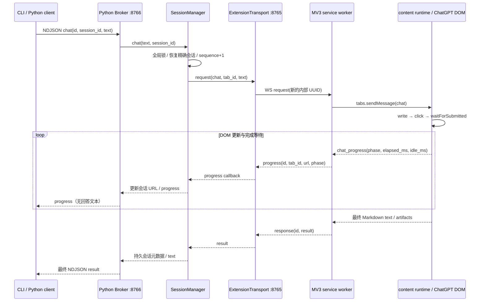

# Web Agent 源码研究：web-llm-bridge

## 范围与证据

- 核对日期：2026-10-30；环境：Windows / PowerShell；仅拉取、搜索和阅读源码。
- 仓库：[Tzufucius/web-llm-bridge](https://github.com/Tzufucius/web-llm-bridge)。本次浅克隆 HEAD：`171a57115cd09f834c064c83f6e7959a81f33102`；提交时间：`2026-08-23T12:21:28+08:00`。
- 拉取方式：`git clone --depth 1 https://github.com/Tzufucius/web-llm-bridge.git <系统临时目录中的独立研究目录>`，随后执行 `git rev-parse HEAD` 与 `git log -1 --format=%cI`。没有安装依赖、加载扩展、启动 Broker、登录账号、发送 Prompt 或运行其测试。
- 下文“实现”表示固定提交中的静态代码存在，不表示目前 ChatGPT 线上 DOM、账号、生成结束判断或异常恢复经过真实验证。README 的“Alpha”和“仅支持 ChatGPT”与源码注册情况一致；Kimi 只是计划。
- 本文只为 AgentBridge 提供研究证据，不引入第三方 Broker，不改变产品代码或当前发布范围。

## 结论

这是三个研究目标中值得优先对照的 ChatGPT DOM 驱动方案：明确分开通用内容运行时、Provider 选择器、页面适配器和 Markdown 序列化器；可以借鉴其“发送前等待、发送后不盲目重发”的阶段划分。但它是一个独立 Python Broker 产品，不能直接作为 AgentBridge 的第二套 Registry / Router / Session 系统。其源码许可声明为 **AGPL-3.0-only**，直接复制代码应另行审查许可兼容与履约范围；本次建议只吸收接口和测试思路，在 AgentBridge 自有适配层实现。

三个关键缺口：对外的 `streaming` 是阶段进度，没有回答文本增量；全会话共用一把锁；`CHAT_STATE_UNKNOWN` 没有配套持久请求收据、查询恢复和持续占位。扩展连接也只有 Origin 格式及协议版本检查，没有 AgentBridge 所需的本机配对认证。

## 1. 组件、入口和完整调用链

| 层 | 固定提交中的源码与入口 | 实际责任 |
| --- | --- | --- |
| 扩展声明 | [extension/manifest.json:1](https://github.com/Tzufucius/web-llm-bridge/blob/171a57115cd09f834c064c83f6e7959a81f33102/extension/manifest.json#L1) | MV3、Chrome 最低版本 120、service worker；仅 ChatGPT 两个 HTTPS host；`alarms` 权限；按顺序注入 core 与 ChatGPT 文件，`document_idle` 启动 |
| background | [extension/service_worker.js:27](https://github.com/Tzufucius/web-llm-bridge/blob/171a57115cd09f834c064c83f6e7959a81f33102/extension/service_worker.js#L27)：`routeRequest()`、`handleRequest()` | `open`、`close_tab`、`chat`、`get_messages`、`get_artifact`；请求转交 tabs，再经 WS 返回结果 |
| WS 客户端 | [extension/core/rpc.js:4](https://github.com/Tzufucius/web-llm-bridge/blob/171a57115cd09f834c064c83f6e7959a81f33102/extension/core/rpc.js#L4)：`createRpcClient()` | hello / ack、心跳、重连、版本冲突与重复连接抑制 |
| 标签页层 | [extension/core/tabs.js:4](https://github.com/Tzufucius/web-llm-bridge/blob/171a57115cd09f834c064c83f6e7959a81f33102/extension/core/tabs.js#L4)：`attach()`、`request()` | 精确 URL 恢复、tab 创建、内容脚本就绪探测、内容 RPC |
| content 入口 | [extension/content.js:3](https://github.com/Tzufucius/web-llm-bridge/blob/171a57115cd09f834c064c83f6e7959a81f33102/extension/content.js#L3) | 根据页面 URL 选择 Provider，建立运行时，用 `runtime.onMessage` 响应 background |
| 通用页面运行时 | [extension/core/content_runtime.js:4](https://github.com/Tzufucius/web-llm-bridge/blob/171a57115cd09f834c064c83f6e7959a81f33102/extension/core/content_runtime.js#L4)：`createContentRuntime()` | 写入、提交确认、完成等待、进度、历史和 Artifact 分块 |
| ChatGPT 驱动 | [extension/providers/chatgpt/adapter.js:124](https://github.com/Tzufucius/web-llm-bridge/blob/171a57115cd09f834c064c83f6e7959a81f33102/extension/providers/chatgpt/adapter.js#L124)：`ChatGPTAdapter` | 输入/发送/停止控件、assistant/user 节点、工具活动、图片节点识别 |
| Python Transport | [web_llm_bridge/transport/extension.py:27](https://github.com/Tzufucius/web-llm-bridge/blob/171a57115cd09f834c064c83f6e7959a81f33102/web_llm_bridge/transport/extension.py#L27)：`ExtensionTransport` | WS 服务、pending Future、进度分发、Artifact 顺序校验 |
| Python Session | [web_llm_bridge/session/manager.py:24](https://github.com/Tzufucius/web-llm-bridge/blob/171a57115cd09f834c064c83f6e7959a81f33102/web_llm_bridge/session/manager.py#L24)：`SessionManager` | 持久会话、tab 恢复、Provider 分派、全局串行锁 |
| Python Broker | [web_llm_bridge/broker/server.py:21](https://github.com/Tzufucius/web-llm-bridge/blob/171a57115cd09f834c064c83f6e7959a81f33102/web_llm_bridge/broker/server.py#L21)：`handle_request()` | 本地 NDJSON 命令校验与会话服务调用 |

注意 CLI 请求 ID 与扩展内部 ID 不是同一个：`ExtensionTransport.request()` 每次生成 UUID。代码只用内存 pending 关联响应，没有以原调用 ID 持久记录执行结果，因此不能直接满足 AgentBridge 的原请求查询约束。

## 2. 本地通信、发现与认证

[protocol.py:6](https://github.com/Tzufucius/web-llm-bridge/blob/171a57115cd09f834c064c83f6e7959a81f33102/web_llm_bridge/protocol.py#L6) 固定 `127.0.0.1`、WS 8765、NDJSON TCP 8766、协议版本 2、单消息 8 MiB。`ExtensionTransport.start()` 的 WS `origins` 使用正则 `chrome-extension://[a-p]{32}`；它限定扩展来源格式，**没有限定已配对扩展 ID，也没有共享凭据、挑战响应或能力授权**。hello 只带协议版本。Broker 的 NDJSON 接入同样未见凭据握手。

它的 Provider Registry 是进程内静态注册表：[extension/core/registry.js:6](https://github.com/Tzufucius/web-llm-bridge/blob/171a57115cd09f834c064c83f6e7959a81f33102/extension/core/registry.js#L6) 暴露 `registerProvider/getProvider/listProviders/detectProvider`。Python 端也有 ProviderRegistry，但不存在 AgentBridge 式网络节点发现、关系授权或跨设备 Transport。`ping` 仅确认内容脚本运行，并不证明已登录、可发消息、未触发验证码或拥有所需模型权限。

AgentBridge 可参考 Provider 与页面运行时的隔离方式；必须由 Node 本身管理认证和对外发现，不能照搬这里的端口和静态 Registry 来绕过现有节点系统。

## 3. Prompt 填充、发送与提交边界

[profile.js:19](https://github.com/Tzufucius/web-llm-bridge/blob/171a57115cd09f834c064c83f6e7959a81f33102/extension/providers/chatgpt/profile.js#L19) 集中配置 200 ms 轮询、30 秒页面/按钮等待、60 秒提交确认、5 分钟无活动超时等参数，以及 `#prompt-textarea`、contenteditable、发送和停止按钮的候选选择器。

[content_runtime.js:15](https://github.com/Tzufucius/web-llm-bridge/blob/171a57115cd09f834c064c83f6e7959a81f33102/extension/core/content_runtime.js#L15) 的 `write()`：

1. 对 contenteditable 选中全部内容，调用 `execCommand(delete/insertText)`；失败时用 Range 和文本节点，并派发 `InputEvent`。
2. 对有 `value` 的控件调用原型 setter，再派发 input。
3. 比较规范化后的文本，防止填充失败后发送空输入。

`sendText()` 只在最初检查 `isGenerating()`，等待编辑器与可用发送按钮，然后 `button.click()`。只在找不到控件或写入失败的**发送前**阶段重试；成功点击后不再重复点击。`chat()` 在点击前记录 user 数量与最后 assistant 节点，点击后调用 `waitForSubmitted()`。

提交确认条件比较宽：新 user 节点、编辑器清空、停止按钮出现或 assistant 节点改变，任一条件即确认。它没有核验新增 user 节点的内容、原始 Prompt 指纹、conversation identity 或手动输入来源；用户同时清空编辑器也可能干扰这一推断。60 秒无确认返回 `SEND_FAILED`，并不等于确定未发送。AgentBridge 应把点击已发生后的这种状态保留为 unknown，不向调用方承诺可重发。

## 4. 流式监听、结束判断与结果提取

[content_runtime.js:43](https://github.com/Tzufucius/web-llm-bridge/blob/171a57115cd09f834c064c83f6e7959a81f33102/extension/core/content_runtime.js#L43) 的 `waitForComplete()` 组合以下信号：

- `MutationObserver` 为主内容、消息、工具和状态子树更新 revision；200 ms 轮询 assistant、活动签名和控件。
- 将发送前最后 assistant 及其快照作为 baseline，要求出现不同节点或内容，避免直接返回旧回答。
- 用文本、图片就绪状态、工具/status 签名判断活动；分别发 `thinking/working/tool_call/streaming` 阶段。
- 要求新回复非空、图片就绪、停止按钮消失、文本/活动至少稳定 1.5 秒、最终序列化候选至少稳定 3 秒，再复读节点与快照。
- 持续 5 分钟没有活动则 `RESPONSE_TIMEOUT`。这不是总任务时限；有活动可持续等待。

虽然驱动实现了 `hasCompletionMarker()`，这里并未把“完成标记必须出现”作为完成条件；marker 变化只参与活动和候选更新。若线上 DOM 的停止按钮选择器失效，文本停顿仍可能被误判为完成。这是静态推导的风险，未在真实页面复现。

**没有回答文本流式输出**：`progress()` 和 service worker 转发的字段只有阶段、elapsed/idle 等；真正 `text` 在最终响应才返回。不能把名称为 `streaming` 的 progress 当作 token / DOM text delta 流，也没有文本事件序号、ACK、重放或快照恢复。

提取方式是 DOM → Markdown：[core/markdown.js:10](https://github.com/Tzufucius/web-llm-bridge/blob/171a57115cd09f834c064c83f6e7959a81f33102/extension/core/markdown.js#L10) 遍历标题、段落、列表、链接、引用、代码、表格等；[chatgpt/serializer.js:5](https://github.com/Tzufucius/web-llm-bridge/blob/171a57115cd09f834c064c83f6e7959a81f33102/extension/providers/chatgpt/serializer.js#L5) 从 MathML/KaTeX annotation 恢复 TeX，避开重复数学渲染节点。需要以复杂 Markdown、代码围栏、嵌套列表和数学公式夹具核验格式损失，不能静态声称无损。

## 5. 多标签页、持续对话与历史

[tabs.js:8](https://github.com/Tzufucius/web-llm-bridge/blob/171a57115cd09f834c064c83f6e7959a81f33102/extension/core/tabs.js#L8) 的 `attach()` 顺序是：已有 tab ID 且规范化 URL 完全匹配 → 扫描同 URL 的 tab → 新建前台 tab。`new=true` 强制新 tab。URL 规范化去 query/hash/末尾斜线，保留 origin 与 pathname；请求执行前只复核 Provider 匹配，未复核完整会话 URL。

[SessionStore:52](https://github.com/Tzufucius/web-llm-bridge/blob/171a57115cd09f834c064c83f6e7959a81f33102/web_llm_bridge/session/store.py#L52) 使用临时文件、flush/fsync、原子替换保存元数据。记录包含 provider、session_id、tab_id、current_url、时间、sequence 和 active。`sequence` 是 chat 次数计数，**不是流事件序号**。Broker 启动时 `deactivate_all()`；下次访问会按原 URL 重新绑定。持续对话由同一网页会话保存上下文，本地不重新拼接历史发送。

[SessionManager.close_session():193](https://github.com/Tzufucius/web-llm-bridge/blob/171a57115cd09f834c064c83f6e7959a81f33102/web_llm_bridge/session/manager.py#L193) 关闭 tab、保留元数据；`forget_session()` 才删除本地元数据和 Artifact。它不删除 Provider 端会话。因为关闭同样需要全局锁，正在等待 chat 时关闭操作必须排队，不能充当任务取消。

[history.js:24](https://github.com/Tzufucius/web-llm-bridge/blob/171a57115cd09f834c064c83f6e7959a81f33102/extension/core/history.js#L24) 的 `capture()/collect()` 缓存 DOM turn，按需上滚触发历史加载，限时 60 秒，完成后恢复滚动位置并返回 truncated。只覆盖页面可呈现的历史，不能宣称 Provider 全量历史必然可导出。该上滚也会与用户阅读产生操作冲突。

## 6. 超时、重连、异常恢复和取消

- [rpc.js:8](https://github.com/Tzufucius/web-llm-bridge/blob/171a57115cd09f834c064c83f6e7959a81f33102/extension/core/rpc.js#L8)：断线重连从 1 秒指数增加到 10 秒，无 jitter；hello ack 后每 20 秒发 ping。版本不兼容或已有扩展连接时停止自动重连，点击扩展可手动恢复。
- [service_worker.js:77](https://github.com/Tzufucius/web-llm-bridge/blob/171a57115cd09f834c064c83f6e7959a81f33102/extension/service_worker.js#L77)：30 秒 alarms、安装、启动和手动点击触发 connect。代码有 MV3 唤醒设计，但没有本次真实浏览器休眠/恢复证据；连接、pending 和生成等待不持久保存。
- [ExtensionTransport._handle_connection():159](https://github.com/Tzufucius/web-llm-bridge/blob/171a57115cd09f834c064c83f6e7959a81f33102/web_llm_bridge/transport/extension.py#L159)：5 秒 hello 超时，拒绝第二个扩展客户端；断线让所有 pending Future 失败。重连不重放已发请求。
- [SessionManager._request_browser():368](https://github.com/Tzufucius/web-llm-bridge/blob/171a57115cd09f834c064c83f6e7959a81f33102/web_llm_bridge/session/manager.py#L368)：chat 中扩展断开、content 不可用、tab 关闭转换为 `CHAT_STATE_UNKNOWN`；RPC 超时转换为 `RESPONSE_TIMEOUT`。错误默认 `safe_to_retry=false`。
- `ExtensionTransport._wait()` 可随进度续期 300 秒等待；页面本身另有 5 分钟无活动超时。两者都没有总时限或可恢复任务句柄。
- [browser/launcher.py:71](https://github.com/Tzufucius/web-llm-bridge/blob/171a57115cd09f834c064c83f6e7959a81f33102/web_llm_bridge/browser/launcher.py#L71)：`BrowserBootstrap` 优先等扩展，必要时唤醒日常浏览器，再等握手；没有 CDP 或临时 profile。
- 没有 Task Cancel RPC，没有点停止按钮的调用，也没有确认“已停止生成”的终态协议。`close_tab` 不能替代取消。

unknown 的边界尤其重要：项目不自动重发，但也不持久保存 requestId 的提交阶段/结果，不提供 `request.query`，错误后释放 `SessionManager.lock`。下一条 chat 没有因上一条 unknown 而保持门禁。AgentBridge 必须复用自身原请求 journal、占位与恢复策略，不能只移植错误码。

## 7. 人工与自动任务冲突

[SessionManager.chat():100](https://github.com/Tzufucius/web-llm-bridge/blob/171a57115cd09f834c064c83f6e7959a81f33102/web_llm_bridge/session/manager.py#L100) 持有整个 manager 的一把 `asyncio.Lock`，覆盖恢复、发送和等待，能串行化经该 Broker 发起的请求，也会阻塞不同 tab 的独立会话；不是按 tab / conversation 并发。

对用户操作的保护只有“发送前页面已经生成则 BUSY”。本次阅读的扩展没有 `isTrusted` 输入监听、人工草稿非空拒绝、所有权租约、conversation revision/fencing、用户导航时的任务归属核验。`write()` 直接覆盖编辑器原内容；用户在发送后导航、改写输入、手动新发一轮，也可能改变被轮询的最后 assistant。因此建议使用显式接管的专用会话 tab，并在 Driver 设计中新增草稿/人工操作/导航冲突处理。

## 8. 私有 API、凭据、许可证与依赖

文本 chat 的调用链是编辑器 DOM 与按钮点击，没有构造 ChatGPT 非公开聊天 HTTP 请求；manifest 没有 cookies 权限，本次阅读未见密码、Cookie、Token 提取。

需要单列图片功能的边界：[adapter.js:69](https://github.com/Tzufucius/web-llm-bridge/blob/171a57115cd09f834c064c83f6e7959a81f33102/extension/providers/chatgpt/adapter.js#L69) 的 `isGeneratedImage()` 识别 DOM 中 `backend-api/estuary/content` 图片 URL；`imageSource()` 选择已有 DOM 图片/链接地址，[content_runtime.js:76](https://github.com/Tzufucius/web-llm-bridge/blob/171a57115cd09f834c064c83f6e7959a81f33102/extension/core/content_runtime.js#L76) 会 `fetch(source)` 读取图片再分块回传。它没有构造聊天私有 API，但“整个项目完全不接触 backend-api URL”也不是准确结论。AgentBridge 文本 MVP 不需要这一 Artifact 分支。

| 项目 | 源码事实 | AgentBridge 复用建议 |
| --- | --- | --- |
| 许可证 | [pyproject.toml:12](https://github.com/Tzufucius/web-llm-bridge/blob/171a57115cd09f834c064c83f6e7959a81f33102/pyproject.toml#L12) 声明 AGPL-3.0-only；[LICENSE](https://github.com/Tzufucius/web-llm-bridge/blob/171a57115cd09f834c064c83f6e7959a81f33102/LICENSE) 为 AGPL v3 文本 | 不把其实现直接复制成当前 MIT 产品的一部分；若决定引入须另审许可和部署/分发条件 |
| Python 依赖 | [requirements.txt:1](https://github.com/Tzufucius/web-llm-bridge/blob/171a57115cd09f834c064c83f6e7959a81f33102/requirements.txt#L1) 仅 `websockets>=14`；pyproject 用 setuptools>=77，无锁定依赖图 | AgentBridge 已有 Node/ws，可复用现有依赖；不增设 Python 服务 |
| JS 依赖 | 研究到的 extension 为原生 JS / Chrome APIs，未见前端包管理依赖 | 参考层次边界，自己实现类型和状态机 |
| 版本要求差异 | pyproject 为 Python >=3.9；README 为 Python 3.11+ | 不能仅依据 README 推断测试环境；本次未安装验证 |
| 可以借鉴 | Provider profile/adapter/serializer 分离、发送前与发送后分界、baseline 排旧回复、复杂 DOM 假件用例 | 在现有 Adapter、pending journal 和测试体系内独立实现 |
| 不宜移植 | Broker、双端口、SessionStore/Registry、全局锁、无认证握手 | 这些职责已有 AgentBridge 对应模块，且不满足本项目约束 |

以上许可结论只陈述仓库许可与工程引入策略，不声称完成第三方依赖的完整许可审计。

## 9. 已有测试与未验证项

仓库包含 Python transport/session/broker 测试与 Node 假 DOM smoke，均只阅读、未运行。例如：

- [submission_wait_smoke.js](https://github.com/Tzufucius/web-llm-bridge/blob/171a57115cd09f834c064c83f6e7959a81f33102/tests/providers/chatgpt/submission_wait_smoke.js) 使用 FakeNode，覆盖延迟编辑器/提交和无提交；不是线上 ChatGPT 实测。
- [streaming_completion_smoke.js](https://github.com/Tzufucius/web-llm-bridge/blob/171a57115cd09f834c064c83f6e7959a81f33102/tests/providers/chatgpt/streaming_completion_smoke.js)、[stale_completion_smoke.js](https://github.com/Tzufucius/web-llm-bridge/blob/171a57115cd09f834c064c83f6e7959a81f33102/tests/providers/chatgpt/stale_completion_smoke.js) 可作为结束判定和旧回答排除的用例参考，不能据文件名认定测试通过。
- [isolation_smoke.js](https://github.com/Tzufucius/web-llm-bridge/blob/171a57115cd09f834c064c83f6e7959a81f33102/tests/providers/chatgpt/isolation_smoke.js) 检查通用 core 不包含 ChatGPT host/选择器，适合 AgentBridge 的 Provider 无关性回归。

本次未验证：当前真实 ChatGPT 页面兼容性、登录/验证码/限流场景、长时间思考、工具调用与图片完成判断、浏览器后台节流和 service worker 回收、用户与自动任务并发、断电重启后 unknown 恢复、多 profile 隔离、取消及跨设备调用。不得把上述静态研究计入任何产品功能通过数。
