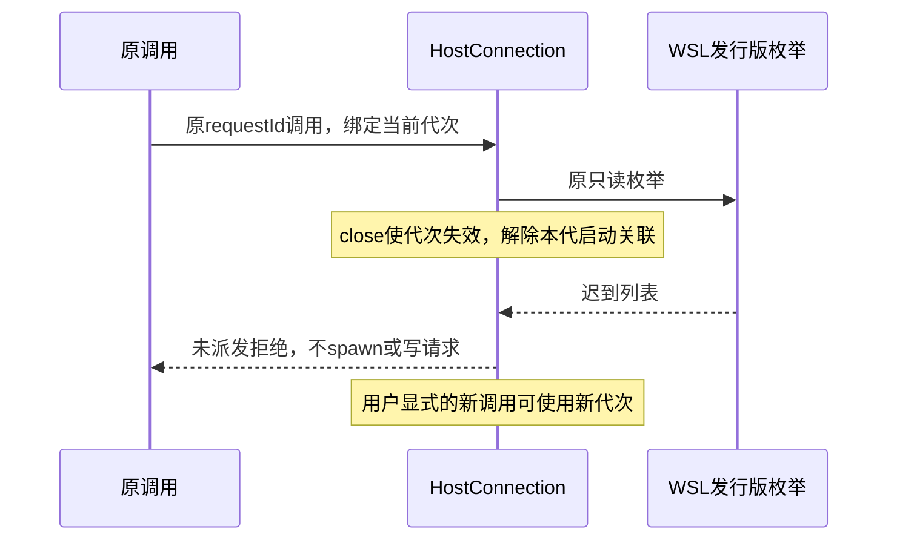

# WSL关闭竞态与图画布稳定性修复

日期：2026-10-23（Asia/Shanghai）。关联AB-F02/F07/F11/F13、M01-F04/F09、M03-F02/F05、M09-F01和M10。承接alpha.50；当前工作版本alpha.51。公开仍alpha.46，不把本轮修复当作全迭代准出。

## 需求与已复现根因

1. 通道在WSL发行版枚举期间关闭后，迟到枚举不能继续启动宿主或派发原请求；显式新调用独立进入新代次，旧启动的finally不能清掉新启动。已写请求仍按原ID查询，不能因关闭变成“未执行”。
2. 图拖动与自动保存不能因为成功提示出现/过期而移动整个画布；原授权草稿、布局收据/冲突、unknown门禁和错误提示保留。继续按[I06原指标](../I06/testing.md#4-统一指标与观察窗口)核对20组/60节点、20真实输入、p95≤100ms，不提高门槛。

旧HostConnection只对已创建子进程的startup Promise执行关闭，发行版列表仍在await时没有可取消的代次记录。受控反例明确产生1个不该启动的宿主：[原四项通过/新增一项失败](../../../artifacts/wsl-lifecycle/2026-10-23/contract-before-direct.tap)。最初node --test受限worker只报告文件失败，不能作为竞态证据；[原受限输出](../../../artifacts/wsl-lifecycle/2026-10-23/contract-before.tap)保留，随后同进程node:test才给出具体1≠0反例。

alpha.50冻结生产前端的单次真实鼠标拖动、实际布局落盘与逐帧坐标观察证明：自动“布局已保存。”提示出现时，canvas.top从476.984375变为537.375，3500ms过期后回到476.984375，**位移60.390625px**。无额外用户输入也会改变鼠标下的画布位置；[原始坐标/提示时间](../../../artifacts/i06-current-metrics/2026-10-23/geometry-before-pointer/metrics.json)。前一键盘诊断没有实际布局变化，明确失败，不当作根因证据：[原报告](../../../artifacts/i06-current-metrics/2026-10-23/geometry-before/metrics.json)。

## 产品实现

[rpc.cjs](../../../desktop/electron/rpc.cjs)增加仅内存的generation。close使代次失效、解除starting关联并关闭原子进程stdin；枚举返回后核对原代次，返回原请求未派发证明而不启动。新调用共享自己的启动Promise；旧finally仅在仍是自己的Promise时清理。start返回原子进程引用，call发送前再次核对引用，避免已关闭原调用落入新通道；就绪帧之后、实际写入之前的关闭仍有严格未派发证明。

已经写入的请求继续由原pending以DESKTOP_TRANSPORT/未知回应拒绝，原requestId/operationId/Task/Session不换、不重放；关闭该stdio观察通道不取消独立Controller或原生任务。WSL未写错误仍用WSL_HOST_NOT_READY，原生直连未写错误用DESKTOP_TRANSPORT并带executionNotDispatched:true；不把这种新错误追溯用于释放旧unknown。

[graph-state.ts](../../../desktop/src/graph-state.ts)在布局收据confirmed后更新已有工具栏保存状态，不再额外发布自动保存成功横幅。用户显式保存授权仍有原成功提示；原布局失败、冲突、待核对与重试提示不变。没有改布局/授权格式、收据判定、保存时序或任务准入。

## 验收方法与边界

受控8项覆盖：并发等就绪、就绪前失败、写后未知、原生直连、枚举中关闭、旧枚举不能清新启动、就绪后未写即关闭、原生启动关闭；[定向8/8](../../../artifacts/wsl-lifecycle/2026-10-23/contract-final.tap)。其中WSL基础启动器不是受控Node场景能证明的内容。

图验收加载冻结包后台/生产前端，20组/60节点/59条边和原鼠标输入保持。新增[画面观察器](../../../desktop/tests/graph-frame-observer.cjs)：使用原Playwright绑定的PNG解析器读取CDP实际画面帧，按主节点7px实色左边框移动至少2px判断可见反馈；忽略2px焦点外框，把frame swap时间与原pointer事件epoch相减。保存每帧PNG/原metadata/哈希及每样本基线和移动帧，不以DOM变更或更早RAF时间戳替代缺失图像。采集发生在观察器中，不进入产品。

最初帧采集在第18次拖动前失败，仅保留17个部分DOM样本，没有完整帧归档，不能当作20次通过；[部分失败](../../../artifacts/i06-current-metrics/2026-10-23/presented-first/metrics.json)。观察器随后补齐失败路径归档；正式结果按最终包样本另行登记。[上一轮117.9ms保守上界](../I06/current-candidate-metrics.md)永久保留，不更改为历史通过。

WSL原始启动器在Bridge之外也存在退出1；本轮修复关闭竞态不宣称消除该环境失败。独立SSH/LAN、真实父模型、自主委派、Hermes/Pi/DSH生命周期、CT-07/08及所有原准出门槛继续按[完整台账](completion-audit.md)推进。没有修改日常原生配置、模型、关系或远端后台，模型0。

## 本轮工程与交付

alpha.51原始工程与交付材料保留在artifacts/wsl-lifecycle/2026-10-23；后续alpha.53已公开并复核冻结包。2026-10-23补验自动保存后canvas.top位移0px，通过真实指针与持久修订验证；完整20次PNG帧观测p95 388.932ms仍未满足100ms。当前工程/普通EXE沿用注明版本的[alpha.53分层报告](opencode-bounded-probe.md)，本轮没有重跑全量或重新打包。[当前包指标与原始证据](../I06/alpha53-current-metrics.md)。
