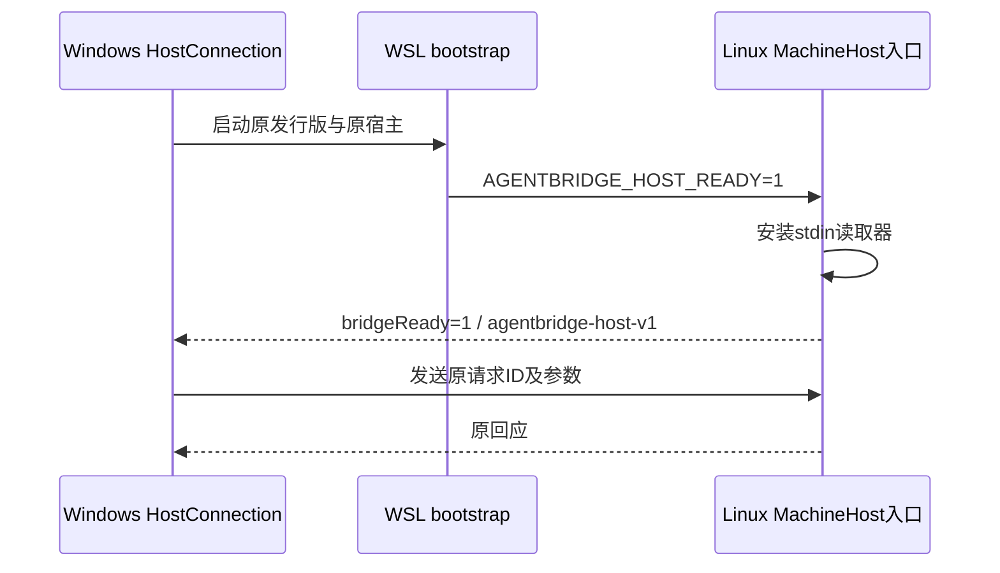

# WSL 宿主就绪握手与原请求保护

日期：2026-10-23（Asia/Shanghai）。本地候选alpha.49承接alpha.48，公开仍alpha.46。关联AB-F02/F07/F11/F13与M03/M05/M06/M07/M09/M10。完整范围仍由[全迭代台账](completion-audit.md)维护。

## 需求与根因

Windows启动WSL宿主后立即向stdin写请求，不能保证Linux接收器已接管标准输入。本机独立`/bin/cat`诊断中立即写入两次均退出1且无输出，等待250ms后写入成功；此证据只解释启动条件，不把固定延时当作协议保证。[原始诊断](../../../artifacts/wsl-mcp-native/2026-10-23/stdin-diagnostic.json)。

源码核对确认：WSL原有路由已通过HostConnection进入完整MachineHost，支持六项`mcp.*`，不是需要新建一层MCP代理。此前架构/协议资料称其没有MCP方法，与当前源码不符，本轮修正。真实WSL启动仍有就绪前退出的现场失败，握手不承诺消除WSL自身启动失败；这类失败必须证明尚未发送请求，不能被当作模型执行失败或自动重试的理由。

## 实现与兼容

- [rpc.cjs](../../../desktop/electron/rpc.cjs)：并发首次调用共享同一启动Promise，WSL等待就绪后才写入；30秒无握手、就绪前退出/无效输出/关闭返回`WSL_HOST_NOT_READY`、`executionNotDispatched:true`，不发送或重放请求。旧进程事件不能污染新连接。
- [bootstrap.sh](../../../desktop/electron/bootstrap.sh)设置就绪环境标志；[desktop-host.ts](../../../src/desktop-host.ts)仅在该标志为1时、安装行读取器后输出`{bridgeReady:1,protocol:'agentbridge-host-v1'}`。原生直连与旧启动器保持仅回应流。旧Core缺握手时新启动器有界拒绝，不写请求。
- 就绪后断线/超时保持现有未知结果语义，不能再标成未派发。没有新Task/Session/持久格式、模型层、关系迁移或SSH协议变化；原requestId/operationId不换、不重放。
- [包校验](../../../desktop/scripts/verify-package.cjs)同时逐字节核对Windows Bridge资源和Linux离线资源中的bootstrap。脚本不在ASAR清单中，不错误要求该路径存在；原有ASAR CJS/Core/前端核验保留。

## 当前启动补验

2026-10-23，当前alpha.50未改包资源20次独立启动为9通过/11次就绪前退出，失败均写入0；原始WSL和PowerShell也复现无输出退出1，根因未定位、稳定性未准出。产品/EXE未变、模型0；[全部样本与对照](../I06/current-candidate-metrics.md)。以下保留alpha.49原范围与日期。

## 验收与边界

证据：[wsl-ready/2026-10-23](../../../artifacts/wsl-ready/2026-10-23/)、[真实WSL](../../../artifacts/wsl-mcp-native/2026-10-23/)。

| 层级 | 实际结果 |
| --- | --- |
| 启动契约受控回归 | 新4项：并发等待、就绪前退出/超时/无效帧/关闭、就绪后未知、不改变原生直连；与OpenCode宿主生命周期合计6/6，[contract.tap](../../../artifacts/wsl-ready/2026-10-23/contract.tap) |
| 工程 | 桌面770/770、核心68/68，类型/lint、根与桌面生产构建通过；[desktop.tap](../../../artifacts/wsl-ready/2026-10-23/desktop.tap)、[core.tap](../../../artifacts/wsl-ready/2026-10-23/core.tap)、[build.log](../../../artifacts/wsl-ready/2026-10-23/build.log) |
| 真实Windows→WSL只读诊断 | 新握手与environment回应实际通过；生产HostConnection三次独立只读启动第一次就绪前退出、后两次通过，保留失败，不冒充稳定性准出；[原始启动](../../../artifacts/wsl-mcp-native/2026-10-23/raw-host-diagnostic.json)、[生产连接](../../../artifacts/wsl-mcp-native/2026-10-23/hostconnection-diagnostic.json) |
| 真实WSL MCP组件 | 源码阶段5组通过，[wsl-source.json](../../../artifacts/wsl-ready/2026-10-23/wsl-source.json)；最终EXE资源5组复验通过，[final-native.json](../../../artifacts/wsl-mcp-native/2026-10-23/final-native.json)。生产Coordinator/AgentNetwork→WSL HostConnection→MachineHost管理原生Codex0.162.1配置及原生列表、7工具；真实Linux stdio客户端按原scope调用，伪造参数拒绝；外部删除/确认宿主退出后重开不补装；撤权立即拒旧客户端、重新安装轮换身份；移除后配置清空、Windows原生配置SHA不变、执行/委派请求均0 |
| 普通Windows EXE | 4组通过：实际版本与普通窗口、生产IPC/SQLite持久化、关闭重开复用后台、完整后台重启保留资料且0请求重放；[windows-portable.json](../../../artifacts/wsl-ready/2026-10-23/windows-portable.json) |

前期辅助进程stdin和Windows→WSL回环控制失败均保留为失败证据；测试改用Linux原地stdio客户端及0700私有目录中的文件邮箱观察，不修改产品协议。最终报告未记录cleanupPending，两个验收客户端及原WSL宿主均确认关闭。

WSL原生MCP测试使用独立CODEX_HOME与临时Bridge目录，不触碰日常原生配置；受控节点目录与真实Linux stdio客户端分别标明。测试邮箱是验收脚本控制面，不进入产品或EXE，也不替代原生父模型。独立SSH、真实模型、完整MCP02/I06C/I07C仍未准出。

## 文档同步与复验

主设计、架构、数据/协议、模块M03/M05/M06/M07/M09/M10与M11、路线/台账均同步。首轮用户站5/6：旧断言仍要求DSH Desktop MCP方式未接入，同时核对出DSH Web/CLI汇总落后于已实现原生补丁，修正当前矩阵与明确期望（不把配置能力混作托管scope）；OpenDesk CLI仍标注只导出。保留[首轮失败](../../../artifacts/wsl-ready/2026-10-23/docs-test-first.log)，最终用户站6/6、构建18页/19 HTML、内部页与证据导出均0，结果见[docs-test.log](../../../artifacts/wsl-ready/2026-10-23/docs-test.log)、[构建边界审计](../../../artifacts/wsl-ready/2026-10-23/docs-build.log)与[完整资料检查](../../../artifacts/wsl-ready/2026-10-23/docs-check.log)。无新网页产品流程，不额外计模型验收。

## 本地包

[alpha.49 Windows EXE](../../../desktop/release/AgentBridge-0.6.0-alpha.49-Windows-x64.exe)，130185817字节，SHA-256 `139409cd3e5a5ac31f86f66487b98bdb24592bb9c0d8ccde125af50f6ec6737f`。未签名、未公开、未切换日常后台或部署远端。最终包核验51后台模块、84Core文件、1699Linux资源，四项源码一致性及bootstrap一致性均true，Linux摘要`1bfb30f4b853dbaf7f77abfbe8c730c6cbaf54c51b487d9b9b0b6988b49747aa`；[package.json](../../../artifacts/wsl-ready/2026-10-23/package.json)。首轮校验误要求ASAR内存在bootstrap而失败，纠正校验位置后通过，产品包未改动；保留[构建日志](../../../artifacts/wsl-ready/2026-10-23/package-build.log)与[最终校验](../../../artifacts/wsl-ready/2026-10-23/package-final.log)。

已复制`C:\Users\jiqi\Downloads\AgentBridge-0.6.0-alpha.49-Windows-x64.exe`，完整SHA-256与本地包一致，旁边同名`.exe.sha256`；[副本核验](../../../artifacts/wsl-ready/2026-10-23/download-copy.json)。切换时先在旧Bridge“设置→后台运行→停止后台并退出”，再打开新EXE；不升级SSH，不重放旧请求。

## 真实父模型验收待授权

2026-10-22的只读预检在日常正式授权列表找到7个目标，但没有Windows Claude；父模型Prompt提交0、子任务0。拟改用现有Windows OpenCode时，自动审批拒绝了更换真实模型目标，理由是既有授权只覆盖一次Windows Claude。已向用户询问是否允许最多1个Windows OpenCode心算子任务；未收到明确答复前不执行，也不改关系或用户配置。[预检证据](../../../artifacts/opendesk-parent-delegation/2026-10-22/native-parent.json)。
