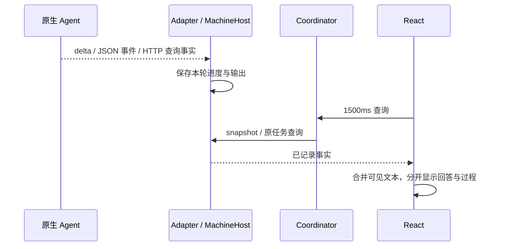

# M01 桌面界面与交互设计

## 当前历史详情读取与错误作用域

M01-F04/F05/F07：顶层快照/pending错误保持全局同步锁；单条会话/任务详情独立加载与错误，按原ID/来源核对迟到回应。详情失败仅锁本条继续/控制，保留已读内容，独立新建可用；加载/未找到/历史/真实后台错误/零轮次分开显示。 2026-10-19源码/GitHub预发布alpha.30，GitHub已预发布alpha.30；[设计、兼容与实际证据](../../iterations/I07/history-detail-recovery.md)。

## 2026-10-17：SSH持久拒绝恢复（alpha.28已预发布）

M01-F04：未确认操作沿既有recoverPending入口读取原请求；匹配远端拒绝后列表移除，缺证据仍显示保守诊断。普通request返回明确rejected而非任务，不改界面布局。 当前源码/GitHub预发布alpha.28；[完整需求、状态与验证](../../iterations/I06/daemon-rejection-recovery.md)。

## 当前停止工作行为

[停止状态界面](../../../desktop/src/TeamStopStatus.tsx)与[工作空间](../../../desktop/src/TeamWorkspace.tsx)提供明确确认、旧后台能力提示，显示停止中/待核对原终态/已归档。confirmed取消收据不呈现成任务已取消；外部成员自身运行需在原入口停止。

停止工作状态为stopping → closed，不向Core Task.status增加stopping；等待字段继续仅公开类别/数量，所有新行为和原请求规则见[停止专项](../../iterations/I07/native-stop.md)。

## alpha.24本地候选 / I07C停止协调

2026-10-16：源码/本地候选alpha.24，GitHub预发布仍alpha.23；I07A/B基础继续适用，完整I07C与I06C未准出。

| 功能 ID | 功能 | 当前状态 |
| --- | --- | --- |
| M01-F10 | 小队工作空间 | I07A基础继续适用 |
| M01-F11 | 任务板、交接授权与验收 | I07B源码已实现，实际分层证据见报告 |
| M01-F12 | 持续协作授权、预算和事件状态 | I07C首批源码实现，证据层级见本模块报告 |
| M01-F13 | 整项工作停止和原取消进度 | alpha.24源码实现，实际证据与边界见[停止专项](../../iterations/I07/native-stop.md) |

小队工作空间保留登记/文档/消息/任务板，在持续协作卡明确选择可自动执行的成员，配置累计次数/总时长/无进展检查。能力不足的成员禁选，外部MCP显示从自身入口工作；当前只开放Claude适配的自动续接。成员复选框使用紧凑原生尺寸，避免全局表单规则挤压说明。显示预算、未处理事件、原执行问题和总验收等待，普通消息/@不启动模型。回应未知仍查原ID；停止自动调度不标成取消，暂停保留原执行。

本次源码在小队原执行记录中展示原生权限/输入等待类别和数量，并追加去重系统通知。通知不触发自动激活、不批准权限，也不复制原生问题、工具参数或权限ID。unknown保留上次观察到的等待；只有已核对的非unknown状态才能清除。相同等待跨重启不重复通知，原任务终态清除等待。详见[等待可见性专项](../../iterations/I07/native-waiting.md)。

I07A/B的登记、成员/文档权限、公共消息、版本任务和授权交接继续按[I07B完整行为](../../iterations/I07/task-handoff.md)执行；新流程、异常、预算、接口和源码见[I07C首批交付](../../iterations/I07/automation.md)。以下原功能继续适用。

原功能基线说明（保留原日期/版本，以下原模式继续适用）：更新：2026-10-14。当时源码候选 alpha.18；界面主入口是 `NetworkApp`，不是保留的旧 `App` 总页面；旧 App 的 TaskDetail 被复用。0.5.0 已发布本机节点界面，I06A SSH 界面已随 0.6.0-alpha.2 候选完成主要真实 Windows 使用流程验收。

## 1. 使用者与职责

用户在一个窗口查看机器、选择真实工具节点、发需求、读结果并处理原生等待。界面负责呈现和输入，通过受限 preload 调用后台；机器身份、任务归属、协作权限和 SSH 认证由后台校验。

它不会把原生工具的模型、供应商或项目目录变成节点接入的必填项，也不会自行认定任务已经执行或取消。

## 2. 功能目录

| 编号 | 功能与人类可验收行为 | 当前状态 |
| --- | --- | --- |
| M01-F01 | 首屏机器概览、宿主标识与该环境受支持的全部工具节点 | alpha.28已发布界面沿用机器图；未发布源码默认分组概览并支持切关系图，验证见当次专项 |
| M01-F02 | 从节点动作接入，不要求模型/项目；0.5.0 的空格多选保留历史 | alpha.9 按机器添加、节点接入/断开/移除，保留原身份与历史 |
| M01-F03 | 添加 Linux 的认证选项、指纹、预检、一次安装批准与进度 | 候选已实现；隔离界面与真实 Windows SSH 主要流程分别通过 |
| M01-F04 | 指定主 Agent 与允许的子节点，保存后台修订 | 节点端点编辑/稳定收据保留；CT-01按主调用方/子接收方分别限制，新三工具保留直接与被委派 |
| M01-F05 | 新会话、需求与可选目标目录，原会话续问 | 已发布；工具能力限制保留 |
| M01-F06 | 任务看板、来源信息、本轮回答和执行详情分开 | 已发布 |
| M01-F07 | 处理权限/表单/取消与未确认原操作 | 界面复用 TaskDetail；支持范围取决于适配器 |
| M01-F08 | 关闭窗口与停止后台分开 | 设置页提供两个入口，停止需要明确确认；真实窗口生命周期以本模块报告为准 |
| M01-F09 | 节点图、拖拽端点、图布局与权限草稿 | 节点图保持挂载，概览切换不重置草稿；原鼠标/键盘和恢复证据保留历史版本，当前验证见报告 |
| M01-F14 | 统一桌面外壳、机器概览、页内搜索和分组阅读 | 未发布源码已实现；2026-10-18 Windows生产前端隔离5组及12图通过，当前修复与程序边界见[视觉交互验收](../../iterations/I07/ui-visual-acceptance.md) |
| M01-F15 | 六种 Agent 本地品牌图标与类型呈现 | 当前源码覆盖 Codex/Claude Code/OpenCode/Hermes/Pi/DSH；官方素材、来源与验证见[扩展专项](../../iterations/I07/native-agent-expansion.md) |

对应整体功能：AB-F01/03/04/05/08/09/10/11/12/14/16。验证记录见 [测试报告](test-report.md)。

## 3. 页面结构

小队“原生节点”选择仅列已接入、支持执行且支持小队协作的节点。缺少可选能力字段的历史快照只兼容 Claude/OpenCode/Codex；显式 false 继续禁用，未知工具不推定支持。Hermes/Pi/DSH 提示可从机器页直接会话，不误导用户先登记再执行。界面不是授权边界，后台仍复核新登记/执行。[完整规则](../../iterations/I07/native-integration-guards.md)。

当前未发布源码在保留五个导航入口的基础上，采用统一桌面外壳；设计依据见 [界面重构专项](../../iterations/I07/ui-redesign.md)，2026-10-18的完整交互修复与Windows实际截图见[视觉交互验收](../../iterations/I07/ui-visual-acceptance.md)。GitHub alpha.28 EXE 保持原界面，新的本地候选程序状态以当次交付记录为准。

| 页面 | 主任务与入口 | 呈现规则 |
| --- | --- | --- |
| 机器与 Agent | 管理接入、开始会话；切到关系图配置主从授权 | 默认机器分组概览；工具行展示名称、版本、角色、状态与开始会话；搜索只过滤视图；扫描/添加按机器操作，维护/断开/移除收进更多 |
| 小队协作 | 工作空间、智能体、小队设置 | 统一下划线页内导航及数量；首次接入指引；能力说明可展开，原消息/执行/任务/文档和权限逻辑保持原实现 |
| 任务看板 | 按原执行状态查看进展与过程 | 四列原状态、数量、本地搜索、空态；原生等待单独标识，不改写 Task.status |
| 会话 | 从列表选原 Conversation，阅读各轮回答和继续追问 | 列表与阅读双栏；搜索/连接验证筛选；目录、来源、历史/unknown/等待原因明确；发送条件见下节 |
| 设置 | 主题、连接、后台生命周期、原请求恢复 | 外观/连接/后台/恢复分组；未确认项展示原原因与固定码；移除机器恢复保留原身份 |

六种 Agent 使用共享品牌映射及本地 `AgentIcon`，覆盖机器概览、节点图、接入候选、任务/会话来源与成员选择。素材随前端构建和桌面包保存，不在用户浏览页面时请求第三方。未知工具保留文字/通用回退；图标只表示工具身份，不表示健康、执行成功或协作能力。品牌来源记录见[图标目录](../../../desktop/assets/agents/README.md)。

桌面外壳由 AppShell 提供标题栏、可收起侧栏、当前页与同步状态。侧栏设置固定在底部；图标轨保留可读名称。主题支持浅色、深色和跟随系统，系统主题变化即时应用。窄桌面窗口自动使用图标侧栏；这是桌面适配，不声称已验收移动端。

机器/节点更多菜单同时仅展开一个；外部点击关闭，Escape关闭后焦点返回菜单入口，执行可用动作后关闭。搜索的清空按钮及Escape保留输入焦点；机器/Agent长名称和安装路径按容器换行。会话阅读内容独立滚动，续问区在标准与最小桌面视口保持可达；首页说明使用紧凑留白。实际浏览器与极端状态覆盖分开记录。

概览和关系图是同一机器页的两个视图。AgentGraph 始终挂载，切页或概览时仅隐藏；未保存授权、独立布局及原操作恢复不能因切视图丢失。概览与关系图共用后台/原授权保存执行锁，节点管理继续合并元数据与原资源门槛。机器筛选同时用于任务/会话范围，设置/小队不使用该筛选。搜索匹配机器时展示该机器全部工具，匹配工具时只缩小显示，不改后台资源归属。

外壳、概览与搜索是纯展示层；NetworkApp 继续拥有 snapshot/pending 轮询、原身份、管理 hooks、弹窗和任务控制。新 UI 不能按视觉颜色自行结算成功、取消或 unknown。

## 4. 接入与会话交互

### 本机节点

扫描显示工具、版本、健康与是否已接入。alpha.9 在机器组提供“添加 Agent”，按安装位置区分同名候选；节点提供“接入”、断开/移除确认，接入后可“开始会话”，键盘可聚焦动作，安装位置在候选和节点详情展开。0.5.0 空格多选是旧界面历史，当前图不以复选框配置主从。后台仍校验工具可调用性。

只读扫描不会调用模型。工具已接入与模型能回复不同；原生账号或配置拒绝时展示原始业务错误，不在节点页面增加供应商修复向导。

### SSH 表单

地址/端口/用户名是连接配置；密码、私钥文件、ssh-agent 用选项卡式 radio 选择。秘密字段使用 password input，默认不保存，认证输入经 credential.provide 发送后清空；组件卸载也清空。私钥内容由后台读取，路径可存配置但内容不上传。

流程是“测试连接 → 必要的主机指纹确认 → 环境与安装摘要 → 安装并连接或连接已有后台”。第一次信任未开始认证时，后台保留有限期临时输入，避免让用户无意义地重复填密码。

alpha.14：明确上传失败 `SSH_UPLOAD_FAILED` 后显示安全错误原因并回到凭据表单，提供“重新检测安装”；先检测原连接、重新展示摘要，再批准才沿原安装 ID 继续。尚未批准安装同样可回到检测。其他安装/中央回应未知保留原操作，不显示重装按钮。见 [上传恢复](../../iterations/I06/ssh-upload-recovery.md)。

未知信任、已变更公钥与普通网络错误分开显示；变更公钥不出现忽略按钮。SSH 安装进度显示在机器卡片和对话框，后台返回 ready 不代表机器 online。

### 新会话

从节点开始会话默认目标为该节点；通用新会话优先主节点/可用节点。目标、需求、目录是本次执行输入。留空目录使用该节点默认目录，相同节点/目录/模式会复用执行上下文，不提供每个新会话独立的文件隔离。只有目标为当前主节点时可选择允许协作。

SSH 目录只手输 Linux 路径，隐藏本地目录选择按钮。Windows/WSL 的选择目录经后台做发行版和路径转换。需求传给原节点，不转换为任意 shell 命令。

### 续聊与验证记录

按原 Conversation ID 读取详情，来源节点在线且接入、上一轮有终态、canContinue为真、无原资源占位且共享执行锁解除后才允许发送；提交处理再次核对门槛，不只依赖按钮外观。连接验证记录默认不混入普通会话，显示“这是连接验证记录”，实际需求另开会话。机器范围或验证记录开关排除当前选择时，隐藏其阅读与续问区；返回原范围后仍按原身份读取，不转移执行归属。关键词搜索仅过滤列表，不更换原会话。Codex 当前 canContinue 依据已有 thread 绑定，并没有提前识别每种原生 resume 限制；发送失败后保留本轮错误，入口仍可能可用，这是待改的能力呈现边界。

设置页停止入口属于当前窗口界面。当前窗口可以是新 EXE，并通过认证 IPC 连接同一 profile 的旧后台；确认“停止后台并退出”会停止该已连接后台并关闭新窗口。再次打开新 EXE 才启动新版本后台，无需旧窗口。后端不可认证或不可达时保留实际错误，不能按 PID 名称任意强杀。

## 5. 数据刷新与流式阅读

界面用结构共享保留未变化JSON分支，机器/节点对象不会仅因轮询反复替换；真实时间戳、错误、busy/等待/unknown变化仍完整接收。关系图不展示持续跳秒的最近同步行，详细同步时间保留在机器菜单。展开项、菜单和图位置在后台轮询中保留。安装发现仅在后台首次使用或用户明确扫描触发；普通刷新只读取实时状态。[原因与实测](../../iterations/I07/desktop-polling.md)。

界面每 1500ms 请求 snapshot 与 pending；打开的任务/会话再按原 ID 读取。每次详情请求固定原查询ID；返回时仅在当前选择仍相同且返回身份匹配时更新内容及其来源/目录，选A后改选B或关闭详情时丢弃迟到的A回应。缺少snapshot元信息时保留原详情返回的nodeId/workspace，不借用另一选择的数据。refresh 的 ref 防止同时启动重复轮询。它不是直接订阅原生 SSE/token 的传输接口。

`api.ts.taskEvents` 合并相邻可见输出：Claude 按 delta 拼接；OpenCode 新快照覆盖旧前缀快照。原始事件不改，工具/状态分界保留。验证 token 不逐个显示为人工阅读过程，完成文字说明验证结果。

Codex 协作过程的 progress 文本包含 `mcp_tool_call · server/tool`，例如 `agentbridge/list_agents`，便于用户识别实际调用的发现入口；来自宿主事件，界面仍按原过程展示，不显示私有 endpoint 或工具参数。

回答最终优先取 error/result，其次取合并中的流式文本与摘要。不能把工具输出或父/子任务文本混作本轮最终回答。

## 6. 错误、占位与控制

pending journal 产生“原操作回应未确认”提示。界面每约 10 秒触发只读恢复，核实原回执或严格匹配的原未派发意图后再解除；新后台通过 pending 的可选 blockedNodeIds 投影原节点和共享目录的阻塞范围，图卡片、新建、续聊和任务控制按该范围禁用；同机器独立节点可工作。旧后台没有该字段时仍按来源机器限制，缺来源记录保留全局保护。机器/节点管理继续使用原整机限制，不能用改名、移除或切换目录释放原占位。

TaskDetail 沿用权限与表单的原请求 ID、执行归属和控制收据。取消请求与实际 cancelled 分开。退出观察、关闭详情和关闭窗口都不等于取消任务。

小队原执行若有后台公开的continuationError，显示“会话身份异常，当前记录不能作为可信验收依据”，同时保留原生终态、结果及原错误。前端不根据所有历史异常全局禁用验收，也不推断当前业务是否可验收；当前有效执行的可信度由后台守卫核对。详见[业务验收保护](../../iterations/I07/acceptance-native-binding.md)与[本轮界面记录](../../iterations/I07/ui-visual-acceptance.md)。

网络失败展示可读原因与重试入口，保留历史结果；busy 标记避免用户重复点击，不替代后台幂等与权限验证。

机器卡片的 error 来自当前快照；SSH 恢复成功后清除缓存的旧版本/连接报错。新的连接拒绝或 RPC 超时仍显示，任务的原生失败和 unknown 不由连接恢复清除。后端状态合并负责清理，不按“在线”隐藏全部错误。

“查询原请求”显示查询中状态，完成后显示已核对/仍待确认数量；未解决项显示固定脱敏原因及错误码。旧后台只有 resolved 时明确提示缺少具体原因。原请求的 submitted/unknown 不由 UI 自行改写，也不展示完整参数或远端任意错误正文。[alpha.18 验证](../../iterations/I06/runtime-recovery.md)。

## 7. 窗口与后台生命周期

I06A 关闭窗口使 Electron 客户端退出，before-quit 只关闭 Coordinator 客户端连接。独立中央维持连接。

设置页提供“仅关闭窗口”和“停止后台并退出”。明确停止前显示确认，后台停止失败保留窗口并恢复刷新；普通关闭只结束客户端。

## 8. 当前节点图、草稿与布局

### 当前连接能力与恢复

M01-F04/F05/F07/F09：节点概览分别显示执行/被委派/Bridge MCP能力。图主选择/连线源必须能调用MCP，目标只要求能接收普通委派；未知执行或未知适配器禁用发送，新三工具保留直接会话。历史不支持调用MCP的主记录保留，协作框禁用且不默认勾选，可关闭协作直接会话。匹配原关系拒绝收据才解除relationPending并保留base/草稿；not_found、裸码、外来ID继续等待。 当前为未发布源码；[完整能力/错误/兼容契约](../../iterations/I07/connection-capabilities.md)及[本模块报告](test-report.md)记录实际范围。

alpha.9 / I06B 使用锁定的 `@xyflow/react 12.12.0`，资源随前端离线打包。机器与协作功能合并在“机器与 Agent”一个菜单，使用同一图和编辑状态；其他页面隐藏图，切页不销毁草稿。默认概览展示全部机器；切到关系图后，机器标签定位画布并过滤看板/会话。WSL 保留宿主标识；无工具及离线分组不被删除。

主 Agent 用皇冠、蓝色角色徽标、加粗边框与低饱和底色突出，普通/子节点使用中性徽标；角色跟随草稿，放弃草稿恢复已保存角色。卡片保持相同尺寸，切主不改变已有布局。每台机器每种工具只显示当前入口节点，名称、当前版本、角色、接入、等待、工作、待核对及最近失败统一呈现。supersededBy 历史安装从概览、关系图和添加 Agent 列表隐藏，历史阅读仍保留全量节点来源；当前节点的占用包含历史安装未知执行。机器记录最近成功同步时间；工具原生失败不改变机器在线状态。点击节点显示安装位置与可读错误；执行入口仍检查任务占位和来源机器的未确认台账。

点击“设为主 Agent”只改草稿，切主清空草稿成员并提示旧边待移除；不自动改向旧边、不迁移任务。主节点只显示右侧输出端点，普通/子节点只显示左侧输入端点；无用端点不接收鼠标/键盘输入，且不向辅助技术暴露。隐藏端点保留几何锚点，以显示换主后等待移除的旧边。主输出端点拖到其他已接入/支持节点输入端点创建草稿。重复、自连、普通节点输出、未接入目标拒绝。离线或忙的已接入节点可以配置授权，执行另行校验。已保存实线、新增虚线、待移除标记与文字分开显示；选边后删除或按 Delete/Backspace 只改授权草稿。

已保存/草稿边采用正交路线，绕过工具卡片，箭头指向子输入端点。向左连接时从主右侧离开、从子左侧进入；边位于机器背景之上。卡片重叠或端点间距过小使通道受阻时使用折线回退，不承诺重叠布局仍完全避让。

键盘在起始端点用 Enter/Space 开始，方向键循环高亮目标并通过 live region 朗读机器/工具，再次 Enter/Space 完成；焦点保留起始端点，也可 Tab 到目标端点完成。Esc 或窗口失焦取消临时线。节点/分组用方向键小步移动、Shift+方向键大步移动。按钮、边和端点可聚焦，不要求精确鼠标操作。

按住鼠标中键可在画布空白、节点、按钮、端点和机器组区域平移全图；显示抓取光标，松开、指针取消或窗口失焦后结束。移动只更新视口，保留节点/组坐标、缩放和授权；布局回应待核对时禁止平移。左键拖动节点卡片，机器组可从标题或空白背景拖动；空白画布可左键平移。Agent 保持在所属机器内，移动不转移机器身份或执行归属。图支持组内节点拖动、机器组拖动、平移、25%–200% 缩放、100%、适配、定位主节点、自动整理。首次出现节点/机器时生成并保存缺省位置；状态轮询和切主不重排已知坐标。缺省布局及自动整理把当前主 Agent 所属机器优先排在左侧，主节点在组内优先；自动整理是明确用户动作，已保存及手动布局不被轮询或切主重排。布局与授权分别保存，移动位置不改变机器身份、关系 revision 或执行任务。

布局加载失败时不永久锁定画布，改为本机布局模式并明确显示错误、“布局仅保存在本机”和重新读取入口。本机拖动及视口保存到浏览器缓存，不发送后台写入；旧后台下图授权编辑禁用，原会话入口仍可用。原 layoutPending 仍锁定该 lane，不能因为布局读取失败而消除原 unknown。后台恢复支持图接口后保留本机位置，以正常修订/收据同步；读取不可用时不以默认修订误报冲突。中键通过 pointer capture 保证移出画布释放也结束。

关系保存带 operationId/expectedRevision；布局另带 operationId/expectedLayoutRevision，拖动/视口结束后合并保存。两种收据各自原子持久化，中央另保留独立图意图台账。保存回应未知时暂停该类新编辑/写入，只查询原操作；浏览器草稿和原 ID 缓存到本机，重开也查询原 ID。中央台账还阻止另一窗口换 ID 绕过 unknown；任务台账不被图操作解除。

轮询只更新运行事实和更高 revision 的后台关系；已确认收据的较新版本不能被旧快照回退，未保存草稿保留。关系或布局修订冲突展示最新状态与保留草稿的重新校验入口，不静默覆盖。另一窗口的未确认操作不吞本窗口草稿。原收据缺失继续待核对，不用相似快照冒充确认。明确拒绝保留输入，布局与授权错误分别呈现。

新会话从节点卡选择目标；通用入口按机器分组选择，不再使用执行节点下拉框。换目标清空未提交目录并保留需求文本；普通节点聊天不会自动启用协作。只有已保存的主节点能启用协作，草稿没有执行权限。目录留空使用该节点默认上下文，不能宣称每次新会话文件隔离。

代码：[AgentGraph.tsx](../../../desktop/src/AgentGraph.tsx)、[graph-state.ts](../../../desktop/src/graph-state.ts)、[图样式](../../../desktop/src/graph.css)、[避让路由](../../../desktop/src/graph-routing.ts)。后台合约见 [M02](../02-coordinator/design.md)、[M08](../08-collaboration/design.md)。

## 9. 代码入口与模块接口

| 文件 | 作用 |
| --- | --- |
| [main.tsx](../../../desktop/src/main.tsx) | 挂载 NetworkApp |
| [NetworkApp.tsx](../../../desktop/src/NetworkApp.tsx) | 数据编排、原身份与恢复、管理 hooks、弹窗、持久挂载的图 |
| [AppShell.tsx](../../../desktop/src/AppShell.tsx) | 标题栏、导航、侧栏折叠、同步状态 |
| [MachineInventory.tsx](../../../desktop/src/MachineInventory.tsx) | 机器概览、工具状态、视图搜索、已有操作入口 |
| [WorkspacePages.tsx](../../../desktop/src/WorkspacePages.tsx) | 任务、会话与设置展示及本地筛选 |
| [workbench.css](../../../desktop/src/workbench.css) / [workspace-pages.css](../../../desktop/src/workspace-pages.css) | 共享颜色/尺寸/状态、桌面与页面布局；后于历史样式载入 |
| [AddMachineDialog.tsx](../../../desktop/src/AddMachineDialog.tsx) | SSH 表单与信任/安装流程 |
| [App.tsx](../../../desktop/src/App.tsx) | 当前复用 TaskDetail；旧总页面保留 |
| [api.ts](../../../desktop/src/api.ts) | 调用 envelope、状态文字、输出聚合 |
| [types.ts](../../../desktop/src/types.ts) | UI 对象与业务字段 |
| [preload.cjs](../../../desktop/electron/preload.cjs) | 受限桌面 API |

实际调用参数见 [整体协议](../../protocol.md)。涉及接口变化时同时更新 M02/M04/M06/M08，不在 UI 中假设新增后台方法已存在。

## 10. 当前验证与来源

I05 模拟界面有 6 项交互记录；I06A SSH 模拟界面有 6 组记录。它们证明交互与调用参数，不证明真实密码认证、模型回复或新 EXE 生命周期。详见 [报告](test-report.md)。

alpha.8 当前真实打包窗口与旧后台兼容检查见 [拖动修复](../../iterations/I06/graph-drag-fix.md)。历史状态来自源码与 [I06A 进度](../../iterations/I06/progress.md)，已发布功能来源 [I05 验收](../../iterations/I05/acceptance.md)。以后本页维护完整最终交互，变更原因写入当次迭代。

## 2026-10-12：6A 收尾

设置页有“仅关闭窗口”和“停止后台并退出”两个独立入口。停止弹窗说明连接与协作暂停、远端已接收任务不取消；取消弹窗不发送后台动作。确认停止后暂停刷新，失败时保留窗口并恢复刷新。普通关闭只结束客户端。

OpenCode 会话读取必须返回 canContinue；界面仍依据上一轮终态、原绑定及后台判断启用续问，不通过强行放开按钮规避后端约束。

I06B 布局实现明确提供机器组与工具节点的宽高，首次 DOM 测量前也能正确计算 parent extent；避免节点被夹到组原点、盖住组标题并错误拖动机器组。保存和重开按后台相对节点坐标及视口分别核对。当前实际鼠标节点/组拖动、键盘组移动、缩放与重开证据见 [测试报告](test-report.md)。

## alpha.9 页面与节点管理

机器/关系菜单合并为“机器与 Agent”；图、授权保存/冲突、主 Agent 需求和最近委派同页保留。每个机器组的“添加 Agent”打开本机安装候选列表，显示名称/版本/路径/状态并提供重新扫描、接入及恢复已移除项。卡片断开/移除弹出明确范围确认，后端忙碌/未知/离线拦截，取消无写入。断开保留卡片，移除隐藏卡片，任务与会话继续可查；会话目标列表仅包含可见已接入节点。前端原节点意图独立持久化，重开/其他窗口只读接收 node lane，未确认锁定节点与授权；旧后台能力缺失明确引导更新。布局和中键行为保留。代码和验收见 [当次完整说明](../../iterations/I06/node-management.md)。

alpha.9 角色变化后显式刷新保留的隐藏端点几何，待移除的原边持续使用原锚点，保存/放弃仍控制实际授权。前端同时从快照保留 removed 节点的历史名称与来源，断开/移除会话暂停续问，不回退到同机器另一同名工具。当前专项见 [节点管理](../../iterations/I06/node-management.md)。

## I06C 当前机器管理与观察恢复

机器组操作提供编辑 SSH、确认断开/移除和重新连接；设置页保留已移除机器与显式恢复。机器图/目标隐藏 removed 机器，但历史引用全量机器/节点名称；历史快照标识清楚且禁止继续/控制。已接入用户不能在编辑中换执行域；关闭已有机器详情无写入。原机器意图存本机，未知只查原 ID 并锁元数据，旧后台能力缺失禁用编辑/移除。 完整接口、事务、当次实际证据与未完成范围见 [6C 首批](../../iterations/I06/machine-management.md)。

## 当前维护与原操作恢复（alpha.13）

机器组的“后台维护”打开独立确认框，显示实际运行、目标与可回退版本，支持升级、回滚、停止及卸载。原维护未确认时仅查询原操作，机器/节点/授权元数据暂停；布局独立，其他机器仍可发需求。同一来源任务不能绕过维护屏障；连接详情仍可安全补录凭据。旧中央没有 daemonManagement 时不提供维护写入。表单秘密字段使用遮罩，表单答案不进入中央恢复台账。

实现入口：[DaemonDialog.tsx](../../../desktop/src/DaemonDialog.tsx)。需求、分层证据及未测范围见 [I06C 收尾](../../iterations/I06/final-delivery.md)。
