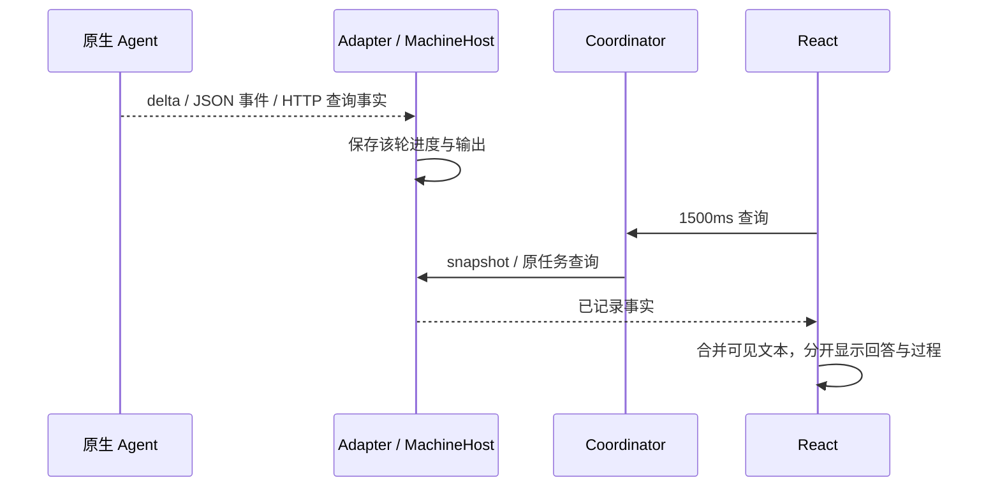

# M01 桌面界面与交互设计

当前公开alpha.68已收录本模块本轮改动；冻结38cd637，EXE与源码/实际载荷匹配，普通EXE独立合成profile恢复及整个后台重启通过。源码受控、真实原生组件与普通EXE结果分别记录，未进行真实用户profile恢复或新增模型轮次。[发布、证据和未准出项](../../iterations/I08/alpha68-release.md)。

M01-F02/F04：Hermes节点沿用当前配置/审计入口，能力投影取消为false；用户从原生Hermes会话工作与停止网关任务，界面不以进程退出显示任务已取消。无新增页面/模型表单。 [本轮构建、分层验证与限制](../../iterations/I08/alpha65-hermes-windows.md)。

M01-F04/F09/F15：关系编辑只全局检查关系自身待核对、台账可信读取、后台可用和本机草稿持久化。无关节点/机器管理未知不锁全部关系；目标未知仅阻止新增该目标或将其设为新主。删除已保存边先显示“待移除”，保存才撤权；清主同时清空成员。布局读取失败或自身pending不阻断授权。禁用删除/保存提供原因；revision冲突保留草稿并显式重新校验，较低修订不覆盖已确认撤权。已随alpha.64公开，[关系撤权与目标作用域](../../iterations/I08/relation-revocation-scope.md)。

### CT-05原包传递与接收声明

新增同工作原包持久传递、目标读取/匹配收据和桌面按需只读审计；小队MCP22项，经典10不变。原state版本3/receipts结构保持，独立SQLite表与写收据原子提交；无调度、任务或权限副作用。当前本地alpha.63已打包交付，Pi→固定源码Hermes原生组件传递7组已验；真实父模型消费待验。完整字段、当前身份/可见性、原ID恢复、容量/错误和源码见[原包传递设计](../../iterations/I07/context-delivery.md)。

## 配置与审计控制台

M01-F01/F04/F05/F06/F07/F14：实际入口为接入配置、小队设置、执行审计、会话审计、设置，稳定page ID保持。机器概览/关系卡/详情均不提供新会话，根入口不挂载提交或续聊回调。任务和会话保留原历史、筛选、来源及刷新；任务默认只读，显式进入原执行恢复才开放原权限/表单/取消，切原Task来源重置恢复态。小队保留用户作用域/成员/MCP/预算/交接/文档编辑权限及停止归档；正文只读且保存权限时保持原title/content，不提供日常任务/消息/报告/验收或手动执行。原配置意图写前持久化，核对原ID/完整指纹与当前原字节，损坏/丢回应/并发变化保持锁定。[本片完整流程与验证](../../iterations/I07/configuration-console.md)。

## 失败操作清理

M01-F02/F04/F07：设置提供“清理已失败操作”。按钮在操作/核对期间禁用，沿原管理ID和执行请求查询，报告已解除失败占位、已核对管理/执行和仍待确认数量。每条查询失败/未找到原因可见；终态意图移出未确认列表，原持久失败历史保留。不另起ID或重发需求。 [需求、证据与未测边界](../../iterations/I08/failed-operation-cleanup.md)。

## CT-08连接策略与原意图恢复

M01-F02/F04/F07：新增“连接策略与确认”页面，按机器/Agent标签管理各主预授权、明确允许/拒绝原请求和最近审计。新写入前保存原方法/参数/ID/指纹，存储失败不派发；丢回应/页面重开只查原ID，not_found/错指纹/损坏本机意图保留锁定，不自动重发。草稿保持原双修订CAS。各主原生MCP按自身启用出站关系判断；旧关系图仍selected。 [完整契约、验证与边界](../../iterations/I07/connection-policy.md)。

## OpenCode 原生 API 状态

M01-F02：OpenCode 的 `needs_check` 显示“待检查原生 API”及原服务的协议/健康失败原因；即使旧快照残留 connected=true，也不显示“已接入”或开放执行能力。成功探测、原安装版本与能力一致后显示已接入。原未知操作继续查询原 ID，不因界面状态释放。[需求与验证](../../iterations/I08/opencode-bounded-probe.md).

## 当前 OpenDesk 生命周期与关系作用域

M01-F01/F02/F06/F15：OpenDesk 配置卡持续显示退出→刷新→添加→手动重开→原生人工核对；运行/进程状态未知禁用添加，完全退出后原节点即使断开也可配置；“配置已写入”不表示加载成功，原生列表探测禁用并显示具体原因。关系图设主、连线及保存中的新增角色按新目标判断；清主与删除授权按关系自身台账独立处理，禁止原因使用真实管理/能力理由。 [需求、流程与失败边界](../../iterations/I08/opendesk-lifecycle-relation-scope.md)。

## 连接身份与节点管理准入

M01-F01/F02/F06/F15：DSH 配置固定原节点并显示未配置/已加载/待扫描/身份不匹配/原目标缺失/损坏六种状态；只有从未配置可预填默认3080，保存回应与后续刷新按明确ID选取，token每次保存/刷新/切源清空。概览和关系图以节点作用域显示接入门禁及原查询理由，run派发前再次核对当前缓存；新增独立写入不主动查询其他unknown，既有只读定时轮询保留。 [完整设计与失败流程](../../iterations/I08/connection-identity-node-scope.md)。

M01-F04/F09当前指标仍按20组/60节点、20真实输入、反馈p95≤100ms与卡顿≤500ms验收；确认落盘到界面p95≤2s。本地状态同步与独立LAN分别证明，DOM/下一帧上界不能冒充准确呈现时间。[当前包实测与未准出项](../../iterations/I06/current-candidate-metrics.md)。
M01-F02/F05/F15：Pi/Hermes共用原节点MCP卡，显示绑定路径/当前选择、原生禁用与安全探测原因。原生禁用或目标变化时安装禁用，移除仍只清原目标；分别提示/reload和/reload-mcp，不新增模型或登录表单。 [最终实现、原始证据与范围](../../iterations/I08/hermes-mcp-config.md)。

M01-F02/F05/F15：DSH Desktop MCP卡片按原生选择记录管理并显示绑定Profile；切换后显示原路径/当前路径与具体错误，阻止误写，移除仅清理原目标；DSH服务连接仍独立。 [实现与分层验收](../../iterations/I08/dsh-desktop-mcp.md)。

## MCP02恢复与观测（2026-10-22）

M01-F02/F05：MCP卡片展示探测时间与有效性，过期后连接/工具为未知；区分服务端目录与原生连接/委派授权。 [实现、原始证据与未测项](../../iterations/I08/mcp-open-recovery.md)。

I08-MCP02统一开放MCP与双向配置已完成源码第一片：MCP卡片改为六项状态事实逐项显示、能力门禁改按“能否管理原生MCP配置”判断、主角色按钮区分独立MCP与托管绑定，见本页[Agent行MCP状态与控制](#agent行mcp状态与控制)；逐入口真实原生验收仍待执行。[本轮开发与验收记录](../../iterations/I08/mcp-open-integration.md)。

机器页、关系图及任务来源使用OpenDesk本地品牌图，CLI与Desktop分别显示。前端认可两个已注册入口的原生执行能力；健康且执行能力明确为true时允许接入，原生委派继续按原占用门禁执行。未知入口、来源不匹配或能力false/null不能因健康状态而开放执行。两个入口的行配置打开原生MCP管理，可添加/移除/导出；OpenDesk托管会话的协作选项禁用，独立MCP调用与主从关系配置保留。界面不添加模型/供应商字段。 [实现与证据边界](../../iterations/I08/opendesk-existing-interfaces.md)。

## alpha.38 维护前置门禁与越过未确认收据

M01-F03/F06：用户已批准的契约变更。[DaemonDialog](../../../desktop/src/DaemonDialog.tsx)把维护对话框拆成三个语义独立的区块：**上次维护结果**（持久历史）、**维护前置门禁**（实时只读阻塞项，每条带“按原 ID 查询”）、**越过未确认收据**。当实际版本==本程序版本时，历史区块降级为中性 `status`：“无需升级；以上只是历史记录，不代表当前失败”，不再当作 alert。越过的勾选与“确认升级（保留未确认收据）”按钮**仅在“有收据阻塞 且 无任何任务/Agent 阻塞 且 有升级目标”时出现**；任务/Agent 阻塞时只显示“维护前置门禁不可越过”，**永不提供越过入口**。门禁读取失败或无收据端点只 inline 说明，不把整个对话框判为失败。[NetworkApp](../../../desktop/src/NetworkApp.tsx) 经新增只读 RPC `machine.maintenanceBlockers`/`machine.queryBlockedOperation` 接线。[契约、RPC、现场与未测边界](../../iterations/I08/alpha38-delivery.md)。

## alpha.36整合边界

M01-F01/F06：alpha.36整合基线含公开alpha.35执行资源级保护/原查询反馈与所有工作区增量；OpenCode宿主和原管理拒绝恢复并存，原身份/Session/unknown不迁移。精确收录alpha.34/35 daemon清单，客户端升级不自动替换远端。[完整交付](../../iterations/I07/alpha36-delivery.md)。

## Agent 行配置入口

M01-F01/F02/F06/F14：机器概览每个Agent行在接入状态旁提供带编辑图标的“配置”；关系图使用同一弹窗。全局设置只保留外观、连接概况、后台、原操作恢复与已移除机器，不再挂载MCP/DSH表单或提前读取其配置。弹窗固定原机器与节点，不提供第二个目标选择器；源离线/移除/被替代后保留原目标并禁用写入，不能自动选择另一节点。Escape/遮罩可关闭并返回触发按钮焦点，Tab在弹窗内循环；写入在途不能关闭。窄窗口独立滚动且保留关闭入口。[完整流程与验证](../../iterations/I07/agent-row-configuration.md)。

## 扫描、服务配置与原管理操作

M01-F01/F04/F06/F07：机器扫描与“添加 Agent”查看入口不被待核对管理意图禁用；实际接入、断开、移除及执行继续受原机器/资源锁限制。节点“原操作待核对 · 查看”打开设置并自动定位到原操作卡片；“未确认操作”合并执行台账、中央图管理台账与本机节点/机器意图，显示来源、原操作ID、原错误与只读查询失败。仅匹配终态收据清除原管理意图，不能把管理收据当作任务成功。DSH安装提示显示“待配置服务连接”并提供配置入口。[完整规则与分层验证](../../iterations/I07/agent-management-recovery.md)。

## DSH Desktop / Web 当前行为

M01-F01/F06/F15：DSH Desktop/Web节点的配置弹窗固定所属机器与入口，精确按adapter+executable读取已有服务地址；密码式token不回填，保存或关闭后清空，状态只显示无token的地址。保存不提交任务，按机器启停连接后手动重扫；节点/关系图/任务来源使用本地DSH图标，能力门禁保持。 [完整契约与证据](../../iterations/I07/dsh-desktop-web.md)。公开alpha.34不包含该能力；本地.dsh.3候选已构建并验证真实连接，Desktop模型两轮均RATE_LIMIT，独立SSH未验，见[本地交付](../../iterations/I07/dsh-exe-delivery.md)。

中央hello公布`opencode-dual-api-v1`与`team-context-mcp-v1`语义能力；新前台遇到仍在运行的alpha.33后台时要求显式停止并重开，设置/停止入口保留。避免新EXE复用旧2.x独占后台后仍拒绝1.x或缺MCP/材料方法；原任务、收据和unknown不改。

## 当前维护进度与持久化边界

M01-F03：机器显示安全进度告警，上传继续不等同升级成功；最终保存拒绝保留具体原因。 [完整设计、实测与边界](../../iterations/I07/maintenance-persistence.md)。

## 维护阶段可见与有界自动核对

M01-F03/F06：[DaemonDialog](../../../desktop/src/DaemonDialog.tsx) 按快照 `machine.installProgress.phase`（uploading/extracting/verifying）显示“正在上传/解包/校验 <已完成> / <总量>”与 `role=progressbar`，`progressWarning` 作为提示而非失败；未决时显示“已发送维护指令，等待远端切换（原操作已保留，不会重做）”，终态显示成功或 `rejected` 的原因（`role=alert`）。未决期间新增可选 `poll`：1s→2s→4s→8s 封顶退避、同一时刻一次在途、卸载或 `pending` 变 false 立即停止，且**只查询本地保留的原 operationId**。`NetworkApp` 改为按 machineId 从当前快照解析对话框的 `machine`（否则进度不会流入），[MachineInventory](../../../desktop/src/MachineInventory.tsx) 在卡片上显示同一进度行。未决收据下按钮仍按原设计禁用，不提供换 ID 重做入口。[切片说明、UI 用例与未测边界](../../iterations/I08/maintenance-offline/maintenance-visibility.md)。

## 当前版本准入与管理作用域

M01-F04/F05/F07：概览、关系图和设置按目标机器展示管理阻断原因；异机unknown不禁空闲机器维护。同机、来源不足、原授权pending和全局同步错误继续保护；OpenCode接受可识别的1.x与2.x，其他主版本在启动前拒绝，版本不兼容时仍投影不可用并保留原历史。 [版本准入沿革](../../iterations/I07/version-management-recovery.md)、[1.x/2.x 兼容修复](../../iterations/I07/opencode-v1-compatibility.md)。

## 当前历史详情读取与错误作用域

M01-F04/F05/F07：顶层快照/pending错误保持全局同步锁；单条会话/任务详情独立加载与错误，按原ID/来源核对迟到回应。详情失败仅锁本条继续/控制，保留已读内容，独立新建可用；加载/未找到/历史/真实后台错误/零轮次分开显示。 [设计、兼容与实际证据](../../iterations/I07/history-detail-recovery.md)。

## 独立 MCP 配置与运行契约

M01-F01/F06：原生Agent行的“配置”打开绑定原节点的MCP卡片，显示原生文件路径、授权/安装/冲突状态和三份独立文件路径。添加/移除/导出独立操作；配置变化只手动刷新，不加入运行快照轮询。失败后读取状态核对结果，同名冲突保留条目，撤权与是否删掉文件分别显示。原生客户端需重新加载配置；旧后台的原错误可见。[配置/数据/失败流程与源码](../../iterations/I07/mcp-installation.md)。

## Agent行MCP状态与控制

M01-F01/F02/F06：MCP卡片把单一“已安装”拆成**六项独立状态事实**逐项显示——配置、原生加载、连接、工具、授权、归属——每项各有一句“这一项说明了什么、不能据此推断什么”的说明；后台只返回旧摘要时，只显示一行“需要升级后台才能核对原生证据”，不逐项编造。状态标签覆盖`未添加`/`已生成独立配置`/`已添加`/`配置冲突`/`已撤销授权，原生配置待清理`/`当前产品不支持此操作`。

- 能力门禁按 `nativeMcpConfig`（能否管理该产品原生MCP条目）判断，与 `mcpClient`（该产品能否调用Bridge MCP）分开显示；该产品有MCP客户端但Bridge无原生配置适配时，明确写出“仍可在原生工具中手动添加，但本页无法核对原生加载/连接/工具”。
- 不可管理时直接显示后台给出的 `nativeSupportCode`/`nativeSupportReason` 原文，不用笼统失败代替。
- 操作：添加、移除、生成独立MCP文件、撤销连接授权、重新探测原生列表、刷新状态。移除与撤权分开确认；`revoked_config_pending` 单独告警“授权已撤销、原生配置仍存在、新调用会被拒绝、不会自动恢复授权”。只读探测不会新增/恢复/启用原生配置。
- DSH服务连接仍在原位置单独配置，不呈现为第二种MCP安装方式；DSH Web的原生MCP条目由同一张MCP卡片管理。DSH CLI 行额外提供“DSH 原生 profile”输入框（说明“Bridge 不会猜测目标 profile”，切换 profile 会重读该 profile 的条目）；不填时只能生成片段，添加/移除会被后台以 `MCP_DSH_PROFILE_REQUIRED` 拒绝。DSH Desktop在alpha.48候选按原生选择记录管理当前Profile；卡片显示接入绑定Profile与原路径，选择变化显示原因/当前路径并禁安装，移除仅清理原绑定。
- 主角色按钮的禁用理由改按MCP调用能力给出；能独立调用但托管绑定未适配时，按钮可用并附注“以独立MCP会话作为主Agent，托管任务绑定未适配”，不把托管缺失说成MCP不可用。

实现落点：[McpSettings.tsx](../../../desktop/src/McpSettings.tsx#L19)（状态标签/事实行/说明/动作与禁用条件）、[connection-capabilities.ts](../../../desktop/src/connection-capabilities.ts#L1)（`canCallBridge`/`canConfigureMcp`/`canHostManagedTask` 与未知理由）、[CollaborationChoice.tsx](../../../desktop/src/CollaborationChoice.tsx#L4)。受控界面用例见[本模块报告](test-report.md)；逐入口真实原生可见性仍待验。

## SSH持久拒绝恢复

M01-F04：未确认操作沿既有recoverPending入口读取原请求；匹配远端拒绝后列表移除，缺证据仍显示保守诊断。普通request返回明确rejected而非任务，不改界面布局。 [完整需求、状态与验证](../../iterations/I06/daemon-rejection-recovery.md)。

## 当前停止工作行为

[停止状态界面](../../../desktop/src/TeamStopStatus.tsx)与[工作空间](../../../desktop/src/TeamWorkspace.tsx)提供明确确认、旧后台能力提示，显示停止中/待核对原终态/已归档。confirmed取消收据不呈现成任务已取消；外部成员自身运行需在原入口停止。

停止工作状态为stopping → closed，不向Core Task.status增加stopping；等待字段继续仅公开类别/数量，所有新行为和原请求规则见[停止专项](../../iterations/I07/native-stop.md)。

## 停止协调

I07A/B基础继续适用，完整I07C与I06C未准出；当前发布状态见[迭代发布记录](../../iterations/release-ledger.md)。

| 功能 ID | 功能 | 当前状态 |
| --- | --- | --- |
| M01-F10 | 小队工作空间 | 公开基础保留；本地63为配置/审计入口，新增原包/接收声明按需只读审计，不代发送/确认 |
| M01-F11 | 任务板、交接授权与验收 | 源码已实现；实际分层证据见本模块报告 |
| M01-F12 | 持续协作授权、预算和事件状态 | 源码已实现；证据层级见本模块报告 |
| M01-F13 | 整项工作停止和原取消进度 | 源码已实现；实际证据与边界见[停止专项](../../iterations/I07/native-stop.md) |

小队工作空间保留登记/文档/消息/任务板，在持续协作卡明确选择可自动执行的成员，配置累计次数/总时长/无进展检查。能力不足的成员禁选，外部MCP显示从自身入口工作；当前只开放Claude适配的自动续接。成员复选框使用紧凑原生尺寸，避免全局表单规则挤压说明。显示预算、未处理事件、原执行问题和总验收等待，普通消息/@不启动模型。回应未知仍查原ID；停止自动调度不标成取消，暂停保留原执行。

小队原执行记录展示原生权限/输入等待类别和数量，并追加去重系统通知。通知不触发自动激活、不批准权限，也不复制原生问题、工具参数或权限ID。unknown保留上次观察到的等待；只有已核对的非unknown状态才能清除。相同等待跨重启不重复通知，原任务终态清除等待。详见[等待可见性专项](../../iterations/I07/native-waiting.md)。

I07A/B的登记、成员/文档权限、公共消息、版本任务和授权交接继续按[I07B完整行为](../../iterations/I07/task-handoff.md)执行；新流程、异常、预算、接口和源码见[I07C首批交付](../../iterations/I07/automation.md)。以下原功能继续适用。

界面主入口是 `NetworkApp`，不是保留的旧 `App` 总页面；旧 App 的 TaskDetail 被复用。0.5.0 已发布本机节点界面；SSH 界面已随 0.6.0-alpha.2 候选完成主要真实 Windows 使用流程验收。

## 1. 使用者与职责

用户在一个窗口配置机器与原生工具、管理授权、读取原执行与会话，并显式处理原执行恢复。日常需求从原生Agent会话发起。界面负责呈现和输入，通过受限 preload 调用后台；机器身份、任务归属、协作权限和 SSH 认证由后台校验。

它不会把原生工具的模型、供应商或项目目录变成节点接入的必填项，也不会自行认定任务已经执行或取消。

## 2. 功能目录

| 编号 | 功能与人类可验收行为 | 当前状态 |
| --- | --- | --- |
| M01-F01 | 首屏机器概览、宿主标识与该环境受支持的全部工具节点 | 已发布机器概览与分组/关系图；本地alpha.62只配置接入，原布局/身份保持，呈现指标独立验收 |
| M01-F02 | 从节点动作接入，不要求模型/项目；旧版空格多选仅作兼容保留 | 已发布；按机器添加、节点接入/断开/移除，保留原身份与历史 |
| M01-F03 | 添加 Linux 的认证选项、指纹、预检、一次安装批准与进度 | 源码已实现；隔离界面与真实 Windows SSH 主要流程分别通过，其他认证专项范围见[本模块报告](test-report.md) |
| M01-F04 | 指定主 Agent 与允许的子节点，保存后台修订 | 已发布；节点端点编辑/稳定收据保留；CT-01按主调用方/子接收方分别限制，新三工具保留直接与被委派 |
| M01-F05 | 需求入口与原会话边界 | alpha.62桌面收敛为审计；日常提交/续聊使用原生Agent与MCP，既有后台能力保留 |
| M01-F06 | 任务看板、来源信息、该轮回答和执行详情分开 | 公开alpha.60已有任务看板；本地alpha.62改为只读执行审计，原状态/来源与结果保留 |
| M01-F07 | 处理权限/表单/取消与未确认原操作 | 本地alpha.62默认只读，显式进入这条原执行才可回复原等待/取消；支持范围按原适配器，unknown只查原ID |
| M01-F08 | 关闭窗口与停止后台分开 | 源码已实现；设置页提供两个入口，停止需要明确确认；真实窗口生命周期以本模块报告为准 |
| M01-F09 | 节点图、拖拽端点、图布局与权限草稿 | 源码已实现；节点图保持挂载，概览切换不重置草稿；原鼠标/键盘和恢复证据保留历史版本，当前验证见报告 |
| M01-F14 | 统一桌面外壳、机器概览、页内搜索和分组阅读 | 统一外壳已发布；当前源码按Taste/Impeccable采用浅色框架、白色工作面板、数字统计栏与本地IBM Plex字体，配套中性深色主题；[当前视觉与交互证据](../../iterations/I08/taste-impeccable-ui.md)；普通EXE历史范围见[窗口证据](../../iterations/I08/window-lifecycle-verifier.md) |
| M01-F15 | 六种 Agent 本地品牌图标与类型呈现 | 七种产品本地品牌映射，覆盖实际注册入口；工具能力与健康独立，原生扩展和OpenDesk范围见对应专项 |

对应整体功能：AB-F01/03/04/05/08/09/10/11/12/14/16。验证记录见 [测试报告](test-report.md)。

## 3. 页面结构

小队“原生节点”选择仅列已接入、支持执行且支持小队协作的节点。缺少可选能力字段的历史快照只兼容 Claude/OpenCode/Codex；显式 false 继续禁用，未知工具不推定支持。Hermes/Pi/DSH 提示从原生入口工作，不误导用户先登记再执行。界面不是授权边界，后台仍复核新登记/执行。[完整规则](../../iterations/I07/native-integration-guards.md)。

当前alpha.62沿用统一外壳和五个稳定页面ID；alpha.60公开包仍有旧日常入口，本地候选范围与证据见[本片](../../iterations/I07/configuration-console.md)。

| 页面 | 主任务与入口 | 呈现规则 |
| --- | --- | --- |
| 接入配置 | 机器/原生节点/MCP及关系授权 | 默认分组概览，可切关系图；配置/扫描/接入/维护保留，不提供开始会话；图保持挂载与草稿 |
| 小队设置 | 成员、作用域、用户授权及公共历史 | 预算/交接/文档编辑者/停止归档保留；日常任务、消息、正文和验收由成员MCP处理 |
| 执行审计 | 原Task状态、结果与恢复 | 原四列/搜索/来源保持，默认只读；显式进入这条原执行后才可回复等待/取消 |
| 会话审计 | 原Conversation与各轮回答 | 原列表/筛选/历史/来源保持，不提供新建与续问 |
| 设置 | 主题、后台、原操作恢复 | 原ID核对及已失败管理清理，未知请求保留；无模型/供应商设置 |

六种 Agent 使用共享品牌映射及本地 `AgentIcon`，覆盖机器概览、节点图、接入候选、任务/会话来源与成员选择。素材随前端构建和桌面包保存，不在用户浏览页面时请求第三方。未知工具保留文字/通用回退；图标只表示工具身份，不表示健康、执行成功或协作能力。品牌来源记录见[图标目录](../../../desktop/assets/agents/README.md)。

桌面外壳由 AppShell 提供标题栏、可收起侧栏、当前页与同步状态。侧栏设置固定在底部；图标轨保留可读名称。主题支持浅色、深色和跟随系统，系统主题变化即时应用。窄桌面窗口自动使用图标侧栏；这是桌面适配，不声称已验收移动端。

当前源码采用Taste的framed-sheet方向：侧栏与48px顶栏共享浅灰蓝框架，白色工作面板距右/底边8px、圆角16px，静态表面不投影。深色主题使用中性灰黑；导航选中与会话选中使用中性底色，主操作为近黑/反白。橙色保留于品牌，语义颜色用于状态与焦点，不把配色当作接入或执行成功的证明。同步中的标记使用中性色。

接入配置保留页首连接策略与添加Linux机器、原四项统计及机器范围/视图切换。统计改为标签与数字组成的一栏，不带装饰图标或独立彩色卡片；计算口径不变。机器和原生工具标识采用原本地图标，列表优先显示真实版本、接入及协作能力。宽窗口的“安装位置”折叠入口位于工具信息右侧，展开路径跨整行；窄窗口回到纵向阅读，错误与原操作恢复入口保留。导航只为执行审计显示原数量，机器及会话总量由各页读取。搜索控件显式清除旧label外边距，避免无用留白。

各页删除标题上方的装饰英文标签，标题22px、正文14px，常用标签与操作13px，辅助元数据不低于11px。IBM Plex Sans用于拉丁UI文字，IBM Plex Mono仅用于路径/ID/代码，中文继续使用系统回退；两种字体与OFL许可随本地资源构建，无外部字体、图标请求或新增运行时依赖。设置按左侧说明/右侧操作分段对齐；审计仍为原四列，状态以文字和小标记表达；会话、SSH认证选项和原生配置弹窗保留焦点及原目标门禁。

正常桌面侧栏宽228px；手动折叠或窗口宽度不超过1050px时为70px图标轨。760px及以下统计成为两列紧凑条目；更窄预览保留搜索及全部操作。焦点与减少动态效果偏好保留。当前外观已进入公开alpha.68的EXE；[当前设计、工具版本和分层验证](../../iterations/I08/taste-impeccable-ui.md)取代前一轮外观作为当前源码说明。

本机界面预览通过仓库根的[启动器](../../../preview-ui.cmd)或 `npm run desktop:preview` 先构建Core与renderer，再在127.0.0.1:4197提供生产前端和一次性合成后台。浏览期间须保留启动终端；关闭终端后的地址失效不代表Electron产品异常。预览不连接日常profile、不执行真实Agent或模型，也不注册常驻服务。可通过 `AGENTBRIDGE_UI_PREVIEW_PORT` 更换端口；它是源码开发入口，不改变已冻结EXE。

机器/节点更多菜单同时仅展开一个；外部点击关闭，Escape关闭后焦点返回菜单入口，执行可用动作后关闭。搜索的清空按钮及Escape保留输入焦点；机器/Agent长名称和安装路径按容器换行。会话阅读内容独立滚动，保持历史内容可达；首页说明使用紧凑留白。实际浏览器与极端状态覆盖分开记录。

概览和关系图是同一机器页的两个视图。AgentGraph 始终挂载，切页或概览时仅隐藏；未保存授权、独立布局及原操作恢复不能因切视图丢失。概览与关系图共用后台/原授权保存执行锁，节点管理继续合并元数据与原资源门槛。机器筛选同时用于任务/会话范围，设置/小队不使用该筛选。搜索匹配机器时展示该机器全部工具，匹配工具时只缩小显示，不改后台资源归属。

外壳、概览与搜索是纯展示层；NetworkApp 继续拥有 snapshot/pending 轮询、原身份、管理 hooks、弹窗和任务控制。新 UI 不能按视觉颜色自行结算成功、取消或 unknown。

## 4. 接入与会话交互

### 本机节点

扫描显示工具、版本、健康与是否已接入。alpha.9 在机器组提供“添加 Agent”，按安装位置区分同名候选；节点提供“接入”、断开/移除确认，接入后可配置MCP并从原生会话开始工作，键盘可聚焦动作，安装位置在候选和节点详情展开。0.5.0 空格多选是旧界面历史，当前图不以复选框配置主从。后台仍校验工具可调用性。

只读扫描不会调用模型。工具已接入与模型能回复不同；原生账号或配置拒绝时展示原始业务错误，不在节点页面增加供应商修复向导。

### SSH 表单

地址/端口/用户名是连接配置；密码、私钥文件、ssh-agent 用选项卡式 radio 选择。秘密字段使用 password input，默认不保存，认证输入经 credential.provide 发送后清空；组件卸载也清空。私钥内容由后台读取，路径可存配置但内容不上传。

流程是“测试连接 → 必要的主机指纹确认 → 环境与安装摘要 → 安装并连接或连接已有后台”。第一次信任未开始认证时，后台保留有限期临时输入，避免让用户无意义地重复填密码。

alpha.14：明确上传失败 `SSH_UPLOAD_FAILED` 后显示安全错误原因并回到凭据表单，提供“重新检测安装”；先检测原连接、重新展示摘要，再批准才沿原安装 ID 继续。尚未批准安装同样可回到检测。其他安装/中央回应未知保留原操作，不显示重装按钮。见 [上传恢复](../../iterations/I06/ssh-upload-recovery.md)。

未知信任、已变更公钥与普通网络错误分开显示；变更公钥不出现忽略按钮。SSH 安装进度显示在机器卡片和对话框，后台返回 ready 不代表机器 online。

### 日常需求入口

alpha.62实际桌面不再挂载新建/续聊表单或nodeRequest写回调。用户从原生Agent会话提出需求，经独立MCP或当前工作MCP在授权范围内委派。后台旧提交/续聊能力继续供原生/CLI兼容；目录、身份及能力守卫不变，不以另起会话绕过原unknown。

### 续聊与验证记录

按原Conversation ID与来源机器只读加载，保留各轮回答、历史/unknown与原Session关联，不显示续问表单。机器范围或验证记录开关排除当前选择时隐藏其阅读区；返回原范围后仍按原身份读取。关键词只过滤列表，不更换归属。canContinue仍是后台原生能力事实，不能用它重新开放桌面续问。

设置页停止入口属于当前窗口界面。当前窗口可以是新 EXE，并通过认证 IPC 连接同一 profile 的旧后台；确认“停止后台并退出”会停止该已连接后台并关闭新窗口。再次打开新 EXE 才启动新版本后台，无需旧窗口。后端不可认证或不可达时保留实际错误，不能按 PID 名称任意强杀。

## 5. 数据刷新与流式阅读

### 选定上下文预览与导出（M01-F10，CT-05）

TeamContextPacket在公共材料卡后提供收起入口，目标/材料默认未选，按directory+runId挂载。选择现有目标成员、文档准确历史修订、任务当前revision/round、消息ID/seq和历史产物ID/version；每类最多8项，只有明确点击才调用team.contextPacket。候选复用原工作上下文，较早消息按显式team.messages分页，未选正文不进入包。

浏览器team-context-transfer先核对来源/目标/原引用、原history正文摘要、任务/报告来源及规范packetId，白名单拒绝额外材料或私有字段，再从结构化内容生成Markdown；不复制后台原Markdown。响应和生成包均受256 KiB紧凑JSON限额。结构化JSON/MD只作只读文本，实际复制/下载须已通过核对；复制拒绝保留手动文本，下载只宣告发起本机副本，不宣告发送/已读或业务交接。

改变目标/选择即移除旧预览；观察到工作/成员修订或所选任务当前修订/轮次变化也失效，在途用代次/作用域丢弃。任务原选择保留，要求取消后重选，不能自动换新版本。作用域检查依既有工作刷新，不声称撤回旧文件；切工作/目录丢弃迟到包。原unknown不阻只读，也不被解除。旧后台/损坏/过期响应无导出回退；无模型调用、新存储或权限动作。[完整实现/失败与实际证据](../../iterations/I07/context-packet-ui.md)。

### 公共材料阅读与本机副本（M01-F10，CT-04）

小队工作中的公共材料卡初始收起；首次明确打开才读取team.materials，已有快照再次展开不自动刷新，用户手动刷新回首页，按游标前后页读取。当前页索引可复制/下载Markdown，单份文档需另按documentId/revision读取；材料不加入轮询，原未确认写操作不阻塞这些只读入口，也不被它们解除。

文档响应必须匹配原runId/documentId/revision及有效currentRevision；浏览器重新计算正文SHA-256，与响应摘要及索引指定版本的摘要核对。手动指定另一修订同样严格核对。缺版本/旧后台忽略字段/摘要错误均清除旧正文和复制/下载入口并报错；不回退最新。工作/目录切换重建组件、刷新/分页递增代次，迟到索引或正文不会成为另一工作的显示/下载内容。

标题/正文按文字和只读文本框呈现，不执行HTML/Markdown。clipboard失败保留手动复制；浏览器Blob下载为UTF-8，文件名去除非法路径字符并加固定前缀。文档MD记录读取修订/当时最新修订、版本引用和正文摘要，当前页索引MD不含全文档正文；下载提示仅说明已发起，不作为产物交付/任务成功证据。引用仅文字展示、不访问远端；无导入/实时同步/自动执行或新授权。[源码、完整流程与实际验证](../../iterations/I07/public-materials-ui.md)。

界面用结构共享保留未变化JSON分支，机器/节点对象不会仅因轮询反复替换；真实时间戳、错误、busy/等待/unknown变化仍完整接收。关系图不展示持续跳秒的最近同步行，详细同步时间保留在机器菜单。展开项、菜单和图位置在后台轮询中保留。安装发现仅在后台首次使用或用户明确扫描触发；普通刷新只读取实时状态。[原因与实测](../../iterations/I07/desktop-polling.md)。

界面每 1500ms 请求 snapshot 与 pending；打开的任务/会话再按原 ID 读取。每次详情请求固定原查询ID；返回时仅在当前选择仍相同且返回身份匹配时更新内容及其来源/目录，选A后改选B或关闭详情时丢弃迟到的A回应。缺少snapshot元信息时保留原详情返回的nodeId/workspace，不借用另一选择的数据。refresh 的 ref 防止同时启动重复轮询。它不是直接订阅原生 SSE/token 的传输接口。

`api.ts.taskEvents` 合并相邻可见输出：Claude 按 delta 拼接；OpenCode 新快照覆盖旧前缀快照。原始事件不改，工具/状态分界保留。验证 token 不逐个显示为人工阅读过程，完成文字说明验证结果。

Codex 协作过程的 progress 文本包含 `mcp_tool_call · server/tool`，例如 `agentbridge/list_agents`，便于用户识别实际调用的发现入口；来自宿主事件，界面仍按原过程展示，不显示私有 endpoint 或工具参数。

回答最终优先取 error/result，其次取合并中的流式文本与摘要。不能把工具输出或父/子任务文本混作该轮最终回答。

## 6. 错误、占位与控制

pending journal 产生“原操作回应未确认”提示。界面每约 10 秒触发只读恢复，核实原回执或严格匹配的原未派发意图后再解除；新后台通过 pending 的可选 blockedNodeIds 投影原节点和共享目录的阻塞范围，图卡片、新建、续聊和任务控制按该范围禁用；同机器独立节点可工作。旧后台没有该字段时仍按来源机器限制，缺来源记录保留全局保护。机器/节点管理继续使用原整机限制，不能用改名、移除或切换目录释放原占位。

TaskDetail 沿用权限与表单的原请求 ID、执行归属和控制收据。取消请求与实际 cancelled 分开。退出观察、关闭详情和关闭窗口都不等于取消任务。

小队原执行若有后台公开的continuationError，显示“会话身份异常，当前记录不能作为可信验收依据”，同时保留原生终态、结果及原错误。前端不根据所有历史异常全局禁用验收，也不推断当前业务是否可验收；当前有效执行的可信度由后台守卫核对。详见[业务验收保护](../../iterations/I07/acceptance-native-binding.md)与[界面验收记录](../../iterations/I07/ui-visual-acceptance.md)。

网络失败展示可读原因与重试入口，保留历史结果；busy 标记避免用户重复点击，不替代后台幂等与权限验证。

机器卡片的 error 来自当前快照；SSH 恢复成功后清除缓存的旧版本/连接报错。新的连接拒绝或 RPC 超时仍显示，任务的原生失败和 unknown 不由连接恢复清除。后端状态合并负责清理，不按“在线”隐藏全部错误。

“查询原请求”显示查询中状态，完成后显示已核对/仍待确认数量；未解决项显示固定脱敏原因及错误码。旧后台只有 resolved 时明确提示缺少具体原因。原请求的 submitted/unknown 不由 UI 自行改写，也不展示完整参数或远端任意错误正文。[alpha.18 验证](../../iterations/I06/runtime-recovery.md)。

## 7. 窗口与后台生命周期

I06A 关闭窗口使 Electron 客户端退出，before-quit 只关闭 Coordinator 客户端连接。独立中央维持连接。

设置页提供“仅关闭窗口”和“停止后台并退出”。明确停止前显示确认，后台停止失败保留窗口并恢复刷新；普通关闭只结束客户端。

## 8. 当前节点图、草稿与布局

### 当前连接能力与恢复

M01-F04/F05/F07/F09：节点概览分别显示执行/被委派/Bridge MCP能力。图主选择/连线源必须能调用MCP，目标只要求能接收普通委派；未知执行或未知适配器禁用发送，新三工具保留原生执行/被委派能力，桌面不提供日常提交。历史不支持调用MCP的主记录保留，不因配置页面扩大原生MCP或托管scope能力。匹配原关系拒绝收据才解除relationPending并保留base/草稿；not_found、裸码、外来ID继续等待。 当前为未发布源码；[完整能力/错误/兼容契约](../../iterations/I07/connection-capabilities.md)及[本模块报告](test-report.md)记录实际范围。

alpha.9 / I06B 使用锁定的 `@xyflow/react 12.12.0`，资源随前端离线打包。机器与协作功能合并在“机器与 Agent”一个菜单，使用同一图和编辑状态；其他页面隐藏图，切页不销毁草稿。默认概览展示全部机器；切到关系图后，机器标签定位画布并过滤看板/会话。WSL 保留宿主标识；无工具及离线分组不被删除。

主 Agent 用皇冠、青绿色角色徽标、加粗边框与低饱和底色突出，普通/子节点使用中性徽标；角色跟随草稿，放弃草稿恢复已保存角色。卡片保持相同尺寸，切主不改变已有布局。每台机器每种工具只显示当前入口节点，名称、当前版本、角色、接入、等待、工作、待核对及最近失败统一呈现。supersededBy 历史安装从概览、关系图和添加 Agent 列表隐藏，历史阅读仍保留全量节点来源；当前节点的占用包含历史安装未知执行。机器记录最近成功同步时间；工具原生失败不改变机器在线状态。点击节点显示安装位置与可读错误；执行入口仍检查任务占位和来源机器的未确认台账。

点击“设为主 Agent”只改草稿，切主清空草稿成员并提示旧边待移除；不自动改向旧边、不迁移任务。主节点只显示右侧输出端点，普通/子节点只显示左侧输入端点；无用端点不接收鼠标/键盘输入，且不向辅助技术暴露。隐藏端点保留几何锚点，以显示换主后等待移除的旧边。主输出端点拖到其他已接入/支持节点输入端点创建草稿。重复、自连、普通节点输出、未接入目标拒绝。离线或忙的已接入节点可以配置授权，执行另行校验。已保存实线、新增虚线、待移除标记与文字分开显示；选边后删除或按 Delete/Backspace 只改授权草稿。

已保存/草稿边采用正交路线，绕过工具卡片，箭头指向子输入端点。向左连接时从主右侧离开、从子左侧进入；边位于机器背景之上。卡片重叠或端点间距过小使通道受阻时使用折线回退，不承诺重叠布局仍完全避让。

键盘在起始端点用 Enter/Space 开始，方向键循环高亮目标并通过 live region 朗读机器/工具，再次 Enter/Space 完成；焦点保留起始端点，也可 Tab 到目标端点完成。Esc 或窗口失焦取消临时线。节点/分组用方向键小步移动、Shift+方向键大步移动。按钮、边和端点可聚焦，不要求精确鼠标操作。

按住鼠标中键可在画布空白、节点、按钮、端点和机器组区域平移全图；显示抓取光标，松开、指针取消或窗口失焦后结束。移动只更新视口，保留节点/组坐标、缩放和授权；布局回应待核对时禁止平移。左键拖动节点卡片，机器组可从标题或空白背景拖动；空白画布可左键平移。Agent 保持在所属机器内，移动不转移机器身份或执行归属。图支持组内节点拖动、机器组拖动、平移、25%–200% 缩放、100%、适配、定位主节点、自动整理。首次出现节点/机器时生成并保存缺省位置；状态轮询和切主不重排已知坐标。缺省布局及自动整理把当前主 Agent 所属机器优先排在左侧，主节点在组内优先；自动整理是明确用户动作，已保存及手动布局不被轮询或切主重排。布局与授权分别保存，移动位置不改变机器身份、关系 revision 或执行任务。 自动布局保存confirmed后只更新图工具栏已有保存状态，不额外插入会移动画布的成功横幅；授权保存成功、布局冲突/待核对/失败仍按原规则提示。[画布稳定性修复](../../iterations/I08/wsl-close-and-graph-stability.md)。

布局加载失败时不永久锁定画布，改为本机布局模式并明确显示错误、“布局仅保存在本机”和重新读取入口。本机拖动及视口保存到浏览器缓存，不发送后台写入；关系编辑独立检查管理台账与关系收据；布局接口不可用不影响授权写，原会话审计仍可用。原 layoutPending 仍锁定该 lane，不能因为布局读取失败而消除原 unknown。后台恢复支持图接口后保留本机位置，以正常修订/收据同步；读取不可用时不以默认修订误报冲突。中键通过 pointer capture 保证移出画布释放也结束。

关系保存带 operationId/expectedRevision；布局另带 operationId/expectedLayoutRevision，拖动/视口结束后合并保存。两种收据各自原子持久化，中央另保留独立图意图台账。保存回应未知时暂停该类新编辑/写入，只查询原操作；浏览器草稿和原 ID 缓存到本机，重开也查询原 ID。中央台账还阻止另一窗口换 ID 绕过 unknown；任务台账不被图操作解除。

轮询只更新运行事实和更高 revision 的后台关系；已确认收据的较新版本不能被旧快照回退，未保存草稿保留。关系或布局修订冲突展示最新状态与保留草稿的重新校验入口，不静默覆盖。另一窗口的未确认操作不吞本窗口草稿。原收据缺失继续待核对，不用相似快照冒充确认。明确拒绝保留输入，布局与授权错误分别呈现。

节点卡与详情只提供配置和授权操作；从原生Agent会话提出日常需求。目录仍属于原执行上下文，不属于节点或关系；不能通过换目录解除原unknown。

代码：[AgentGraph.tsx](../../../desktop/src/AgentGraph.tsx)、[graph-state.ts](../../../desktop/src/graph-state.ts)、[图样式](../../../desktop/src/graph.css)、[避让路由](../../../desktop/src/graph-routing.ts)。后台合约见 [M02](../02-coordinator/design.md)、[M08](../08-collaboration/design.md)。

## 9. 代码入口与模块接口

| 文件 | 作用 |
| --- | --- |
| [main.tsx](../../../desktop/src/main.tsx) | 挂载 NetworkApp |
| [NetworkApp.tsx](../../../desktop/src/NetworkApp.tsx) | 数据编排、原身份与恢复、管理 hooks、弹窗、持久挂载的图 |
| [AppShell.tsx](../../../desktop/src/AppShell.tsx) | 标题栏、导航、侧栏折叠、同步状态 |
| [MachineInventory.tsx](../../../desktop/src/MachineInventory.tsx) | 机器概览、工具状态、视图搜索、已有操作入口 |
| [WorkspacePages.tsx](../../../desktop/src/WorkspacePages.tsx) | 任务、会话与设置展示及本地筛选 |
| [workbench.css](../../../desktop/src/workbench.css) / [workspace-pages.css](../../../desktop/src/workspace-pages.css) | 共享颜色/尺寸/状态、桌面与页面布局；后于历史样式载入 |
| [check-workbench-design.cjs](../../../desktop/scripts/check-workbench-design.cjs) | 生产前端与隔离Coordinator的主题、窗口、截图及交互检查；不执行真实Agent或模型 |
| [AddMachineDialog.tsx](../../../desktop/src/AddMachineDialog.tsx) | SSH 表单与信任/安装流程 |
| [App.tsx](../../../desktop/src/App.tsx) | 当前复用 TaskDetail；旧总页面保留 |
| [api.ts](../../../desktop/src/api.ts) | 调用 envelope、状态文字、输出聚合 |
| [types.ts](../../../desktop/src/types.ts) | UI 对象与业务字段 |
| [preload.cjs](../../../desktop/electron/preload.cjs) | 受限桌面 API |

实际调用参数见 [整体协议](../../protocol.md)。涉及接口变化时同时更新 M02/M04/M06/M08，不在 UI 中假设新增后台方法已存在。

## 10. 当前验证与来源

I05 模拟界面有 6 项交互记录；I06A SSH 模拟界面有 6 组记录。它们证明交互与调用参数，不证明真实密码认证、模型回复或新 EXE 生命周期。详见 [报告](test-report.md)。

alpha.8 当前真实打包窗口与旧后台兼容检查见 [拖动修复](../../iterations/I06/graph-drag-fix.md)。历史状态来自源码与 [I06A 进度](../../iterations/I06/progress.md)，已发布功能来源 [I05 验收](../../iterations/I05/acceptance.md)。本页维护完整最终交互，变更原因写入对应迭代记录。

## 收尾行为

设置页有“仅关闭窗口”和“停止后台并退出”两个独立入口。停止弹窗说明连接与协作暂停、远端已接收任务不取消；取消弹窗不发送后台动作。确认停止后暂停刷新，失败时保留窗口并恢复刷新。普通关闭只结束客户端。

OpenCode会话读取继续返回canContinue供原生/CLI兼容，桌面只读审计不据此挂载续问入口。

受控图节点在当前挂载视图内按ID保留React Flow实际dimensions测量，并在坐标/选择/布局重建时带回measured，避免丢失端点测量后反复卸载授权边。真实尺寸变化仍接收新测量；角色变化继续调用原端点重测。该状态不进入本地草稿、GraphLayout或后台，不影响布局pending、授权及任务门禁。[尺寸保留修复与验收](../../iterations/I08/graph-measured-dimensions.md)。

I06B 布局实现明确提供机器组与工具节点的宽高，首次 DOM 测量前也能正确计算 parent extent；避免节点被夹到组原点、盖住组标题并错误拖动机器组。保存和重开按后台相对节点坐标及视口分别核对。当前实际鼠标节点/组拖动、键盘组移动、缩放与重开证据见 [测试报告](test-report.md)。

## 页面与节点管理

机器/关系菜单合并为“机器与 Agent”；图、授权保存/冲突和最近委派审计同页保留。每个机器组的“添加 Agent”打开本机安装候选列表，显示名称/版本/路径/状态并提供重新扫描、接入及恢复已移除项。卡片断开/移除弹出明确范围确认，后端忙碌/未知/离线拦截，取消无写入。断开保留卡片，移除隐藏卡片，任务与会话继续可查；审计始终保留原节点来源。前端原节点意图独立持久化，重开/其他窗口只读接收 node lane，未确认按原节点/安装/共享目录锁定管理与新增目标，撤权独立；关系自身未知或缺可信来源仍阻止关系写。旧后台能力缺失明确引导更新。布局和中键行为保留。代码和验收见 [完整说明](../../iterations/I06/node-management.md)。

alpha.9 角色变化后显式刷新保留的隐藏端点几何，待移除的原边持续使用原锚点，保存/放弃仍控制实际授权。前端同时从快照保留 removed 节点的历史名称与来源，断开/移除会话暂停续问，不回退到同机器另一同名工具。当前专项见 [节点管理](../../iterations/I06/node-management.md)。

## 当前机器管理与观察恢复

机器组操作提供编辑 SSH、确认断开/移除和重新连接；设置页保留已移除机器与显式恢复。机器图/目标隐藏 removed 机器，但历史引用全量机器/节点名称；历史快照标识清楚且禁止继续/控制。已接入用户不能在编辑中换执行域；关闭已有机器详情无写入。原机器意图存本机，未知只查原 ID 并锁元数据，旧后台能力缺失禁用编辑/移除。 完整接口、事务、实际证据与未完成范围见 [6C 首批](../../iterations/I06/machine-management.md)。

## 当前维护与原操作恢复

机器组的“后台维护”打开独立确认框，显示实际运行、目标与可回退版本，支持升级、回滚、停止及卸载。原维护未确认时仅查询原操作，该机器管理/执行/新增目标受保护，已有授权可独立撤销；布局独立，其他机器仍可由获准原生入口发起委派。同一来源任务不能绕过维护屏障；连接详情仍可安全补录凭据。旧中央没有 daemonManagement 时不提供维护写入。表单秘密字段使用遮罩，表单答案不进入中央恢复台账。

实现入口：[DaemonDialog.tsx](../../../desktop/src/DaemonDialog.tsx)。需求、分层证据及未测范围见 [I06C 收尾](../../iterations/I06/final-delivery.md)。

alpha.68关系冲突流程：错误区可只读检查，连续唯一原收据生成匿名提案；明确勾选确认后备份与原子恢复，再重新连接。中央在业务网络构造前处理检查/确认，旧后台缺关系索引同步能力则拒绝自动启动和复用。[完整设计](../../iterations/I08/relation-conflict-diagnostic.md)。
