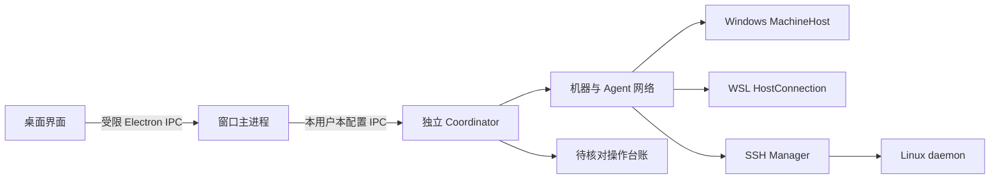
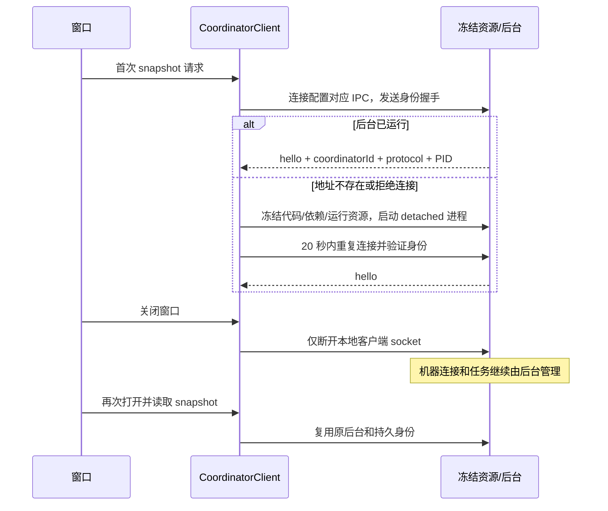

# M02 中央协调后台设计

更新日期：2026-10-14。代码基线：桌面源码 `0.6.0-alpha.18`，根 CLI 包 `0.1.0`；Windows 已发布便携版仍为 `0.5.0`。本模块已实现独立后台和本地 IPC，Windows 候选生命周期与普通 EXE 已验收。测试结论见 [本模块测试报告](test-report.md)。

## 1. 用途与交付功能

中央协调后台（Coordinator）是这份 AgentBridge 配置的管理进程。它保存机器、Agent 节点、协作关系和待核对操作，连接 Windows、WSL、SSH 机器，并把用户需求转发到指定节点。它自身没有模型，不负责推理；主 Agent 由用户从已接入的原生 Agent 节点中指定。

| 功能 ID | 用户可看到的行为 | 当前状态 |
| --- | --- | --- |
| M02-F01 | 打开看板自动连接或启动后台；相同配置复用一个后台 | 已实现，受控测试通过 |
| M02-F02 | 关闭窗口后后台保持运行；重开后继续读取原机器和任务 | 已实现；Linux 开发环境有真实记录，Windows 候选主要流程已实测 |
| M02-F03 | Windows、WSL、SSH 节点由同一后台管理，离线机器不替代成其他机器 | 已实现，路由回归通过 |
| M02-F04 | 提交前保存原请求，响应中断后显示待核对操作，通过原 ID 恢复 | 已实现，台账回归通过 |
| M02-F05 | 只允许持有本用户、本配置后台身份的本地客户端调用 | 已实现，错误身份拒绝测试通过；Windows ACL 实测未完成 |
| M02-F06 | 便携程序临时目录被清理后，后台仍有完整代码、依赖和运行资源 | 已实现资源冻结；当前 Windows 候选主要流程已验收 |
| M02-F07 | 主动“停止后台并退出”与关闭窗口区分 | 设置页入口与确认已实现；IPC 停止和界面模拟通过，真实包结果单列 |

这里的“相同配置”指同一个 `userData` 目录。不同测试配置目录拥有不同后台身份和 IPC 地址，不能混用任务。

## 2. 模块边界



- 界面负责展示和输入，不能直接操作文件、启动 SSH 或执行原生 Agent。
- Coordinator 拥有 `AgentNetwork`、`SshManager` 和 `pending.json`，不随窗口生命周期创建第二份执行台账。
- 机器/节点身份、路径与任务路由由 [M03 机器与 Agent 节点](../03-machine-network/design.md)负责。
- SSH 认证、安装和连接状态由 [M04 SSH 接入](../04-ssh-access/design.md)负责。
- 远端进程、收据和事件由 [M05 Linux daemon](../05-linux-daemon/design.md)负责。
- 会话执行和原生模型配置属于原生适配模块；Coordinator 不修改模型、供应商或账号设置。

Coordinator 把 SSH 状态作为完整观测合并到机器目录：缺失 error/connectionError 表示清除旧连接错误，变更同步持久化。快照合并同时保留当前机器 RPC 失败；SSH 通道在线不能覆盖失败快照的离线状态。机器、节点、历史和待核对操作身份不变。

## 3. 身份、进程与数据

| 对象 | 身份或归属 | 存储/用途 |
| --- | --- | --- |
| 配置目录 | `app.getPath('userData')`；开发可用 `AGENTBRIDGE_DESKTOP_PROFILE` | 后台、机器和台账的共同根目录 |
| Coordinator | 首次生成持久 UUID `coordinatorId` | `coordinator-identity.json` |
| 本地认证秘密 | 随身份生成的 32 字节随机令牌 | 只放本用户私有身份文件；不是用户需填写的接入凭据 |
| IPC 地址 | 配置目录绝对路径的 SHA-256 前 32 位 | Windows 命名管道；Linux 私有临时目录中的 socket |
| 后台进程 | 当前 IPC 服务持有者 | `coordinator-status.json` 中 PID 用于诊断，不能仅凭 PID 杀进程 |
| 冻结资源 | 桌面版本 + 后台代码摘要 | `coordinator/versions/<version>-<digest>/` |

```text
<userData>/
  coordinator-identity.json    # coordinatorId + 私有认证令牌，不导出到诊断报告
  coordinator-status.json      # PID、协议、版本、启动时间
  coordinator.log              # 启动与后台诊断
  coordinator/versions/.../    # dist、CJS 模块、生产依赖、Linux 离线包
  coordinator/runtime/.../     # 需要时保存 Electron/Node 运行资源
  desktop.json                # 主题、旧 WSL 偏好；不含 SSH 密码
  machines.json               # 机器和旧连接/实例目录
  agent-network.json          # 节点、协作关系和节点请求
  pending.json                # 原请求与控制操作的核对台账
  ssh-connections.json        # 非秘密 SSH 配置及连接操作收据
  runtime.json                # 只读诊断摘要
```

Linux 私有目录为 `0700`，身份文件/socket 为 `0600`。Windows 目录用 `whoami.exe` 获取当前 SID，再用 `icacls.exe` 移除继承、授予该 SID 权限。本地管道仍要求协议和令牌握手；当前代码没有另行设置命名管道 DACL，不能把目录权限测试说成管道 ACL 实测。

## 4. 正常启动与窗口关闭



新 EXE 的界面与已运行的后台可以属于不同发布版本。只要当前 profile 身份和 IPC 协议握手通过，新窗口可读取该旧后台，也可从自己的“设置 → 后台运行 → 停止后台并退出”停止它；不需要旧 EXE 或旧窗口。停止后再次打开新 EXE，原配置身份保留，后台从新 EXE 的冻结资源启动。此操作不会自动把正在运行的后台替换成新版本；侧栏版本当前来自后台 preferences，连接旧后台时可能仍显示旧版本。

首次后台启动发生在首次业务请求时，不是窗口构造时。已存在地址只允许连接，不能因握手失败自动新建后台或删除未知进程。Linux 残留 socket 只有确认无服务、是当前用户 socket 后才移除。Windows 同名管道已占用时直接拒绝第二个服务。

资源冻结先写临时目录，完成后原子改名；复制根 `dist`、后台 CJS 文件、`package.json` 及其生产依赖闭包，并复制 Linux 离线包。真正启动的是冻结副本中的 `coordinator.cjs`。Electron 的 ICU/V8 等运行资源由 `workerRuntime` 另存，避免便携启动器清理临时目录后后台无法执行。

## 5. 本地 IPC 与业务 API

本地 IPC 使用 UTF-8 JSON 行，协议版本为 `2`，不同于远端 daemon 的四字节长度帧。`StringDecoder` 保留跨 chunk 的完整中文和 emoji。未经握手不能调用业务；握手限时 5 秒。单条请求最大 1 MiB、每客户端最多 64 项在途请求，输出缓冲达到 8 MiB 时关闭通道。

服务层的真实入口：

| `CoordinatorClient.request(method, params)` | 参数/结果 |
| --- | --- |
| `call` | `{method,params}`，返回 `{ok,result}` 或 `{ok:false,error}` |
| `preferences` / `savePreferences` | 读取/保存 `theme`、`distribution`、`directory` |
| `runtimes` / `machines` | 查询平台/发行版或机器目录 |
| `pending` | 返回 `pending` / `unknown` 操作 |
| `recoverPending` | 返回 resolved、可选 remaining/items；核对原回执或严格匹配的未派发意图，不重发需求 |
| `shutdown` | IPC 层停止服务；普通 `service.dispatch` 不接受此方法 |

最小调用示例（仅示意程序内契约，不是 HTTP 接口）：

```js
await client.request('call', { method: 'snapshot', params: {} });
await client.request('call', {
  method: 'nodeRequest',
  params: { nodeId: 'node-example', requestId: 'req-example-1',
    op: 'submit', message: '阅读 README 并总结', workspace: '/srv/example' }
});
await client.request('recoverPending');
```

普通客户端调用限时 75 秒；`machine.connectSsh` 为慢链路安装留出 20 分钟。超时表示回应未确认，不表示需求没有执行。

## 6. 写操作与中断处理

`ipc` / `nodeRequest` 中 `submit`、`continue`、`verify`、`reply`、`cancel` 必须带稳定 ID。服务先通过机器路由补齐原机器，再写 `pending.json`，最后执行。台账键由机器 ID 和请求/操作 ID 共同组成。

| 台账状态 | 含义 | 后续行为 |
| --- | --- | --- |
| `pending` | 本地已记录，等待执行回应 | 保留原参数和原机器 |
| `confirmed` | 收据可核对 | 可显示原任务，不等同于任务已成功 |
| `rejected` | 确认在业务校验阶段被拒绝 | 显示原因，允许修正后新操作 |
| `unknown` | 可能已执行，但未核对到收据 | 查询原请求；保留原节点/共享目录占位，独立节点可工作；来源不全时保留整机限制 |

已有未知操作不能用相同 ID 替换内容，也不能靠切换实例或机器来源消除警告。恢复仅在原台账时间、参数和状态未被其他调用更改时更新结果，避免覆盖并发提交。未确认记录全部保留，已解决历史只保留最近 100 条。

Windows OpenCode 的共享运行资源 INVALID/MISSING 可发生在上下文创建前。仅原 submit 的机器/节点/请求 ID/内容指纹对应，原中央 intent.dispatched===false、无任务/会话绑定且无 nodeJob 时，才将该条旧 unknown 对账为 rejected；落盘前再次核验。新提交同样按这一证据分类，不能只凭错误码或一次 not_found 解除占位。原参数/ID/历史保留。查询返回固定原因，任意远端错误正文不下发。[需求与验证](../../iterations/I06/runtime-recovery.md)。

## 7. 已知限制与后续设计

已实现但已通过候选主要流程：便携包后台冻结、关闭/重开窗口、明确停止及真实 SSH 原任务恢复。Windows 跨用户管道 ACL 等专项边界未测。2026-10-10 的已有真实记录来自 Linux 开发端，不能替代 Windows 新包。

尚未完成：后台版本升级/兼容迁移、完整连接故障指标验收。设置页已提供“仅关闭窗口”和“停止后台并退出”；后者展示连接/协作暂停与远端任务保留的确认，确认时暂停界面轮询，避免退出过程中再次拉起后台。新客户端可以附着到已有协议兼容的后台；当前附着握手未强制核对源码版本一致，发布验收应检查实际后台版本，不能仅看窗口版本。

资源缓存摘要包含后台 CJS、根 `dist` 和 `package.json`，没有逐一纳入依赖目录与 Linux 包内容。发布时仍需核对冻结资源和离线包，不将缓存命中视为完整发布校验。

## 8. 代码定位与维护

| 职责 | 代码 |
| --- | --- |
| 本地服务/身份/端点 | [coordinator.cjs](../../../desktop/electron/coordinator.cjs) |
| 客户端复用/启动/超时 | [coordinator-client.cjs](../../../desktop/electron/coordinator-client.cjs) |
| 资源冻结 | [coordinator-runtime.cjs](../../../desktop/electron/coordinator-runtime.cjs) |
| 路由服务与操作台账 | [coordinator-service.cjs](../../../desktop/electron/coordinator-service.cjs) |
| 当前用户目录保护 | [private-directory.cjs](../../../desktop/electron/private-directory.cjs) |
| 窗口生命周期/退出动作 | [main.cjs](../../../desktop/electron/main.cjs) |

修改身份、IPC、生命周期或台账行为时，需同步本设计、[测试报告](test-report.md)、相关模块接口与当期迭代记录。变更来源：[I06 开发项 A01/A05/A06](../../iterations/I06/development.md)、[当前进度](../../iterations/I06/progress.md)；这些来源不是阅读本模块的前提。

## I06B 图元数据事务

窗口沿用 call(method,params) 的认证 IPC，不新增 HTTP 控制入口。中央接受 collaborationOperation、graphLayout、saveGraphLayout、graphLayoutOperation、graphPending。关系与 relationOperations 同存在 agent-network.json；布局与自己的收据存在 graph-layout.json。两者写临时文件、flush 后 rename，成功后才替换内存状态。损坏布局保留 corrupt 副本并用默认位置，不覆盖关系/历史。

图写入另用 graph-pending.json，先落意图再调用业务；关系/layout 两个 lane 分开，避免布局错误阻断授权或释放原任务占位。同 ID 的 payload 内容摘要忽略对象键顺序；不同内容拒绝。pending/unknown 原操作只查询对应业务收据，未找到不重写；同 lane 新 ID 被 GRAPH_UNCONFIRMED 拒绝。明确校验拒绝记录 rejected；意图未落盘则 GRAPH_INTENT_FAILED，业务调用数为零。graphPending 提供所有窗口的未确认原操作。它独立于 pending.json 的任务/控制恢复，不把图 ID 当作 taskId。

布局只含 version=1、layoutRevision、机器组/节点坐标和 viewport。已知机器/节点、坐标有限且绝对值不超过一百万、节点相对坐标非负、zoom 0.25–2、组≤1024/节点≤4096 均校验；不允许 role、成员、目录、模型、秘密或额外字段。布局修订冲突为 LAYOUT_REVISION_CONFLICT。完整参数见 [协议](../../protocol.md)，代码：[图台账](../../../desktop/electron/graph-operations.cjs)、[布局存储](../../../desktop/electron/graph-layout.cjs)。


原任务 recoverPending 只查询原 machineId/requestId；原 daemon 的持久记录返回明确执行前 AGENT_UNHEALTHY 时，中央核对为 rejected，不调用 submit。缺收据、网络未知与其他模糊失败保持 unknown。与图收据、控制 confirmed 及任务终态分开。

## alpha.9 节点管理入口与意图

受限方法新增 manageNode/nodeOperation；旧 attachNode 入口转成相同的受控节点事务。操作前核对 machineId 和来源机器 pending.json，未知原生提交/回复/取消阻止节点变更。GraphOperationJournal 的 node lane 与 relation 互锁，layout 独立；意图先落盘，确认后按原节点收据完成，未知仅查询原 ID。确定拒绝也可按原 ID 查回；落盘故障仍保留未知。snapshot.nodeManagement 是新增能力标志，旧中央无此字段时新界面不写节点事务。原认证与 IPC 协议不变，详见 [节点管理](../../iterations/I06/node-management.md)。

## I06C 当前机器管理与观察恢复

中央服务为 SSH 管理加入稳定原 ID、修订、来源准入锁和秘密字段白名单。危险动作核对来源全部非终态任务、实例/节点/上下文/目录锁及原 native pending；重连仅恢复观察，不因任务 unknown 禁用。machine、node、relation 未知共享屏障，layout 独立；查询原 SSH 收据可按原 ID 补齐网络本地撤权，跨文件中断不重发远端任务。 完整接口、事务、当次实际证据与未完成范围见 [6C 首批](../../iterations/I06/machine-management.md)。

## 当前维护与原操作恢复（alpha.13）

machine.maintainDaemon 经过稳定操作意图、来源机器准入和配置白名单，再交给 SSH 管理执行；machine.operation 只核对原维护。机器/node/relation 的 unknown 共用元数据屏障，layout 独立；直接 MCP 原生准入也检查该来源机器。pending.json 损坏或无法持久化时拒绝执行，不能当作空表。表单答案仅保留摘要与 [redacted]，恢复依赖原目标/ID，不持久化敏感答案或任意原生返回正文。

实现入口：[coordinator-service.cjs](../../../desktop/electron/coordinator-service.cjs)。需求、分层证据及未测范围见 [I06C 收尾](../../iterations/I06/final-delivery.md)。

## 未确认操作的执行资源范围（alpha.20 候选）

Coordinator 以原台账、AgentNetwork 请求意图和持久实例归属解析节点及目录。来源明确时，同节点继续阻塞，其他节点仅在共享目录时冲突；缺少来源/节点/原目录依据时保留整机或全局保护。原请求不被解除或迁移，独立节点可以新建及续聊。初步准入之后，在上下文完成真实目录解析、即将调用原生任务前再次检查，覆盖 Windows/WSL 路径别名和新建上下文。相同 ID 的例外同时核对来源机器和内容，不能靠跨机器同名 ID 绕过保护。机器维护、移除和节点管理仍按原整机策略。

上下文准备及续聊读取/协作 scope 准备失败，在发送原生调用之前保存 preparationRejection。原 requestId、输入指纹、最终有效指纹、来源和未派发状态匹配，且无任务/会话绑定和在途节点 job 时，可把原 unknown 对账为 rejected；落盘前重查证据。已拒绝请求的同 ID 重试返回原拒绝，修好配置后由用户新建请求。仅本次查询报错不产生拒绝证明。[需求与验证](../../iterations/I06/pending-isolation.md)。
