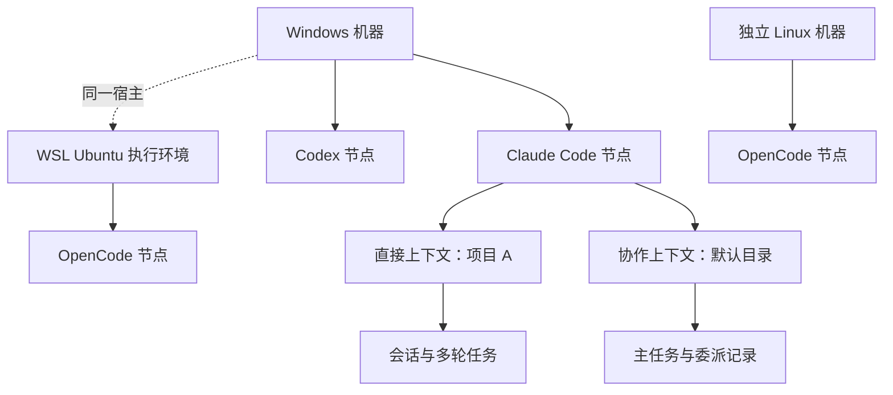
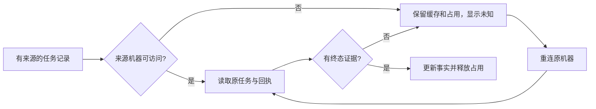

# M03 机器、Agent 节点与执行上下文设计

## 连接身份与节点管理准入

M03-F01：dsh.status/configure按原machineId/nodeId/adapter验证归属；从原adapter+显式origin唯一保存回应核对connectionId后原子保存dshBindings。绑定保存失败报告部分结果，原选择不变；扫描遵循原选择，不因枚举先后或更新时间选回旧origin。连接切换后需显式接入，原上下文不改绑。 [完整设计与失败流程](../../iterations/I08/connection-identity-node-scope.md)。

OpenDesk CLI按目标环境当前PATH发现；已知扩展名为空的npm入口使用原安装和后台Node。Windows Desktop只读原生setting中的网关地址与本用户网关身份，调用已有接口核对，不启动桌面程序或写原生配置；网关不可用时显示原因。CLI/Desktop节点独立，桌面默认目录沿用原生设置。 [实现与证据边界](../../iterations/I08/opendesk-existing-interfaces.md)。

M03-F02：OpenCode 显式接入遇原服务已退出时，仅启动原 context 内的原生服务，再核验原 Agent；本次新增恢复不放在快照或原请求读取分支。接入准备失败原子记录本地 attach 拒绝收据，原图意图只按匹配证据收敛；不改变原任务、Session 或 unknown 门禁。恢复不改协议或原生模型配置。详见[恢复契约与边界](../../iterations/I08/opencode-oom-recovery.md)。

## alpha.36整合边界

M03-F02：alpha.36整合基线含公开alpha.35执行资源级保护/原查询反馈与所有工作区增量；OpenCode宿主和原管理拒绝恢复并存，原身份/Session/unknown不迁移。精确收录alpha.34/35 daemon清单，客户端升级不自动替换远端。[完整交付](../../iterations/I07/alpha36-delivery.md)。

OpenCode专用发现从通用扫描中仅接受自身adapter，避免DSH服务健康时被误选为OpenCode；缺失原工具不选择其他健康Agent代替。[发现共存回归](../../iterations/I07/agent-row-configuration.md)。

## 节点配置的来源绑定

M03-F02/F05：配置入口属于机器上的原Agent节点。MCP读写携带原nodeId，由后台派生所属机器/adapter；DSH读写使用弹窗固定machineId/adapter，读取仅采用原executable对应的服务条目，不能将同机另一服务当默认连接。关闭再开另一节点清空输入；本次不新增RPC或持久数据格式，不移动节点/任务/原请求身份。[实现与边界](../../iterations/I07/agent-row-configuration.md)。

## 调用方获准连接视图

M03-F02：list_agents不读取全网身份供调用者选择，仅按原scope节点与当前关系投影。当前主快照完成后再次读取关系，撤销目标或换主不会返回旧关系目标；非主无目标，caller区分leader/member/unassigned，节点来源和能力仍取原快照。没有节点/角色迁移、全网发现或接入行为。[完整字段、流程与范围](../../iterations/I07/agent-connections.md)。

## 发现提示与管理占位

M03-F02/F05：DSH Desktop/Web只缺服务连接时带errorCode=DSH_CONNECTION_REQUIRED，节点投影configuration_required，不能开始执行。成功扫描后不再找到的纯发现提示不继续展示；仅在未接入/未显式管理、无目录上下文、原请求与主从角色时隐藏投影，持久nodeId不删除。任何原请求、上下文或管理状态仍保留身份与占位。扫描不触发接入、模型或未知请求重放。[完整规则与分层验证](../../iterations/I07/agent-management-recovery.md)。

## OpenCode 宿主生命周期

M03-F02：MachineHost 的 OpenCode 上下文工厂同步返回完整的 call/close 宿主；同一原 contextId 和 executable 继续路由到原目录。源码与本地 config.2 已包含，公开 alpha.35 的冻结源码未包含；[实现与验证](../../iterations/I07/opencode-host-lifecycle.md)。

## DSH Desktop / Web 当前行为

M03-F02/F05：两个DSH服务adapter各有独立节点、配置文件连接身份和目录上下文；节点配置按所属机器转发dsh.status/configure并执行维护准入。不同origin形成新身份，原上下文/executable/Session保留；损坏单连接不阻断其他工具发现。 [完整契约与证据](../../iterations/I07/dsh-desktop-web.md)。公开alpha.34不包含该能力；本地.dsh.3候选已构建并验证真实连接，Desktop模型两轮均RATE_LIMIT，独立SSH未验，见[本地交付](../../iterations/I07/dsh-exe-delivery.md)。

M03-F02：CLI版本探测识别到Distributed Shell/Dancer's shell时忽略该无关同名程序（含退出1、stderr输出），继续寻找真实DSH；真正工具失败仍保留PATH选择。Linux发现`~/.dsh/profiles/web/package.json`（或`DSH_HOME`下同路径）且包名为`dsh-profile-web`时，仅显示未配置Web服务提示；Windows Desktop安装提示继续按实际EXE与包名核对。已有服务配置（包括停用）不再补安装提示，不启动服务、不读取原生凭据。安装提示不能执行，配置服务后按原adapter+origin建立连接身份；历史和unknown保持。[本轮复现与验证](../../iterations/I07/dsh-desktop-web.md#同名程序与服务发现修复)。

中央hello公布`opencode-dual-api-v1`与`team-context-mcp-v1`语义能力；新前台遇到仍在运行的alpha.33后台时要求显式停止并重开，设置/停止入口保留。避免新EXE复用旧2.x独占后台后仍拒绝1.x或缺MCP/材料方法；原任务、收据和unknown不改。

## OpenCode 1.x / 2.x 兼容修复

M03-F01/F02/F03：原 PATH 与原安装核验不变；OpenCode 可识别 1.x/2.x 都可进入实际服务契约检查，未知主版本继续明确拒绝。只读原对象/收据和按机器占位规则不变。 [需求、实现、验证与未测边界](../../iterations/I07/opencode-v1-compatibility.md)。

## 当前维护进度与持久化边界

M03-F04：机器目录通过已有atomicWrite有界重试/fsync/原子替换，永久失败保留完整原文件并仅清当前tmp。 [完整设计、实测与边界](../../iterations/I07/maintenance-persistence.md)。

## 历史版本准入与管理作用域

M03-F01/F02/F03：安装健康与执行兼容分开，OpenCode接受可识别的1.x与2.x，其他主版本在启动前拒绝且不新建执行上下文。version_incompatible投影connected=false/available=false及执行委派关闭；原存储关联和历史保留。管理按机器隔离，原已派发请求查询不被当前版本门禁遮蔽。 [版本准入沿革](../../iterations/I07/version-management-recovery.md)、[1.x/2.x 兼容修复](../../iterations/I07/opencode-v1-compatibility.md)。

读取归属已失配的旧会话只允许查看，即使宿主保有原生Session也不宣告可继续；不改其Agent、ID或Session，正常绑定和真正legacy能力保留。

## 当前历史详情读取与错误作用域

M03-F04/F05/F06：task/conversation按backend自身快照确认来源，单一来源才读详情；不凭空/旧targetAgent猜根OpenCode。MachineRouter仅对明确未找到加同机器同ID历史回退，内嵌异机身份拒绝。历史非终态仅投影unknown且不可继续，不改保存记录或原Session。 [设计、兼容与实际证据](../../iterations/I07/history-detail-recovery.md)。

Windows官方Codex npm启动器直接解析原包内原生EXE，隐藏参数不再丢失于JS二次spawn；节点仍记录原JS身份，缺原二进制拒绝，未改账号/模型。Claude空闲snapshot不定期重跑版本/auth，显式检查与提交前检查保留。[复现与验收](../../iterations/I07/desktop-polling.md)。

## SSH持久拒绝恢复

M03-F04/F06：原节点submit/continue的双指纹、原agent/续聊父目标、机器/daemon/profile与远端参数摘要匹配且无任务绑定/在途job，才把dispatched改false并持久daemonRejection。写失败回退内存，重开重核缓存，其他unknown不释放。 [完整需求、状态与验证](../../iterations/I06/daemon-rejection-recovery.md)。

## Windows未派发与持久化恢复

M03-F04/F05：saveNetwork与共享atomicWrite统一原子保存，分享锁最多重试6次。派发前保存失败回滚内存dispatched=false，派发后保存失败保留unknown；历史EPERM仅接受本profile的精确UUID临时文件rename形状和原未派发指纹证据。 [需求、状态图、验证与交付](../../iterations/I06/windows-start-persistence.md)。
## Windows原请求上下文恢复

M03-F04/F05：node-contexts允许连接准备阶段尚无agentId的记录。按Agent直达仅接受非空白字符串ID；按task/Conversation查owner后亦须有有效targetAgent。无Agent的request只读搜索legacy及已分配Agent的上下文，未完成行不参与归属匹配。[完整修复与证据](../../iterations/I06/windows-context-recovery.md)。

## 小队续接与身份准入

I07A/B基础继续适用，完整I07C与I06C未准出；当前发布状态见[迭代发布记录](../../iterations/release-ledger.md)。

| 功能 ID | 功能 | 当前状态 |
| --- | --- | --- |
| M03-F08 | 外部智能体登记与资源绑定 | 源码已实现；分层证据见本模块报告 |
| M03-F09 | 小队原上下文续接与新执行身份 | 源码已实现；证据层级见本模块报告 |

新小队续接核对原节点/Conversation所属上下文，重新配置独立成员scope，并要求MachineHost的teamContinuation确认；旧后台在派发前拒绝。保存每轮teamSessionId，普通未带新成员身份的续接不能接管小队原会话。目录/机器/节点准入、原请求去重及旧主从范围继续适用；不使用别名释放unknown。

I07A/B的登记、成员/文档权限、公共消息、版本任务和授权交接继续按[I07B完整行为](../../iterations/I07/task-handoff.md)执行；新流程、异常、预算、接口和源码见[I07C首批交付](../../iterations/I07/automation.md)。以下原功能继续适用。

桌面源码版本以工作区 `desktop/package.json` 为准，稳定历史 Windows 便携版为 `0.5.0`；当前发布状态见[资料入口](../../README.md)。SSH 的源码交付和 Windows 发布验收分别标记，不能以源码版本代表发布完成。

## 1. 用户得到什么

用户先看到机器，再看到机器上安装的 Claude Code、OpenCode、Codex、Hermes、Pi、DSH 等 Agent 节点。后三种是 alpha.28 后未发布源码扩展，详情见[原生扩展专项](../../iterations/I07/native-agent-expansion.md)。接入节点不要求项目目录、模型或供应商。发送任务时才选择执行目录；不处理现有项目时可留空，由后台创建默认目录。

一台 Windows 电脑和它的 WSL 是两个执行环境，但 WSL 标明所属 Windows 宿主。通过 SSH 接入的 Linux 是独立机器，文件路径、任务和故障归属于它自己。

| 功能 ID | 功能与可验收表现 | 当前状态 |
| --- | --- | --- |
| M03-F01 | 没有项目或会话也能显示机器；Windows、各 WSL 分开显示 | 源码已实现；Windows/WSL 已真实验证 |
| M03-F02 | 自动发现同机多种工具，选择后一次接入，不询问模型或项目 | 源码已实现；安装可调用不等于账号推理可用 |
| M03-F03 | 重扫、重开、启动脚本解析后保持节点归属，不按项目产生新节点 | 源码已实现；受控测试及已发布版验证 |
| M03-F04 | 任务创建私有执行上下文；沿用原生设置，历史项目实例保留 | 源码已实现；Claude/OpenCode 真实验证，Codex 有原生限制 |
| M03-F05 | 所有查询、续聊、回复和取消回到原机器、原后端 | 源码已实现；同名 ID 隔离受控验证 |
| M03-F06 | 同工具当前/历史节点串行；同一 Windows/WSL 共享目录互斥；一台离线不拖垮其他机器 | 源码已实现；离线缓存显示为不确定 |
| M03-F07 | 导入旧目录、项目实例和历史，不改原生 Session ID | 源码已实现；兼容入口继续保留 |

SSH 登录、凭据和安装见 [M04](../04-ssh-access/design.md)，Linux daemon 见 [M05](../05-linux-daemon/design.md)。本模块将已经连接的远端纳入统一目录；不负责服务器登录。

## 2. 核心概念

| 对象 | 含义 | 是否绑定目录 | 身份依据 |
| --- | --- | --- | --- |
| Machine | 可独立发现、启动工具的执行环境 | 否 | 本机持久 UUID、WSL 分发名称、SSH 经过握手确认的远端身份 |
| Tool Connection | 机器上某个可执行工具的安装及接入记录 | 否 | 机器 ID + 可执行路径；Windows 路径大小写归一 |
| Agent Node | 每台机器每种工具的当前命令入口；旧安装节点保留历史引用 | 否 | 首次按机器/适配器/路径生成；升级沿用已有角色或已接入节点的 nodeId |
| Execution Context | 某节点在某个目录、直接或协作模式下的私有运行配置 | 是 | 节点 + 真实目录 + 模式的摘要 |
| Instance | 兼容旧核心协议的后端执行实例 | 是 | 原始 backendId，中央视图增加机器前缀 |
| Conversation / Task | 会话与一轮执行 | 继承上下文 | 原后端 ID；中央视图带来源机器 |

这里的“Agent”是工具节点，例如这台电脑的 Claude Code。模型和供应商由该工具自己的配置决定，不能成为连接节点的必填选项。



## 3. 职责与调用边界

### 当前连接能力与恢复

M03-F02/F04/F05：节点snapshot投影八项connectionCapabilities及capabilitySource；静态已审核适配器为上限，显式false/null、来源不匹配只能收窄，未知适配器不能借名称或availability开放。execution/delegation/bridgeMcp分别表示执行、普通被委派、调用Bridge；不改稳定节点/机器身份或原请求路由，不记录敏感安装/账号配置。 当前为未发布源码；[完整能力/错误/兼容契约](../../iterations/I07/connection-capabilities.md)及[本模块报告](test-report.md)记录实际范围。

`MachineRouter` 管理机器目录、工具记录、后端实例导入、路径和来源路由。`AgentNetwork` 在其上增加用户节点、节点请求台账和协作关系。每台机器上的 `MachineHost` 管理工具发现及私有上下文，再调用原生适配器。

发现与 MachineHost 派发共享同一受校验静态注册表，稳定 adapter ID 为 `claude`、`opencode`、`codex`、`hermes`、`pi`、`dsh`。导入快照按实际 adapter 取名称，不将未知工具标为 OpenCode。Windows npm 入口按注册路径解析，Pi 兼容新旧包作用域；原上下文选中安装失效不替换成另一套程序；新工作使用当前入口并在安装变化时建立独立上下文。安装健康仅代表版本命令可调用。扩展代码接口见[开发指南](../../custom-agent-development.md)。

### 小队节点的静态接入资格

Coordinator 在现有 `snapshot.nodes` 中投影可选 `teamCollaboration`，依据[静态注册表](../../../desktop/electron/builtin-adapters.cjs)判断原生小队接入资格。它独立于普通直接会话的 `executionSupported`，由中央生成，不修改原 nodeId、machineId、已接入状态或持久化节点格式。这是本地适配能力门槛；AgentNetwork 没有新增远端能力采集或持久化，也不能据该投影推定目标机器已经具备小队通信或原会话续接能力。实际执行仍由原 MachineHost `context` / `scope` 及 `teamContinuation` 确认来源后台支持情况。

| 节点适配器与字段 | 新小队接入规则 |
| --- | --- |
| Claude Code / OpenCode / Codex，旧节点缺少该字段 | 按既有静态声明兼容手动小队接入，不能把缺字段一律视为不支持；自动续接仍只开放已验证的 Claude |
| 原三种工具，传入节点确有显式 `false` | 保留拒绝，不能按工具名称覆盖 |
| Hermes / Pi / DSH | 支持直接会话，不开放原生小队；可选字段伪造为 `true` 也不能授予能力 |
| 未知或未注册适配器 | 不推定支持；仅有 `executionSupported` 或伪造 `true` 均不足以准入 |

界面[节点选择器](../../../desktop/src/TeamNativeNodeSelect.tsx)同时过滤未接入、已移除和已被当前安装替代的节点；登记与独立手动执行下拉共用门槛，历史误登记成员及原尝试仍保留供阅读。[TeamSpace](../../../desktop/electron/team-space.cjs)在原收据幂等分支之后，再对新登记和既有成员的新执行校验静态能力。拒绝发生在认领工作项、消耗自动预算、保存新尝试或派发之前；查询原请求或同 ID 恢复已有执行不经过这项新准入，原身份、撤权及 unknown 保护照常生效。外部 MCP 成员仍从自身入口工作。需求与实际证据见[交付说明](../../iterations/I07/native-integration-guards.md)。

| 组件 | 输入 | 输出与责任 |
| --- | --- | --- |
| MachineRouter | snapshot / discover / ipc 等请求 | 汇总各机器快照，给后端对象加来源前缀，保持目录占用 |
| AgentNetwork | attachNode / nodeRequest / saveCollaboration | 面向用户的节点身份、请求去重、节点忙碌状态 |
| MachineHost | discover / context / scope / ipc | 扫描本机工具，按上下文选回原后端，接入 MCP |
| 原生适配器 | 某上下文的任务、控制或查询 | 启动并观察 Claude/OpenCode/Codex 的原生执行 |

Windows 的工具在 Windows 启动，WSL 的工具在选定分发中启动，SSH 工具在远端 daemon 内启动。用户任务不会因为当前机器筛选变化而迁移到其他机器。

## 4. 数据归属与文件

下列文件放在中央 profile 或机器后台自己的状态目录，实际目录由部署端提供。

| 文件 | 所属端 | 内容与维护原则 |
| --- | --- | --- |
| `machines.json` | 中央 Coordinator | 本机、WSL、已接入机器、工具连接、兼容实例；version=1 |
| `machines.json.before-nodes.json` | 中央 Coordinator | 首次引入节点时的旧目录备份，不作为当前配置读取 |
| `agent-network.json` | 中央 Coordinator | nodes、collaboration、requests、delegations；version=1 |
| `node-contexts.json` | 各机器 MachineHost | contextId、nodeId、adapter、executable、workspace、backend agentId |
| `node-contexts/<contextId>/` | 各机器 MachineHost | 原生适配器的任务、会话、MCP 描述与私有状态 |
| `sessions/<nodeId>/` | 各机器 MachineHost | 未指定工作目录时的默认目录 |

目录及节点 JSON 使用临时文件写完后替换。它们是中央/机器后台拥有的数据，前端不能自行改写。原生工具的账号、模型、供应商配置继续属于原工具。

## 5. 发现和接入流程

1. 中央先确保本机存在；Windows 再枚举 WSL 分发，并保留曾配置但当前不可用的分发身份。
2. 并行获取各机器快照；每台机器独立超时，当前默认为 10 秒。
3. 工具扫描按目标用户 PATH 顺序选择第一个已安装的可执行命令，只探测其版本；探测失败报告该入口异常，不悄悄切换到旧安装或版本号更高的安装。PATH 没有入口时才检查默认目录及 Linux fnm/nvm/Volta/asdf/mise/Cargo/Bun/pnpm/npm prefix 等目录；后备探测允许跳过损坏安装。扫描不 source Shell rc、不解释 alias/function、不写原生配置、不发模型 Prompt。显式指定原安装的二次核验仍只验证原路径。
4. 每台机器每种 adapter 只展示一个当前节点。优先保留原主角色、原子角色、已接入及已有节点的身份；新发现更新当前 executable/version，不按版本号排序。其他旧节点写 supersededBy，保留原 ID、接入记录、请求、上下文和历史，概览/图/添加列表隐藏它们。不自动迁移旧授权或收据，也不创建项目实例。
5. 用户接入节点时重新核对可执行工具仍存在且可调用，记录 connected。
6. 真实发送任务才建立执行上下文，并核对目录真实存在。

机器列表在后台首次使用时枚举，并发首次读取合并；工具在该机器首次成功读取快照后尝试一次扫描。实时 snapshot 不按时间重新枚举 WSL 或启动工具版本探测，失败探测也不在后续快照自动重试；用户明确点击“扫描”才重新枚举环境并重扫目标工具。安装/卸载/升级工具或新增 WSL 后需扫描；实际执行前原安装核验保留。失败快照短暂退避约 5 秒，`snapshotJobs` 合并同机器正在进行的读取。详见[桌面空闲专项](../../iterations/I07/desktop-polling.md)。

`healthy` 表示安装/调用检查可用；`connected` 表示用户接入过节点；真实模型能否回复由任务结果验证。账号拒绝不能被扫描成功掩盖。

SSH 工具列表来自远端实际 daemon 的共享扫描器。旧兼容 daemon 复用不会自动换代码；alpha.19 的用户目录覆盖需要在原 SSH 机器“后台维护 → 升级后台”后重扫，不能仅更新客户端或重建机器来推定生效。[完整范围](../../iterations/I06/linux-cli-discovery.md)。

OpenCode 的 core 二次检查复用同一共享扫描器，任务上下文核验原 executable，不重新按 PATH 选另一安装；原路径删除/损坏仍拒绝，OpenCode HTTP 入口当前区分 1.x/2.x 原生协议。Windows 私有配置使用可写文件句柄 flush 与原子替换，Linux 继续目录 flush。[二次发现专项](../../iterations/I06/opencode-discovery.md)。

## 6. 任务路由与目录互斥

中央显示 ID 形如 `machineId::backendId`，例如 `local-demo::task-001`。机器前缀用于来源选择，发往原后端时去掉前缀。原生 Session ID 保持原样。

请求显式 machineId 与对象前缀冲突时返回 `WRONG_MACHINE`，不会猜另一台机器。相同 raw taskId 在不同机器上属于不同对象。

| 路径情况 | 当前处理 |
| --- | --- |
| Windows `D:\project` | 原样交给 Windows；占用键与本机 WSL `/mnt/d/project` 对齐 |
| 为 WSL 选择 Windows 磁盘目录 | 转为选定分发中的 `/mnt/<盘符>/...` |
| `\\wsl.localhost\Ubuntu\home\...` | 只允许转给 Ubuntu；分发不符拒绝 |
| SSH `/mnt/d/project` | 作为远端 Linux 目录，不与本地 D 盘共享占用 |
| SSH Windows 格式路径 | 不自动转换；由远端目录验证返回真实错误 |

互斥有两个层次：当前节点汇总同工具历史节点上的非终态任务和未确认请求，历史节点的在途准备/管理锁也阻止当前入口并发；pending journal 的原历史节点占用覆盖同机器同 adapter。目录占用阻止同一项目在 Windows/WSL 的其他实例执行。检查全部实例和任务占用，不能只用前端显示的前 100 条任务。

## 7. API 使用示例

以下是中央服务已经暴露的业务调用；示例 ID 为占位值，不是运行环境身份。

```json
{"method":"attachNode","params":{"nodeId":"node-demo","machineId":"local-demo"}}
```

```json
{"method":"nodeRequest","params":{"op":"submit","nodeId":"node-demo","requestId":"req-20261012-001","message":"分析目录里的项目结构","workspace":"D:\\project"}}
```

```json
{"method":"ipc","params":{"op":"task","machineId":"local-demo","taskId":"local-demo::task-001"}}
```

OpenCode 新上下文连接后在 10 秒观察预算内轮询只读健康快照，待原生目录元数据与心跳就绪后才发送用户需求；仍不健康明确 AGENT_UNHEALTHY，未提交 Prompt，不修改原生模型/账号。等待不执行健康验证 Prompt。

`nodeRequest` 不接受 model 或 providerID。旧 `createInstance` / `setInstanceModel` 仍属于历史兼容实现，不构成当前节点产品流程。

## 8. 离线、重连与未知结果

成功读取机器快照清除从旧目录继承的 error/connectionError；SSH 连接状态由 Coordinator 权威合并并持久化。新快照超时或拒绝仍显示实际 error、online=false 和 stale，不被 SSH online 覆盖。恢复连接不清除历史任务失败或 unknown，也不重新创建机器/节点。

离线不会删除节点、关系、会话和任务。已有快照可继续展示；来源不可访问的非终态任务标为 unknown，节点保持占用。其他在线机器继续提供结果。



连接另一个节点、换机器筛选或删除可见卡片，不能释放尚未核对的原执行。`REQUEST_NOT_FOUND` 也不能独立证明 Prompt 从未执行。

原 Windows OpenCode submit 的运行资源失败可以在 Task 创建前被中央未派发意图证明。undispatchedRejection 只读同机器/节点/ID/内容指纹的原记录；dispatched 必须严格为 false，且无 Task/Conversation 绑定、节点无在途 job。Coordinator 落盘前再核验，其他未知占位不解除。[alpha.18 原意图恢复](../../iterations/I06/runtime-recovery.md)。

## 9. 当前限制与已确认后续设计

- 同机器同 adapter 的旧安装归为当前入口的历史节点；不跨机器或工具合并。历史节点不能新建任务或重新接入，原请求查询和原会话续接仍按原身份路由；原安装不可调用时保留实际失败。若同一工具曾有多个授权节点，仅保留原授权记录，不自动扩权。
- Windows/WSL 真实链路已发布；alpha.6 候选的独立 SSH Linux 接入与 Windows 双向核心协作已实际验收；正式 0.6.0 与完整 I06C 专项尚未准出。
- 当前只有一个默认协作组；alpha.6 节点图编辑同一真实授权。图的几何 parent、布局与 WSL 的物理宿主/机器身份分别管理，布局不改变任务路由。
- alpha.10 远端连接编辑/移除/恢复已实现，原生工具卸载仍未完成；alpha.9 是节点管理历史增量。机器移除保留远端安装和历史。

## 10. 代码入口与维护

从 [machine-router.cjs](../../../desktop/electron/machine-router.cjs) 读目录、路由和共享磁盘锁，从 [agent-network.cjs](../../../desktop/electron/agent-network.cjs) 读节点及请求台账，从 [machine-host.cjs](../../../desktop/electron/machine-host.cjs) 读上下文。发现细节见 [tool-discovery.cjs](../../../desktop/electron/tool-discovery.cjs)，中央宿主组装见 [coordinator-service.cjs](../../../desktop/electron/coordinator-service.cjs)。

变更节点身份、状态、路径归属、台账或接入功能时，同时更新本文、[模块测试报告](test-report.md)和对应迭代材料；兼容数据变化必须说明迁移和回退，不能只改新界面。

历史依据：[I05 节点设计](../../iterations/I05/node-design.md)、[I05 验收](../../iterations/I05/acceptance.md)、[I06A 当前进度](../../iterations/I06/progress.md)。历史描述与现代码冲突时，以本文明确列出的当前行为和限制为准。

兼容复用旧 SSH daemon 时，机器 ID 仍来自原 daemonId，工具节点仍来自原机器与工具安装。客户端/离线包补丁版本变化不作为新机器、新节点、目录别名或释放 unknown 的依据；实际选择与验证由 [M04](../04-ssh-access/design.md)完成，未知或不可信发布继续拒绝。

## 节点运行事实与图投影

成功读取机器快照后更新 lastSyncedAt，失联保留最后已知时刻。节点快照新增 uncertain、waiting、lastError：来自该节点原实例/任务的 unknown、原生等待与最近失败，不是模型配置。unknown 任务仍占用节点，available 不被图连线或位置修改释放。图为每个真实 memberId 投影一条 leaderId→memberId 边，不创建另一份授权。节点坐标相对于其所属机器组，不允许拖到另一机器来改 machineId。来源见 [I06B 实施](../../iterations/I06/graph-implementation.md)。

## 节点接入、断开、移除与恢复

现有 M03-F02/F03/F05/F06/F07 包含节点生命周期：managed=true 后 connected/removed 以中央显式状态为准，扫描与原生实例不能自动重新接入；removed 节点仍在快照/持久化目录中，图和新会话目标隐藏，历史继续引用原 nodeId。添加仅接入受支持、健康的已发现安装；重新添加复用原 ID/坐标，不恢复旧授权。断开/移除及授权撤销和 nodeOperations 收据同文件原子提交；节点任务、请求、委派、原生上下文/配置保持。任务分页外实例 busy/currentTask、未确认派发、nodeJobs、启动目录锁参与占用检查；机器离线拒绝变更。并发接入锁及旧 IPC submit/continue/verify 同样执行接入校验。查询/控制旧任务继续回来源，详情见 [完整事务与验证](../../iterations/I06/node-management.md)。

## 当前机器管理与观察恢复

机器移除是 removedMachines 中央可见性状态，不删除机器、节点、实例或布局；原节点新增准入检查机器移除/变更锁。移除同时撤销相关主/子授权，恢复原 machineId/nodeId 但不恢复授权。machine-history.json 私有保存已观察历史，合并后续分页；离线/移除/重开可读 historical 任务/会话，原任务/控制收据仍回原来源，历史非终态保持 unknown。 完整接口、事务、实际证据与未完成范围见 [6C 首批](../../iterations/I06/machine-management.md)。

## 当前维护与原操作恢复

维护未知期间，所属机器的新执行和节点编辑被中央与原生准入双重阻断；其他机器原有会话可继续。卸载的原远端收据 confirmed 后按原 machineId 完成中央移除、撤销新协作权限及隐藏图节点，保留机器/节点/会话/任务历史。断开、停止、卸载不等于取消原任务，不以名字或地址别名释放未知占位。

实现入口：[agent-network.cjs](../../../desktop/electron/agent-network.cjs)。需求、分层证据及未测范围见 [I06C 收尾](../../iterations/I06/final-delivery.md)。

## 未确认请求的节点与目录归属

pendingResource 从原 requests、实例及保留节点解析身份；不以当前筛选器、显示名称或新目录替换来源。原节点始终保留占位；共享实例目录使用 workspaceKey，Windows/WSL 盘符和挂载路径仍共享保护。不同节点且目录独立时不再被整机台账阻断，原任务的 busy/unknown、原生资源锁和接入校验照常执行；真实目录解析后、派发前再次由 Coordinator 核对。

requests 新增可选 inputFingerprint（继承协作前的原输入）及 preparationRejection（原生调用前的准备拒绝码）；fingerprint 继续绑定实际有效参数。续聊自动继承协作时仍同时校验两份输入。旧版本资源错误恢复保持，最初保存的 NOT_CONFIGURED 也必须与原未派发意图完全匹配；新查询仅返回 NOT_CONFIGURED、无原意图或已派发均不足以解除占位。[交付说明](../../iterations/I06/pending-isolation.md)。

底层明确返回配置准入拒绝 NOT_CONFIGURED 时，也保存原拒绝并将 dispatched 置 false，避免台账已 rejected、节点仍被无任务的意图标忙。已派发后的传输失败不按该规则回收。
