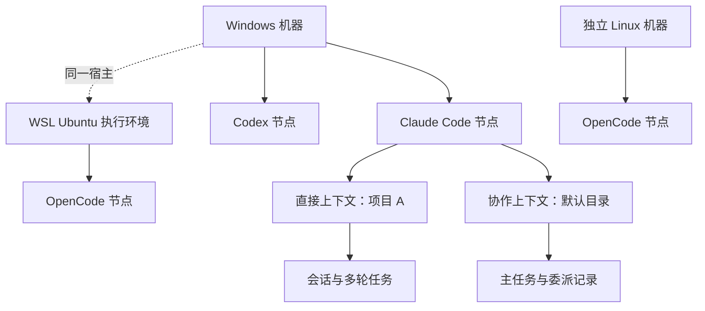
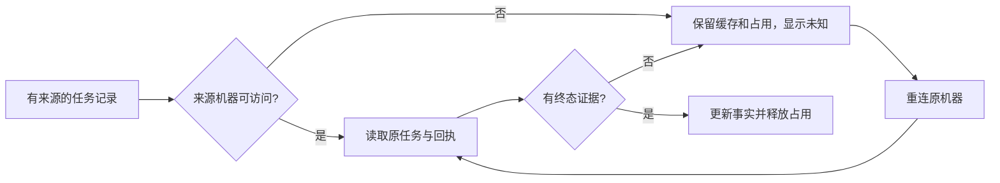

# M03 机器、Agent 节点与执行上下文设计

更新日期：2026-10-13。本文描述当前源码行为；桌面源码为 `0.6.0-alpha.9`，已发布 Windows 便携版为 `0.5.0`。SSH 的源码交付和 Windows 发布验收分别标记，不能以源码版本代表发布完成。

## 1. 用户得到什么

用户先看到机器，再看到机器上安装的 Claude Code、OpenCode、Codex 等 Agent 节点。接入节点不要求项目目录、模型或供应商。发送任务时才选择执行目录；不处理现有项目时可留空，由后台创建默认目录。

一台 Windows 电脑和它的 WSL 是两个执行环境，但 WSL 标明所属 Windows 宿主。通过 SSH 接入的 Linux 是独立机器，文件路径、任务和故障归属于它自己。

| 功能 ID | 功能与可验收表现 | 当前状态 |
| --- | --- | --- |
| M03-F01 | 没有项目或会话也能显示机器；Windows、各 WSL 分开显示 | 已实现；Windows/WSL 已真实验证 |
| M03-F02 | 自动发现同机多种工具，选择后一次接入，不询问模型或项目 | 已实现；安装可调用不等于账号推理可用 |
| M03-F03 | 重扫、重开、启动脚本解析后保持节点归属，不按项目产生新节点 | 已实现；受控测试及已发布版验证 |
| M03-F04 | 任务创建私有执行上下文；沿用原生设置，历史项目实例保留 | 已实现；Claude/OpenCode 真实验证，Codex 有原生限制 |
| M03-F05 | 所有查询、续聊、回复和取消回到原机器、原后端 | 已实现；同名 ID 隔离受控验证 |
| M03-F06 | 单节点串行；同一 Windows/WSL 共享目录互斥；一台离线不拖垮其他机器 | 已实现；离线缓存显示为不确定 |
| M03-F07 | 导入旧目录、项目实例和历史，不改原生 Session ID | 已实现；兼容入口继续保留 |

SSH 登录、凭据和安装见 [M04](../04-ssh-access/design.md)，Linux daemon 见 [M05](../05-linux-daemon/design.md)。本模块将已经连接的远端纳入统一目录；不负责服务器登录。

## 2. 核心概念

| 对象 | 含义 | 是否绑定目录 | 身份依据 |
| --- | --- | --- | --- |
| Machine | 可独立发现、启动工具的执行环境 | 否 | 本机持久 UUID、WSL 分发名称、SSH 经过握手确认的远端身份 |
| Tool Connection | 机器上某个可执行工具的安装及接入记录 | 否 | 机器 ID + 可执行路径；Windows 路径大小写归一 |
| Agent Node | 用户看到和连接关系使用的工具节点 | 否 | 机器 ID + 适配器 + 可执行路径，已有上下文的 nodeId 优先 |
| Execution Context | 某节点在某个目录、直接或协作模式下的私有运行配置 | 是 | 节点 + 真实目录 + 模式的摘要 |
| Instance | 兼容旧核心协议的后端执行实例 | 是 | 原始 backendId，中央视图增加机器前缀 |
| Conversation / Task | 会话与一轮执行 | 继承上下文 | 原后端 ID；中央视图带来源机器 |

这里的“Agent”是工具节点，例如这台电脑的 Claude Code。模型和供应商由该工具自己的配置决定，不能成为连接节点的必填选项。



## 3. 职责与调用边界

`MachineRouter` 管理机器目录、工具记录、后端实例导入、路径和来源路由。`AgentNetwork` 在其上增加用户节点、节点请求台账和协作关系。每台机器上的 `MachineHost` 管理工具发现及私有上下文，再调用原生适配器。

| 组件 | 输入 | 输出与责任 |
| --- | --- | --- |
| MachineRouter | snapshot / discover / ipc 等请求 | 汇总各机器快照，给后端对象加来源前缀，保持目录占用 |
| AgentNetwork | attachNode / nodeRequest / saveCollaboration | 面向用户的节点身份、请求去重、节点忙碌状态 |
| MachineHost | discover / context / scope / ipc | 扫描本机工具，按上下文选回原后端，接入 MCP |
| 原生适配器 | 某上下文的任务、控制或查询 | 启动并观察 Claude/OpenCode/Codex 的原生执行 |

Windows 的工具在 Windows 启动，WSL 的工具在选定分发中启动，SSH 工具在远端 daemon 内启动。用户任务不会因为当前机器筛选变化而迁移到其他机器。

## 4. 数据归属与文件

下列文件放在中央 profile 或机器后台自己的状态目录，实际目录由部署端提供。

| 文件 | 所属端 | 内容与维护原则 |
| --- | --- | --- |
| `machines.json` | 中央 Coordinator | 本机、WSL、已接入机器、工具连接、兼容实例；version=1 |
| `machines.json.before-nodes.json` | 中央 Coordinator | 首次引入节点时的旧目录备份，不作为当前配置读取 |
| `agent-network.json` | 中央 Coordinator | nodes、collaboration、requests、delegations；version=1 |
| `node-contexts.json` | 各机器 MachineHost | contextId、nodeId、adapter、executable、workspace、backend agentId |
| `node-contexts/<contextId>/` | 各机器 MachineHost | 原生适配器的任务、会话、MCP 描述与私有状态 |
| `sessions/<nodeId>/` | 各机器 MachineHost | 未指定工作目录时的默认目录 |

目录及节点 JSON 使用临时文件写完后替换。它们是中央/机器后台拥有的数据，前端不能自行改写。原生工具的账号、模型、供应商配置继续属于原工具。

## 5. 发现和接入流程

1. 中央先确保本机存在；Windows 再枚举 WSL 分发，并保留曾配置但当前不可用的分发身份。
2. 并行获取各机器快照；每台机器独立超时，当前默认为 10 秒。
3. 工具扫描检查 PATH 与原生常见安装位置，执行版本探测；元数据扫描不发模型 Prompt。
4. 将扫描结果归为工具连接，再建立或复用节点；不创建项目实例。
5. 用户接入节点时重新核对可执行工具仍存在且可调用，记录 connected。
6. 真实发送任务才建立执行上下文，并核对目录真实存在。

机器列表扫描缓存约 15 秒，工具扫描缓存约 30 秒；失败快照短暂退避约 5 秒。`snapshotJobs` 合并同机器正在进行的读取，避免卡住时持续启动新后台。

`healthy` 表示安装/调用检查可用；`connected` 表示用户接入过节点；真实模型能否回复由任务结果验证。账号拒绝不能被扫描成功掩盖。

## 6. 任务路由与目录互斥

中央显示 ID 形如 `machineId::backendId`，例如 `local-demo::task-001`。机器前缀用于来源选择，发往原后端时去掉前缀。原生 Session ID 保持原样。

请求显式 machineId 与对象前缀冲突时返回 `WRONG_MACHINE`，不会猜另一台机器。相同 raw taskId 在不同机器上属于不同对象。

| 路径情况 | 当前处理 |
| --- | --- |
| Windows `D:\project` | 原样交给 Windows；占用键与本机 WSL `/mnt/d/project` 对齐 |
| 为 WSL 选择 Windows 磁盘目录 | 转为选定分发中的 `/mnt/<盘符>/...` |
| `\\wsl.localhost\Ubuntu\home\...` | 只允许转给 Ubuntu；分发不符拒绝 |
| SSH `/mnt/d/project` | 作为远端 Linux 目录，不与本地 D 盘共享占用 |
| SSH Windows 格式路径 | 不自动转换；由远端目录验证返回真实错误 |

互斥有两个层次：节点上的非终态任务和未确认请求阻止新的节点执行；目录占用阻止同一项目在 Windows/WSL 的其他实例执行。检查全部实例和任务占用，不能只用前端显示的前 100 条任务。

## 7. API 使用示例

以下是中央服务已经暴露的业务调用；示例 ID 为占位值，不是运行环境身份。

```json
{"method":"attachNode","params":{"nodeId":"node-demo","machineId":"local-demo"}}
```

```json
{"method":"nodeRequest","params":{"op":"submit","nodeId":"node-demo","requestId":"req-20261012-001","message":"分析目录里的项目结构","workspace":"D:\\project"}}
```

```json
{"method":"ipc","params":{"op":"task","machineId":"local-demo","taskId":"local-demo::task-001"}}
```

OpenCode 新上下文连接后在 10 秒观察预算内轮询只读健康快照，待原生目录元数据与心跳就绪后才发送用户需求；仍不健康明确 AGENT_UNHEALTHY，未提交 Prompt，不修改原生模型/账号。等待不执行健康验证 Prompt。

`nodeRequest` 不接受 model 或 providerID。旧 `createInstance` / `setInstanceModel` 仍属于历史兼容实现，不构成当前节点产品流程。

## 8. 离线、重连与未知结果

成功读取机器快照清除从旧目录继承的 error/connectionError；SSH 连接状态由 Coordinator 权威合并并持久化。新快照超时或拒绝仍显示实际 error、online=false 和 stale，不被 SSH online 覆盖。恢复连接不清除历史任务失败或 unknown，也不重新创建机器/节点。

离线不会删除节点、关系、会话和任务。已有快照可继续展示；来源不可访问的非终态任务标为 unknown，节点保持占用。其他在线机器继续提供结果。



连接另一个节点、换机器筛选或删除可见卡片，不能释放尚未核对的原执行。`REQUEST_NOT_FOUND` 也不能独立证明 Prompt 从未执行。

## 9. 当前限制与已确认后续设计

- 节点路径变化依靠已有上下文的权威 nodeId 保持归属；任意安装迁移和所有符号链接别名的统一合并没有完整验收。
- Windows/WSL 真实链路已发布；alpha.6 候选的独立 SSH Linux 接入与 Windows 双向核心协作已实际验收；正式 0.6.0 与完整 I06C 专项尚未准出。
- 当前只有一个默认协作组；alpha.6 节点图编辑同一真实授权。图的几何 parent、布局与 WSL 的物理宿主/机器身份分别管理，布局不改变任务路由。
- 原生工具卸载、远端连接编辑/移除仍未完成。alpha.9 仅管理 Bridge 的节点接入和可见性，不删除安装或机器。

## 10. 代码入口与维护

从 [machine-router.cjs](../../../desktop/electron/machine-router.cjs) 读目录、路由和共享磁盘锁，从 [agent-network.cjs](../../../desktop/electron/agent-network.cjs) 读节点及请求台账，从 [machine-host.cjs](../../../desktop/electron/machine-host.cjs) 读上下文。发现细节见 [tool-discovery.cjs](../../../desktop/electron/tool-discovery.cjs)，中央宿主组装见 [coordinator-service.cjs](../../../desktop/electron/coordinator-service.cjs)。

变更节点身份、状态、路径归属、台账或接入功能时，同时更新本文、[模块测试报告](test-report.md)和对应迭代材料；兼容数据变化必须说明迁移和回退，不能只改新界面。

历史依据：[I05 节点设计](../../iterations/I05/node-design.md)、[I05 验收](../../iterations/I05/acceptance.md)、[I06A 当前进度](../../iterations/I06/progress.md)。历史描述与现代码冲突时，以本文明确列出的当前行为和限制为准。

兼容复用旧 SSH daemon 时，机器 ID 仍来自原 daemonId，工具节点仍来自原机器与工具安装。客户端/离线包补丁版本变化不作为新机器、新节点、目录别名或释放 unknown 的依据；实际选择与验证由 [M04](../04-ssh-access/design.md)完成，未知或不可信发布继续拒绝。

## I06B 节点运行事实与图投影

成功读取机器快照后更新 lastSyncedAt，失联保留最后已知时刻。节点快照新增 uncertain、waiting、lastError：来自该节点原实例/任务的 unknown、原生等待与最近失败，不是模型配置。unknown 任务仍占用节点，available 不被图连线或位置修改释放。图为每个真实 memberId 投影一条 leaderId→memberId 边，不创建另一份授权。节点坐标相对于其所属机器组，不允许拖到另一机器来改 machineId。来源见 [I06B 实施](../../iterations/I06/graph-implementation.md)。

## alpha.9 节点接入、断开、移除与恢复

现有 M03-F02/F03/F05/F06/F07 包含节点生命周期：managed=true 后 connected/removed 以中央显式状态为准，扫描与原生实例不能自动重新接入；removed 节点仍在快照/持久化目录中，图和新会话目标隐藏，历史继续引用原 nodeId。添加仅接入受支持、健康的已发现安装；重新添加复用原 ID/坐标，不恢复旧授权。断开/移除及授权撤销和 nodeOperations 收据同文件原子提交；节点任务、请求、委派、原生上下文/配置保持。任务分页外实例 busy/currentTask、未确认派发、nodeJobs、启动目录锁参与占用检查；机器离线拒绝变更。并发接入锁及旧 IPC submit/continue/verify 同样执行接入校验。查询/控制旧任务继续回来源，详情见 [完整事务与验证](../../iterations/I06/node-management.md)。
